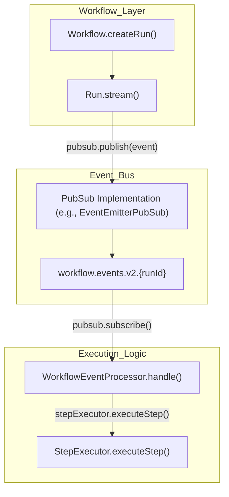
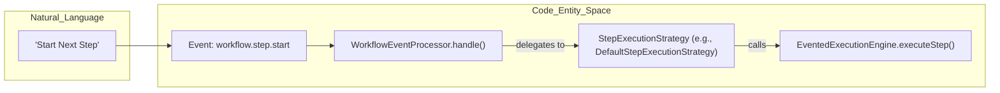

<!-- source: DeepWiki mcp.deepwiki.com · repo mastra-ai/mastra · page 17.2 PubSub and Event System · fetched 2026-10-26 -->

# PubSub and Event System

Relevant source files

The following files were used as context for generating this wiki page:

- [.changeset/evented-foreach-running-status.md](.changeset/evented-foreach-running-status.md)
- [.changeset/strong-gifts-smell.md](.changeset/strong-gifts-smell.md)
- [.changeset/tidy-pumas-invite.md](.changeset/tidy-pumas-invite.md)
- [.github/scripts/validate-pkg-json.mjs](.github/scripts/validate-pkg-json.mjs)
- [packages/_external-types/package.json](packages/_external-types/package.json)
- [packages/_vendored/ai_v4/package.json](packages/_vendored/ai_v4/package.json)
- [packages/_vendored/ai_v5/package.json](packages/_vendored/ai_v5/package.json)
- [packages/_vendored/ai_v6/package.json](packages/_vendored/ai_v6/package.json)
- [packages/core/src/processors/index.ts](packages/core/src/processors/index.ts)
- [packages/core/src/processors/processor-model-settings.test-d.ts](packages/core/src/processors/processor-model-settings.test-d.ts)
- [packages/core/src/processors/runner.test.ts](packages/core/src/processors/runner.test.ts)
- [packages/core/src/processors/runner.ts](packages/core/src/processors/runner.ts)
- [packages/core/src/processors/step-schema.ts](packages/core/src/processors/step-schema.ts)
- [packages/core/src/workflows/concurrent-resume.test.ts](packages/core/src/workflows/concurrent-resume.test.ts)
- [packages/core/src/workflows/default.test.ts](packages/core/src/workflows/default.test.ts)
- [packages/core/src/workflows/default.ts](packages/core/src/workflows/default.ts)
- [packages/core/src/workflows/evented/evented-workflow.test.ts](packages/core/src/workflows/evented/evented-workflow.test.ts)
- [packages/core/src/workflows/evented/foreach-running-status.test.ts](packages/core/src/workflows/evented/foreach-running-status.test.ts)
- [packages/core/src/workflows/evented/step-executor.test.ts](packages/core/src/workflows/evented/step-executor.test.ts)
- [packages/core/src/workflows/evented/step-executor.ts](packages/core/src/workflows/evented/step-executor.ts)
- [packages/core/src/workflows/evented/workflow-event-processor/index.ts](packages/core/src/workflows/evented/workflow-event-processor/index.ts)
- [packages/core/src/workflows/evented/workflow-event-processor/loop.ts](packages/core/src/workflows/evented/workflow-event-processor/loop.ts)
- [packages/core/src/workflows/evented/workflow.ts](packages/core/src/workflows/evented/workflow.ts)
- [packages/core/src/workflows/execution-engine.ts](packages/core/src/workflows/execution-engine.ts)
- [packages/core/src/workflows/foreach-nested-workflow.test.ts](packages/core/src/workflows/foreach-nested-workflow.test.ts)
- [packages/core/src/workflows/foreach-running-status.test.ts](packages/core/src/workflows/foreach-running-status.test.ts)
- [packages/core/src/workflows/handlers/control-flow.ts](packages/core/src/workflows/handlers/control-flow.ts)
- [packages/core/src/workflows/handlers/entry.ts](packages/core/src/workflows/handlers/entry.ts)
- [packages/core/src/workflows/handlers/sleep.ts](packages/core/src/workflows/handlers/sleep.ts)
- [packages/core/src/workflows/handlers/step.ts](packages/core/src/workflows/handlers/step.ts)
- [packages/core/src/workflows/types.ts](packages/core/src/workflows/types.ts)
- [packages/core/src/workflows/utils.ts](packages/core/src/workflows/utils.ts)
- [packages/core/src/workflows/workflow.test.ts](packages/core/src/workflows/workflow.test.ts)
- [packages/core/src/workflows/workflow.ts](packages/core/src/workflows/workflow.ts)
- [pubsub/google-cloud-pubsub/package.json](pubsub/google-cloud-pubsub/package.json)
- [pubsub/redis-streams/package.json](pubsub/redis-streams/package.json)
- [pubsub/valkey-streams/package.json](pubsub/valkey-streams/package.json)
- [stores/cloudflare-d1/package.json](stores/cloudflare-d1/package.json)
- [stores/cloudflare/package.json](stores/cloudflare/package.json)
- [stores/couchbase/package.json](stores/couchbase/package.json)
- [stores/dsql/package.json](stores/dsql/package.json)
- [stores/dynamodb/package.json](stores/dynamodb/package.json)
- [stores/elasticsearch/package.json](stores/elasticsearch/package.json)
- [stores/lance/package.json](stores/lance/package.json)
- [stores/opensearch/package.json](stores/opensearch/package.json)
- [stores/redis/CHANGELOG.md](stores/redis/CHANGELOG.md)
- [stores/redis/package.json](stores/redis/package.json)
- [stores/vectorize/package.json](stores/vectorize/package.json)
- [voice/cloudflare/package.json](voice/cloudflare/package.json)
- [workflows/inngest/src/index.ts](workflows/inngest/src/index.ts)

The Mastra PubSub and Event System provides a unified abstraction layer for asynchronous messaging, event-driven workflows, and cross-process agent communication. It supports different delivery modes ranging from local in-memory event emitters for single-process usage to distributed message brokers suitable for horizontal scaling and cloud environments.

---

## PubSub Abstraction

### Overview

At the core of Mastra's event architecture is the `PubSub` abstract base class [packages/core/src/events/pubsub.ts:1-1](). This defines the contract that every pub/sub backend implements, ensuring the rest of the framework can publish and subscribe to events without transport-specific knowledge. The `EventEmitterPubSub` [packages/core/src/workflows/workflow.ts:19-19]() is a concrete implementation using Node.js `EventEmitter` for in-process communication.

Mastra uses PubSub for:
- **Workflow Event Processing:** Communicating state changes and triggering steps [packages/core/src/workflows/workflow.ts:19-20]().
- **Evented Workflow Execution:** The `EventedExecutionEngine` relies on PubSub to dispatch and receive step execution events [packages/core/src/workflows/evented/workflow.ts:102-102]().
- **Cross-process Communication:** Integrating with external systems like Inngest for durable execution [workflows/inngest/src/index.ts:1-1]().

Sources:
- [packages/core/src/events/pubsub.ts:1-1]()
- [packages/core/src/workflows/workflow.ts:19-20]()
- [packages/core/src/workflows/evented/workflow.ts:102-102]()
- [workflows/inngest/src/index.ts:1-1]()

### Delivery Modes

A `PubSub` implementation declares its supported modes via the `supportedModes` property.

| Mode | Description |
|---|---|
| `push` | Events are delivered to the consumer without active polling (e.g., `EventEmitterPubSub` [packages/core/src/workflows/workflow.ts:19-19]()). |
| `pull` | Consumers must actively read from the broker. Mastra providers like `RedisStreamsPubSub` support consumer groups for this mode. |

Sources:
- [packages/core/src/workflows/workflow.ts:19-19]()
- [packages/core/src/workflows/evented/workflow-event-processor/index.ts:5-6]()

---

## Redis and Valkey Streams Providers

### Core Features

The `RedisStreamsPubSub` provider [pubsub/redis-streams/src/index.ts:1-1]() (and the compatible Valkey provider `ValkeyStreamsPubSub` [pubsub/valkey-streams/src/index.ts:1-1]()) uses Redis Streams for robust, distributed event delivery.

- **Consumer Groups:** Subscriptions can use Redis consumer groups to share work among competing consumers, ensuring high availability.
- **Fan-out:** Subscriptions without a group allow every subscriber to see every event, useful for broadcasting state updates.
- **Fault Tolerance:** Uses `XAUTOCLAIM` to reclaim events that were read but never acknowledged by a consumer that subsequently failed, preventing message loss.
- **Integration:** Integrated into the `WorkflowEventProcessor` to manage delivery attempts and cap transport-level redelivery [packages/core/src/workflows/evented/workflow-event-processor/index.ts:156-166]().

### Topic Management

The system manages topic lifecycles to prevent memory leaks. The `WorkflowEventProcessor` includes a `topicCleanupDelayMs` (defaulting to 30,000ms) to clear pubsub topics after a run reaches a terminal state, ensuring watchers have time to drain final events [packages/core/src/workflows/evented/workflow-event-processor/index.ts:163-165]().

Sources:
- [pubsub/redis-streams/src/index.ts:1-1]()
- [pubsub/valkey-streams/src/index.ts:1-1]()
- [packages/core/src/workflows/evented/workflow-event-processor/index.ts:156-166]()

---

## Google Cloud PubSub Provider

Mastra provides a `GoogleCloudPubSub` implementation [pubsub/google-cloud-pubsub/src/index.ts:1-1]() for cloud-native environments. It maps Mastra topics to GCP Pub/Sub Topics and Subscriptions, providing:
- **Global Scalability:** Leveraging Google's infrastructure for high-throughput eventing.
- **Durability:** Messages are persisted by GCP until acknowledged.
- **IAM Integration:** Secure communication using service accounts.

Sources:
- [pubsub/google-cloud-pubsub/src/index.ts:1-1]()

---

## Integration with Workflow Events

### Evented Workflow Engine

The `EventedExecutionEngine` [packages/core/src/workflows/evented/workflow.ts:102-102]() uses PubSub to decouple the workflow definition from its execution. When a step is ready, an event is published; a `WorkflowEventProcessor` listens for these events to execute the logic [packages/core/src/workflows/evented/workflow-event-processor/index.ts:148-148]().

### Data Flow and Key Classes

#### Diagram 1: Workflow Event Lifecycle (Code Entity Mapping)

This diagram shows how events flow from the `Workflow` through the `PubSub` layer to the `WorkflowEventProcessor`.

Sources:
- [packages/core/src/workflows/workflow.ts:110-114]()
- [packages/core/src/workflows/evented/workflow-event-processor/index.ts:148-148]()
- [packages/core/src/workflows/evented/step-executor.ts:149-149]()

#### Diagram 2: Evented Step Execution Path

Associates the natural language concept of "Step Triggering" with the specific internal classes and event types.

Sources:
- [packages/core/src/workflows/evented/workflow-event-processor/index.ts:148-148]()
- [packages/core/src/workflows/evented/execution-engine.ts:1-1]()
- [packages/core/src/workflows/evented/step-executor.ts:149-149]()

---

## Summary Table: Event System Components

| Component | Class/File | Role |
|---|---|---|
| **PubSub Base** | `PubSub` | Abstract interface for all event transports [packages/core/src/events/pubsub.ts:1-1](). |
| **Event Processor** | `WorkflowEventProcessor` | Orchestrates workflow runs by responding to events [packages/core/src/workflows/evented/workflow-event-processor/index.ts:148-148](). |
| **Step Executor** | `StepExecutor` | Handles the actual execution of individual steps within an evented context [packages/core/src/workflows/evented/step-executor.ts:149-149](). |
| **Inngest Bridge** | `InngestPubSub` | Adapts Mastra events to Inngest's durable execution model [workflows/inngest/src/index.ts:1-1](). |

Sources:
- [packages/core/src/events/pubsub.ts:1-1]()
- [packages/core/src/workflows/evented/workflow-event-processor/index.ts:148-148]()
- [packages/core/src/workflows/evented/step-executor.ts:149-149]()
- [workflows/inngest/src/index.ts:1-1]()

---

