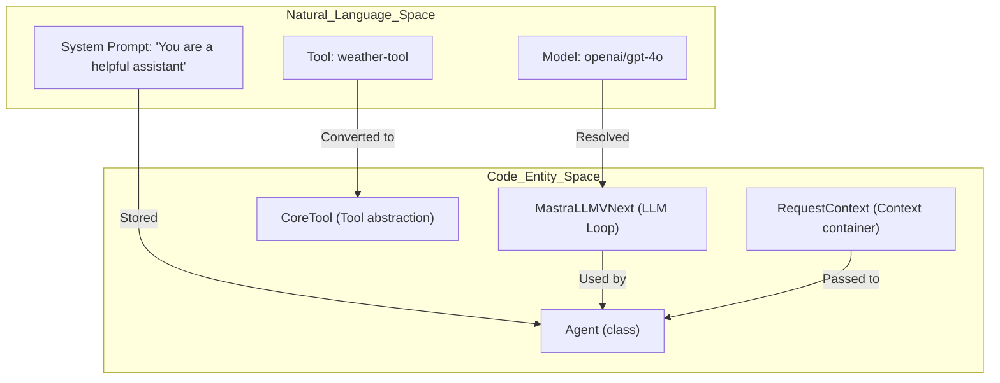
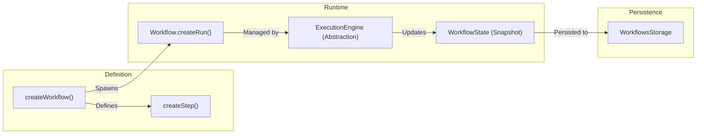

<!-- source: DeepWiki mcp.deepwiki.com · repo mastra-ai/mastra · page 19 Glossary · fetched 2026-10-26 -->

# Glossary

Relevant source files

The following files were used as context for generating this wiki page:

- [.changeset/peer-discovery-busy-caller.md](.changeset/peer-discovery-busy-caller.md)
- [.changeset/retake-lapsed-thread-lease.md](.changeset/retake-lapsed-thread-lease.md)
- [docs/src/content/en/docs/subagents.mdx](docs/src/content/en/docs/subagents.mdx)
- [mastracode/sdk/src/agent-connections/__tests__/cross-process-agent-signals.integration.test.ts](mastracode/sdk/src/agent-connections/__tests__/cross-process-agent-signals.integration.test.ts)
- [mastracode/sdk/src/agent-connections/__tests__/fixtures/cross-process-agent-signals-child.mts](mastracode/sdk/src/agent-connections/__tests__/fixtures/cross-process-agent-signals-child.mts)
- [observability/mastra/src/model-tracing.test.ts](observability/mastra/src/model-tracing.test.ts)
- [observability/mastra/src/model-tracing.ts](observability/mastra/src/model-tracing.ts)
- [packages/core/src/agent-controller/lease-lost-abort-reason.test.ts](packages/core/src/agent-controller/lease-lost-abort-reason.test.ts)
- [packages/core/src/agent/__tests__/delegation-thread-metadata.test.ts](packages/core/src/agent/__tests__/delegation-thread-metadata.test.ts)
- [packages/core/src/agent/__tests__/memory-metadata.test.ts](packages/core/src/agent/__tests__/memory-metadata.test.ts)
- [packages/core/src/agent/__tests__/signals-claimed-ownership.test.ts](packages/core/src/agent/__tests__/signals-claimed-ownership.test.ts)
- [packages/core/src/agent/__tests__/signals-idle-active-behavior.test.ts](packages/core/src/agent/__tests__/signals-idle-active-behavior.test.ts)
- [packages/core/src/agent/__tests__/stream.test.ts](packages/core/src/agent/__tests__/stream.test.ts)
- [packages/core/src/agent/__tests__/thread-lease-loss-abort.test.ts](packages/core/src/agent/__tests__/thread-lease-loss-abort.test.ts)
- [packages/core/src/agent/__tests__/tool-concurrency-called-strategy-resume.test.ts](packages/core/src/agent/__tests__/tool-concurrency-called-strategy-resume.test.ts)
- [packages/core/src/agent/__tests__/tool-concurrency-called-strategy.test.ts](packages/core/src/agent/__tests__/tool-concurrency-called-strategy.test.ts)
- [packages/core/src/agent/__tests__/tool-handling.test.ts](packages/core/src/agent/__tests__/tool-handling.test.ts)
- [packages/core/src/agent/agent-legacy.ts](packages/core/src/agent/agent-legacy.ts)
- [packages/core/src/agent/agent-types.test-d.ts](packages/core/src/agent/agent-types.test-d.ts)
- [packages/core/src/agent/agent.test.ts](packages/core/src/agent/agent.test.ts)
- [packages/core/src/agent/agent.ts](packages/core/src/agent/agent.ts)
- [packages/core/src/agent/agent.types.ts](packages/core/src/agent/agent.types.ts)
- [packages/core/src/agent/durable/durable-parity.test-d.ts](packages/core/src/agent/durable/durable-parity.test-d.ts)
- [packages/core/src/agent/subagent.ts](packages/core/src/agent/subagent.ts)
- [packages/core/src/agent/thread-stream-runtime.ts](packages/core/src/agent/thread-stream-runtime.ts)
- [packages/core/src/agent/types.ts](packages/core/src/agent/types.ts)
- [packages/core/src/agent/workflows/prepare-stream/index.ts](packages/core/src/agent/workflows/prepare-stream/index.ts)
- [packages/core/src/agent/workflows/prepare-stream/map-results-step.ts](packages/core/src/agent/workflows/prepare-stream/map-results-step.ts)
- [packages/core/src/agent/workflows/prepare-stream/prepare-memory-step.ts](packages/core/src/agent/workflows/prepare-stream/prepare-memory-step.ts)
- [packages/core/src/agent/workflows/prepare-stream/prepare-tools-step.ts](packages/core/src/agent/workflows/prepare-stream/prepare-tools-step.ts)
- [packages/core/src/agent/workflows/prepare-stream/run-scope-keys.ts](packages/core/src/agent/workflows/prepare-stream/run-scope-keys.ts)
- [packages/core/src/agent/workflows/prepare-stream/schema.ts](packages/core/src/agent/workflows/prepare-stream/schema.ts)
- [packages/core/src/agent/workflows/prepare-stream/stream-step.ts](packages/core/src/agent/workflows/prepare-stream/stream-step.ts)
- [packages/core/src/llm/model/model.loop.ts](packages/core/src/llm/model/model.loop.ts)
- [packages/core/src/loop/loop.ts](packages/core/src/loop/loop.ts)
- [packages/core/src/loop/network/index.ts](packages/core/src/loop/network/index.ts)
- [packages/core/src/loop/network/validation.test.ts](packages/core/src/loop/network/validation.test.ts)
- [packages/core/src/loop/network/validation.ts](packages/core/src/loop/network/validation.ts)
- [packages/core/src/loop/types.ts](packages/core/src/loop/types.ts)
- [packages/core/src/loop/workflows/agentic-execution/index.ts](packages/core/src/loop/workflows/agentic-execution/index.ts)
- [packages/core/src/loop/workflows/agentic-execution/tool-call-concurrency.test.ts](packages/core/src/loop/workflows/agentic-execution/tool-call-concurrency.test.ts)
- [packages/core/src/loop/workflows/agentic-execution/tool-call-concurrency.ts](packages/core/src/loop/workflows/agentic-execution/tool-call-concurrency.ts)
- [packages/core/src/loop/workflows/agentic-loop/index.ts](packages/core/src/loop/workflows/agentic-loop/index.ts)
- [packages/core/src/memory/index.ts](packages/core/src/memory/index.ts)
- [packages/core/src/memory/run-state.test.ts](packages/core/src/memory/run-state.test.ts)
- [packages/core/src/memory/run-state.ts](packages/core/src/memory/run-state.ts)
- [packages/core/src/tools/request-context-schema-types.test-d.ts](packages/core/src/tools/request-context-schema-types.test-d.ts)
- [packages/rag/src/document/validation.ts](packages/rag/src/document/validation.ts)

This glossary defines technical terms, architectural components, and domain-specific jargon used within the Mastra codebase. It serves as a high-level reference for onboarding engineers to understand the key concepts, how major subsystems relate, and the location of core implementations. Detailed technical definitions and deep dives are available in the child glossary pages linked below.

---

## Core Runtime Concepts

The foundation of Mastra runtime revolves around Agents, Workflows, Tools, Processors, Memory, and RequestContext. These are the primary abstractions that implement the agentic behavior, execution context, and dynamic resource scoping essential to AI-powered applications.

- **Mastra Instance**: The central orchestrator that registers and manages all primitives such as agents, workflows, memory, and tools. It controls lifecycle, configuration, and execution domains [packages/core/src/mastra/mastra-ctor-holder.ts:5-5]().
- **Agent**: The autonomous AI component that interacts with language models (LLMs) and tools, orchestrated through an iterative execution loop ("The Loop") [packages/core/src/agent/agent.ts:11-11892]().
- **Workflow**: A graph-based, multi-step process engine enabling complex sequences of agent, tool, and processor steps with durable state [packages/core/src/loop/network/index.ts:26-28]().
- **Step**: The atomic building block of workflows representing individual functions, tool calls, or agent invocations [packages/core/src/loop/network/index.ts:27-27]().
- **Tool**: Functional units that agents or workflows invoke for specific tasks, ranging from API calls to utility operations [packages/core/src/agent/agent.ts:140-150]().
- **Processor**: Middleware that transforms inputs or outputs of agents or workflows, such as schema enforcement or safety checks [packages/core/src/agent/agent.ts:101-107]().
- **Memory**: Abstractions for storing and retrieving conversation history, working state, and observational reflections scoped by threads or resources [packages/core/src/agent/agent.ts:65-66]().
- **RequestContext**: Metadata container providing tenant isolation, dynamic configuration, authorization context, and execution scoping [packages/core/src/agent/agent.ts:123-123]().
- **Loop**: The core agentic execution architecture that handles reasoning, calling tools, streaming results, and terminating [packages/core/src/llm/model/model.loop.ts:5-5]().
- **Harness**: A framework for terminal-based AI coding agents managing modes, threads, and user interaction state.
- **A2A (Agent-to-Agent) & ACP (Agent Client Protocol)**: Protocols enabling multi-agent collaboration and remote agent wrapping.
- **SubAgent & SDKAgent**: Wrappers and adapters for third-party AI SDKs or sub-agents integrated within Mastra agents [packages/core/src/agent/types.ts:79-79]().

For detailed definitions and code pointers, see [Glossary: Core Runtime Concepts](#19.1).

---

## Server, Storage, and Operations

This subsystem covers the backend API and persistence layers critical to Mastra’s operational capabilities.

- **MastraServer**: The unified API server implementation that mounts Mastra endpoints and middleware, supporting multiple adapters including Hono and NestJS.
- **Adapters**: Modular components integrating storage backends, servers, and observability systems.
- **SSE (Server-Sent Events)**: Streaming protocol used for real-time response delivery in agent and workflow endpoints.
- **Stores**: Abstractions and concrete implementations for persistent storage domains like thread state, working memory, vector indexes, and RAG document stores [packages/core/src/agent/agent.ts:132-132]().
- **Threads & Resources**: Memory scoping entities; threads track conversation context, resources identify tenant-specific scope [packages/core/src/agent/thread-stream-runtime.ts:8-8]().
- **Vectors and RAG**: Vector stores for embedding search and Retrieval-Augmented Generation support.
- **Observability Spans**: Distributed tracing units for monitoring agent and workflow executions [observability/mastra/src/model-tracing.ts:17-27]().
- **Responses API**: OpenAI-compatible interface for agent-like responses and background tasks.
- **Datasets & Experiments**: Management of evaluation datasets and running experiments for AI assessment.
- **PubSub and RedisStreamsPubSub**: Event-driven communication abstractions supporting cross-process event delivery [packages/core/src/agent/thread-stream-runtime.ts:3-5]().

For full technical details and code locations, see [Glossary: Server, Storage, and Operations](#19.2).

---

## Tooling and Ecosystem

Mastra's developer tooling and ecosystem facilitate building, deploying, and managing AI-powered systems efficiently.

- **CLI Commands**: Tools for project creation, development server, build, deployment, and studio integration.
- **Templates & Changesets**: Pre-built starter projects and versioned migration tooling for upgrade paths [packages/core/src/agent/__tests__/thread-lease-loss-abort.test.ts:1-14]().
- **MCP (Model Context Protocol)**: A protocol for exposing and integrating external agents and tools [packages/core/src/agent/agent.ts:148-148]().
- **Skills**: Agent extensions containing specialized capabilities or toolsets [packages/core/src/agent/agent.ts:129-131]().
- **Workspaces & Sandboxes**: Abstractions for AI agent file systems and isolated code execution environments [packages/core/src/agent/types.ts:72-72]().
- **Studio & Editor**: The CMS-style web UI for managing agents, workflows, and tools with live editing and overrides.
- **Deployers**: Platform-specific infrastructure adapters (e.g., Cloudflare, Vercel, Netlify).
- **Codemod**: Automated code transformation tools to aid in upgrading or refactoring Mastra projects.
- **AI SDK Adapter**: Bridges connecting Mastra with Vercel AI SDK and other third-party SDKs for smooth integration [packages/core/src/agent/agent.ts:1-2]().
- **Temporal, Inngest**: Workflow orchestration backends for production-grade deployment.
- **Connect**: The platform-connection layer for integrating third-party tools and services.
- **Factory boards/work items/skills**: Components of the Mastra Software Factory for managing AI-driven development processes.
- **Channels & Signals**: Mechanisms for agent communication and integration with external messaging platforms [packages/core/src/agent/agent.ts:14-15]().

For comprehensive coverage and source references, see [Glossary: Tooling and Ecosystem](#19.3).

---

## Relationships Overview

The glossary terms often span multiple subsystems. The following diagrams illustrate key mappings from user-facing or natural language concepts to code entities in the Mastra codebase.

### Diagram: Agent System Natural Language to Code Entities Mapping

Sources:
- [packages/core/src/agent/agent.ts:11-11892]()
- [packages/core/src/llm/model/model.loop.ts:27-28]()
- [packages/core/src/agent/agent.ts:140-150]()
- [packages/core/src/agent/agent.ts:123-123]()

### Diagram: Workflow System from Definition to Execution

Sources:
- [packages/core/src/loop/network/index.ts:26-28]()
- [packages/core/src/loop/network/index.ts:27-27]()

---

## Additional Terms Summary Table

| Term | Description | Code Location |
|---|---|---|
| **Mastra** | Root class managing agents, workflows, tools, memory, and storage registrations. | [packages/core/src/agent/agent.ts:61-61]() |
| **Agent** | Autonomous entity orchestrating LLM interaction, tools, memory, and signaling. | [packages/core/src/agent/agent.ts:11-11892]() |
| **Workflow** | Modular multi-step execution primitive with durable state, steps, and triggers. | [packages/core/src/loop/network/index.ts:26-28]() |
| **Step** | The atomic building block of workflows representing individual functions, tool calls, or agent invocations. | [packages/core/src/loop/network/index.ts:27-27]() |
| **Tool** | Invokable resource used by agents or workflows for specific functions. | [packages/core/src/agent/agent.ts:140-150]() |
| **Processor** | Middleware component for input/output transformation and behavior enforcement. | [packages/core/src/agent/agent.ts:101-107]() |
| **Memory** | Conversation and state persistence abstraction scoped to threads/resources. | [packages/core/src/agent/agent.ts:65-66]() |
| **RequestContext** | Per-execution context metadata for tenant isolation and authorization. | [packages/core/src/agent/agent.ts:123-123]() |
| **MessageList** | Manager for converting and handling message history across different AI SDK formats. | [packages/core/src/agent/message-list/index.ts:1-1]() |
| **PubSub** | Publish-Subscribe event system used for workflow events and agent communication. | [packages/core/src/agent/thread-stream-runtime.ts:3-5]() |
| **TripWire** | Mechanism to intercept and halt agent execution based on specific conditions. | [packages/core/src/agent/workflows/prepare-stream/map-results-step.ts:137-137]() |
| **SubAgent** | An interface for wrapping external or remote agents to be used within a Mastra loop. | [packages/core/src/agent/types.ts:79-79]() |

---

## Summary and Next Steps

This overview introduces the key terms and relationships central to the Mastra codebase. It outlines the major runtime abstractions, backend operational components, and the developer tooling ecosystem.

For an in-depth understanding of each topic, please consult the focused child pages:
- [Glossary: Core Runtime Concepts](#19.1)
- [Glossary: Server, Storage, and Operations](#19.2)
- [Glossary: Tooling and Ecosystem](#19.3)

---

Sources:
- [packages/core/src/agent/agent.ts:1-11892]()
- [packages/core/src/agent/agent.types.ts:1-932]()
- [packages/core/src/agent/agent-legacy.ts:1-1603]()
- [packages/core/src/agent/thread-stream-runtime.ts:1-7056]()
- [packages/core/src/agent/types.ts:1-1398]()
- [packages/core/src/agent/workflows/prepare-stream/map-results-step.ts:1-511]()
- [packages/core/src/agent/__tests__/thread-lease-loss-abort.test.ts:1-1876]()
- [packages/core/src/llm/model/model.loop.ts:1-436]()
- [packages/core/src/loop/network/index.ts:1-2757]()
- [packages/core/src/loop/workflows/agentic-loop/index.ts:1-14]()
- [observability/mastra/src/model-tracing.ts:1-1191]()
- [observability/mastra/src/model-tracing.test.ts:1-2594]()

---

