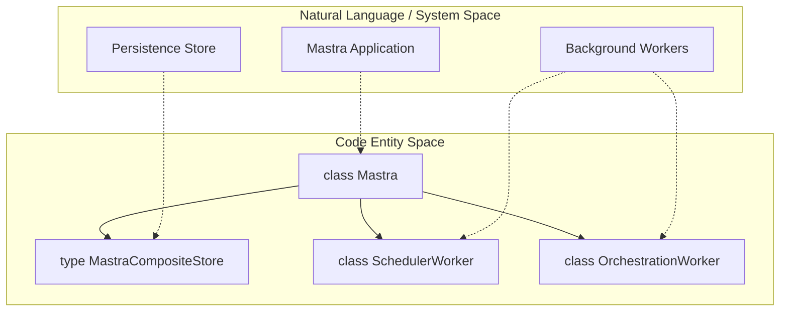
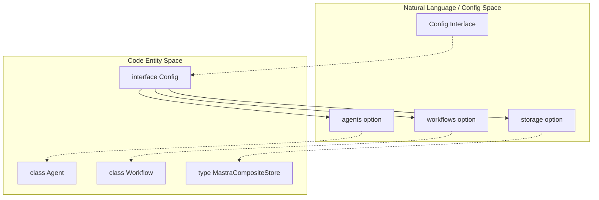
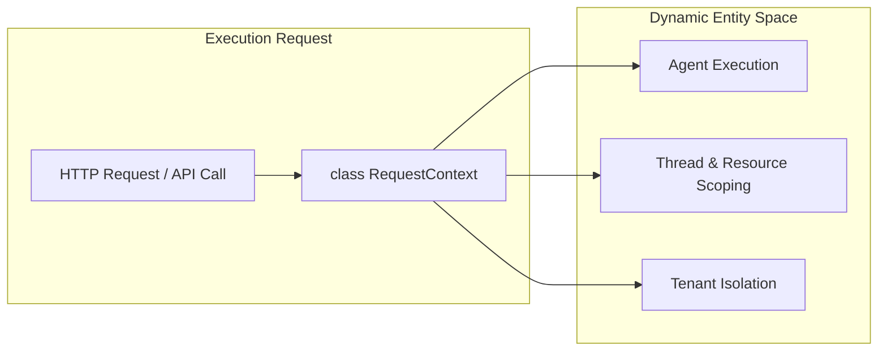

<!-- source: DeepWiki mcp.deepwiki.com · repo mastra-ai/mastra · page 2 Mastra Core and Configuration · fetched 2026-10-26 -->

# Mastra Core and Configuration

Relevant source files

The following files were used as context for generating this wiki page:

- [docs/src/content/en/docs/harness/durable-agents.mdx](docs/src/content/en/docs/harness/durable-agents.mdx)
- [docs/src/content/en/reference/agents/durable-agent.mdx](docs/src/content/en/reference/agents/durable-agent.mdx)
- [docs/src/content/en/reference/configuration.mdx](docs/src/content/en/reference/configuration.mdx)
- [docs/src/content/en/reference/core/mastra-class.mdx](docs/src/content/en/reference/core/mastra-class.mdx)
- [docs/src/content/en/reference/server/register-api-route.mdx](docs/src/content/en/reference/server/register-api-route.mdx)
- [e2e-tests/_local-registry-setup/package.json](e2e-tests/_local-registry-setup/package.json)
- [e2e-tests/_local-registry-setup/prepare.js](e2e-tests/_local-registry-setup/prepare.js)
- [e2e-tests/_local-registry-setup/publish-ci-registry.js](e2e-tests/_local-registry-setup/publish-ci-registry.js)
- [e2e-tests/_local-registry-setup/publish-roots.js](e2e-tests/_local-registry-setup/publish-roots.js)
- [e2e-tests/_local-registry-setup/publish.js](e2e-tests/_local-registry-setup/publish.js)
- [e2e-tests/commonjs/setup.ts](e2e-tests/commonjs/setup.ts)
- [e2e-tests/create-mastra/create-mastra.test.ts](e2e-tests/create-mastra/create-mastra.test.ts)
- [e2e-tests/create-mastra/setup.ts](e2e-tests/create-mastra/setup.ts)
- [e2e-tests/deployers/setup.ts](e2e-tests/deployers/setup.ts)
- [e2e-tests/no-bundling/setup.ts](e2e-tests/no-bundling/setup.ts)
- [e2e-tests/type-check/setup.ts](e2e-tests/type-check/setup.ts)
- [e2e-tests/type-check/template/core/agent-message-input.test-d.ts](e2e-tests/type-check/template/core/agent-message-input.test-d.ts)
- [e2e-tests/type-check/template/core/auth.test-d.ts](e2e-tests/type-check/template/core/auth.test-d.ts)
- [e2e-tests/type-check/template/package.json](e2e-tests/type-check/template/package.json)
- [e2e-tests/type-check/template/tsconfig.exact-optional.json](e2e-tests/type-check/template/tsconfig.exact-optional.json)
- [e2e-tests/type-check/template/tsconfig.mcp.json](e2e-tests/type-check/template/tsconfig.mcp.json)
- [e2e-tests/type-check/template/vitest.config.ts](e2e-tests/type-check/template/vitest.config.ts)
- [e2e-tests/type-check/template/vitest.mcp.config.ts](e2e-tests/type-check/template/vitest.mcp.config.ts)
- [e2e-tests/type-check/test.ts](e2e-tests/type-check/test.ts)
- [examples/agent/src/mastra/agents/weather-fs/README.md](examples/agent/src/mastra/agents/weather-fs/README.md)
- [packages/_internals/auth/src/provider/index.ts](packages/_internals/auth/src/provider/index.ts)
- [packages/_types-builder/AGENTS.md](packages/_types-builder/AGENTS.md)
- [packages/auth/src/index.ts](packages/auth/src/index.ts)
- [packages/core/src/agent/durable/__tests__/durable-agent-execution-fence.test.ts](packages/core/src/agent/durable/__tests__/durable-agent-execution-fence.test.ts)
- [packages/core/src/agent/durable/__tests__/durable-agent-memory.test.ts](packages/core/src/agent/durable/__tests__/durable-agent-memory.test.ts)
- [packages/core/src/agent/durable/__tests__/evented-split-transport.test.ts](packages/core/src/agent/durable/__tests__/evented-split-transport.test.ts)
- [packages/core/src/agent/durable/__tests__/observe-detach.test.ts](packages/core/src/agent/durable/__tests__/observe-detach.test.ts)
- [packages/core/src/agent/durable/__tests__/recover-active-runs.test.ts](packages/core/src/agent/durable/__tests__/recover-active-runs.test.ts)
- [packages/core/src/agent/durable/__tests__/stream-generation.test.ts](packages/core/src/agent/durable/__tests__/stream-generation.test.ts)
- [packages/core/src/agent/fs-routing/index.test.ts](packages/core/src/agent/fs-routing/index.test.ts)
- [packages/core/src/agent/fs-routing/index.ts](packages/core/src/agent/fs-routing/index.ts)
- [packages/core/src/agent/message-list/types.ts](packages/core/src/agent/message-list/types.ts)
- [packages/core/src/agent/save-queue/index.ts](packages/core/src/agent/save-queue/index.ts)
- [packages/core/src/agent/save-queue/save-queue.test.ts](packages/core/src/agent/save-queue/save-queue.test.ts)
- [packages/core/src/loop/test-utils/aimock/scenarios/durable-input-persistence.scenario.test.ts](packages/core/src/loop/test-utils/aimock/scenarios/durable-input-persistence.scenario.test.ts)
- [packages/core/src/loop/test-utils/aimock/scenarios/observe-lifecycle.scenario.test.ts](packages/core/src/loop/test-utils/aimock/scenarios/observe-lifecycle.scenario.test.ts)
- [packages/core/src/loop/test-utils/aimock/scenarios/save-per-step-failed-save.scenario.test.ts](packages/core/src/loop/test-utils/aimock/scenarios/save-per-step-failed-save.scenario.test.ts)
- [packages/core/src/mastra/index.ts](packages/core/src/mastra/index.ts)
- [packages/core/src/mastra/recover-all-durable-agents.test.ts](packages/core/src/mastra/recover-all-durable-agents.test.ts)
- [packages/core/src/server/auth.test.ts](packages/core/src/server/auth.test.ts)
- [packages/core/src/server/auth.ts](packages/core/src/server/auth.ts)
- [packages/core/src/server/composite-auth.ts](packages/core/src/server/composite-auth.ts)
- [packages/core/src/server/index.ts](packages/core/src/server/index.ts)
- [packages/core/src/server/server.test-d.ts](packages/core/src/server/server.test-d.ts)
- [packages/core/src/server/server.test.ts](packages/core/src/server/server.test.ts)
- [packages/core/src/server/types.ts](packages/core/src/server/types.ts)
- [packages/deployer/src/build/fs-routing/codegen-eval.test.ts](packages/deployer/src/build/fs-routing/codegen-eval.test.ts)
- [packages/deployer/src/build/fs-routing/codegen.ts](packages/deployer/src/build/fs-routing/codegen.ts)
- [packages/deployer/src/build/fs-routing/discover.ts](packages/deployer/src/build/fs-routing/discover.ts)
- [packages/deployer/src/build/fs-routing/fs-routing.test.ts](packages/deployer/src/build/fs-routing/fs-routing.test.ts)
- [packages/deployer/src/build/fs-routing/prepare.ts](packages/deployer/src/build/fs-routing/prepare.ts)
- [packages/deployer/src/build/index.ts](packages/deployer/src/build/index.ts)
- [packages/memory/src/processors/observational-memory/__tests__/inflight-turn-preservation.test.ts](packages/memory/src/processors/observational-memory/__tests__/inflight-turn-preservation.test.ts)
- [stores/libsql/src/storage/durable-agent-input-persistence.test.ts](stores/libsql/src/storage/durable-agent-input-persistence.test.ts)

## Purpose and Scope

This page provides a high-level overview of the `Mastra` class, its configuration system, and its core abstractions, which together form the central orchestration layer for Mastra applications [packages/core/src/mastra/index.ts:109-120](). The `Mastra` instance acts as a dependency injection container and registry that wires together agents, workflows, tools, memory systems, and storage adapters [packages/core/src/mastra/index.ts:69-85](). 

This is a **PARENT page**. Detailed technical breakdowns of configuration schemas, initialization parameters, tenant isolation, and dynamic runtime context are delegated to child pages:
- For comprehensive configuration properties and initialization options, see [Configuration Schema and Options](#2.1).
- For tenant isolation, dynamic agent configuration, and authorization rules, see [RequestContext and Dynamic Configuration](#2.2).

Sources: [packages/core/src/mastra/index.ts:69-120]()

---

## The Mastra Class and Application Lifecycle

The `Mastra` class serves as the primary entry point for constructing and running AI applications [packages/core/src/mastra/index.ts:109-120](). It coordinates initialization, validation, registration, and runtime orchestration across the framework. 

During initialization, the container sets up internal event systems, context storage, and logging adapters [packages/core/src/mastra/index.ts:21-41](). It then registers user-defined or file-system-routed components (such as agents discovered via `discoverFsAgents` and assembled via `assembleAgentFromFsEntry`) [packages/deployer/src/build/fs-routing/codegen.ts:19-24](). At runtime, it provides a stable registry that the server layer queries to handle HTTP endpoints and background execution.

### Runtime Component to Code Entity Mapping

Sources: [packages/core/src/mastra/index.ts:109-120](), [packages/core/src/mastra/index.ts:69-87](), [packages/deployer/src/build/fs-routing/codegen.ts:19-24]()

---

## Configuration Architecture

The configuration system governs how a Mastra instance is set up, linking top-level definitions to underlying classes and TypeScript types [packages/core/src/mastra/index.ts:114-130](). It accepts configurations for agents, workflows, tools, storage engines, vector databases, and logging utilities, ensuring end-to-end type safety across packages [packages/core/src/mastra/index.ts:41-85]().

### Configuration to Code Entity Mapping

For detailed information on configuration schemas, optional initialization parameters, and build-time options, see [Configuration Schema and Options](#2.1).

Sources: [packages/core/src/mastra/index.ts:114-130](), [packages/core/src/mastra/index.ts:41-85]()

---

## Request Context and Dynamic Configuration

Mastra utilizes a modular context architecture centered around `RequestContext` to manage runtime data, environment overrides, and tenant-specific configurations without modifying static definitions [docs/src/content/en/docs/server/request-context.mdx:10-14](). 

This mechanism enables dynamic behavior such as injecting tenant-specific credentials, scoping memory threads and resources, and enforcing runtime authorization rules as requests pass through the server layer and execution loop.

For detailed documentation on how to use `RequestContext` for tenant isolation and runtime modifications, see [RequestContext and Dynamic Configuration](#2.2).

Sources: [docs/src/content/en/docs/server/request-context.mdx:10-14](), [packages/core/src/mastra/index.ts:109-112]()

---

