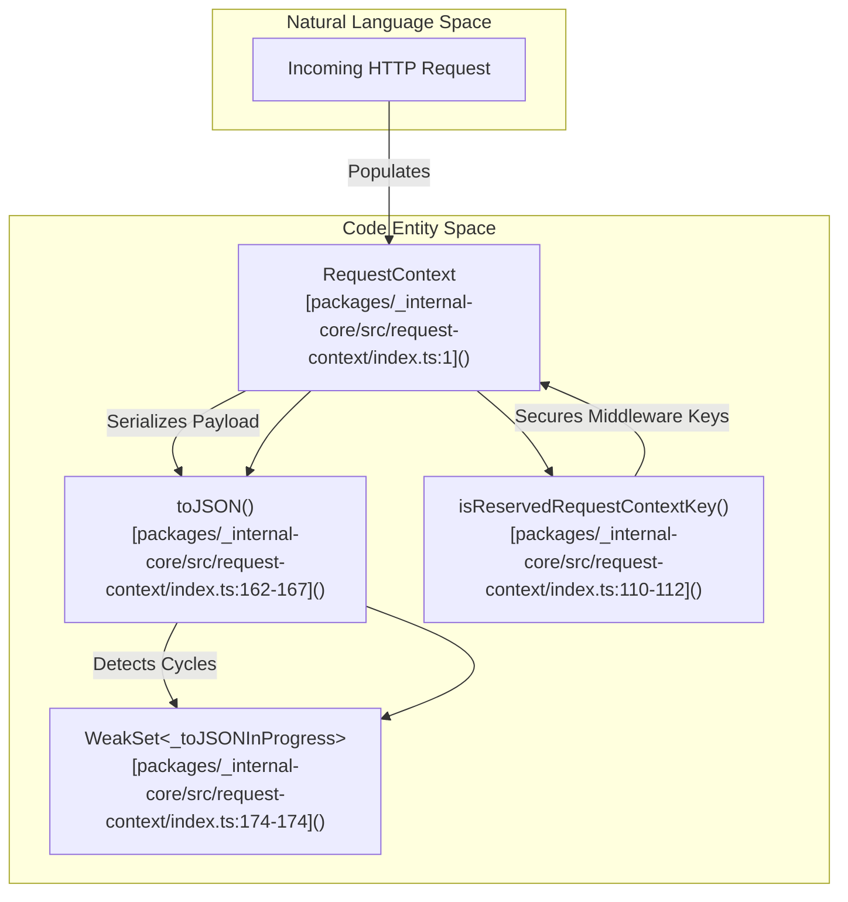
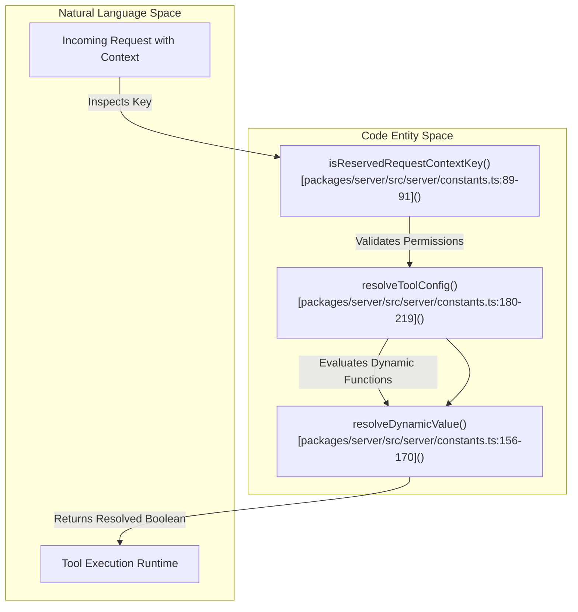

<!-- source: DeepWiki mcp.deepwiki.com · repo mastra-ai/mastra · page 2.2 RequestContext and Dynamic Configuration · fetched 2026-10-26 -->

# RequestContext and Dynamic Configuration

<details>
<summary>Relevant source files</summary>

The following files were used as context for generating this wiki page:

- [docs/src/content/en/docs/evals/custom-scorers.mdx](docs/src/content/en/docs/evals/custom-scorers.mdx)
- [docs/src/content/en/docs/workflows/agents-and-tools.mdx](docs/src/content/en/docs/workflows/agents-and-tools.mdx)
- [docs/src/content/en/reference/evals/create-scorer.mdx](docs/src/content/en/reference/evals/create-scorer.mdx)
- [docs/src/content/en/reference/evals/mastra-scorer.mdx](docs/src/content/en/reference/evals/mastra-scorer.mdx)
- [packages/_internal-core/src/request-context/index.ts](packages/_internal-core/src/request-context/index.ts)
- [packages/core/src/agent/__tests__/delegation-memory-inheritance.test.ts](packages/core/src/agent/__tests__/delegation-memory-inheritance.test.ts)
- [packages/core/src/agent/__tests__/structured-output-tool-calls.test.ts](packages/core/src/agent/__tests__/structured-output-tool-calls.test.ts)
- [packages/core/src/agent/__tests__/utils.test.ts](packages/core/src/agent/__tests__/utils.test.ts)
- [packages/core/src/agent/utils.test.ts](packages/core/src/agent/utils.test.ts)
- [packages/core/src/agent/utils.ts](packages/core/src/agent/utils.ts)
- [packages/core/src/evals/base.test.ts](packages/core/src/evals/base.test.ts)
- [packages/core/src/evals/base.ts](packages/core/src/evals/base.ts)
- [packages/core/src/loop/loop.test.ts](packages/core/src/loop/loop.test.ts)
- [packages/core/src/request-context/index.test.ts](packages/core/src/request-context/index.test.ts)
- [packages/core/src/request-context/index.ts](packages/core/src/request-context/index.ts)
- [packages/server/src/server/constants.test.ts](packages/server/src/server/constants.test.ts)
- [packages/server/src/server/constants.ts](packages/server/src/server/constants.ts)
- [server-adapters/hono/src/__tests__/agent-scopes-security.test.ts](server-adapters/hono/src/__tests__/agent-scopes-security.test.ts)

</details>


This page documents the `RequestContext` system for managing request-scoped state and the dynamic configuration pattern that enables runtime adaptation of agents, tools, workflows, and other Mastra components based on contextual data.

## Purpose and Scope

The `RequestContext` system provides:

1.  **Request-scoped key-value storage** for passing contextual data through the execution stack.
2.  **Tenant isolation** via reserved security keys that prevent unauthorized access to memory and threads.
3.  **Dynamic configuration resolution** enabling runtime adaptation of instructions, models, and tools based on context.
4.  **Authorization enforcement** through middleware-controlled reserved keys and resource ownership validation.

All components in Mastra (agents, workflows, tools, processors, memory) accept `RequestContext` as a parameter to provide runtime, request-specific configuration [docs/src/content/en/docs/server/request-context.mdx:8-10]().

Sources: [docs/src/content/en/docs/server/request-context.mdx:8-10]()

## RequestContext: Core Concepts

### Key-Value Store and Initialization

`RequestContext` acts as a specialized container for request-scoped state. It can be initialized from a plain object (e.g., during deserialization), an array of key-value tuples, or empty arguments [packages/core/src/request-context/index.test.ts:6-40]().

Title: "RequestContext Data Flow and Code Entities"

Sources: [packages/_internal-core/src/request-context/index.ts:1-174](), [packages/core/src/request-context/index.test.ts:6-40]()

### Reserved Keys and Security Model

Specific keys are **reserved** and managed by server-side middleware to enforce multi-tenant isolation, authorization, and sub-agent version overrides [packages/_internal-core/src/request-context/index.ts:1-85](). Client bodies and query parameters are prohibited from injecting reserved keys [packages/server/src/server/constants.ts:63-85]().

| Constant | Purpose | File Reference |
| :--- | :--- | :--- |
| `MASTRA_RESOURCE_ID_KEY` | Identifies the authenticated tenant/user for memory isolation. | [packages/_internal-core/src/request-context/index.ts:17-17]() |
| `MASTRA_THREAD_ID_KEY` | Overrides client thread ID to force operation on a specific thread. | [packages/_internal-core/src/request-context/index.ts:31-31]() |
| `MASTRA_SCOPES_KEY` | Holds `string[]` addresses for organization and resource scoping. | [packages/_internal-core/src/request-context/index.ts:53-53]() |
| `MASTRA_VERSIONS_KEY` | Stores sub-agent version overrides (`VersionOverrides`). | [packages/_internal-core/src/request-context/index.ts:66-66]() |
| `MASTRA_AUTH_TOKEN_KEY` | Stores incoming request auth token for downstream RPC/MCP calls. | [packages/_internal-core/src/request-context/index.ts:73-73]() |
| `MASTRA_INHERITED_MEMORY_KEY` | Carries a delegating agent's memory into a delegated run. | [packages/_internal-core/src/request-context/index.ts:85-85]() |

Sources: [packages/_internal-core/src/request-context/index.ts:1-85](), [packages/server/src/server/constants.ts:63-85]()

### Serialization and Safety

`RequestContext` features a cycle-safe serialization mechanism via `.toJSON()` [packages/core/src/request-context/index.test.ts:42-105](). It filters out functions, symbols, and cross-context cycles using a `WeakSet` tracking mechanism (`_toJSONInProgress`) and throws `CyclicRequestContextToJSONError` to prevent runaway CPU loops during serialization [packages/_internal-core/src/request-context/index.ts:144-178]().

Sources: [packages/_internal-core/src/request-context/index.ts:144-178](), [packages/core/src/request-context/index.test.ts:42-197]()

## Dynamic Configuration Pattern

Dynamic configuration allows Mastra primitives to adapt based on the `RequestContext` provided at runtime.

### Dynamic Agent Configuration

Agents can resolve instructions, models, and tools dynamically by accepting functions that receive context parameters [docs/src/content/en/docs/server/request-context.mdx:143-156]().

```typescript
const agent = new Agent({
  instructions: async ({ requestContext }) => {
    const tier = requestContext.get('user-tier');
    return tier === 'enterprise' ? 'Detailed mode' : 'Concise mode';
  },
  model: ({ requestContext }) => {
     return requestContext.get('user-tier') === 'enterprise' ? 'openai/gpt-4o' : 'openai/gpt-4o-mini';
  }
});
```

Sources: [docs/src/content/en/docs/server/request-context.mdx:143-156]()

### Tool Context Injection and Dynamic Tool Resolution

When tools execute within an agent loop or workflow, configuration values (such as whether a workspace tool requires approval) can be resolved dynamically via helper functions like `resolveToolConfig` [packages/server/src/server/constants.ts:180-219]().

Title: "Dynamic Configuration and Tool Resolution"

Sources: [packages/server/src/server/constants.ts:63-219]()

## Authorization and Middleware

### Middleware Enforcement

`RequestContext` is populated in server middleware before requests reach route handlers or custom API routes [docs/src/content/en/docs/server/middleware.mdx:115-133](). Middleware enforces security by populating reserved keys (`MASTRA_RESOURCE_ID_KEY`, `MASTRA_SCOPES_KEY`) which cannot be overwritten by client request payloads [packages/server/src/server/constants.ts:63-85]().

```typescript
const mastra = new Mastra({
  server: {
    middleware: [
      async (context, next) => {
        const country = context.req.header('CF-IPCountry');
        const requestContext = context.get('requestContext');

        requestContext.set('temperature-unit', country === 'US' ? 'fahrenheit' : 'celsius');

        await next();
      },
    ],
  },
});
```

Sources: [packages/server/src/server/constants.ts:63-85](), [docs/src/content/en/docs/server/request-context.mdx:93-113]()

---

