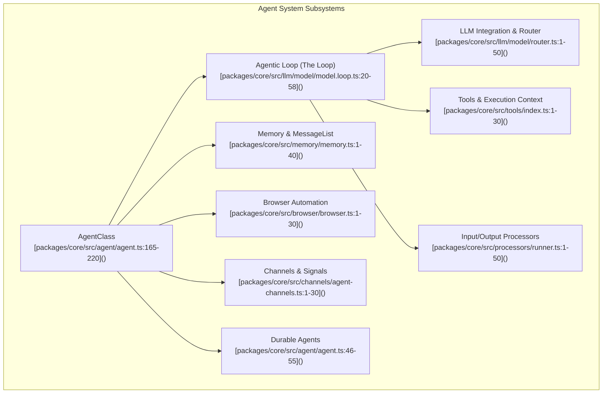

<!-- source: DeepWiki mcp.deepwiki.com · repo mastra-ai/mastra · page 3 Agent System · fetched 2026-10-26 -->

# Agent System

Relevant source files

The following files were used as context for generating this wiki page:

- [.changeset/peer-discovery-busy-caller.md](.changeset/peer-discovery-busy-caller.md)
- [.changeset/retake-lapsed-thread-lease.md](.changeset/retake-lapsed-thread-lease.md)
- [docs/src/content/en/docs/subagents.mdx](docs/src/content/en/docs/subagents.mdx)
- [mastracode/sdk/src/agent-connections/__tests__/cross-process-agent-signals.integration.test.ts](mastracode/sdk/src/agent-connections/__tests__/cross-process-agent-signals.integration.test.ts)
- [mastracode/sdk/src/agent-connections/__tests__/fixtures/cross-process-agent-signals-child.mts](mastracode/sdk/src/agent-connections/__tests__/fixtures/cross-process-agent-signals-child.mts)
- [observability/mastra/src/model-tracing.test.ts](observability/mastra/src/model-tracing.test.ts)
- [observability/mastra/src/model-tracing.ts](observability/mastra/src/model-tracing.ts)
- [packages/core/src/agent-controller/lease-lost-abort-reason.test.ts](packages/core/src/agent-controller/lease-lost-abort-reason.test.ts)
- [packages/core/src/agent/__tests__/delegation-thread-metadata.test.ts](packages/core/src/agent/__tests__/delegation-thread-metadata.test.ts)
- [packages/core/src/agent/__tests__/memory-metadata.test.ts](packages/core/src/agent/__tests__/memory-metadata.test.ts)
- [packages/core/src/agent/__tests__/signals-claimed-ownership.test.ts](packages/core/src/agent/__tests__/signals-claimed-ownership.test.ts)
- [packages/core/src/agent/__tests__/signals-idle-active-behavior.test.ts](packages/core/src/agent/__tests__/signals-idle-active-behavior.test.ts)
- [packages/core/src/agent/__tests__/stream.test.ts](packages/core/src/agent/__tests__/stream.test.ts)
- [packages/core/src/agent/__tests__/thread-lease-loss-abort.test.ts](packages/core/src/agent/__tests__/thread-lease-loss-abort.test.ts)
- [packages/core/src/agent/__tests__/tool-concurrency-called-strategy-resume.test.ts](packages/core/src/agent/__tests__/tool-concurrency-called-strategy-resume.test.ts)
- [packages/core/src/agent/__tests__/tool-concurrency-called-strategy.test.ts](packages/core/src/agent/__tests__/tool-concurrency-called-strategy.test.ts)
- [packages/core/src/agent/__tests__/tool-handling.test.ts](packages/core/src/agent/__tests__/tool-handling.test.ts)
- [packages/core/src/agent/agent-legacy.ts](packages/core/src/agent/agent-legacy.ts)
- [packages/core/src/agent/agent-types.test-d.ts](packages/core/src/agent/agent-types.test-d.ts)
- [packages/core/src/agent/agent.test.ts](packages/core/src/agent/agent.test.ts)
- [packages/core/src/agent/agent.ts](packages/core/src/agent/agent.ts)
- [packages/core/src/agent/agent.types.ts](packages/core/src/agent/agent.types.ts)
- [packages/core/src/agent/durable/durable-parity.test-d.ts](packages/core/src/agent/durable/durable-parity.test-d.ts)
- [packages/core/src/agent/subagent.ts](packages/core/src/agent/subagent.ts)
- [packages/core/src/agent/thread-stream-runtime.ts](packages/core/src/agent/thread-stream-runtime.ts)
- [packages/core/src/agent/types.ts](packages/core/src/agent/types.ts)
- [packages/core/src/agent/workflows/prepare-stream/index.ts](packages/core/src/agent/workflows/prepare-stream/index.ts)
- [packages/core/src/agent/workflows/prepare-stream/map-results-step.ts](packages/core/src/agent/workflows/prepare-stream/map-results-step.ts)
- [packages/core/src/agent/workflows/prepare-stream/prepare-memory-step.ts](packages/core/src/agent/workflows/prepare-stream/prepare-memory-step.ts)
- [packages/core/src/agent/workflows/prepare-stream/prepare-tools-step.ts](packages/core/src/agent/workflows/prepare-stream/prepare-tools-step.ts)
- [packages/core/src/agent/workflows/prepare-stream/run-scope-keys.ts](packages/core/src/agent/workflows/prepare-stream/run-scope-keys.ts)
- [packages/core/src/agent/workflows/prepare-stream/schema.ts](packages/core/src/agent/workflows/prepare-stream/schema.ts)
- [packages/core/src/agent/workflows/prepare-stream/stream-step.ts](packages/core/src/agent/workflows/prepare-stream/stream-step.ts)
- [packages/core/src/llm/model/model.loop.ts](packages/core/src/llm/model/model.loop.ts)
- [packages/core/src/loop/loop.ts](packages/core/src/loop/loop.ts)
- [packages/core/src/loop/network/index.ts](packages/core/src/loop/network/index.ts)
- [packages/core/src/loop/network/validation.test.ts](packages/core/src/loop/network/validation.test.ts)
- [packages/core/src/loop/network/validation.ts](packages/core/src/loop/network/validation.ts)
- [packages/core/src/loop/types.ts](packages/core/src/loop/types.ts)
- [packages/core/src/loop/workflows/agentic-execution/index.ts](packages/core/src/loop/workflows/agentic-execution/index.ts)
- [packages/core/src/loop/workflows/agentic-execution/tool-call-concurrency.test.ts](packages/core/src/loop/workflows/agentic-execution/tool-call-concurrency.test.ts)
- [packages/core/src/loop/workflows/agentic-execution/tool-call-concurrency.ts](packages/core/src/loop/workflows/agentic-execution/tool-call-concurrency.ts)
- [packages/core/src/loop/workflows/agentic-loop/index.ts](packages/core/src/loop/workflows/agentic-loop/index.ts)
- [packages/core/src/memory/index.ts](packages/core/src/memory/index.ts)
- [packages/core/src/memory/run-state.test.ts](packages/core/src/memory/run-state.test.ts)
- [packages/core/src/memory/run-state.ts](packages/core/src/memory/run-state.ts)
- [packages/core/src/tools/request-context-schema-types.test-d.ts](packages/core/src/tools/request-context-schema-types.test-d.ts)
- [packages/rag/src/document/validation.ts](packages/rag/src/document/validation.ts)

The Agent System is Mastra's execution engine for LLM-powered autonomous agents. It orchestrates the interaction between language models, tools, memory, processors, and multi-agent network topologies to enable robust agentic behavior. This page provides a high-level overview of the agent architecture and its subsystems. 

For detailed technical specifications, configuration options, and deep dives into individual subsystems, follow the links provided in each subsection below.

Sources: [packages/core/src/agent/agent.ts:1-200](), [packages/core/src/agent/types.ts:1-100]()

---

## Agent Architecture Overview

Sources: [packages/core/src/agent/agent.ts:165-220](), [packages/core/src/llm/model/model.loop.ts:20-58]()

---

## 3.1. Agent Configuration and Execution
The `Agent` class serves as the primary entry point for managing agent lifecycle operations, constructor parameters, and execution triggers such as `generate()` and `stream()` [packages/core/src/agent/agent.ts:165-220](). It accepts a rich set of configuration options covering instructions, models, tools, memory, and processors.

For details on constructor options, method signatures, and execution flow, see [Agent Configuration and Execution](#3.1).

Sources: [packages/core/src/agent/agent.ts:165-220]()

---

## 3.2. LLM Integration and Model Router
Mastra integrates with various language model providers using the Vercel AI SDK and custom compatibility wrappers. The model router system handles model selection, fallback chains, and AI SDK version interoperability (v1, v2, v3) through `MastraLLMVNext` [packages/core/src/llm/model/model.loop.ts:20-58]().

For details on model routing, fallbacks, and version compatibility, see [LLM Integration and Model Router](#3.2).

Sources: [packages/core/src/llm/model/model.loop.ts:20-58](), [packages/core/src/llm/model/router.ts:1-50]()

---

## 3.3. Tool Integration and Execution
Agents can invoke tools defined via `CoreToolBuilder`, client-side tools, and Model Context Protocol (MCP) servers. The tool execution subsystem handles tool validation, execution context resolution, and interactive tool approval or suspension workflows.

For details on tool calling, builders, and approval mechanisms, see [Tool Integration and Execution](#3.3).

Sources: [packages/core/src/tools/index.ts:1-30]()

---

## 3.4. Agent Memory System
Conversation persistence and context management are handled by the agent memory system [packages/core/src/memory/memory.ts:1-40](). It utilizes `MessageList` to manage thread-based conversation state, resource scoping, semantic recall, and memory processors.

For details on thread scoping, message storage, and recall flows, see [Agent Memory System](#3.4).

Sources: [packages/core/src/agent/message-list/index.ts:1-30](), [packages/core/src/memory/memory.ts:1-40]()

---

## 3.5. Input and Output Processors
The processor pipeline inspects and transforms messages before and after LLM execution. Components like `PrepareStepProcessor` and the `TripWire` mechanism enable content moderation, early termination, and state management.

For details on the processor pipeline and TripWire semantics, see [Input and Output Processors](#3.5).

Sources: [packages/core/src/processors/runner.ts:1-50]()

---

## 3.6. Structured Output and Schema Validation
Agents support structured output generation by enforcing Zod schemas or JSON Schema definitions. This subsystem handles schema conversion, validation, and JSON repair routines for tool calls and model responses.

For details on structured output modes and schema validation, see [Structured Output and Schema Validation](#3.6).

Sources: [packages/core/src/schema/index.ts:1-16]()

---

## 3.7. Agent Networks and Multi-Agent Collaboration
Multi-agent systems allow agents to collaborate via network topologies and tool-based agent invocation. The network runner coordinates agent-to-agent communication, delegation hooks, and task completion evaluation.

For details on multi-agent routing and network topologies, see [Agent Networks and Multi-Agent Collaboration](#3.7).

Sources: [packages/core/src/loop/network/index.ts:1-50]()

---

## 3.8. Agentic Execution Loop (The Loop)
The agentic loop drives multi-turn reasoning, controlling the iteration cycle between LLM execution steps, tool calls, and stream processing.

For a deep dive into loop architecture and iteration control, see [Agentic Execution Loop (The Loop)](#3.8).

Sources: [packages/core/src/llm/model/model.loop.ts:100-227]()

---

## 3.9. Browser Automation and Web Interaction
Mastra provides a browser abstraction layer (`MastraBrowser`) alongside integrations with tools like AgentBrowser, Stagehand, and Firecrawl. Browser sessions are scoped to threads and resources for secure web interaction.

For details on browser sessions and tool surfaces, see [Browser Automation and Web Interaction](#3.9).

Sources: [packages/core/src/browser/browser.ts:1-30]()

---

## 3.10. Agent Channels and Signal System
Agent channels enable communication across external messaging platforms (Slack, Telegram, Discord) and inter-agent signaling via the `sendSignal` API and `AgentChannels` interface.

For details on channel providers and agent signals, see [Agent Channels and Signal System](#3.10).

Sources: [packages/core/src/channels/agent-channels.ts:1-30]()

---

## 3.11. Agent SDK Wrappers (Claude, Cursor, OpenAI)
The `agent-sdks` packages wrap third-party agent runtimes as Mastra-compatible SubAgents (`ClaudeSDKAgent`, `CursorSDKAgent`, `OpenAISDKAgent`), bridging external run loops into standard Mastra generate and stream pipelines.

For details on third-party SDK integration, see [Agent SDK Wrappers (Claude, Cursor, OpenAI)](#3.11).

Sources: [packages/core/src/agent/subagent.ts:1-50]()

---

## 3.12. AgentController and Interactive Sessions
`AgentController` manages interactive, long-running agent sessions with workspace resolution, thread locking, and built-in task tools.

For details on interactive session identity and workspace binding, see [AgentController and Interactive Sessions](#3.12).

Sources: [packages/core/src/agent/agent.ts:160-200]()

---

## 3.13. Durable Agents
Durable agents provide fault-tolerant execution via durable workflow steps (`llm-execution`, `tool-call`, `llm-mapping`), snapshot pruning, run recovery, and Inngest durable agent variants.

For details on durable agent runtimes and run recovery, see [Durable Agents](#3.13).

Sources: [packages/core/src/agent/agent.ts:46-55]()

---

