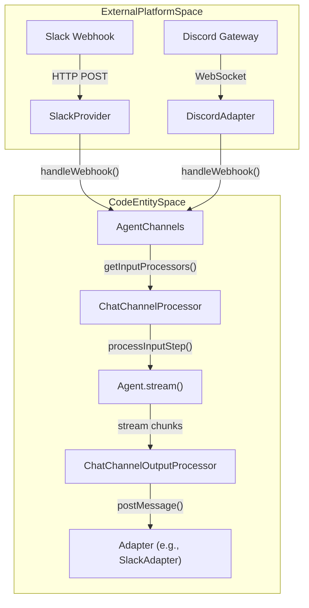
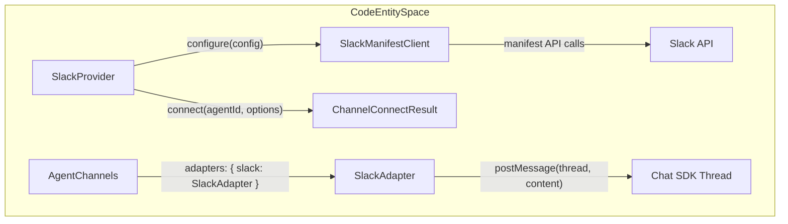
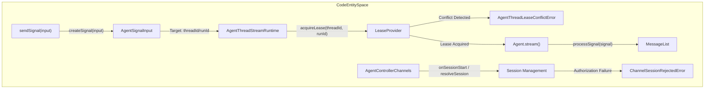

<!-- source: DeepWiki mcp.deepwiki.com · repo mastra-ai/mastra · page 3.10 Agent Channels and Signal System · fetched 2026-10-26 -->

# Agent Channels and Signal System

Relevant source files

The following files were used as context for generating this wiki page:

- [.changeset/bumpy-files-unite.md](.changeset/bumpy-files-unite.md)
- [.changeset/kind-pens-react.md](.changeset/kind-pens-react.md)
- [.changeset/salty-hands-shake.md](.changeset/salty-hands-shake.md)
- [.changeset/sharp-plums-speak.md](.changeset/sharp-plums-speak.md)
- [.changeset/smart-peas-grin.md](.changeset/smart-peas-grin.md)
- [.changeset/sparkly-camels-fold.md](.changeset/sparkly-camels-fold.md)
- [channels/slack/src/provider.test.ts](channels/slack/src/provider.test.ts)
- [channels/slack/src/provider.ts](channels/slack/src/provider.ts)
- [channels/slack/src/types.ts](channels/slack/src/types.ts)
- [docs/src/content/en/docs/agents/processors.mdx](docs/src/content/en/docs/agents/processors.mdx)
- [docs/src/content/en/docs/channels.mdx](docs/src/content/en/docs/channels.mdx)
- [docs/src/content/en/docs/signals/notifications.mdx](docs/src/content/en/docs/signals/notifications.mdx)
- [docs/src/content/en/docs/signals/overview.mdx](docs/src/content/en/docs/signals/overview.mdx)
- [docs/src/content/en/docs/signals/running-across-processes.mdx](docs/src/content/en/docs/signals/running-across-processes.mdx)
- [docs/src/content/en/docs/signals/sending-signals.mdx](docs/src/content/en/docs/signals/sending-signals.mdx)
- [docs/src/content/en/docs/signals/signal-providers.mdx](docs/src/content/en/docs/signals/signal-providers.mdx)
- [docs/src/content/en/reference/agents/channels.mdx](docs/src/content/en/reference/agents/channels.mdx)
- [docs/src/content/en/reference/channels/channel-provider.mdx](docs/src/content/en/reference/channels/channel-provider.mdx)
- [docs/src/content/en/reference/channels/slack-provider.mdx](docs/src/content/en/reference/channels/slack-provider.mdx)
- [docs/src/content/en/reference/processors/processor-interface.mdx](docs/src/content/en/reference/processors/processor-interface.mdx)
- [docs/src/content/en/reference/signals/thread-events.mdx](docs/src/content/en/reference/signals/thread-events.mdx)
- [packages/core/src/channels/__tests__/agent-channels.test.ts](packages/core/src/channels/__tests__/agent-channels.test.ts)
- [packages/core/src/channels/__tests__/agent-controller-channels-tenant-context.test.ts](packages/core/src/channels/__tests__/agent-controller-channels-tenant-context.test.ts)
- [packages/core/src/channels/__tests__/agent-controller-channels.test.ts](packages/core/src/channels/__tests__/agent-controller-channels.test.ts)
- [packages/core/src/channels/__tests__/integration.test.ts](packages/core/src/channels/__tests__/integration.test.ts)
- [packages/core/src/channels/__tests__/output-processor.test.ts](packages/core/src/channels/__tests__/output-processor.test.ts)
- [packages/core/src/channels/__tests__/stream-helpers.test.ts](packages/core/src/channels/__tests__/stream-helpers.test.ts)
- [packages/core/src/channels/agent-channels.ts](packages/core/src/channels/agent-channels.ts)
- [packages/core/src/channels/agent-controller-channels.ts](packages/core/src/channels/agent-controller-channels.ts)
- [packages/core/src/channels/chat-driver-static.ts](packages/core/src/channels/chat-driver-static.ts)
- [packages/core/src/channels/chat-driver-streaming.ts](packages/core/src/channels/chat-driver-streaming.ts)
- [packages/core/src/channels/formatting.test.ts](packages/core/src/channels/formatting.test.ts)
- [packages/core/src/channels/formatting.ts](packages/core/src/channels/formatting.ts)
- [packages/core/src/channels/output-processor.ts](packages/core/src/channels/output-processor.ts)
- [packages/core/src/channels/processor.test.ts](packages/core/src/channels/processor.test.ts)
- [packages/core/src/channels/processor.ts](packages/core/src/channels/processor.ts)
- [packages/core/src/channels/stream-helpers.ts](packages/core/src/channels/stream-helpers.ts)
- [packages/core/src/channels/types.ts](packages/core/src/channels/types.ts)

This page documents Mastra's agent channels abstraction (`AgentChannels`), which standardizes multi-platform bot integration (Slack, Telegram, Discord channel providers), and the agent signal system (`sendSignal`, `AgentThreadStreamRuntime`), which manages asynchronous inter-agent communication, state-based triggers, and thread-level execution control.

## Agent Channels Abstraction (`AgentChannels`)

The `AgentChannels` class manages a single bot identity across multiple platform adapters [packages/core/src/channels/agent-channels.ts:90-96](). It bridges external chat messaging providers and Mastra's internal agent execution loop by mapping external platform identities to internal Mastra threads [packages/core/src/channels/agent-channels.ts:90-96]().

### Configuration and Adapters

Agents are connected to messaging platforms via the `channels` property in the `Agent` constructor, which accepts a `ChannelConfig` object [packages/core/src/channels/types.ts:29](). 

Key components of `AgentChannels`:
- **`adapters`**: A record of platform-specific adapters (e.g., Slack, Discord) stored in `AgentChannels.adapters` [packages/core/src/channels/agent-channels.ts:98]().
- **Tool Generation**: Generates platform-specific action tools like `add_reaction` and `remove_reaction` via `getTools()` [packages/core/src/channels/__tests__/agent-channels.test.ts:101-109]().
- **Input Processing**: Automatically attaches `ChatChannelProcessor` to inject platform context (channel name, platform type) into the agent's system prompt [packages/core/src/channels/agent-channels.ts:161-165]().
- **Output Processing**: Uses `ChatChannelOutputProcessor` to format agent stream chunks (text deltas, tool calls, cards) back into provider-specific formats [packages/core/src/channels/output-processor.ts:153]().

Title: "AgentChannels Architecture and Processing Pipeline"

Sources:
- [packages/core/src/channels/agent-channels.ts:90-150]()
- [packages/core/src/channels/types.ts:25-55]()
- [packages/core/src/channels/output-processor.ts:153-172]()
- [packages/core/src/channels/__tests__/agent-channels.test.ts:101-109]()
- [packages/core/src/channels/__tests__/agent-channels.test.ts:161-165]()

## Platform Integrations: Slack, Telegram, and Discord

Platform providers wrap raw APIs into standard `Adapter` interfaces consumed by `AgentChannels`.

### Slack Integration (`SlackProvider`)
The `SlackProvider` class handles programmatic Slack app creation via the manifest API, OAuth workspace installation flows, and webhook routing for events and slash commands [channels/slack/src/provider.ts:155-159](). 

- **`resolveSlackAdapterConfig`**: Computes opinionated defaults optimized for Slack's AI Assistant UI (such as enabling native message streaming and grouping tools into a single thinking-steps widget) [channels/slack/src/provider.ts:55]().
- **`SlackManifestClient`**: Manages token resolution and app configuration lifecycle during deployment [channels/slack/src/provider.ts:178-182]().

### Generic and Specialized Adapters
Adapters such as those for Discord and Telegram conform to the Chat SDK `Adapter` interface [packages/core/src/channels/__tests__/agent-channels.test.ts:22-41](). They supply methods for posting messages, editing messages, handling reactions, and parsing incoming platform events.

Title: "Slack and Channel Provider Lifecycle"

Sources:
- [channels/slack/src/provider.ts:155-159]()
- [channels/slack/src/provider.ts:55]()
- [channels/slack/src/provider.ts:178-182]()
- [packages/core/src/channels/__tests__/agent-channels.test.ts:22-41]()

## Agent Signal System

Signals are asynchronous events targeted at a specific `threadId` or `runId`, enabling inter-agent communication, external system notifications, and thread-level execution control.

### Signal Structure and Delivery API

A signal wraps content and metadata into structured objects:
- **`AgentSignalContents`**: Defines the payload structure for a signal [packages/core/src/agent/signals.ts:7]().
- **`AgentSignalInput`**: The input type for creating a signal, including target `threadId` or `runId` [packages/core/src/agent/signals.ts:7]().
- **`createSignal`**: A utility function to create an `AgentSignal` [packages/core/src/agent/signals.ts:6]().

The `sendSignal` API controls how signals interact with active or idle execution loops using delivery attributes:
- `deliver`: Immediately injects the signal into the running agent's next turn [docs/src/content/en/docs/signals/sending-signals.mdx:25]().
- `wake`: Starts a new execution loop if the agent is idle [docs/src/content/en/docs/signals/sending-signals.mdx:26]().
- `persist`: Saves the signal to the message list without triggering immediate execution [docs/src/content/en/docs/signals/sending-signals.mdx:27]().
- `ifIdle`: Conditional options applied when targeting idle threads [docs/src/content/en/docs/signals/sending-signals.mdx:28]().

### Thread Leasing and Runtime Management

To prevent race conditions when multiple signals target the same thread, the `AgentThreadStreamRuntime` utilizes a lease mechanism.
- **`AgentControllerChannels`**: Integrates `AgentController` with channels, handling session resolution and lifecycle events [packages/core/src/channels/agent-controller-channels.ts:148-150](). It can define `onSessionStart`, `resolveSession`, and `onStaleToolApproval` hooks to manage session state and authorization [packages/core/src/channels/agent-controller-channels.ts:127-145]().
- **`ChannelSessionRejectedError`**: Thrown when a session cannot be resolved or authorized, preventing agent execution [packages/core/src/channels/errors.ts:21]().

Title: "Signal Processing and Thread Leasing Architecture"

Sources:
- [packages/core/src/agent/signals.ts:6-7]()
- [docs/src/content/en/docs/signals/sending-signals.mdx:25-28]()
- [packages/core/src/channels/agent-controller-channels.ts:148-150]()
- [packages/core/src/channels/agent-controller-channels.ts:127-145]()
- [packages/core/src/channels/errors.ts:21]()

## GitHub Signals Provider

The GitHub Signals provider allows agents to participate in software development workflows by subscribing to repository events, issues, and pull request activity.

### PR Subscriptions and Automated Sync
- **`GithubSignals`**: Monitors GitHub webhooks and translates repository events into Mastra signals.
- **`GITHUB_SUBSCRIBE_PR_TAG`**: Metadata tag utilized to track which agent threads are observing specific Pull Requests.
- **Context Synchronization**: Fetches PR snapshots (such as CI check statuses, review comments, and commit updates) and injects them as signals into the agent's memory context, allowing autonomous code review and status management.

Sources:
- [docs/src/content/en/docs/harness/overview.mdx:25-29]()

---

