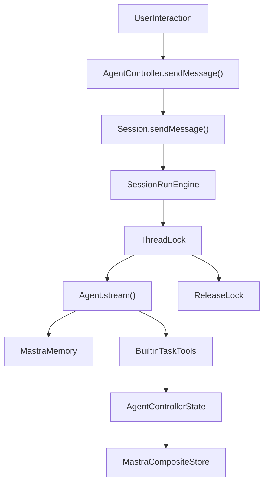
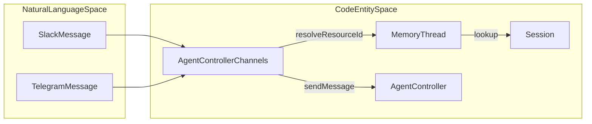

<!-- source: DeepWiki mcp.deepwiki.com · repo mastra-ai/mastra · page 3.12 AgentController and Interactive Sessions · fetched 2026-10-26 -->

# AgentController and Interactive Sessions

Relevant source files

The following files were used as context for generating this wiki page:

- [client-sdks/client-js/src/index.test.ts](client-sdks/client-js/src/index.test.ts)
- [client-sdks/client-js/src/resources/agent-controller.test.ts](client-sdks/client-js/src/resources/agent-controller.test.ts)
- [client-sdks/client-js/src/resources/agent-controller.ts](client-sdks/client-js/src/resources/agent-controller.ts)
- [docs/src/content/en/docs/harness/agent-controller.mdx](docs/src/content/en/docs/harness/agent-controller.mdx)
- [docs/src/content/en/docs/harness/overview.mdx](docs/src/content/en/docs/harness/overview.mdx)
- [docs/src/content/en/reference/agent-controller/agent-controller-class.mdx](docs/src/content/en/reference/agent-controller/agent-controller-class.mdx)
- [docs/src/content/en/reference/agent-controller/session.mdx](docs/src/content/en/reference/agent-controller/session.mdx)
- [docs/src/content/en/reference/client-js/agent-controller.mdx](docs/src/content/en/reference/client-js/agent-controller.mdx)
- [docs/src/content/en/reference/client-js/mastra-client.mdx](docs/src/content/en/reference/client-js/mastra-client.mdx)
- [docs/src/content/en/reference/code-sdk/mount-agent-controller.mdx](docs/src/content/en/reference/code-sdk/mount-agent-controller.mdx)
- [mastracode/sdk/src/__tests__/wake-owner-credentials.test.ts](mastracode/sdk/src/__tests__/wake-owner-credentials.test.ts)
- [mastracode/sdk/src/tools/workflows/__tests__/create-workflow.test.ts](mastracode/sdk/src/tools/workflows/__tests__/create-workflow.test.ts)
- [mastracode/sdk/src/tools/workflows/create-workflow.ts](mastracode/sdk/src/tools/workflows/create-workflow.ts)
- [mastracode/sdk/src/utils/__tests__/notification-dispatch.test.ts](mastracode/sdk/src/utils/__tests__/notification-dispatch.test.ts)
- [mastracode/sdk/src/utils/__tests__/signals-pubsub-cross-project.test.ts](mastracode/sdk/src/utils/__tests__/signals-pubsub-cross-project.test.ts)
- [mastracode/sdk/src/utils/__tests__/signals-pubsub.test.ts](mastracode/sdk/src/utils/__tests__/signals-pubsub.test.ts)
- [mastracode/sdk/src/utils/__tests__/wake-session.test.ts](mastracode/sdk/src/utils/__tests__/wake-session.test.ts)
- [mastracode/sdk/src/utils/notification-dispatch.ts](mastracode/sdk/src/utils/notification-dispatch.ts)
- [mastracode/sdk/src/utils/signals-pubsub.ts](mastracode/sdk/src/utils/signals-pubsub.ts)
- [mastracode/sdk/src/utils/wake-session.ts](mastracode/sdk/src/utils/wake-session.ts)
- [mastracode/tui/e2e/fixtures/goal-fresh-thread-persistence.json](mastracode/tui/e2e/fixtures/goal-fresh-thread-persistence.json)
- [mastracode/tui/e2e/fixtures/goal-max-runs-ends-goal.json](mastracode/tui/e2e/fixtures/goal-max-runs-ends-goal.json)
- [mastracode/tui/e2e/tui/goal-fresh-thread-persistence.ts](mastracode/tui/e2e/tui/goal-fresh-thread-persistence.ts)
- [mastracode/tui/e2e/tui/goal-max-runs-ends-goal.ts](mastracode/tui/e2e/tui/goal-max-runs-ends-goal.ts)
- [packages/core/src/agent-controller/__tests__/agent-controller-ask-user-snapshot-failure.test.ts](packages/core/src/agent-controller/__tests__/agent-controller-ask-user-snapshot-failure.test.ts)
- [packages/core/src/agent-controller/__tests__/agent-controller-ask-user.test.ts](packages/core/src/agent-controller/__tests__/agent-controller-ask-user.test.ts)
- [packages/core/src/agent-controller/__tests__/message-identity-integration.test.ts](packages/core/src/agent-controller/__tests__/message-identity-integration.test.ts)
- [packages/core/src/agent-controller/__tests__/mode-tools-after-approval.test.ts](packages/core/src/agent-controller/__tests__/mode-tools-after-approval.test.ts)
- [packages/core/src/agent-controller/__tests__/run-engine-abort-deadline.test.ts](packages/core/src/agent-controller/__tests__/run-engine-abort-deadline.test.ts)
- [packages/core/src/agent-controller/__tests__/run-engine-db-message.test.ts](packages/core/src/agent-controller/__tests__/run-engine-db-message.test.ts)
- [packages/core/src/agent-controller/__tests__/run-engine-delegated-subagent.test.ts](packages/core/src/agent-controller/__tests__/run-engine-delegated-subagent.test.ts)
- [packages/core/src/agent-controller/__tests__/session-abort-approval-suspension.test.ts](packages/core/src/agent-controller/__tests__/session-abort-approval-suspension.test.ts)
- [packages/core/src/agent-controller/__tests__/session-thread-derived-state.test.ts](packages/core/src/agent-controller/__tests__/session-thread-derived-state.test.ts)
- [packages/core/src/agent-controller/agent-controller.ts](packages/core/src/agent-controller/agent-controller.ts)
- [packages/core/src/agent-controller/errors.ts](packages/core/src/agent-controller/errors.ts)
- [packages/core/src/agent-controller/index.ts](packages/core/src/agent-controller/index.ts)
- [packages/core/src/agent-controller/session-run-engine.ts](packages/core/src/agent-controller/session-run-engine.ts)
- [packages/core/src/agent-controller/session.ts](packages/core/src/agent-controller/session.ts)
- [packages/core/src/agent-controller/signal-messages.test.ts](packages/core/src/agent-controller/signal-messages.test.ts)
- [packages/core/src/agent-controller/subagent-tool.test.ts](packages/core/src/agent-controller/subagent-tool.test.ts)
- [packages/core/src/agent-controller/tools.ts](packages/core/src/agent-controller/tools.ts)
- [packages/core/src/agent-controller/types.ts](packages/core/src/agent-controller/types.ts)
- [packages/core/src/agent/__tests__/goal.test.ts](packages/core/src/agent/__tests__/goal.test.ts)
- [packages/core/src/agent/__tests__/thread-stream-liveness.test.ts](packages/core/src/agent/__tests__/thread-stream-liveness.test.ts)
- [packages/core/src/agent/durable/__tests__/durable-agent-delegation-bail.test.ts](packages/core/src/agent/durable/__tests__/durable-agent-delegation-bail.test.ts)
- [packages/core/src/agent/durable/__tests__/durable-agent-goal.test.ts](packages/core/src/agent/durable/__tests__/durable-agent-goal.test.ts)
- [packages/core/src/agent/durable/__tests__/durable-agent-trailing-assistant-guard.test.ts](packages/core/src/agent/durable/__tests__/durable-agent-trailing-assistant-guard.test.ts)
- [packages/core/src/agent/durable/workflows/steps/goal.ts](packages/core/src/agent/durable/workflows/steps/goal.ts)
- [packages/core/src/agent/goal/activity.test.ts](packages/core/src/agent/goal/activity.test.ts)
- [packages/core/src/agent/goal/activity.ts](packages/core/src/agent/goal/activity.ts)
- [packages/core/src/agent/goal/index.ts](packages/core/src/agent/goal/index.ts)
- [packages/core/src/agent/goal/objective.ts](packages/core/src/agent/goal/objective.ts)
- [packages/core/src/agent/goal/scorer.test.ts](packages/core/src/agent/goal/scorer.test.ts)
- [packages/core/src/agent/goal/scorer.ts](packages/core/src/agent/goal/scorer.ts)
- [packages/core/src/agent/goal/state-processor.test.ts](packages/core/src/agent/goal/state-processor.test.ts)
- [packages/core/src/agent/goal/state-processor.ts](packages/core/src/agent/goal/state-processor.ts)
- [packages/core/src/loop/shared/steps/goal-core.ts](packages/core/src/loop/shared/steps/goal-core.ts)
- [packages/core/src/loop/test-utils/aimock/aimock-scenario.ts](packages/core/src/loop/test-utils/aimock/aimock-scenario.ts)
- [packages/core/src/loop/test-utils/aimock/scenarios/delegation-complete-bail.scenario.test.ts](packages/core/src/loop/test-utils/aimock/scenarios/delegation-complete-bail.scenario.test.ts)
- [packages/core/src/loop/test-utils/aimock/scenarios/goal-judge-guard-continuation.scenario.test.ts](packages/core/src/loop/test-utils/aimock/scenarios/goal-judge-guard-continuation.scenario.test.ts)
- [packages/core/src/loop/test-utils/aimock/scenarios/harness-stream-error.scenario.test.ts](packages/core/src/loop/test-utils/aimock/scenarios/harness-stream-error.scenario.test.ts)
- [packages/core/src/loop/test-utils/aimock/scenarios/iteration-complete.scenario.test.ts](packages/core/src/loop/test-utils/aimock/scenarios/iteration-complete.scenario.test.ts)
- [packages/core/src/loop/test-utils/aimock/scenarios/stop-condition-long-loop.scenario.test.ts](packages/core/src/loop/test-utils/aimock/scenarios/stop-condition-long-loop.scenario.test.ts)
- [packages/core/src/loop/test-utils/aimock/scenarios/trailing-assistant-guard-persistence.scenario.test.ts](packages/core/src/loop/test-utils/aimock/scenarios/trailing-assistant-guard-persistence.scenario.test.ts)
- [packages/core/src/loop/test-utils/aimock/types.ts](packages/core/src/loop/test-utils/aimock/types.ts)
- [packages/core/src/loop/workflows/agentic-execution/goal-step.test.ts](packages/core/src/loop/workflows/agentic-execution/goal-step.test.ts)
- [packages/core/src/loop/workflows/agentic-execution/goal-step.ts](packages/core/src/loop/workflows/agentic-execution/goal-step.ts)
- [packages/server/src/server/handlers/agent-controller.test.ts](packages/server/src/server/handlers/agent-controller.test.ts)
- [packages/server/src/server/handlers/agent-controller.ts](packages/server/src/server/handlers/agent-controller.ts)

The `AgentController` API provides a high-level orchestration layer for managing long-running, interactive agent sessions. Unlike standard `Agent.generate()` or `Agent.stream()` methods, which handle single request-response cycles, `AgentController` manages session identity, thread-level locking, state persistence across turns, and multi-channel integration [packages/core/src/agent-controller/agent-controller.ts:152-177]().

## Core Concepts and Session Identity

An interactive session is managed via a `Session` object, which encapsulates the agent's identity, the active conversation thread, and its associated resource scoping [packages/core/src/agent-controller/session.ts:163-170]().

### Session Scoping and Persistence
Sessions are keyed using a combination of identity and context attributes:
- **`resourceId`**: The memory resource identifier the session reads and writes under (e.g., a project or user ID) [packages/core/src/agent-controller/session.ts:146-148]().
- **`id`**: The unique identifier for the session itself. When omitted during creation, it defaults to `resourceId` [docs/src/content/en/docs/harness/agent-controller.mdx:104-106]().
- **`threadId`**: Identifies a specific execution stream or conversation history within the resource scope [packages/core/src/agent-controller/session.ts:182-184]().

Sources: [packages/core/src/agent-controller/session.ts:124-184](), [packages/server/src/server/handlers/agent-controller.ts:146-151](), [docs/src/content/en/docs/harness/agent-controller.mdx:104-106]()

### Thread Selection and Concurrency Control
To prevent race conditions during concurrent updates, `AgentController` coordinates thread access:
- **Active Run Management**: The controller tracks active execution states to ensure only one run executes per thread at a time [packages/core/src/agent-controller/agent-controller.ts:4-5]().
- **Thread Metadata**: Runtime bookkeeping and user preferences are persisted directly into thread metadata [packages/core/src/agent-controller/session.ts:130-155]().

Sources: [packages/core/src/agent-controller/agent-controller.ts:1-25](), [packages/core/src/agent-controller/session.ts:130-155]()

## System Architecture: Session Data Flow

The following diagram details how user messages flow through `AgentController`, `Session`, and `SessionRunEngine` into the memory and storage layers.

Title: "Interactive Session Execution Data Flow"

Sources: [packages/core/src/agent-controller/agent-controller.ts:152-177](), [packages/core/src/agent-controller/session.ts:25-42](), [packages/core/src/agent-controller/session-run-engine.ts:23-30]()

## Built-in Task Tools

`AgentController` includes specialized tools for tracking plan progression, checking goals, and requesting user feedback.

| Tool Name | Purpose / Action | File Reference |
| :--- | :--- | :--- |
| `taskWriteTool` | Creates or updates the agent's task plan/goal structure. | [packages/core/src/agent-controller/tools.ts:100-102]() |
| `taskUpdateTool` | Updates an existing task item. | [packages/core/src/agent-controller/tools.ts:103-105]() |
| `taskCheckTool` | Verifies the status of ongoing tasks and goals. | [packages/core/src/agent-controller/tools.ts:106-108]() |
| `taskCompleteTool` | Marks a task as complete. | [packages/core/src/agent-controller/tools.ts:109-111]() |
| `submitPlanTool` | Submits a plan for review, often triggering mode transitions. | [packages/core/src/agent-controller/tools.ts:112-114]() |
| `askUserTool` | Suspends execution to prompt the user for input or clarification. | [packages/core/src/agent-controller/tools.ts:115-117]() |
| `createSubagentTool` | Spawns a subagent to delegate focused subtasks. | [packages/core/src/agent-controller/tools.ts:118-120]() |

Sources: [packages/core/src/agent-controller/tools.ts:100-120](), [packages/core/src/agent-controller/types.ts:74-80]()

## Workspace Resolution

Interactive sessions often execute within a `Workspace` to provide an isolated filesystem and tool execution context.
- **Dynamic Context**: The controller resolves workspace bindings per session or request context [packages/core/src/agent-controller/agent-controller.ts:191-195]().
- **Tool Integration**: Tools like file readers and shell executors operate safely within the boundaries of the assigned workspace instance [packages/core/src/agent-controller/agent-controller.ts:35-40]().

Sources: [packages/core/src/agent-controller/agent-controller.ts:191-195](), [packages/core/src/agent-controller/agent-controller.ts:35-40]()

## Channels Integration

`AgentController` supports bridging external communications platforms (such as Slack or Telegram) directly into active session threads.

### Signal System and Messaging
- **Platform Mapping**: Incoming platform threads are mapped to Mastra `resourceId` values via `AgentChannels` [packages/core/src/channels/agent-controller-channels.ts:1-15]().
- **Signal Dispatch**: Asynchronous events such as tool approvals or notifications are dispatched across channel adapters using the agent signal system [packages/core/src/agent-controller/session.ts:3-10]().

Title: "Channel to Agent Mapping Architecture"

Sources: [packages/core/src/agent-controller/agent-controller.ts:8-12](), [packages/core/src/agent-controller/session.ts:144-153](), [packages/core/src/channels/agent-controller-channels.ts:1-15]()

## Comparison: Plain Agent vs. AgentController

| Feature | Plain `Agent` (`generate`/`stream`) | `AgentController` Session |
| :--- | :--- | :--- |
| **Persistence** | Caller must explicitly manage `threadId` and message lists. | Automatically managed via `Session` persistence layers [packages/core/src/agent-controller/session.ts:91-97](). |
| **Concurrency** | No built-in locking; concurrent updates can race. | Coordinated thread locking and active run tracking [packages/core/src/agent-controller/agent-controller.ts:177-185](). |
| **State Management** | Stateless between requests unless memory is wired. | Persistent `AgentControllerState` with schema validation [packages/core/src/agent-controller/agent-controller.ts:160-162](). |
| **Execution Modes** | Single operating profile determined by static instructions. | Multi-mode architecture (e.g., plan vs. build) with transitions [packages/core/src/agent-controller/types.ts:44-80](). |
| **Interactive Tools** | Manual handling of tool outputs and suspension states. | Built-in `askUserTool` and automated approval loops [packages/core/src/agent-controller/session-run-engine.ts:78-80](). |

Sources: [packages/core/src/agent-controller/agent-controller.ts:152-177](), [packages/core/src/agent-controller/types.ts:44-135](), [packages/core/src/agent-controller/session-run-engine.ts:66-83]()

---

