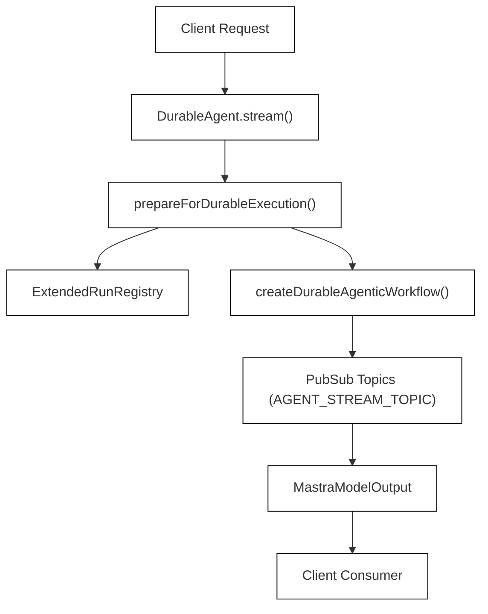
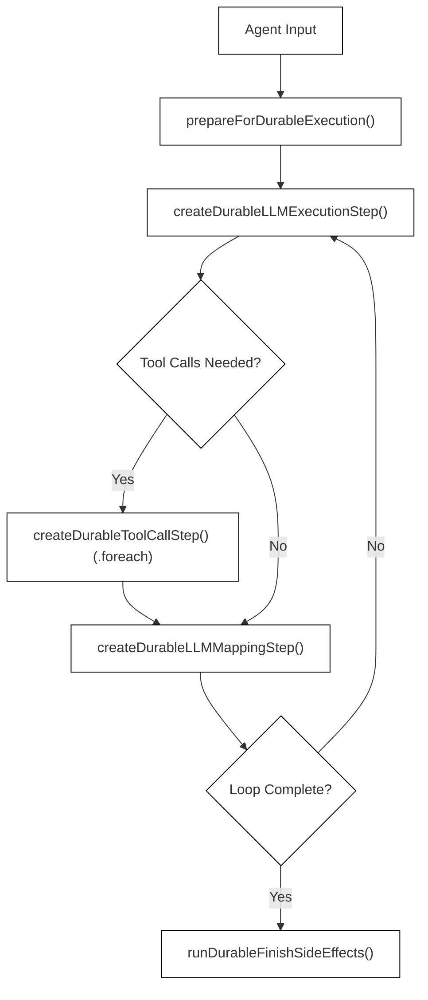
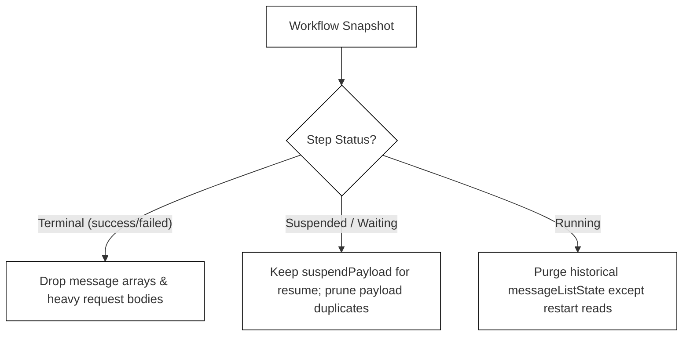
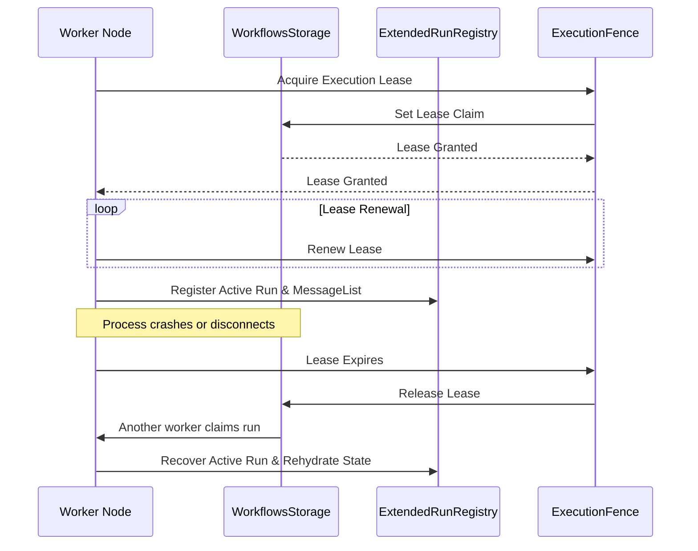
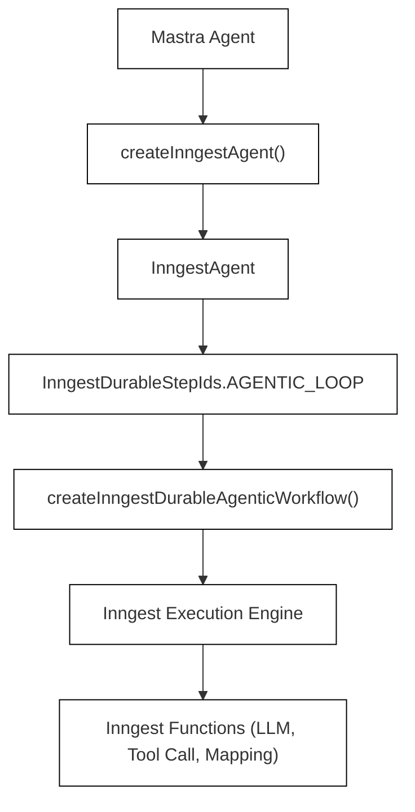

<!-- source: DeepWiki mcp.deepwiki.com · repo mastra-ai/mastra · page 3.13 Durable Agents · fetched 2026-10-26 -->

# Durable Agents

Relevant source files

The following files were used as context for generating this wiki page:

- [docs/src/content/en/integrations/deploy/inngest.mdx](docs/src/content/en/integrations/deploy/inngest.mdx)
- [docs/src/content/en/reference/agents/inngest-agent.mdx](docs/src/content/en/reference/agents/inngest-agent.mdx)
- [examples/inngest/README.md](examples/inngest/README.md)
- [examples/inngest/package.json](examples/inngest/package.json)
- [packages/core/src/agent/durable/__tests__/durable-agent-approval-resume-data.test.ts](packages/core/src/agent/durable/__tests__/durable-agent-approval-resume-data.test.ts)
- [packages/core/src/agent/durable/__tests__/durable-agent-emit-error.test.ts](packages/core/src/agent/durable/__tests__/durable-agent-emit-error.test.ts)
- [packages/core/src/agent/durable/__tests__/durable-agent-structured-output-persistence.test.ts](packages/core/src/agent/durable/__tests__/durable-agent-structured-output-persistence.test.ts)
- [packages/core/src/agent/durable/__tests__/durable-agent-structured-output.test.ts](packages/core/src/agent/durable/__tests__/durable-agent-structured-output.test.ts)
- [packages/core/src/agent/durable/__tests__/durable-agent-to-model-output.test.ts](packages/core/src/agent/durable/__tests__/durable-agent-to-model-output.test.ts)
- [packages/core/src/agent/durable/__tests__/durable-agent-tracing.test.ts](packages/core/src/agent/durable/__tests__/durable-agent-tracing.test.ts)
- [packages/core/src/agent/durable/__tests__/durable-agent-version-resume.test.ts](packages/core/src/agent/durable/__tests__/durable-agent-version-resume.test.ts)
- [packages/core/src/agent/durable/__tests__/durable-agent.test.ts](packages/core/src/agent/durable/__tests__/durable-agent.test.ts)
- [packages/core/src/agent/durable/__tests__/recover-run.test.ts](packages/core/src/agent/durable/__tests__/recover-run.test.ts)
- [packages/core/src/agent/durable/__tests__/resume-api.test.ts](packages/core/src/agent/durable/__tests__/resume-api.test.ts)
- [packages/core/src/agent/durable/constants.ts](packages/core/src/agent/durable/constants.ts)
- [packages/core/src/agent/durable/durable-agent.ts](packages/core/src/agent/durable/durable-agent.ts)
- [packages/core/src/agent/durable/evented-agent.ts](packages/core/src/agent/durable/evented-agent.ts)
- [packages/core/src/agent/durable/index.ts](packages/core/src/agent/durable/index.ts)
- [packages/core/src/agent/durable/preparation.ts](packages/core/src/agent/durable/preparation.ts)
- [packages/core/src/agent/durable/stream-adapter.ts](packages/core/src/agent/durable/stream-adapter.ts)
- [packages/core/src/agent/durable/types.ts](packages/core/src/agent/durable/types.ts)
- [packages/core/src/agent/durable/utils/resolve-runtime.ts](packages/core/src/agent/durable/utils/resolve-runtime.ts)
- [packages/core/src/agent/durable/utils/serialize-state.test.ts](packages/core/src/agent/durable/utils/serialize-state.test.ts)
- [packages/core/src/agent/durable/utils/serialize-state.ts](packages/core/src/agent/durable/utils/serialize-state.ts)
- [packages/core/src/agent/durable/workflows/__tests__/finalize-run.test.ts](packages/core/src/agent/durable/workflows/__tests__/finalize-run.test.ts)
- [packages/core/src/agent/durable/workflows/create-durable-agentic-workflow.ts](packages/core/src/agent/durable/workflows/create-durable-agentic-workflow.ts)
- [packages/core/src/agent/durable/workflows/durable-loop-builder.ts](packages/core/src/agent/durable/workflows/durable-loop-builder.ts)
- [packages/core/src/agent/durable/workflows/finalize-run.ts](packages/core/src/agent/durable/workflows/finalize-run.ts)
- [packages/core/src/agent/durable/workflows/shared/iteration-state.test.ts](packages/core/src/agent/durable/workflows/shared/iteration-state.test.ts)
- [packages/core/src/agent/durable/workflows/shared/iteration-state.ts](packages/core/src/agent/durable/workflows/shared/iteration-state.ts)
- [packages/core/src/agent/durable/workflows/shared/schemas.ts](packages/core/src/agent/durable/workflows/shared/schemas.ts)
- [packages/core/src/agent/durable/workflows/steps/llm-execution.ts](packages/core/src/agent/durable/workflows/steps/llm-execution.ts)
- [packages/core/src/agent/durable/workflows/steps/llm-mapping.ts](packages/core/src/agent/durable/workflows/steps/llm-mapping.ts)
- [packages/core/src/agent/durable/workflows/steps/tool-call.ts](packages/core/src/agent/durable/workflows/steps/tool-call.ts)
- [packages/core/src/agent/workflows/prepare-stream/client-tool-output-hooks.test.ts](packages/core/src/agent/workflows/prepare-stream/client-tool-output-hooks.test.ts)
- [packages/core/src/agent/workflows/prepare-stream/client-tool-output-hooks.ts](packages/core/src/agent/workflows/prepare-stream/client-tool-output-hooks.ts)
- [packages/core/src/loop/workflows/agentic-execution/llm-execution-step.ts](packages/core/src/loop/workflows/agentic-execution/llm-execution-step.ts)
- [workflows/inngest/src/__tests__/create-inngest-agent.test.ts](workflows/inngest/src/__tests__/create-inngest-agent.test.ts)
- [workflows/inngest/src/__tests__/durable-abort.test.ts](workflows/inngest/src/__tests__/durable-abort.test.ts)
- [workflows/inngest/src/__tests__/durable-agent.test.utils.ts](workflows/inngest/src/__tests__/durable-agent.test.utils.ts)
- [workflows/inngest/src/__tests__/durable-finish-side-effects-serve.test.ts](workflows/inngest/src/__tests__/durable-finish-side-effects-serve.test.ts)
- [workflows/inngest/src/__tests__/fixtures/abort-agent.ts](workflows/inngest/src/__tests__/fixtures/abort-agent.ts)
- [workflows/inngest/src/__tests__/fixtures/abort-worker.ts](workflows/inngest/src/__tests__/fixtures/abort-worker.ts)
- [workflows/inngest/src/__tests__/inngest-agent-delegation-retry.test.ts](workflows/inngest/src/__tests__/inngest-agent-delegation-retry.test.ts)
- [workflows/inngest/src/connect.test.ts](workflows/inngest/src/connect.test.ts)
- [workflows/inngest/src/connect.ts](workflows/inngest/src/connect.ts)
- [workflows/inngest/src/durable-agent/create-inngest-agent.ts](workflows/inngest/src/durable-agent/create-inngest-agent.ts)
- [workflows/inngest/src/durable-agent/create-inngest-agentic-workflow.test.ts](workflows/inngest/src/durable-agent/create-inngest-agentic-workflow.test.ts)
- [workflows/inngest/src/durable-agent/create-inngest-agentic-workflow.ts](workflows/inngest/src/durable-agent/create-inngest-agentic-workflow.ts)
- [workflows/inngest/src/execution-engine.test.ts](workflows/inngest/src/execution-engine.test.ts)
- [workflows/inngest/src/execution-engine.ts](workflows/inngest/src/execution-engine.ts)
- [workflows/inngest/src/function-retries.test.ts](workflows/inngest/src/function-retries.test.ts)
- [workflows/inngest/src/functions.test.ts](workflows/inngest/src/functions.test.ts)
- [workflows/inngest/src/functions.ts](workflows/inngest/src/functions.ts)
- [workflows/inngest/src/index.test.ts](workflows/inngest/src/index.test.ts)
- [workflows/inngest/src/pubsub.ts](workflows/inngest/src/pubsub.ts)
- [workflows/inngest/src/realtime-subscription.test.ts](workflows/inngest/src/realtime-subscription.test.ts)
- [workflows/inngest/src/resume-async.test.ts](workflows/inngest/src/resume-async.test.ts)
- [workflows/inngest/src/resume-nested-workflow.test.ts](workflows/inngest/src/resume-nested-workflow.test.ts)
- [workflows/inngest/src/resume-snapshot-rehydration.test.ts](workflows/inngest/src/resume-snapshot-rehydration.test.ts)
- [workflows/inngest/src/run.ts](workflows/inngest/src/run.ts)
- [workflows/inngest/src/serve.test.ts](workflows/inngest/src/serve.test.ts)
- [workflows/inngest/src/serve.ts](workflows/inngest/src/serve.ts)
- [workflows/inngest/src/types.ts](workflows/inngest/src/types.ts)
- [workflows/inngest/src/workflow.ts](workflows/inngest/src/workflow.ts)
- [workflows/inngest/vitest.config.ts](workflows/inngest/vitest.config.ts)

## Purpose and Scope

This page documents the durable agent runtime in Mastra, designed to allow long-running or multi-step agent executions to survive process crashes, server restarts, and client disconnections. It details `DurableAgent`, the underlying durable agentic workflow steps (`llm-execution`, `tool-call`, `llm-mapping`), snapshot pruning mechanisms for state optimization, run recovery with lease management, and alternative execution engines like Inngest.

---

## 1. The `DurableAgent` Runtime & Abstractions

The `DurableAgent` class wraps a standard `Agent` instance to execute its agentic loop within a durable workflow engine [packages/core/src/agent/durable/durable-agent.ts:36-37](). It leverages Mastra's `PubSub` system and persistence layer to enable resumable streams and background execution.

### Key Factories and Classes
- **`DurableAgent`**: Extends or delegates to an `Agent`, intercepting `.generate()` and `.stream()` calls to coordinate run registration, state serialization, and PubSub emission [packages/core/src/agent/durable/durable-agent.ts:36-37]().
- **`createDurableAgenticWorkflow`**: This function composes the durable agentic workflow, defining its topology, options, and continuation predicate [packages/core/src/agent/durable/workflows/create-durable-agentic-workflow.ts:16-18]().

*Diagram 1: `DurableAgent` streaming and execution coordination flow.*

Sources:
- [packages/core/src/agent/durable/durable-agent.ts:36-37]()
- [packages/core/src/agent/durable/workflows/create-durable-agentic-workflow.ts:16-18]()

---

## 2. Durable Agentic Workflow and Steps

Durable execution breaks the agentic loop into discrete, retriable workflow steps orchestrated by `DurableAgenticLoopBuilder` [packages/core/src/agent/durable/workflows/durable-loop-builder.ts:5](). Each iteration of the loop executes three primary steps:

1.  **`llm-execution` (`DurableStepIds.LLM_EXECUTION`)**: Invokes the language model via the AI SDK wrapper (`execute`), handling timeouts, model fallbacks, token counting, and step processors [packages/core/src/agent/durable/workflows/steps/llm-execution.ts:57](). This step is created by `createDurableLLMExecutionStep()` [packages/core/src/agent/durable/workflows/durable-loop-builder.ts:60]().
2.  **`tool-call` (`DurableStepIds.TOOL_CALL`)**: Executes requested tool calls (including parallel calls via `.foreach()`), managing tool approval workflows (`requireApproval`), background dispatch, and interceptor hooks [packages/core/src/agent/durable/workflows/steps/tool-call.ts:12](). This step is created by `createDurableToolCallStep()` [packages/core/src/agent/durable/workflows/durable-loop-builder.ts:61]().
3.  **`llm-mapping` (`DurableStepIds.LLM_MAPPING`)**: Collects tool results and LLM outputs, updates the serialized `MessageList`, commits tool execution states, and prepares the input for the next iteration [packages/core/src/agent/durable/workflows/steps/llm-mapping.ts:1-501](). This step is created by `createDurableLLMMappingStep()` [packages/core/src/agent/durable/workflows/durable-loop-builder.ts:62]().

*Diagram 2: Agentic loop execution lifecycle across durable workflow steps.*

Sources:
- [packages/core/src/agent/durable/workflows/steps/llm-execution.ts:57]()
- [packages/core/src/agent/durable/workflows/steps/tool-call.ts:12]()
- [packages/core/src/agent/durable/workflows/steps/llm-mapping.ts:1-501]()
- [packages/core/src/agent/durable/workflows/durable-loop-builder.ts:5]()
- [packages/core/src/agent/durable/workflows/durable-loop-builder.ts:60]()
- [packages/core/src/agent/durable/workflows/durable-loop-builder.ts:61]()
- [packages/core/src/agent/durable/workflows/durable-loop-builder.ts:62]()

---

## 3. Snapshot Pruning and Memory Optimization

Because durable workflows persist state snapshots at every step transition, long-running agent threads with extensive message histories can rapidly bloat storage documents (exceeding database limits such as MongoDB's 16MB document cap). Mastra solves this via snapshot pruning implemented in `pruneAgentLoopSnapshot` [packages/core/src/loop/workflows/prune-snapshot.ts:10](). This function is used by `DurableAgenticLoopBuilder` [packages/core/src/agent/durable/workflows/durable-loop-builder.ts:10]().

### Pruning Rules and Policies
-   **Terminal Steps**: Completed, failed, or cancelled steps drop heavy iteration payloads (such as `messages`, `output.steps` prompt bodies, and `__`-prefixed stream states) while retaining structural result metadata [packages/core/src/loop/workflows/prune-snapshot.ts:17-46]().
-   **Non-Terminal Steps**: Suspended or waiting steps preserve their `suspendPayload` (required for human-in-the-loop resume and tool approval re-hydration) but strip redundant conversation copies from standard `payload` objects [packages/core/src/loop/workflows/prune-snapshot.ts:25-30]().
-   **Running Snapshots**: Active execution checkpoints selectively prune historical `messageListState` entries across completed boundaries to prevent write amplification [packages/core/src/loop/workflows/prune-snapshot.ts:35-38]().

*Diagram 3: Workflow snapshot pruning decision tree.*

Sources:
- [packages/core/src/loop/workflows/prune-snapshot.ts:10]()
- [packages/core/src/loop/workflows/prune-snapshot.ts:17-46]()
- [packages/core/src/loop/workflows/prune-snapshot.ts:25-30]()
- [packages/core/src/loop/workflows/prune-snapshot.ts:35-38]()
- [packages/core/src/agent/durable/workflows/durable-loop-builder.ts:10]()

---

## 4. Run Recovery, Leases, and Crash Handling

When a worker node running a durable agent crashes or drops offline, active runs can be recovered via the run registry (`ExtendedRunRegistry`) and lease synchronization mechanisms [packages/core/src/agent/durable/durable-agent.ts:80-85]().

### Recovery Mechanics
-   **Recovery Leases**: Workers acquire transient execution leases to prevent split-brain execution across distributed instances. The `ExecutionFence` class manages these leases [packages/core/src/agent/durable/durable-agent.ts:62-72]().
-   **Run Registry**: `globalRunRegistry` tracks active run metadata, in-process `MessageList` references, tools, and tracing contexts in memory while persisting checkpoints to the underlying storage provider [packages/core/src/agent/durable/durable-agent.ts:80-85]().
-   **Active Run Scanning**: Storage adapters batch-fetch running snapshots to rehydrate and resume stranded execution paths. The `recoverActiveRuns` method in `DurableAgent` orchestrates this [packages/core/src/agent/durable/durable-agent.ts:120]().

*Diagram 4: Durable run recovery and lease renewal sequence.*

Sources:
- [packages/core/src/agent/durable/durable-agent.ts:62-72]()
- [packages/core/src/agent/durable/durable-agent.ts:80-85]()
- [packages/core/src/agent/durable/durable-agent.ts:120]()

---

## 5. Inngest Durable Agent Variants & Alternative Engines

For production environments requiring specialized durable execution runtimes beyond Mastra's built-in workflow engine, Mastra supports external durable orchestration providers such as Inngest.

-   **`createInngestAgent`**: Provided by `@mastra/inngest`, this factory function wraps a Mastra `Agent` with Inngest's durable execution engine [workflows/inngest/src/durable-agent/create-inngest-agent.ts:1-37](). It automatically registers the necessary workflow when added to Mastra [workflows/inngest/src/durable-agent/create-inngest-agent.ts:6-7]().
-   **`InngestDurableStepIds`**: Defines Inngest-prefixed workflow IDs to avoid collision with other engines, such as `inngest:durable-agentic-execution` and `inngest:durable-agentic-loop` [workflows/inngest/src/durable-agent/create-inngest-agentic-workflow.ts:138-141]().
-   **`createInngestDurableAgenticWorkflow`**: This function creates the Inngest-specific durable agentic workflow, implementing the agentic loop pattern using Inngest's execution engine [workflows/inngest/src/durable-agent/create-inngest-agentic-workflow.ts:118-133]().

*Diagram 5: Inngest Durable Agent integration flow.*

Sources:
- [workflows/inngest/src/durable-agent/create-inngest-agent.ts:1-37]()
- [workflows/inngest/src/durable-agent/create-inngest-agent.ts:6-7]()
- [workflows/inngest/src/durable-agent/create-inngest-agentic-workflow.ts:138-141]()
- [workflows/inngest/src/durable-agent/create-inngest-agentic-workflow.ts:118-133]()

---

