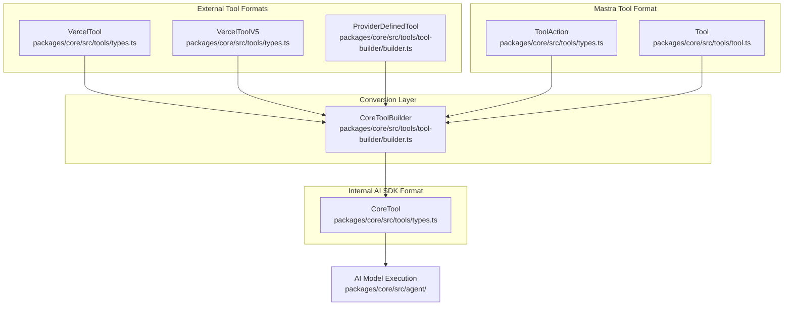
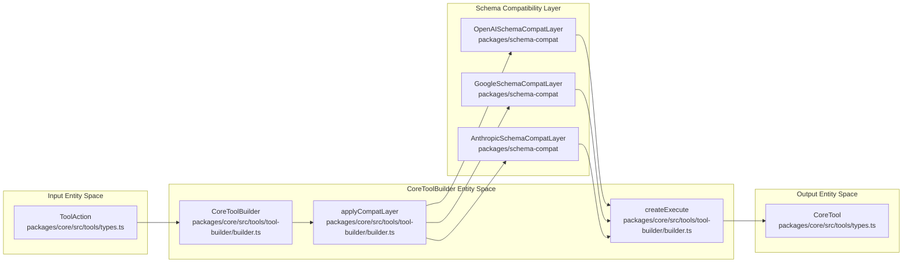
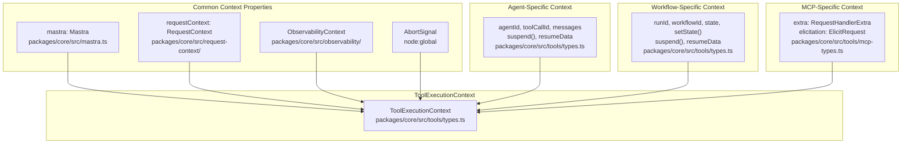
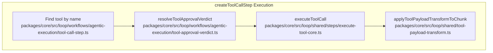
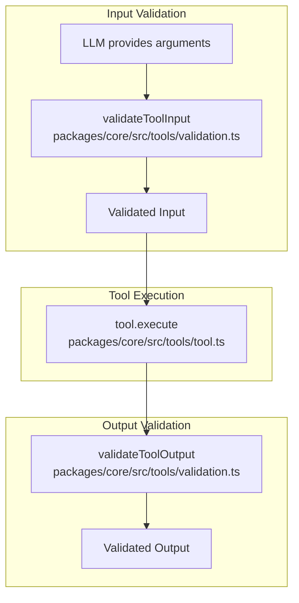

<!-- source: DeepWiki mcp.deepwiki.com · repo mastra-ai/mastra · page 3.3 Tool Integration and Execution · fetched 2026-10-26 -->

# Tool Integration and Execution

Relevant source files

The following files were used as context for generating this wiki page:

- [.changeset/fluffy-oranges-end.md](.changeset/fluffy-oranges-end.md)
- [client-sdks/ai-sdk/src/__tests__/background-task-stream.test.ts](client-sdks/ai-sdk/src/__tests__/background-task-stream.test.ts)
- [docs/src/content/en/reference/agents/agent.mdx](docs/src/content/en/reference/agents/agent.mdx)
- [docs/src/content/en/reference/tools/create-tool.mdx](docs/src/content/en/reference/tools/create-tool.mdx)
- [packages/core/src/agent/__tests__/tools.test.ts](packages/core/src/agent/__tests__/tools.test.ts)
- [packages/core/src/agent/__tests__/working-memory-context.test.ts](packages/core/src/agent/__tests__/working-memory-context.test.ts)
- [packages/core/src/agent/durable/__tests__/durable-agent-client-tool-pending.test.ts](packages/core/src/agent/durable/__tests__/durable-agent-client-tool-pending.test.ts)
- [packages/core/src/agent/durable/__tests__/durable-agent-tools.test.ts](packages/core/src/agent/durable/__tests__/durable-agent-tools.test.ts)
- [packages/core/src/agent/durable/workflows/steps/llm-mapping-pending-client-tool.test.ts](packages/core/src/agent/durable/workflows/steps/llm-mapping-pending-client-tool.test.ts)
- [packages/core/src/loop/shared/auto-resume-system-message.test.ts](packages/core/src/loop/shared/auto-resume-system-message.test.ts)
- [packages/core/src/loop/shared/auto-resume-system-message.ts](packages/core/src/loop/shared/auto-resume-system-message.ts)
- [packages/core/src/loop/test-utils/aimock/scenarios/approval-conditional.scenario.test.ts](packages/core/src/loop/test-utils/aimock/scenarios/approval-conditional.scenario.test.ts)
- [packages/core/src/loop/test-utils/aimock/scenarios/approval-input-validation.scenario.test.ts](packages/core/src/loop/test-utils/aimock/scenarios/approval-input-validation.scenario.test.ts)
- [packages/core/src/loop/test-utils/aimock/scenarios/auto-resume-suspended-tools.scenario.test.ts](packages/core/src/loop/test-utils/aimock/scenarios/auto-resume-suspended-tools.scenario.test.ts)
- [packages/core/src/loop/test-utils/aimock/scenarios/background-task-agent-level.scenario.test.ts](packages/core/src/loop/test-utils/aimock/scenarios/background-task-agent-level.scenario.test.ts)
- [packages/core/src/loop/test-utils/aimock/scenarios/background-task-tool-level.scenario.test.ts](packages/core/src/loop/test-utils/aimock/scenarios/background-task-tool-level.scenario.test.ts)
- [packages/core/src/loop/test-utils/aimock/scenarios/client-tools.scenario.test.ts](packages/core/src/loop/test-utils/aimock/scenarios/client-tools.scenario.test.ts)
- [packages/core/src/loop/test-utils/aimock/scenarios/prepare-step.scenario.test.ts](packages/core/src/loop/test-utils/aimock/scenarios/prepare-step.scenario.test.ts)
- [packages/core/src/loop/test-utils/aimock/scenarios/supervisor-delegation-hooks.scenario.test.ts](packages/core/src/loop/test-utils/aimock/scenarios/supervisor-delegation-hooks.scenario.test.ts)
- [packages/core/src/loop/test-utils/aimock/scenarios/tool-lifecycle-hooks.scenario.test.ts](packages/core/src/loop/test-utils/aimock/scenarios/tool-lifecycle-hooks.scenario.test.ts)
- [packages/core/src/loop/workflows/agentic-execution/tool-approval-verdict.ts](packages/core/src/loop/workflows/agentic-execution/tool-approval-verdict.ts)
- [packages/core/src/loop/workflows/agentic-execution/tool-call-step-before-approval.test.ts](packages/core/src/loop/workflows/agentic-execution/tool-call-step-before-approval.test.ts)
- [packages/core/src/loop/workflows/agentic-execution/tool-call-step.test.ts](packages/core/src/loop/workflows/agentic-execution/tool-call-step.test.ts)
- [packages/core/src/loop/workflows/agentic-execution/tool-call-step.ts](packages/core/src/loop/workflows/agentic-execution/tool-call-step.ts)
- [packages/core/src/processors/processor-tool-request-context.test.ts](packages/core/src/processors/processor-tool-request-context.test.ts)
- [packages/core/src/tools/builtin/web-fetch.test.ts](packages/core/src/tools/builtin/web-fetch.test.ts)
- [packages/core/src/tools/builtin/web-fetch.ts](packages/core/src/tools/builtin/web-fetch.ts)
- [packages/core/src/tools/index.ts](packages/core/src/tools/index.ts)
- [packages/core/src/tools/tool-builder/background-override-injection.test.ts](packages/core/src/tools/tool-builder/background-override-injection.test.ts)
- [packages/core/src/tools/tool-builder/builder.e2e.test.ts](packages/core/src/tools/tool-builder/builder.e2e.test.ts)
- [packages/core/src/tools/tool-builder/builder.test.ts](packages/core/src/tools/tool-builder/builder.test.ts)
- [packages/core/src/tools/tool-builder/builder.ts](packages/core/src/tools/tool-builder/builder.ts)
- [packages/core/src/tools/tool-builder/schema-compat-validation.test.ts](packages/core/src/tools/tool-builder/schema-compat-validation.test.ts)
- [packages/core/src/tools/tool-builder/validation-error-paths.test.ts](packages/core/src/tools/tool-builder/validation-error-paths.test.ts)
- [packages/core/src/tools/tool.test.ts](packages/core/src/tools/tool.test.ts)
- [packages/core/src/tools/tool.ts](packages/core/src/tools/tool.ts)
- [packages/core/src/tools/toolchecks.ts](packages/core/src/tools/toolchecks.ts)
- [packages/core/src/tools/types.ts](packages/core/src/tools/types.ts)
- [packages/core/src/tools/validation.test.ts](packages/core/src/tools/validation.test.ts)
- [packages/core/src/tools/validation.ts](packages/core/src/tools/validation.ts)

This document describes how tools are integrated into agents and executed within the Mastra framework. It covers tool type conversion, schema compatibility, execution contexts, client-side vs server-side execution patterns, approval mechanisms, validation workflows, and the underlying builder and step execution logic.

For information about defining tools using `createTool`, see [6.1. Tool Definition and Execution Context](). For tool builder architecture and schema conversion internals, see [6.2. Tool Builder and Schema Conversion](). For agent configuration and general execution, see [3.1. Agent Configuration and Execution]().

## Tool Types and Formats

The Mastra framework supports multiple tool formats to ensure compatibility across different AI SDK versions and external tool providers.

### Supported Tool Types

Sources: [packages/core/src/tools/types.ts:25-27](), [packages/core/src/tools/tool-builder/builder.ts:104-112](), [packages/core/src/tools/tool.ts:193-204]()

The framework distinguishes between several tool interfaces:

| Tool Type | Source | Execute Signature | Schema Property |
|-----------|--------|-------------------|-----------------|
| `ToolAction` | Mastra Core | `(inputData, context)` | `inputSchema` |
| `VercelTool` | AI SDK v4 | `(params, options)` | `parameters` |
| `VercelToolV5` | AI SDK v5 | `(params, options)` | `inputSchema` |
| `ProviderDefinedTool` | External providers | `(params, options)` | `parameters` or `inputSchema` |

All formats are converted to `CoreTool` format for execution via the `CoreToolBuilder` class [packages/core/src/tools/tool-builder/builder.ts:104-112]().

Sources: [packages/core/src/tools/types.ts:25-30](), [packages/core/src/tools/tool-builder/builder.ts:104-112]()

---

## CoreToolBuilder: Schema Conversion and Compatibility

The `CoreToolBuilder` class is responsible for converting tools from various formats into the AI SDK-compatible `CoreTool` format, applying schema compatibility transformations, and wrapping execute functions with validation and observability logic [packages/core/src/tools/tool-builder/builder.ts:18-28]().

### Tool Conversion Architecture

Sources: [packages/core/src/tools/tool-builder/builder.ts:4-14](), [packages/core/src/tools/tool-builder/builder.ts:104-112]()

### Schema Extraction and Compatibility

The `CoreToolBuilder` handles schema extraction for different tool formats. Provider-specific schema compatibility is applied using layers defined in `@mastra/schema-compat`. For example, `OpenAISchemaCompatLayer` and `AnthropicSchemaCompatLayer` ensure the Zod or JSON schemas match the target model's specific capabilities [packages/core/src/tools/tool-builder/builder.ts:4-14]().

### Standard Schema Support

Mastra uses the Standard Schema specification to bridge different validation libraries. The `buildJsonOverrideSchema` function creates a Standard Schema that injects override fields like `_background` or `resumeData` while delegating runtime validation to the original schema [packages/core/src/tools/tool-builder/builder.ts:156-165]().

Sources: [packages/core/src/tools/tool-builder/builder.ts:156-171](), [packages/core/src/tools/tool-builder/builder.ts:26-31]()

---

## Tool Execution Context

Tools execute with different context properties depending on whether they're called from an agent, workflow, or MCP server.

### Unified Execution Context Structure

Sources: [packages/core/src/tools/types.ts:243-288]()

### Context Population Based on Execution Source

The context is populated differently based on where the tool is executed:

| Property | Agent Execution | Workflow Execution | MCP Execution |
|----------|----------------|-------------------|---------------|
| `agentId` | ✓ Always present [packages/core/src/tools/types.ts:246-246]() | ✗ | ✗ |
| `toolCallId` | ✓ Always present [packages/core/src/tools/types.ts:247-247]() | ✗ | ✗ |
| `runId` | ✗ | ✓ Always present [packages/core/src/tools/types.ts:270-270]() | ✗ |
| `workflowId` | ✗ | ✓ Always present [packages/core/src/tools/types.ts:271-271]() | ✗ |
| `mcp.extra` | ✗ | ✗ | ✓ MCP protocol context [packages/core/src/tools/types.ts:282-282]() |

Sources: [packages/core/src/tools/types.ts:243-288]()

---

## Client-Side Tools

Mastra supports executing tools on the client side, allowing agents to interact with browser-native APIs or UI state.

### Client-Side Execution Flow

When a tool is executed on the client, the server emits a tool call chunk with `providerExecuted: false`. The JS Client SDK intercepts this, executes the tool locally, and returns the result to the server [packages/core/src/loop/workflows/agentic-execution/tool-call-step.ts:251-270]().

Sources: [packages/core/src/loop/workflows/agentic-execution/tool-call-step.ts:251-270](), [packages/core/src/stream/types.ts:194-195]()

---

## Tool Approval and Suspension

Mastra supports sophisticated execution control including manual approval and long-running task suspension.

### Approval and Suspension Logic in CoreToolBuilder

When a tool is marked for approval or supports suspension, `CoreToolBuilder` injects specialized fields into the input schema via `buildJsonOverrideSchema` [packages/core/src/tools/tool-builder/builder.ts:156-171]():
* `_background`: For background task configuration [packages/core/src/tools/tool-builder/builder.ts:18-22]().
* `suspendedToolRunId`: To track the run being resumed [packages/core/src/tools/tool-builder/builder.ts:134-136]().
* `resumeData`: To pass data from the suspension point back to the tool [packages/core/src/tools/tool-builder/builder.ts:134-136]().

Sources: [packages/core/src/tools/tool-builder/builder.ts:18-22](), [packages/core/src/tools/tool-builder/builder.ts:134-171]()

### Suspension Context

The `ToolExecutionContext` provides a `suspend` function that tools can call to halt execution and wait for external input or approval [packages/core/src/tools/types.ts:249-249](), [packages/core/src/tools/types.ts:274-274]().

Sources: [packages/core/src/tools/types.ts:249-249](), [packages/core/src/tools/types.ts:274-274]()

---

## Tool Execution Flow in Agent Loop

The `createToolCallStep` manages the lifecycle of a tool call within the agent's execution loop, including handling background tasks and replayed tool calls [packages/core/src/loop/workflows/agentic-execution/tool-call-step.ts:106-112]().

### Tool Call Lifecycle

Sources: [packages/core/src/loop/workflows/agentic-execution/tool-call-step.ts:106-112](), [packages/core/src/loop/workflows/agentic-execution/tool-call-step.ts:49-66]()

---

## Model Context Protocol (MCP) Integration

Mastra allows exposing tools, agents, and workflows via MCP servers, and conversely, consuming tools from external MCP servers.

### MCP Server Integration
The `MCPServer` class exposes Mastra entities as MCP tools. Agents are converted to `ask_<agentId>` tools, and workflows to `run_<workflowId>` tools. It supports both `StdioServerTransport` and `SSEServerTransport`.

### MCP Client Integration
The `InternalMastraMCPClient` connects to external MCP servers and converts their tool definitions into Mastra `Tool` instances.

Sources: [packages/core/src/tools/types.ts:21-23]()

---

## Schema Validation and Compatibility

Tool input and output validation uses Standard Schema compliant objects with provider-specific compatibility transformations.

### Validation Pipeline

Sources: [packages/core/src/tools/tool.ts:17-19](), [packages/core/src/tools/validation.ts:50-55]()

### Advanced Schema Features
*   **Strict Mode**: Enables strict tool input generation for supported model providers [docs/src/content/en/reference/tools/create-tool.mdx:102-107]().
*   **ToModelOutput**: Allows transforming raw tool output before it is returned to the LLM [docs/src/content/en/reference/tools/create-tool.mdx:117-122]().
*   **Transform**: Provides target-aware (display/transcript) payload transformations [docs/src/content/en/reference/tools/create-tool.mdx:124-129]().

Sources: [docs/src/content/en/reference/tools/create-tool.mdx:102-130]()

---

