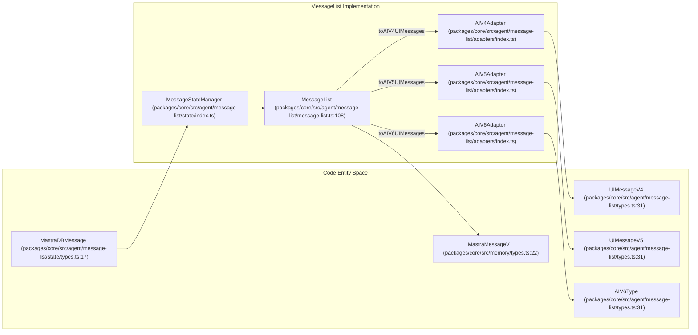
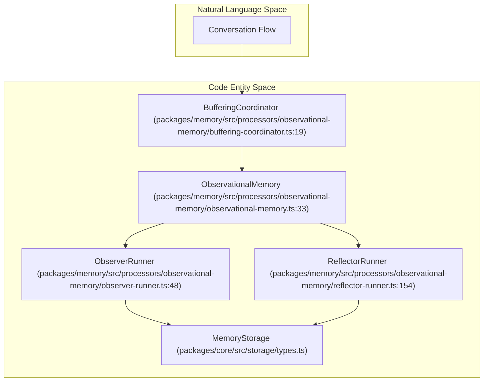

<!-- source: DeepWiki mcp.deepwiki.com · repo mastra-ai/mastra · page 3.4 Agent Memory System · fetched 2026-10-26 -->

# Agent Memory System

Relevant source files

The following files were used as context for generating this wiki page:

- [.changeset/replay-tool-call-without-args.md](.changeset/replay-tool-call-without-args.md)
- [.changeset/silent-steaks-yell.md](.changeset/silent-steaks-yell.md)
- [client-sdks/ai-sdk/src/__tests__/chat-route-v7.test.ts](client-sdks/ai-sdk/src/__tests__/chat-route-v7.test.ts)
- [client-sdks/ai-sdk/src/__tests__/convert-messages.test.ts](client-sdks/ai-sdk/src/__tests__/convert-messages.test.ts)
- [client-sdks/ai-sdk/src/__tests__/workflow-route.test.ts](client-sdks/ai-sdk/src/__tests__/workflow-route.test.ts)
- [client-sdks/ai-sdk/src/convert-messages.ts](client-sdks/ai-sdk/src/convert-messages.ts)
- [client-sdks/ai-sdk/src/workflow-route.ts](client-sdks/ai-sdk/src/workflow-route.ts)
- [docs/src/content/en/docs/memory/message-history.mdx](docs/src/content/en/docs/memory/message-history.mdx)
- [docs/src/content/en/docs/memory/observational-memory.mdx](docs/src/content/en/docs/memory/observational-memory.mdx)
- [docs/src/content/en/docs/memory/overview.mdx](docs/src/content/en/docs/memory/overview.mdx)
- [docs/src/content/en/docs/memory/semantic-recall.mdx](docs/src/content/en/docs/memory/semantic-recall.mdx)
- [docs/src/content/en/reference/ai-sdk/to-ai-sdk-messages.mdx](docs/src/content/en/reference/ai-sdk/to-ai-sdk-messages.mdx)
- [docs/src/content/en/reference/memory/memory-class.mdx](docs/src/content/en/reference/memory/memory-class.mdx)
- [docs/src/content/en/reference/memory/observational-memory.mdx](docs/src/content/en/reference/memory/observational-memory.mdx)
- [packages/core/src/agent-builder/ee/normalize-candidate.ts](packages/core/src/agent-builder/ee/normalize-candidate.ts)
- [packages/core/src/agent/durable/__tests__/durable-agent-background-task-prompt.test.ts](packages/core/src/agent/durable/__tests__/durable-agent-background-task-prompt.test.ts)
- [packages/core/src/agent/durable/workflows/steps/scorer-execution.ts](packages/core/src/agent/durable/workflows/steps/scorer-execution.ts)
- [packages/core/src/agent/message-list/adapters/AIV5Adapter-file-ui-part.test.ts](packages/core/src/agent/message-list/adapters/AIV5Adapter-file-ui-part.test.ts)
- [packages/core/src/agent/message-list/adapters/AIV5Adapter.ts](packages/core/src/agent/message-list/adapters/AIV5Adapter.ts)
- [packages/core/src/agent/message-list/adapters/AIV6Adapter-suspended-parts.test.ts](packages/core/src/agent/message-list/adapters/AIV6Adapter-suspended-parts.test.ts)
- [packages/core/src/agent/message-list/adapters/AIV6Adapter.ts](packages/core/src/agent/message-list/adapters/AIV6Adapter.ts)
- [packages/core/src/agent/message-list/adapters/agent-signal-ui-conversion.test.ts](packages/core/src/agent/message-list/adapters/agent-signal-ui-conversion.test.ts)
- [packages/core/src/agent/message-list/conversion/index.ts](packages/core/src/agent/message-list/conversion/index.ts)
- [packages/core/src/agent/message-list/conversion/output-converter-file-metadata.test.ts](packages/core/src/agent/message-list/conversion/output-converter-file-metadata.test.ts)
- [packages/core/src/agent/message-list/conversion/output-converter-mcp-media.test.ts](packages/core/src/agent/message-list/conversion/output-converter-mcp-media.test.ts)
- [packages/core/src/agent/message-list/conversion/output-converter-provider-executed.test.ts](packages/core/src/agent/message-list/conversion/output-converter-provider-executed.test.ts)
- [packages/core/src/agent/message-list/conversion/output-converter-provider-file-id.test.ts](packages/core/src/agent/message-list/conversion/output-converter-provider-file-id.test.ts)
- [packages/core/src/agent/message-list/conversion/output-converter.ts](packages/core/src/agent/message-list/conversion/output-converter.ts)
- [packages/core/src/agent/message-list/conversion/to-prompt-tool-name-sanitization.test.ts](packages/core/src/agent/message-list/conversion/to-prompt-tool-name-sanitization.test.ts)
- [packages/core/src/agent/message-list/conversion/to-prompt.ts](packages/core/src/agent/message-list/conversion/to-prompt.ts)
- [packages/core/src/agent/message-list/detection/TypeDetector.ts](packages/core/src/agent/message-list/detection/TypeDetector.ts)
- [packages/core/src/agent/message-list/index.ts](packages/core/src/agent/message-list/index.ts)
- [packages/core/src/agent/message-list/message-list-suspended-tool-calls.test.ts](packages/core/src/agent/message-list/message-list-suspended-tool-calls.test.ts)
- [packages/core/src/agent/message-list/message-list.ts](packages/core/src/agent/message-list/message-list.ts)
- [packages/core/src/agent/message-list/prompt/attachments-to-parts.test.ts](packages/core/src/agent/message-list/prompt/attachments-to-parts.test.ts)
- [packages/core/src/agent/message-list/prompt/attachments-to-parts.ts](packages/core/src/agent/message-list/prompt/attachments-to-parts.ts)
- [packages/core/src/agent/message-list/prompt/image-utils.test.ts](packages/core/src/agent/message-list/prompt/image-utils.test.ts)
- [packages/core/src/agent/message-list/prompt/image-utils.ts](packages/core/src/agent/message-list/prompt/image-utils.ts)
- [packages/core/src/agent/message-list/tests/message-list-v5.test.ts](packages/core/src/agent/message-list/tests/message-list-v5.test.ts)
- [packages/core/src/agent/message-list/tests/message-list-v6.test.ts](packages/core/src/agent/message-list/tests/message-list-v6.test.ts)
- [packages/core/src/agent/message-list/tests/split-tool-call-args.test.ts](packages/core/src/agent/message-list/tests/split-tool-call-args.test.ts)
- [packages/core/src/agent/message-list/tests/update-tool-invocation.test.ts](packages/core/src/agent/message-list/tests/update-tool-invocation.test.ts)
- [packages/core/src/agent/message-list/utils/provider-compat.test.ts](packages/core/src/agent/message-list/utils/provider-compat.test.ts)
- [packages/core/src/agent/message-list/utils/provider-compat.ts](packages/core/src/agent/message-list/utils/provider-compat.ts)
- [packages/core/src/loop/shared/build-llm-prompt-args.test.ts](packages/core/src/loop/shared/build-llm-prompt-args.test.ts)
- [packages/core/src/loop/shared/build-llm-prompt-args.ts](packages/core/src/loop/shared/build-llm-prompt-args.ts)
- [packages/core/src/loop/shared/compose-step-input.test.ts](packages/core/src/loop/shared/compose-step-input.test.ts)
- [packages/core/src/loop/shared/inject-background-task-prompt.test.ts](packages/core/src/loop/shared/inject-background-task-prompt.test.ts)
- [packages/core/src/loop/shared/inject-background-task-prompt.ts](packages/core/src/loop/shared/inject-background-task-prompt.ts)
- [packages/core/src/loop/test-utils/aimock/scenarios/invalid-tool-args-replay.scenario.test.ts](packages/core/src/loop/test-utils/aimock/scenarios/invalid-tool-args-replay.scenario.test.ts)
- [packages/core/src/loop/test-utils/aimock/scenarios/working-memory-gemini-thought-signature.scenario.test.ts](packages/core/src/loop/test-utils/aimock/scenarios/working-memory-gemini-thought-signature.scenario.test.ts)
- [packages/core/src/memory/memory.ts](packages/core/src/memory/memory.ts)
- [packages/core/src/memory/mock-working-memory-merge.test.ts](packages/core/src/memory/mock-working-memory-merge.test.ts)
- [packages/core/src/memory/mock.ts](packages/core/src/memory/mock.ts)
- [packages/core/src/memory/types.ts](packages/core/src/memory/types.ts)
- [packages/core/src/memory/working-memory-utils.test.ts](packages/core/src/memory/working-memory-utils.test.ts)
- [packages/core/src/memory/working-memory-utils.ts](packages/core/src/memory/working-memory-utils.ts)
- [packages/core/src/processors/memory/message-history.test.ts](packages/core/src/processors/memory/message-history.test.ts)
- [packages/core/src/processors/memory/message-history.ts](packages/core/src/processors/memory/message-history.ts)
- [packages/core/src/utils/deep-equal.test.ts](packages/core/src/utils/deep-equal.test.ts)
- [packages/core/src/utils/deep-equal.ts](packages/core/src/utils/deep-equal.ts)
- [packages/memory/src/index.test.ts](packages/memory/src/index.test.ts)
- [packages/memory/src/index.ts](packages/memory/src/index.ts)
- [packages/memory/src/processors/observational-memory/__tests__/idle-buffering.test.ts](packages/memory/src/processors/observational-memory/__tests__/idle-buffering.test.ts)
- [packages/memory/src/processors/observational-memory/__tests__/message-utils.test.ts](packages/memory/src/processors/observational-memory/__tests__/message-utils.test.ts)
- [packages/memory/src/processors/observational-memory/__tests__/mid-loop-observation.test.ts](packages/memory/src/processors/observational-memory/__tests__/mid-loop-observation.test.ts)
- [packages/memory/src/processors/observational-memory/__tests__/mock-om-agent.test.ts](packages/memory/src/processors/observational-memory/__tests__/mock-om-agent.test.ts)
- [packages/memory/src/processors/observational-memory/__tests__/observation-groups.test.ts](packages/memory/src/processors/observational-memory/__tests__/observation-groups.test.ts)
- [packages/memory/src/processors/observational-memory/__tests__/observational-memory-api.test.ts](packages/memory/src/processors/observational-memory/__tests__/observational-memory-api.test.ts)
- [packages/memory/src/processors/observational-memory/__tests__/observational-memory.test.ts](packages/memory/src/processors/observational-memory/__tests__/observational-memory.test.ts)
- [packages/memory/src/processors/observational-memory/index.ts](packages/memory/src/processors/observational-memory/index.ts)
- [packages/memory/src/processors/observational-memory/message-utils.ts](packages/memory/src/processors/observational-memory/message-utils.ts)
- [packages/memory/src/processors/observational-memory/observation-groups.ts](packages/memory/src/processors/observational-memory/observation-groups.ts)
- [packages/memory/src/processors/observational-memory/observation-strategies/async-buffer.ts](packages/memory/src/processors/observational-memory/observation-strategies/async-buffer.ts)
- [packages/memory/src/processors/observational-memory/observation-strategies/base.ts](packages/memory/src/processors/observational-memory/observation-strategies/base.ts)
- [packages/memory/src/processors/observational-memory/observation-strategies/resource-scoped.ts](packages/memory/src/processors/observational-memory/observation-strategies/resource-scoped.ts)
- [packages/memory/src/processors/observational-memory/observation-strategies/sync.ts](packages/memory/src/processors/observational-memory/observation-strategies/sync.ts)
- [packages/memory/src/processors/observational-memory/observation-strategies/types.ts](packages/memory/src/processors/observational-memory/observation-strategies/types.ts)
- [packages/memory/src/processors/observational-memory/observation-turn/step.ts](packages/memory/src/processors/observational-memory/observation-turn/step.ts)
- [packages/memory/src/processors/observational-memory/observation-turn/turn.ts](packages/memory/src/processors/observational-memory/observation-turn/turn.ts)
- [packages/memory/src/processors/observational-memory/observational-memory.ts](packages/memory/src/processors/observational-memory/observational-memory.ts)
- [packages/memory/src/processors/observational-memory/observer-agent.ts](packages/memory/src/processors/observational-memory/observer-agent.ts)
- [packages/memory/src/processors/observational-memory/observer-runner.ts](packages/memory/src/processors/observational-memory/observer-runner.ts)
- [packages/memory/src/processors/observational-memory/processor.ts](packages/memory/src/processors/observational-memory/processor.ts)
- [packages/memory/src/processors/observational-memory/reflector-agent.ts](packages/memory/src/processors/observational-memory/reflector-agent.ts)
- [packages/memory/src/processors/observational-memory/reflector-runner.ts](packages/memory/src/processors/observational-memory/reflector-runner.ts)
- [packages/memory/src/processors/observational-memory/types.ts](packages/memory/src/processors/observational-memory/types.ts)
- [packages/memory/src/tools/working-memory.test.ts](packages/memory/src/tools/working-memory.test.ts)
- [packages/memory/src/tools/working-memory.ts](packages/memory/src/tools/working-memory.ts)

## Purpose and Scope

This document covers how memory integrates with agents in Mastra, including memory configuration, message management via `MessageList`, thread/resource scoping, and the automatic injection of memory processors into the agent execution pipeline.

For information about:
- Memory storage backends and adapters, see [Memory System Architecture](7.1)()
- Storage interfaces and message persistence, see [Thread Management and Message Storage](7.2)()
- Three-tier observational memory implementation, see [Observational Memory System](7.9)()
- Working memory tool and schema modes, see [Working Memory and Tool Integration](7.10)()

---

## Memory Configuration in Agents

### Basic Setup

Agents accept a `memory` parameter that can be provided statically or resolved dynamically via a function. The `MastraMemory` abstract class is the foundation for concrete implementations like `Memory` (from `@mastra/memory`) which handle conversation history, working memory, and observational memory.

[packages/core/src/memory/memory.ts:114-216]()
[packages/memory/src/index.ts:128-138]()

The memory configuration includes:
- **lastMessages**: Number of historical messages to recall (default 10). [packages/core/src/memory/memory.ts:83]()
- **semanticRecall**: Enables vector-based similarity search for context retrieval. [packages/core/src/memory/memory.ts:170-216]()
- **workingMemory**: Configuration for structured conversation state. [packages/core/src/memory/memory.ts:86-101]()
- **observationalMemory**: Configuration for the three-tier background observation system. [packages/memory/src/index.ts:116-126]()

### Storage Injection

When an agent's memory doesn't have its own storage configured, the agent automatically injects storage from its parent `Mastra` instance. This happens during agent initialization.

[packages/core/src/memory/memory.ts:165-169]()
[packages/core/src/memory/memory.ts:223-228]()

The injection logic:
1. Resolves the memory (if it's a function).
2. Checks if memory has `_hasOwnStorage === false` via the internal flag in `MastraMemory`. [packages/core/src/memory/memory.ts:167]()
3. Injects `mastra.getStorage()` into the memory instance via `__registerMastra`. [packages/core/src/memory/memory.ts:223-228]()

Sources: [packages/core/src/memory/memory.ts:83-101](), [packages/core/src/memory/memory.ts:114-216](), [packages/core/src/memory/memory.ts:223-228](), [packages/memory/src/index.ts:128-138]()

---

## MessageList: Central Message Management

### MessageList Class

`MessageList` is the central data structure for managing agent messages. It provides a unified interface for converting between different message formats, including database records, AI SDK V4/V5/V6 types, and UI-compatible messages. It uses a `MessageStateManager` to track internal message categories (memory, user, response, context).

Title: "MessageList Format Mapping"

[packages/core/src/agent/message-list/message-list.ts:108-163]()

### Format and Sanitization

**MastraDBMessage:**
- The canonical format for database storage.
- Contains `role`, `content` (with `parts`), `threadId`, and `resourceId`.
- [packages/core/src/agent/message-list/state/types.ts:17-28]()

**Message Sanitization:**
`MessageList` utilizes utility functions to ensure compatibility across providers.
- **Provider Compatibility**: Handles specific logic for Gemini and Anthropic, such as pairing orphaned tool calls via `pairOrphanedToolCalls`. [packages/core/src/agent/message-list/utils/provider-compat.ts:16-20]()
- **Text Merging**: `MessageMerger` handles the consolidation of message parts to maintain valid context windows for LLMs. [packages/core/src/agent/message-list/message-list.ts:30]()
- **Signal Merging**: Merges non-user signal data parts into adjacent assistant messages to match active-streaming behavior. [packages/core/src/agent/message-list/message-list.ts:60-81]()
- **Stale Tool States**: `withoutStaleToolStates` ensures that live tool invocation updates do not overwrite canonical stored outcomes, only advancing the state of pending calls or background results. [packages/core/src/agent/message-list/message-list.ts:127-150]()
- **Duplicate Item IDs**: `mergeTextPartsWithDuplicateItemIds` prevents issues with OpenAI's `item_reference` by merging consecutive text parts that share the same `itemId`. [packages/core/src/agent/message-list/conversion/output-converter.ts:47-95]()
- **Unreplayable Hosted Tool Search**: `isUnreplayableHostedToolSearchPart` detects and drops hosted `tool_search` parts that cannot be replayed due to missing item IDs, preventing API errors. [packages/core/src/agent/message-list/conversion/output-converter.ts:98-145]()

Sources: [packages/core/src/agent/message-list/message-list.ts:60-163](), [packages/core/src/agent/message-list/state/types.ts:17-28](), [packages/core/src/agent/message-list/utils/provider-compat.ts:16-20](), [packages/core/src/agent/message-list/conversion/output-converter.ts:47-145]()

---

## Memory Scoping and Retrieval

### Scoping Model

Memory in Mastra uses a two-level scoping model defined in the request context and storage layers:
- **Resource ID**: Represents the owner of the data (e.g., a User ID). [packages/core/src/memory/types.ts:127]()
- **Thread ID**: Represents a specific conversation instance. [packages/core/src/memory/types.ts:126]()

The `recall` process fetches messages based on the `MemoryConfigInternal` (e.g., `lastMessages` count). If `semanticRecall` is enabled, it uses the vector store and embedder to find relevant context via semantic search. [packages/core/src/memory/memory.ts:170-216]()

### Observational Memory Integration

Observational Memory (OM) introduces background agents that process message history.
- **Observer**: Watches conversations and creates observations. [packages/memory/src/processors/observational-memory/observational-memory.ts:33-161]()
- **Reflector**: Restructures and condenses observations. [packages/memory/src/processors/observational-memory/reflector-agent.ts:13-14]()

Title: "Observational Memory Component Interaction"

**Temporal Markers**: OM can insert temporal gap markers when the gap between messages is at least 10 minutes, helping agents anchor memories to time. [packages/memory/src/processors/observational-memory/types.ts:109-112]()

Sources: [packages/core/src/memory/memory.ts:170-216](), [packages/core/src/memory/types.ts:124-127](), [packages/memory/src/processors/observational-memory/observational-memory.ts:33-161](), [packages/memory/src/processors/observational-memory/reflector-agent.ts:13-14](), [packages/memory/src/processors/observational-memory/types.ts:109-112]()

---

## Memory Processors and Working Memory

### Working Memory Integration

The memory system includes tools for updating working memory:
- `createWorkingMemoryTool`: Factory for creating the tool with custom schemas and templates. [packages/memory/src/tools/working-memory.ts:145-170]()
- `deepMergeWorkingMemory`: Logic for merging state updates into the existing memory store. [packages/memory/src/tools/working-memory.ts:57-89]()

**Deep Merge Semantics:**
For schema-based working memory, Mastra uses `deepMergeWorkingMemory` which recursively merges objects, replaces arrays, and deletes properties when a `null` value is provided. [packages/memory/src/tools/working-memory.ts:57-89]()

**Visibility and Tag Extraction:**
Mastra uses specific tags (`<working_memory>`) to identify working memory content in text.
- `extractWorkingMemoryTags`: Extracts all working memory blocks from text. [packages/memory/src/tools/working-memory.ts:165-181]()
- `removeWorkingMemoryTags`: Strips tags from text for clean output. [packages/memory/src/tools/working-memory.ts:183-206]()
- `extractWorkingMemoryContent`: Gets the raw content inside the tags. [packages/memory/src/tools/working-memory.ts:208-217]()

### Memory Retrieval in Streams

During agent execution (`generate`/`stream`), the memory system is integrated via the agentic execution loop:
1. `llmExecutionStep`: Composes step input by building LLM prompt arguments, which include historical messages from the `MessageList`. [packages/core/src/loop/workflows/agentic-execution/llm-execution-step.ts:80-81]()
2. `llmMappingStep`: Handles tool-result chunks, ensuring that results from tools like `updateWorkingMemory` are synced back into the `MessageList`. [packages/core/src/loop/workflows/agentic-execution/llm-mapping-step.ts:31-47]()

Sources: [packages/memory/src/tools/working-memory.ts:57-217](), [packages/core/src/loop/workflows/agentic-execution/llm-execution-step.ts:80-81](), [packages/core/src/loop/workflows/agentic-execution/llm-mapping-step.ts:31-47]()

---

