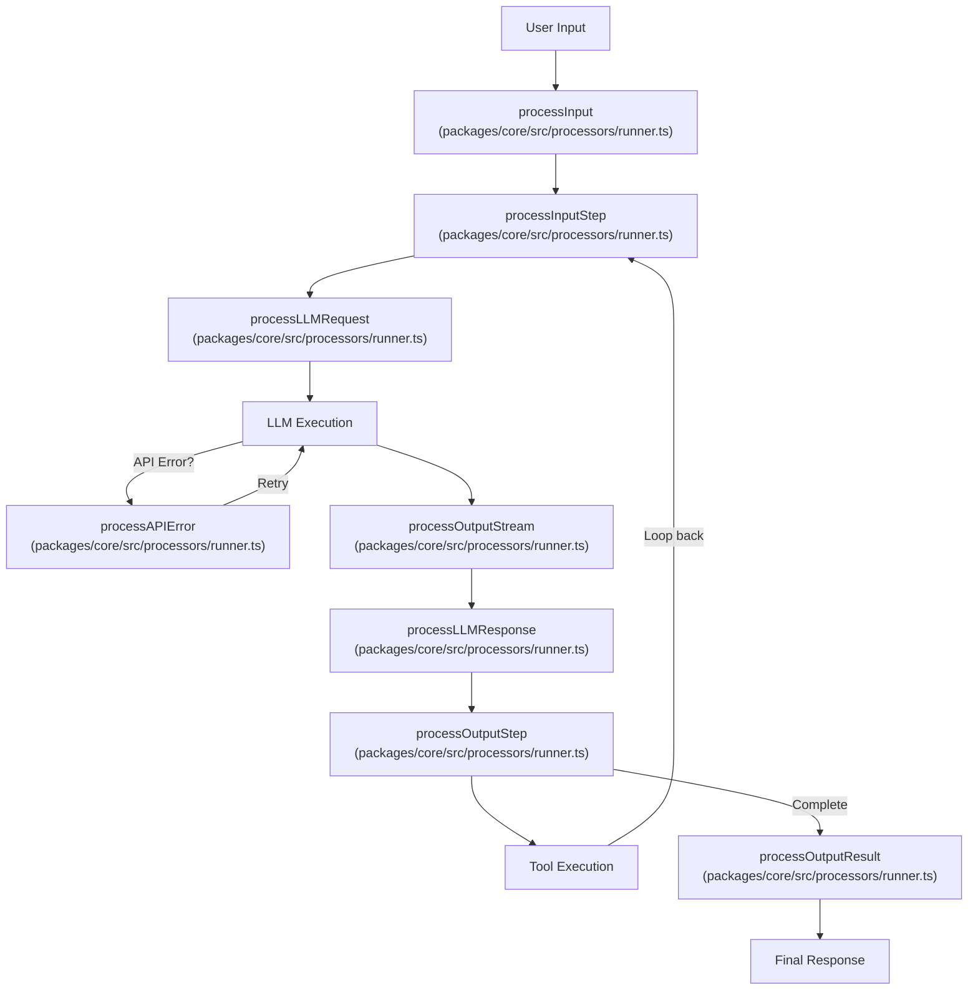

<!-- source: DeepWiki mcp.deepwiki.com · repo mastra-ai/mastra · page 3.5 Input and Output Processors · fetched 2026-10-26 -->

# Input and Output Processors

Relevant source files

The following files were used as context for generating this wiki page:

- [docs/src/content/en/docs/agents/processors.mdx](docs/src/content/en/docs/agents/processors.mdx)
- [docs/src/content/en/docs/signals/notifications.mdx](docs/src/content/en/docs/signals/notifications.mdx)
- [docs/src/content/en/docs/signals/overview.mdx](docs/src/content/en/docs/signals/overview.mdx)
- [docs/src/content/en/docs/signals/running-across-processes.mdx](docs/src/content/en/docs/signals/running-across-processes.mdx)
- [docs/src/content/en/docs/signals/sending-signals.mdx](docs/src/content/en/docs/signals/sending-signals.mdx)
- [docs/src/content/en/docs/signals/signal-providers.mdx](docs/src/content/en/docs/signals/signal-providers.mdx)
- [docs/src/content/en/reference/processors/processor-interface.mdx](docs/src/content/en/reference/processors/processor-interface.mdx)
- [docs/src/content/en/reference/processors/provider-history-compat.mdx](docs/src/content/en/reference/processors/provider-history-compat.mdx)
- [docs/src/content/en/reference/processors/stream-error-retry-processor.mdx](docs/src/content/en/reference/processors/stream-error-retry-processor.mdx)
- [docs/src/content/en/reference/signals/thread-events.mdx](docs/src/content/en/reference/signals/thread-events.mdx)
- [packages/core/src/agent/__tests__/memory-error-processors.test.ts](packages/core/src/agent/__tests__/memory-error-processors.test.ts)
- [packages/core/src/agent/__tests__/model-retry-after.test.ts](packages/core/src/agent/__tests__/model-retry-after.test.ts)
- [packages/core/src/agent/__tests__/user-first-turn.test.ts](packages/core/src/agent/__tests__/user-first-turn.test.ts)
- [packages/core/src/agent/durable/__tests__/durable-agent-error-processor-rotation.test.ts](packages/core/src/agent/durable/__tests__/durable-agent-error-processor-rotation.test.ts)
- [packages/core/src/agent/message-list/tests/anthropic-thinking-roundtrip.test.ts](packages/core/src/agent/message-list/tests/anthropic-thinking-roundtrip.test.ts)
- [packages/core/src/agent/message-list/tests/message-list-gemini.test.ts](packages/core/src/agent/message-list/tests/message-list-gemini.test.ts)
- [packages/core/src/processors/provider-history-compat.test.ts](packages/core/src/processors/provider-history-compat.test.ts)
- [packages/core/src/processors/provider-history-compat.ts](packages/core/src/processors/provider-history-compat.ts)
- [packages/core/src/processors/stream-error-retry-processor.test.ts](packages/core/src/processors/stream-error-retry-processor.test.ts)
- [packages/core/src/processors/stream-error-retry-processor.ts](packages/core/src/processors/stream-error-retry-processor.ts)
- [packages/core/src/utils/retry-after.test.ts](packages/core/src/utils/retry-after.test.ts)
- [packages/core/src/utils/retry-after.ts](packages/core/src/utils/retry-after.ts)
- [packages/memory/__recordings__/memory-integration-tests-src-working-memory-v4.json](packages/memory/__recordings__/memory-integration-tests-src-working-memory-v4.json)
- [packages/memory/__recordings__/memory-integration-tests-src-working-memory-v5.json](packages/memory/__recordings__/memory-integration-tests-src-working-memory-v5.json)
- [packages/memory/__recordings__/memory-integration-tests-src-working-memory-v6.json](packages/memory/__recordings__/memory-integration-tests-src-working-memory-v6.json)

Input and output processors provide a composable pipeline architecture for applying guardrails, transformations, and validation to agent interactions. Processors intercept and modify data at specific points in the execution flow—input processors transform messages before they reach the language model, while output processors modify responses before returning them to users. This enables security controls (prompt injection detection, PII filtering), content moderation, normalization, and response optimization without coupling these concerns to core agent logic.

## Processor Pipeline Architecture

The processor system integrates with the agent execution pipeline through the `ProcessorRunner`, which manages the execution of both individual `Processor` instances and `ProcessorWorkflow` structures [packages/core/src/processors/runner.ts:42-57](). The pipeline is orchestrated within the agentic loop, where processors are executed sequentially.

### Agentic Execution Loop Integration
In the agentic loop, processors are triggered within the execution flow to handle the transformation of inputs via `runInputProcessors` [packages/core/src/processors/runner.ts:461-464]() and outputs via `runOutputProcessors` [packages/core/src/processors/runner.ts:671-674]().

Title: Agent Execution Lifecycle and Processor Methods

Sources: [packages/core/src/processors/runner.ts:42-57](), [packages/core/src/processors/runner.ts:461-464](), [packages/core/src/processors/runner.ts:671-674]()

Processors can implement one or more methods to handle different stages:
- **Transform**: Modify the input/output data via `processInput` [docs/src/content/en/reference/processors/processor-interface.mdx:60-63]() or `processOutputStream` [docs/src/content/en/reference/processors/processor-interface.mdx:93-95]()
- **Block**: Use the `TripWire` mechanism via the `abort()` function provided in `ProcessorContext` [docs/src/content/en/reference/processors/processor-interface.mdx:60-101]()
- **Validate**: Check data against rules or schemas (e.g., `StructuredOutputProcessor`) [packages/core/src/processors/processors/structured-output.ts:35-39]().
- **Maintain State**: Store data across stream chunks using `ProcessorState` [packages/core/src/processors/runner.ts:99-106]().

Sources: [packages/core/src/processors/runner.ts:42-57](), [packages/core/src/processors/processors/structured-output.ts:35-39](), [packages/core/src/processors/runner.ts:99-106](), [docs/src/content/en/reference/processors/processor-interface.mdx:60-63](), [docs/src/content/en/reference/processors/processor-interface.mdx:93-95](), [docs/src/content/en/reference/processors/processor-interface.mdx:60-101]()

## Configuration and Custom Processors

Processors are attached to an agent via `inputProcessors`, `outputProcessors`, and `errorProcessors`. These can be static arrays or dynamic functions using `RequestContext` [docs/src/content/en/docs/agents/processors.mdx:102-114]().

Title: Processor Subsystems and Code Entity Mapping

```mermaid
graph TD
    SubsystemSecurity["Security & Guardrails Concept"] --> PIIDetectorCode["PIIDetector<br/>(packages/core/src/processors/processors/pii-detector.ts)"]
    SubsystemSecurity --> ModerationCode["ModerationProcessor<br/>(packages/core/src/processors/processors/moderation.ts)"]
    SubsystemSecurity --> PromptInjectionCode["PromptInjectionDetector<br/>(packages/core/src/processors/processors/prompt-injection-detector.ts)"]

    SubsystemOptimization["Token & Performance Concept"] --> TokenLimiterCode["TokenLimiterProcessor<br/>(packages/core/src/processors/processors/token-limiter.ts)"]
    SubsystemOptimization --> BatchPartsCode["BatchPartsProcessor<br/>(packages/core/src/processors/processors/batch-parts.ts)"]

    SubsystemOrchestration["Pipeline Runner Concept"] --> RunnerCode["ProcessorRunner<br/>(packages/core/src/processors/runner.ts)"]
    SubsystemOrchestration --> StateCode["ProcessorState<br/>(packages/core/src/processors/runner.ts)"]
```

Sources: [packages/core/src/processors/processors/pii-detector.ts:200-205](), [packages/core/src/processors/runner.ts:42-57](), [packages/core/src/processors/runner.ts:108-115]()

When creating a custom processor, the `processInput()` method receives `messages`, `systemMessages`, and an `abort()` function [docs/src/content/en/reference/processors/processor-interface.mdx:60-63](). It can return a `MastraDBMessage[]` to replace messages, or a `ProcessInputResultWithSystemMessages` to also modify system messages [docs/src/content/en/reference/processors/processor-interface.mdx:60-63]()

### PrepareStepProcessor Mechanism
While not a single class, the `ProcessorRunner` implements a preparation phase for each step of the agentic loop. This includes:
- **Message Resolution**: Determining which messages from the `MessageList` should be sent to the model [packages/core/src/processors/runner.ts:77-97]().
- **Context Extraction**: Retrieving `threadId` and `resourceId` from `RequestContext` for use in processors like `MessageHistory` [packages/core/src/processors/memory/message-history.ts:41-64]().
- **Signal Handling**: Injecting `sendSignal` and `sendStateSignal` functions into the processor context [docs/src/content/en/reference/processors/processor-interface.mdx:60-101]()

Sources: [docs/src/content/en/docs/agents/processors.mdx:102-114](), [packages/core/src/processors/memory/message-history.ts:41-64](), [packages/core/src/processors/runner.ts:77-97](), [docs/src/content/en/reference/processors/processor-interface.mdx:60-63](), [docs/src/content/en/reference/processors/processor-interface.mdx:60-101]()

## Processor State Management

The `ProcessorState` class tracks data across stream processing iterations. It is used by both legacy processors and workflow processors to maintain context across chunks [packages/core/src/processors/runner.ts:99-106]().

- **Accumulation**: Tracks `inputAccumulatedText` and `outputAccumulatedText` from `text-delta` chunks [packages/core/src/processors/runner.ts:109-112]().
- **Custom State**: Provides a `customState` record for processor-specific persistence across method calls within a single request [packages/core/src/processors/runner.ts:112-112]().
- **Observability**: Automatically creates a child span of type `PROCESSOR_RUN` if `createSpan` is enabled [packages/core/src/processors/runner.ts:148-164]().
- **Stream Tracking**: The `streamParts` array accumulates all `ChunkType` objects processed [packages/core/src/processors/runner.ts:113-113]().

Sources: [packages/core/src/processors/runner.ts:99-106](), [packages/core/src/processors/runner.ts:109-113](), [packages/core/src/processors/runner.ts:112-112](), [packages/core/src/processors/runner.ts:148-164]()

## TripWire and Violation Handling

The `TripWire` mechanism provides early exit capabilities. Processors trigger this by calling the `abort()` function provided in the `ProcessorContext` [docs/src/content/en/reference/processors/processor-interface.mdx:60-101]()

### TripWire Mechanism
- **Reasoning**: `abort()` takes a reason string which is wrapped in a `TripWire` error [packages/core/src/processors/runner.ts:65-77]().
- **Retry Logic**: Tripwires can signal the loop to retry with different parameters if options are passed [docs/src/content/en/reference/processors/processor-interface.mdx:60-101]()
- **Violation Handling**: When a `TripWire` is caught, the `ProcessorRunner` invokes the processor's `onViolation` callback if defined [packages/core/src/processors/runner.ts:65-77]().

Sources: [packages/core/src/processors/runner.ts:65-77](), [docs/src/content/en/reference/processors/processor-interface.mdx:60-101]()

### Violation Strategies
Many built-in processors support multiple strategies:
- **block**: Reject the entire input/output with a `TripWire` error [packages/core/src/processors/processors/pii-detector.ts:117-117]().
- **warn**: Log a warning but allow content through [packages/core/src/processors/processors/pii-detector.ts:117-117]().
- **filter**: Remove flagged messages but continue [packages/core/src/processors/processors/pii-detector.ts:116-116]().
- **redact**: Replace detected sensitive info with redacted versions [packages/core/src/processors/processors/pii-detector.ts:117-117]().

Sources: [packages/core/src/processors/processors/pii-detector.ts:116-117]()

## Core Processor Implementations

Mastra provides several built-in processors for security, formatting, and reliability:

| Processor | Type | Purpose |
| :--- | :--- | :--- |
| `ModerationProcessor` | Hybrid | Detects inappropriate content (hate, harassment, etc.) [packages/core/src/processors/processors/moderation.ts:124-128](). |
| `PIIDetector` | Hybrid | Identifies and redacts sensitive info (emails, SSNs) [packages/core/src/processors/processors/pii-detector.ts:200-205](). |
| `PromptInjectionDetector` | Input | Scans for jailbreaks and system-override attempts [packages/core/src/processors/processors/prompt-injection-detector.ts:127-130](). |
| `StructuredOutputProcessor` | Output | Transforms unstructured LLM text into validated JSON objects [packages/core/src/processors/processors/structured-output.ts:35-39](). |
| `TokenLimiterProcessor` | Hybrid | Limits token usage. In `processInputStep`, it prunes history to fit budget [packages/core/src/processors/processors/token-limiter.ts:117-122](). |
| `MessageHistory` | Hybrid | Fetches historical messages on input and persists new ones on output [packages/core/src/processors/memory/message-history.ts:27-31](). |
| `UnicodeNormalizer` | Input | Standardizes Unicode characters and whitespace [packages/core/src/processors/processors/unicode-normalizer.ts:48-50](). |
| `ProviderHistoryCompat` | Error/Input | Handles provider-specific history incompatibilities, rewriting prompts or repairing messages [docs/src/content/en/reference/processors/provider-history-compat.mdx:10-11](). |
| `StreamErrorRetryProcessor` | Error | Retries transient LLM API and stream failures [docs/src/content/en/reference/processors/stream-error-retry-processor.mdx:10-11](). |

Sources: [packages/core/src/processors/processors/token-limiter.ts:117-122](), [packages/core/src/processors/processors/structured-output.ts:35-39](), [packages/core/src/processors/processors/pii-detector.ts:200-205](), [packages/core/src/processors/memory/message-history.ts:27-31](), [docs/src/content/en/reference/processors/provider-history-compat.mdx:10-11](), [docs/src/content/en/reference/processors/stream-error-retry-processor.mdx:10-11]()

## Processor Workflows

Processors can be composed into workflows using Mastra's workflow primitives. A `ProcessorWorkflow` is a specialized workflow that takes and returns `ProcessorStepOutput` [docs/src/content/en/reference/processors/processor-interface.mdx:60-101]() This allows for advanced logic like parallel moderation checks or conditional processing.

The `isProcessorWorkflow` utility function [packages/core/src/processors/is-processor-workflow.ts:6-8]() is used by the `ProcessorRunner` to determine if it should execute the processor as a simple function or as a workflow using the workflow engine.

Sources: [packages/core/src/processors/is-processor-workflow.ts:6-8](), [docs/src/content/en/reference/processors/processor-interface.mdx:60-101]()

---

