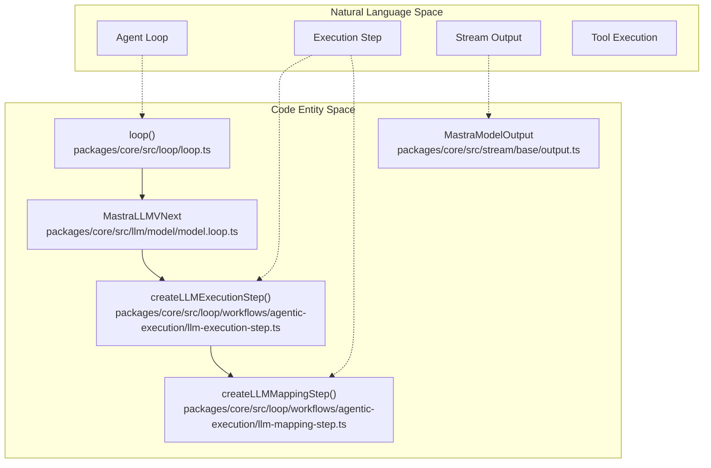
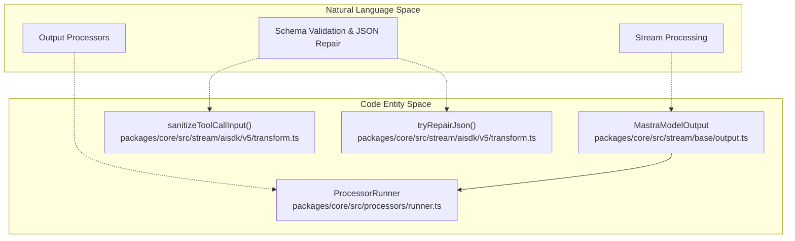

<!-- source: DeepWiki mcp.deepwiki.com · repo mastra-ai/mastra · page 3.8 Agentic Execution Loop (The Loop) · fetched 2026-10-26 -->

# Agentic Execution Loop (The Loop)

Relevant source files

The following files were used as context for generating this wiki page:

- [.changeset/react-shows-accepted-steers.md](.changeset/react-shows-accepted-steers.md)
- [.changeset/steer-shows-when-accepted.md](.changeset/steer-shows-when-accepted.md)
- [client-sdks/react/src/lib/mastra-db/accumulator.test.ts](client-sdks/react/src/lib/mastra-db/accumulator.test.ts)
- [client-sdks/react/src/lib/mastra-db/accumulator.ts](client-sdks/react/src/lib/mastra-db/accumulator.ts)
- [docs/src/content/en/reference/streaming/ChunkType.mdx](docs/src/content/en/reference/streaming/ChunkType.mdx)
- [observability/mastra/src/usage.test.ts](observability/mastra/src/usage.test.ts)
- [observability/mastra/src/usage.ts](observability/mastra/src/usage.ts)
- [packages/core/src/agent/__tests__/signals-pending-steer-chunk.test.ts](packages/core/src/agent/__tests__/signals-pending-steer-chunk.test.ts)
- [packages/core/src/agent/durable/__tests__/durable-agent-approval-resume-data.test.ts](packages/core/src/agent/durable/__tests__/durable-agent-approval-resume-data.test.ts)
- [packages/core/src/agent/durable/__tests__/durable-agent-emit-error.test.ts](packages/core/src/agent/durable/__tests__/durable-agent-emit-error.test.ts)
- [packages/core/src/agent/durable/__tests__/durable-agent-structured-output-persistence.test.ts](packages/core/src/agent/durable/__tests__/durable-agent-structured-output-persistence.test.ts)
- [packages/core/src/agent/durable/__tests__/durable-agent-structured-output.test.ts](packages/core/src/agent/durable/__tests__/durable-agent-structured-output.test.ts)
- [packages/core/src/agent/durable/__tests__/durable-agent-to-model-output.test.ts](packages/core/src/agent/durable/__tests__/durable-agent-to-model-output.test.ts)
- [packages/core/src/agent/durable/__tests__/durable-agent-tracing.test.ts](packages/core/src/agent/durable/__tests__/durable-agent-tracing.test.ts)
- [packages/core/src/agent/durable/__tests__/durable-agent-version-resume.test.ts](packages/core/src/agent/durable/__tests__/durable-agent-version-resume.test.ts)
- [packages/core/src/agent/durable/__tests__/durable-agent.test.ts](packages/core/src/agent/durable/__tests__/durable-agent.test.ts)
- [packages/core/src/agent/durable/__tests__/recover-run.test.ts](packages/core/src/agent/durable/__tests__/recover-run.test.ts)
- [packages/core/src/agent/durable/__tests__/resume-api.test.ts](packages/core/src/agent/durable/__tests__/resume-api.test.ts)
- [packages/core/src/agent/durable/durable-agent.ts](packages/core/src/agent/durable/durable-agent.ts)
- [packages/core/src/agent/durable/evented-agent.ts](packages/core/src/agent/durable/evented-agent.ts)
- [packages/core/src/agent/durable/preparation.ts](packages/core/src/agent/durable/preparation.ts)
- [packages/core/src/agent/durable/stream-adapter.ts](packages/core/src/agent/durable/stream-adapter.ts)
- [packages/core/src/agent/durable/types.ts](packages/core/src/agent/durable/types.ts)
- [packages/core/src/agent/durable/utils/resolve-runtime.ts](packages/core/src/agent/durable/utils/resolve-runtime.ts)
- [packages/core/src/agent/durable/utils/serialize-state.test.ts](packages/core/src/agent/durable/utils/serialize-state.test.ts)
- [packages/core/src/agent/durable/utils/serialize-state.ts](packages/core/src/agent/durable/utils/serialize-state.ts)
- [packages/core/src/agent/durable/workflows/__tests__/finalize-run.test.ts](packages/core/src/agent/durable/workflows/__tests__/finalize-run.test.ts)
- [packages/core/src/agent/durable/workflows/create-durable-agentic-workflow.ts](packages/core/src/agent/durable/workflows/create-durable-agentic-workflow.ts)
- [packages/core/src/agent/durable/workflows/durable-loop-builder.ts](packages/core/src/agent/durable/workflows/durable-loop-builder.ts)
- [packages/core/src/agent/durable/workflows/finalize-run.ts](packages/core/src/agent/durable/workflows/finalize-run.ts)
- [packages/core/src/agent/durable/workflows/shared/iteration-state.test.ts](packages/core/src/agent/durable/workflows/shared/iteration-state.test.ts)
- [packages/core/src/agent/durable/workflows/shared/iteration-state.ts](packages/core/src/agent/durable/workflows/shared/iteration-state.ts)
- [packages/core/src/agent/durable/workflows/shared/schemas.ts](packages/core/src/agent/durable/workflows/shared/schemas.ts)
- [packages/core/src/agent/durable/workflows/steps/llm-execution.ts](packages/core/src/agent/durable/workflows/steps/llm-execution.ts)
- [packages/core/src/agent/durable/workflows/steps/llm-mapping.ts](packages/core/src/agent/durable/workflows/steps/llm-mapping.ts)
- [packages/core/src/agent/durable/workflows/steps/tool-call.ts](packages/core/src/agent/durable/workflows/steps/tool-call.ts)
- [packages/core/src/agent/message-list/adapters/AIV4Adapter.ts](packages/core/src/agent/message-list/adapters/AIV4Adapter.ts)
- [packages/core/src/agent/message-list/prompt/convert-to-mastra-v1.ts](packages/core/src/agent/message-list/prompt/convert-to-mastra-v1.ts)
- [packages/core/src/agent/workflows/prepare-stream/client-tool-output-hooks.test.ts](packages/core/src/agent/workflows/prepare-stream/client-tool-output-hooks.test.ts)
- [packages/core/src/agent/workflows/prepare-stream/client-tool-output-hooks.ts](packages/core/src/agent/workflows/prepare-stream/client-tool-output-hooks.ts)
- [packages/core/src/loop/__snapshots__/loop.test.ts.snap](packages/core/src/loop/__snapshots__/loop.test.ts.snap)
- [packages/core/src/loop/test-utils/aimock/scenarios/signal-queue-message.scenario.test.ts](packages/core/src/loop/test-utils/aimock/scenarios/signal-queue-message.scenario.test.ts)
- [packages/core/src/loop/test-utils/fullStream.ts](packages/core/src/loop/test-utils/fullStream.ts)
- [packages/core/src/loop/test-utils/generateText.ts](packages/core/src/loop/test-utils/generateText.ts)
- [packages/core/src/loop/test-utils/options.ts](packages/core/src/loop/test-utils/options.ts)
- [packages/core/src/loop/test-utils/resultObject.ts](packages/core/src/loop/test-utils/resultObject.ts)
- [packages/core/src/loop/test-utils/streamObject.ts](packages/core/src/loop/test-utils/streamObject.ts)
- [packages/core/src/loop/test-utils/tools.ts](packages/core/src/loop/test-utils/tools.ts)
- [packages/core/src/loop/workflows/agentic-execution/build-messages-from-chunks.test.ts](packages/core/src/loop/workflows/agentic-execution/build-messages-from-chunks.test.ts)
- [packages/core/src/loop/workflows/agentic-execution/build-messages-from-chunks.ts](packages/core/src/loop/workflows/agentic-execution/build-messages-from-chunks.ts)
- [packages/core/src/loop/workflows/agentic-execution/llm-execution-step.test.ts](packages/core/src/loop/workflows/agentic-execution/llm-execution-step.test.ts)
- [packages/core/src/loop/workflows/agentic-execution/llm-execution-step.ts](packages/core/src/loop/workflows/agentic-execution/llm-execution-step.ts)
- [packages/core/src/loop/workflows/agentic-execution/llm-mapping-step.test.ts](packages/core/src/loop/workflows/agentic-execution/llm-mapping-step.test.ts)
- [packages/core/src/loop/workflows/agentic-execution/llm-mapping-step.ts](packages/core/src/loop/workflows/agentic-execution/llm-mapping-step.ts)
- [packages/core/src/stream/aisdk/v5/transform.test.ts](packages/core/src/stream/aisdk/v5/transform.test.ts)
- [packages/core/src/stream/aisdk/v5/transform.ts](packages/core/src/stream/aisdk/v5/transform.ts)
- [packages/core/src/stream/base/output.test.ts](packages/core/src/stream/base/output.test.ts)
- [packages/core/src/stream/base/output.ts](packages/core/src/stream/base/output.ts)
- [packages/core/src/stream/index.ts](packages/core/src/stream/index.ts)
- [packages/core/src/stream/signal-exclusions.ts](packages/core/src/stream/signal-exclusions.ts)
- [packages/core/src/stream/types.ts](packages/core/src/stream/types.ts)
- [packages/core/src/utils.test.ts](packages/core/src/utils.test.ts)
- [packages/core/src/utils.ts](packages/core/src/utils.ts)

The purpose and scope of this page is to provide a deep technical dive into Mastra's agentic execution loop (`loop()`), which orchestrates multi-step LLM inference, tool calling, iteration control, and stream processing. For general agent-level configuration, see [Agent Configuration and Execution](3.1)[]. For message management and memory scoping during execution, see [Agent Memory System](3.4)[]. For request-level hooks, see [Input and Output Processors](3.5)[].

Sources: [packages/core/src/loop/workflows/agentic-execution/llm-execution-step.ts:1-113](), [packages/core/src/stream/base/output.ts:41-113]()

## Overview of the Loop Architecture

The execution loop implements an iterative **LLM → Tool → LLM** cycle using a workflow-based execution engine (`MastraLLMVNext`). Each complete iteration consists of:

1.  **LLM Execution Step**: Invokes the language model via `createLLMExecutionStep`, processes the resulting stream, and applies input/output processors [packages/core/src/loop/workflows/agentic-execution/llm-execution-step.ts:39-43]().
2.  **Tool Call & Mapping Step**: Evaluates tool calls, handles approvals, executes tools concurrently or sequentially via `createLLMMappingStep`, and commits tool results back to the message list [packages/core/src/loop/workflows/agentic-execution/llm-mapping-step.ts:22-52]().
3.  **Iteration Control**: Evaluates terminal finish reasons, maximum step constraints, and drains pending signals or background tasks [packages/core/src/loop/workflows/agentic-execution/llm-execution-step.ts:97-109]().

### Code Entity Mapping: Core Loop Architecture

Sources: [packages/core/src/loop/workflows/agentic-execution/llm-execution-step.ts:66-107](), [packages/core/src/loop/workflows/agentic-execution/llm-mapping-step.ts:22-51](), [packages/core/src/stream/base/output.ts:41-113]()

## Execution Steps and Flow

The execution engine delegates model calls and chunk handling to discrete step builders within `packages/core/src/loop/workflows/agentic-execution/` [packages/core/src/loop/workflows/agentic-execution/llm-execution-step.ts:39-66]().

### LLM Execution Step (`createLLMExecutionStep`)

`createLLMExecutionStep` encapsulates the model invocation lifecycle:
*   **Prompt and Message Assembly**: Prepares prompt arguments via `buildLlmPromptArgs` and manages system messages across iterations [packages/core/src/loop/workflows/agentic-execution/llm-execution-step.ts:100-100]().
*   **Terminal Finish Reasons**: Stops execution immediately upon encountering terminal reasons (`stop`, `error`, `length`, `content-filter`) defined in `TERMINAL_FINISH_REASONS` [packages/core/src/loop/workflows/agentic-execution/llm-execution-step.ts:104-104]().
*   **Processor Integration**: Passes stream chunks through `ProcessorRunner` to validate, transform, or block content via tripwires [packages/core/src/loop/workflows/agentic-execution/llm-execution-step.ts:41-42]().

Sources: [packages/core/src/loop/workflows/agentic-execution/llm-execution-step.ts:37-109]()

## Tool Integration and Execution Mapping

Once the LLM emits tool call requests, execution flows into `createLLMMappingStep` (`packages/core/src/loop/workflows/agentic-execution/llm-mapping-step.ts`) [packages/core/src/loop/workflows/agentic-execution/llm-mapping-step.ts:22-25]().

*   **Tool Result Processing**: Runs post-execution processors (`runToolResultProcessors`) to evaluate tool returns before they are committed to the message list [packages/core/src/loop/workflows/agentic-execution/llm-mapping-step.ts:90-132]().
*   **Human-in-the-Loop (HITL) & Bails**: Inspects tool invocation results; if tools lack execution handlers or require approval, the engine calls `bail` to suspend execution [packages/core/src/loop/test-utils/options.ts:26-89]().
*   **Payload Transformation**: Applies target-specific payload transforms to adapt tool inputs and outputs across provider boundaries [packages/core/src/loop/workflows/agentic-execution/llm-mapping-step.ts:18-19]()

Sources: [packages/core/src/loop/workflows/agentic-execution/llm-mapping-step.ts:22-129](), [packages/core/src/loop/test-utils/options.ts:26-89]()

## Stream Processing and Output Pipeline

Mastra utilizes `MastraModelOutput` to unify streaming and promise-based resolution for agent runs [packages/core/src/stream/base/output.ts:41-113]().

### Code Entity Mapping: Stream Processing & Validation

Sources: [packages/core/src/stream/base/output.ts:41-113](), [packages/core/src/processors/runner.ts:17-18](), [packages/core/src/stream/aisdk/v5/transform.ts:31-99]()

### Chunk Types and JSON Repair

*   **Chunk Types**: Streams emit structured `ChunkType` objects representing `text-delta`, `tool-call`, `tool-result`, `reasoning-delta`, and `file` payloads [packages/core/src/stream/types.ts:104-162]().
*   **Input Sanitization**: `sanitizeToolCallInput` inspects streamed tool call arguments, stripping adversarial LLM tokens (e.g., `<|call|>`) while preserving valid JSON payloads [packages/core/src/stream/aisdk/v5/transform.ts:31-43]().
*   **JSON Malformation Repair**: `tryRepairJson` applies regex-based heuristics to fix unquoted keys, trailing commas, and single quotes in malformed LLM outputs [packages/core/src/stream/aisdk/v5/transform.ts:62-99]().

Sources: [packages/core/src/stream/types.ts:104-162](), [packages/core/src/stream/aisdk/v5/transform.ts:31-99]()

## Iteration Control and State Management

The loop tracks execution state across iterations using run scope contexts and scoped keys (`packages/core/src/loop/run-scope-keys.ts`) [packages/core/src/loop/workflows/agentic-execution/llm-execution-step.ts:75-93]().

*   **Signal Draining**: At the start of iterations, pending signals are drained and injected into the active message context [packages/core/src/loop/workflows/agentic-execution/llm-execution-step.ts:79-82]().
*   **Scope Isolation**: `readScoped` and `writeScoped` maintain thread IDs, resource IDs, and active tool states across workflow step boundaries [packages/core/src/loop/workflows/agentic-execution/llm-execution-step.ts:75-93]().

Sources: [packages/core/src/loop/workflows/agentic-execution/llm-execution-step.ts:75-93]()

---

