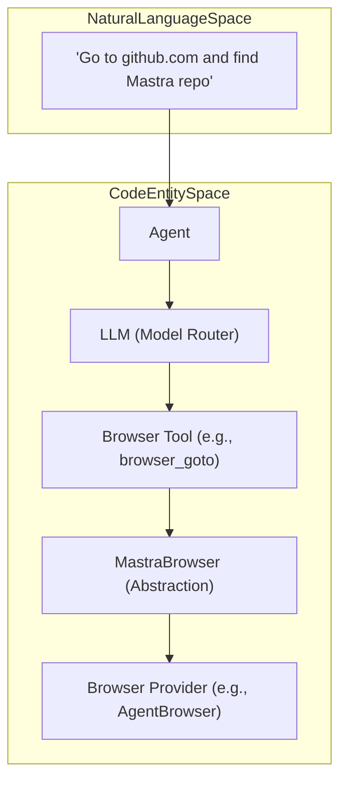
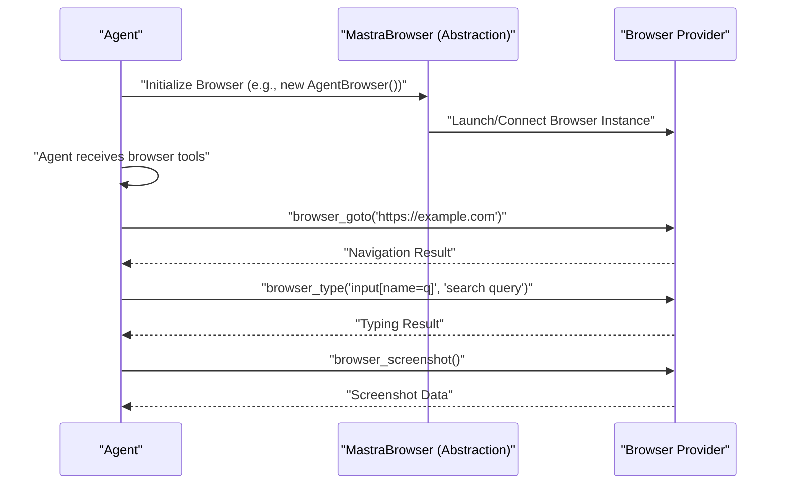
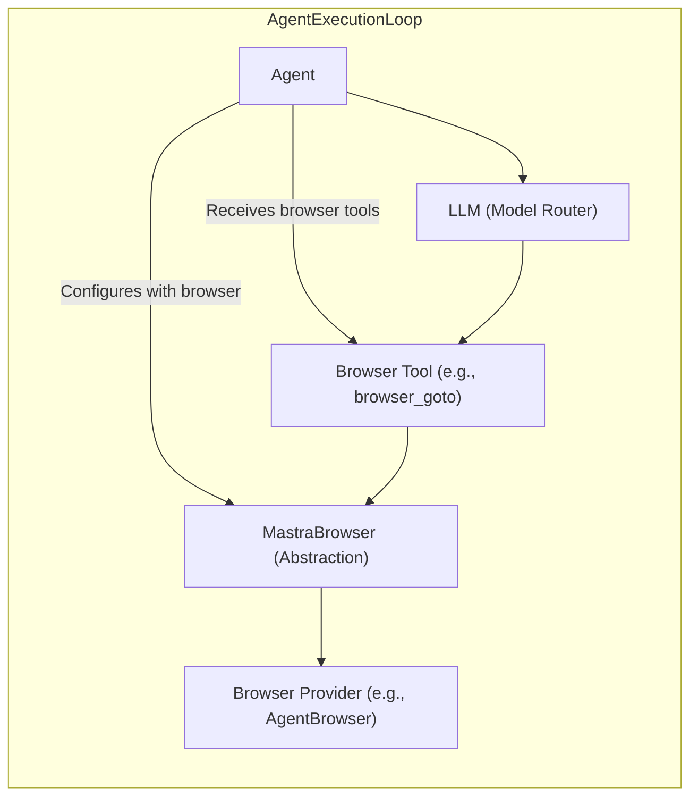

<!-- source: DeepWiki mcp.deepwiki.com · repo mastra-ai/mastra · page 3.9 Browser Automation and Web Interaction · fetched 2026-10-26 -->

# Browser Automation and Web Interaction

Relevant source files

The following files were used as context for generating this wiki page:

- [docs/src/content/en/docs/auth/composite-auth.mdx](docs/src/content/en/docs/auth/composite-auth.mdx)
- [docs/src/content/en/docs/auth/custom-auth-provider.mdx](docs/src/content/en/docs/auth/custom-auth-provider.mdx)
- [docs/src/content/en/docs/auth/jwt.mdx](docs/src/content/en/docs/auth/jwt.mdx)
- [docs/src/content/en/docs/auth/overview.mdx](docs/src/content/en/docs/auth/overview.mdx)
- [docs/src/content/en/docs/auth/simple-auth.mdx](docs/src/content/en/docs/auth/simple-auth.mdx)
- [docs/src/content/en/docs/browser.mdx](docs/src/content/en/docs/browser.mdx)
- [docs/src/content/en/docs/deployment/web-framework.mdx](docs/src/content/en/docs/deployment/web-framework.mdx)
- [docs/src/content/en/docs/observability/integrations/exporters/mastra-storage.mdx](docs/src/content/en/docs/observability/integrations/exporters/mastra-storage.mdx)
- [docs/src/content/en/docs/observability/overview.mdx](docs/src/content/en/docs/observability/overview.mdx)
- [docs/src/content/en/docs/observability/tracing/overview.mdx](docs/src/content/en/docs/observability/tracing/overview.mdx)
- [docs/src/content/en/docs/studio/observability.mdx](docs/src/content/en/docs/studio/observability.mdx)
- [docs/src/content/en/docs/studio/overview.mdx](docs/src/content/en/docs/studio/overview.mdx)
- [docs/src/content/en/reference/agents/createSkill.mdx](docs/src/content/en/reference/agents/createSkill.mdx)
- [docs/src/content/en/reference/agents/getModel.mdx](docs/src/content/en/reference/agents/getModel.mdx)
- [docs/src/content/en/reference/agents/getSkill.mdx](docs/src/content/en/reference/agents/getSkill.mdx)
- [docs/src/content/en/reference/agents/listSkills.mdx](docs/src/content/en/reference/agents/listSkills.mdx)
- [docs/src/content/en/reference/editor/processor-provider.mdx](docs/src/content/en/reference/editor/processor-provider.mdx)
- [docs/src/content/en/reference/memory/deleteMessages.mdx](docs/src/content/en/reference/memory/deleteMessages.mdx)
- [docs/src/content/en/reference/migrations/upgrade-to-v1/memory.mdx](docs/src/content/en/reference/migrations/upgrade-to-v1/memory.mdx)

## Purpose and Scope

This page documents Mastra's browser automation architecture, focusing on the core browser abstraction (`MastraBrowser`), provider implementations (`AgentBrowser`, `Stagehand`, `FirecrawlBrowser`, and `BrowserViewer`), tool surfaces, and browser session scoping.

Sources: [docs/src/content/en/docs/browser.mdx:14-22]()

## Overview of MastraBrowser

The `MastraBrowser` interface serves as the central entity for web interaction. It abstracts the underlying automation engine and provides a consistent API for navigating pages, taking snapshots, and executing AI-powered actions.

### Core Capabilities
- **Navigation and Interaction**: Moving between URLs and interacting with DOM elements.
- **Data Extraction**: Extracting structured data from web pages.
- **Form Filling**: Filling out forms and submitting data.
- **Screencasting**: Streaming a live video feed of the browser to the Mastra Studio UI [docs/src/content/en/docs/browser.mdx:133-135]().
- **Session Recording**: Recording browser runs for review, sharing, or debugging [docs/src/content/en/docs/browser.mdx:162-164]().
- **Tool Surface**: Exposing browser actions as tools that agents can invoke.

### Natural Language to Browser Interaction

Title: "Natural Language to Browser Action Flow"

Sources: [docs/src/content/en/docs/browser.mdx:33-36]()

## Provider Implementations

Mastra supports different browser drivers through a provider pattern. These providers wrap browser automation libraries or CLI tools [docs/src/content/en/docs/browser.mdx:14-16]().

### Supported Providers
- **`AgentBrowser`**: A Playwright-based provider with accessibility-first element targeting. Best for general web automation and scraping [docs/src/content/en/docs/browser.mdx:17-18]().
- **`Stagehand`**: A Browserbase provider with AI-powered element detection. Best for complex interactions that benefit from natural language selectors [docs/src/content/en/docs/browser.mdx:19-20]().
- **`FirecrawlBrowser`**: A Firecrawl Browser Sandbox provider that runs AgentBrowser tools against hosted browser sessions. Best for running automation on hosted browser sessions without managing local browser infrastructure [docs/src/content/en/docs/browser.mdx:21-22]().
- **`BrowserViewer`**: A CLI provider that launches Chrome and injects CDP URLs into CLI tools. Best for workspace agents that drive browsers through shell commands [docs/src/content/en/docs/browser.mdx:23-24]().

### Cloud Providers
All SDK providers support connecting to cloud browser services instead of launching a local browser [docs/src/content/en/docs/browser.mdx:77-78]().
- **Firecrawl Browser Sandbox**: `FirecrawlBrowser` provisions hosted sessions via the Firecrawl API [docs/src/content/en/docs/browser.mdx:81-89]().
- **Browserbase**: `Stagehand` has native Browserbase integration [docs/src/content/en/docs/browser.mdx:92-103]().
- **Browser Use Cloud**: `AgentBrowser` can connect to Browser Use Cloud browsers via CDP [docs/src/content/en/docs/browser.mdx:106-116]().
- **Generic CDP URL**: Any provider can connect to a browser exposing a Chrome DevTools Protocol (CDP) endpoint [docs/src/content/en/docs/browser.mdx:119-130]().

### MastraBrowser Interface (Conceptual)

| Property/Method | Role |
| :--- | :--- |
| `goto(url: string)` | Navigates the browser to a specified URL. |
| `type(selector: string, text: string)` | Types text into an input field identified by a selector. |
| `click(selector: string)` | Clicks an element identified by a selector. |
| `screenshot()` | Captures a visual representation (PNG/JPEG) of the current page. |
| `content()` | Returns the HTML content of the current page. |
| `extract(schema: ZodSchema)` | Extracts structured data from the page based on a Zod schema. |
| `screencast(options: ScreencastOptions)` | Manages video streaming/recording of the session [docs/src/content/en/docs/browser.mdx:151-159](). |
| `record(options: RecordingOptions)` | Starts, checks, and stops browser session recordings [docs/src/content/en/docs/browser.mdx:162-175]().

Sources: [docs/src/content/en/docs/browser.mdx:14-24](), [docs/src/content/en/docs/browser.mdx:77-130](), [docs/src/content/en/docs/browser.mdx:133-175]()

## Browser Sessions and Scoping

Browser sessions in Mastra are scoped to specific execution contexts, ensuring isolation across agent runs. When a browser is assigned to an agent, Mastra includes the provider's tools in the agent's toolset [docs/src/content/en/docs/browser.mdx:33-34]().

### Session Management
When an agent executes a task involving the browser, the session is managed by the chosen provider. The agent uses the provided tools to control the browser, opening URLs, selecting elements, typing text, and reading page content [docs/src/content/en/docs/browser.mdx:34-36]().

Title: "Browser Session Scoping and Resolution"

Sources: [docs/src/content/en/docs/browser.mdx:33-36](), [docs/src/content/en/docs/browser.mdx:49-55]()

## Tool Surfaces

Mastra exposes browser capabilities to agents through a set of specialized tools provided by each browser implementation.

### Example Tools (AgentBrowser)
- `browser_goto(url: string)`: Navigates to a URL.
- `browser_click(selector: string)`: Clicks an element.
- `browser_type(selector: string, text: string)`: Types text into an input.
- `browser_content()`: Gets the full HTML content.
- `browser_screenshot()`: Takes a screenshot.
- `browser_extract(schema: ZodSchema)`: Extracts structured data.
- `browser_record_start(outputPath: string)`: Starts recording the session [docs/src/content/en/docs/browser.mdx:175-175]().
- `browser_record_stop()`: Stops recording the session [docs/src/content/en/docs/browser.mdx:175-175]().
- `browser_record_caption(caption: string)`: Adds a caption to the recording [docs/src/content/en/docs/browser.mdx:175-175]().

Each provider offers a different set of tools optimized for its approach [docs/src/content/en/docs/browser.mdx:36-36]().

Sources: [docs/src/content/en/docs/browser.mdx:36-36](), [docs/src/content/en/docs/browser.mdx:175-175]()

## Integration in Agent Execution

The `Agent` class integrates the browser by accepting a `browser` instance in its configuration. This automatically makes the browser's tools available to the agent [docs/src/content/en/docs/browser.mdx:67-71]().

### Execution Flow
1. **Browser Instance Creation**: A `MastraBrowser` implementation (e.g., `AgentBrowser`) is instantiated [docs/src/content/en/docs/browser.mdx:49-55]().
2. **Agent Configuration**: The browser instance is passed to the `Agent` constructor [docs/src/content/en/docs/browser.mdx:67-71]().
3. **Tool Provisioning**: The agent automatically receives all browser tools from the configured provider [docs/src/content/en/docs/browser.mdx:73-73]().
4. **Agentic Use**: The agent uses these tools within its `instructions` to interact with web pages.

Title: "Agent Browser Tool Execution"

Sources: [docs/src/content/en/docs/browser.mdx:49-55](), [docs/src/content/en/docs/browser.mdx:67-71](), [docs/src/content/en/docs/browser.mdx:73-73]()

## Screencasting and Session Recording

For monitoring, debugging, and review, Mastra's browser providers support screencasting and session recording.

### Screencasting
Browser providers stream a live video feed of the browser to the Mastra Studio UI, allowing real-time observation of agent interactions [docs/src/content/en/docs/browser.mdx:133-135]().
- **Requirements**: Requires `ws` and `@hono/node-ws` packages for WebSocket support [docs/src/content/en/docs/browser.mdx:139-140]().
- **Configuration**: Enabled by default, with options for format, quality, and dimensions [docs/src/content/en/docs/browser.mdx:151-159]().

### Session Recording
`AgentBrowser` and `StagehandBrowser` can record browser runs for later review, sharing, or debugging [docs/src/content/en/docs/browser.mdx:162-164]().
- **Configuration**: Enabled by setting an `outputDir` in the `recording` option [docs/src/content/en/docs/browser.mdx:169-174]().
- **Tools**: Agents use `browser_record` to start, check, and stop recordings, and `browser_record_caption` to label actions [docs/src/content/en/docs/browser.mdx:175-175]().
- **Format**: Recordings use Motion-JPEG AVI and do not require `ffmpeg` [docs/src/content/en/docs/browser.mdx:177-177]().

Sources: [docs/src/content/en/docs/browser.mdx:133-179]()

---

