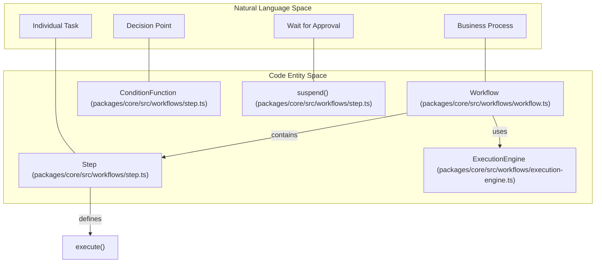
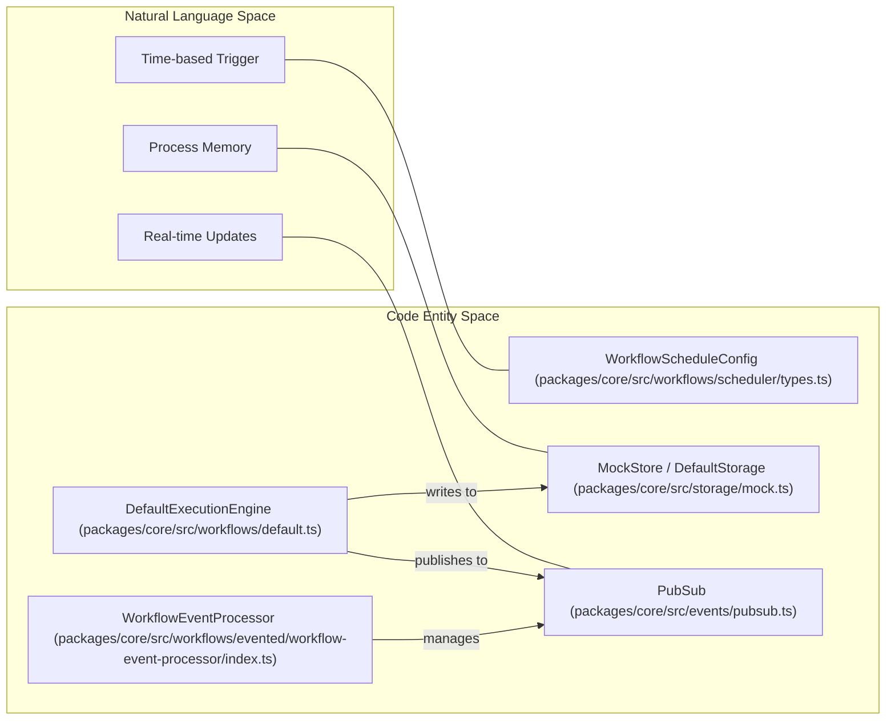
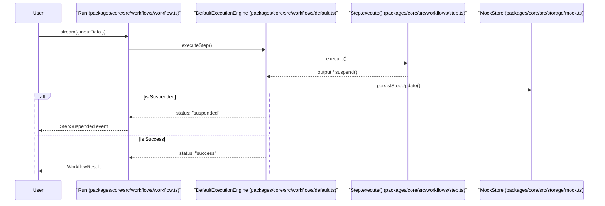

<!-- source: DeepWiki mcp.deepwiki.com · repo mastra-ai/mastra · page 4 Workflow System · fetched 2026-10-26 -->

# Workflow System

Relevant source files

The following files were used as context for generating this wiki page:

- [.changeset/evented-foreach-running-status.md](.changeset/evented-foreach-running-status.md)
- [.changeset/strong-gifts-smell.md](.changeset/strong-gifts-smell.md)
- [packages/core/src/processors/index.ts](packages/core/src/processors/index.ts)
- [packages/core/src/processors/processor-model-settings.test-d.ts](packages/core/src/processors/processor-model-settings.test-d.ts)
- [packages/core/src/processors/runner.test.ts](packages/core/src/processors/runner.test.ts)
- [packages/core/src/processors/runner.ts](packages/core/src/processors/runner.ts)
- [packages/core/src/processors/step-schema.ts](packages/core/src/processors/step-schema.ts)
- [packages/core/src/workflows/concurrent-resume.test.ts](packages/core/src/workflows/concurrent-resume.test.ts)
- [packages/core/src/workflows/default.test.ts](packages/core/src/workflows/default.test.ts)
- [packages/core/src/workflows/default.ts](packages/core/src/workflows/default.ts)
- [packages/core/src/workflows/evented/evented-workflow.test.ts](packages/core/src/workflows/evented/evented-workflow.test.ts)
- [packages/core/src/workflows/evented/foreach-running-status.test.ts](packages/core/src/workflows/evented/foreach-running-status.test.ts)
- [packages/core/src/workflows/evented/step-executor.test.ts](packages/core/src/workflows/evented/step-executor.test.ts)
- [packages/core/src/workflows/evented/step-executor.ts](packages/core/src/workflows/evented/step-executor.ts)
- [packages/core/src/workflows/evented/workflow-event-processor/index.ts](packages/core/src/workflows/evented/workflow-event-processor/index.ts)
- [packages/core/src/workflows/evented/workflow-event-processor/loop.ts](packages/core/src/workflows/evented/workflow-event-processor/loop.ts)
- [packages/core/src/workflows/evented/workflow.ts](packages/core/src/workflows/evented/workflow.ts)
- [packages/core/src/workflows/execution-engine.ts](packages/core/src/workflows/execution-engine.ts)
- [packages/core/src/workflows/foreach-nested-workflow.test.ts](packages/core/src/workflows/foreach-nested-workflow.test.ts)
- [packages/core/src/workflows/foreach-running-status.test.ts](packages/core/src/workflows/foreach-running-status.test.ts)
- [packages/core/src/workflows/handlers/control-flow.ts](packages/core/src/workflows/handlers/control-flow.ts)
- [packages/core/src/workflows/handlers/entry.ts](packages/core/src/workflows/handlers/entry.ts)
- [packages/core/src/workflows/handlers/sleep.ts](packages/core/src/workflows/handlers/sleep.ts)
- [packages/core/src/workflows/handlers/step.ts](packages/core/src/workflows/handlers/step.ts)
- [packages/core/src/workflows/types.ts](packages/core/src/workflows/types.ts)
- [packages/core/src/workflows/utils.ts](packages/core/src/workflows/utils.ts)
- [packages/core/src/workflows/workflow.test.ts](packages/core/src/workflows/workflow.test.ts)
- [packages/core/src/workflows/workflow.ts](packages/core/src/workflows/workflow.ts)
- [workflows/inngest/src/index.ts](workflows/inngest/src/index.ts)

## Purpose and Scope

The Workflow System is a multi-step orchestration engine for building complex processes with agents, tools, and custom logic. It allows developers to define directed acyclic graphs (DAGs) of operations with built-in support for branching, parallel execution, state management, and durable suspension/resumption [packages/core/src/workflows/workflow.ts:1-100]().

- For defining steps and workflows, see [Workflow Definition and Step Composition](#4.1).
- For choosing between in-memory, event-driven, or durable engines, see [Execution Engines](#4.2).
- For managing shared data across steps, see [Workflow State Management and Persistence](#4.3).
- For human-in-the-loop patterns, see [Suspend and Resume Mechanism](#4.4).
- For advanced logic like loops and conditions, see [Control Flow Patterns](#4.5).
- For real-time updates and PubSub integration, see [Workflow Streaming and Events](#4.6).
- For serverless durability, see [Inngest Durability Integration](#4.7).
- For AI-guided project changes, see [Agent Builder and Template Merge Workflows](#4.8).
- For enterprise-grade durability, see [Temporal Durability Integration](#4.9).
- For time-based triggers, see [Scheduling and Cron Triggers](#4.10).

**Sources:** [packages/core/src/workflows/workflow.ts:1-100](), [packages/core/src/workflows/types.ts:41-50]()

---

## Workflow Architecture Overview

The system bridges high-level process definitions with low-level execution primitives. The `Workflow` class acts as the orchestrator, while `ExecutionEngine` implementations handle the mechanics of running steps [packages/core/src/workflows/workflow.ts:189-220]().

### System Concept to Code Mapping
The following diagrams map conceptual workflow elements to their corresponding classes and functions in the codebase.

**Workflow System Mapping**

**Sources:** [packages/core/src/workflows/workflow.ts:189-220](), [packages/core/src/workflows/execution-engine.ts:59-66](), [packages/core/src/workflows/types.ts:20-21]()

**Execution Infrastructure Mapping**

**Sources:** [packages/core/src/workflows/execution-engine.ts:59-66](), [packages/core/src/workflows/default.ts:72-132](), [packages/core/src/workflows/evented/workflow-event-processor/index.ts:148-158](), [packages/core/src/workflows/scheduler/types.ts:1-1](), [packages/core/src/storage/mock.ts:18-18](), [packages/core/src/events/pubsub.ts:1-1]()

---

## Core Components

### 4.1 Workflow Definition and Step Composition
Workflows are composed of modular steps. You can create steps from custom functions, existing agents, or tools. The system uses a builder pattern for defining the execution graph via `createWorkflow` and `.then()` [packages/core/src/workflows/workflow.ts:112-117]().

| Step Source | Creation Method | Description |
| :--- | :--- | :--- |
| **Custom Function** | `createStep(StepParams)` | Arbitrary TypeScript logic with Zod/StandardSchema validation [packages/core/src/workflows/types.ts:134-137](). |
| **Agent** | `createStepFromAgent(Agent)` | Wraps an agent's generation capabilities as a step [packages/core/src/workflows/step-factories.ts:1-1](). |
| **Tool** | `createStepFromTool(Tool)` | Executes a specific tool with its defined schema [packages/core/src/workflows/step-factories.ts:1-1](). |
| **Mapping** | `createMappingStep(MappingConfig)` | Logic for transforming data between steps [packages/core/src/workflows/step-factories.ts:1-1](). |

For details, see [Workflow Definition and Step Composition](#4.1).

**Sources:** [packages/core/src/workflows/workflow.ts:112-117](), [packages/core/src/workflows/types.ts:134-137](), [packages/core/src/workflows/step-factories.ts:1-1]()

### 4.2 Execution Engines
Mastra provides different engines depending on the environment and durability requirements:
- **DefaultExecutionEngine**: Standard in-memory execution for local or server environments [packages/core/src/workflows/default.ts:81-81]().
- **EventedExecutionEngine**: Uses a PubSub system to coordinate steps via events, supporting worker-based execution [packages/core/src/workflows/evented/execution-engine.ts:78-82]().
- **InngestExecutionEngine**: Leverages Inngest for durable, serverless execution with automatic retries and replay safety [workflows/inngest/src/index.ts:1-30]().
- **TemporalExecutionEngine**: Integration for running workflows on the Temporal durable execution platform [packages/core/src/workflows/types.ts:42-42]().

For details, see [Execution Engines](#4.2).

**Sources:** [packages/core/src/workflows/default.ts:81-81](), [packages/core/src/workflows/evented/execution-engine.ts:78-82](), [workflows/inngest/src/index.ts:1-30](), [packages/core/src/workflows/types.ts:42-42]()

### 4.3 Workflow State Management and Persistence
Workflows maintain a shared `state` object. Steps can read from this state and update it using `setState()`. The execution state, including `stepResults` and `activePaths`, can be persisted to support restarts and time travel [packages/core/src/workflows/types.ts:127-131]().

For details, see [Workflow State Management and Persistence](#4.3).

**Sources:** [packages/core/src/workflows/types.ts:127-131](), [packages/core/src/workflows/handlers/entry.ts:131-137]()

### 4.4 Suspend and Resume Mechanism
This mechanism allows a workflow to pause (e.g., waiting for human approval) and resume later. When `suspend()` is called, the engine halts and saves a snapshot. Execution resumes when `run.resume()` is called with `resumeData` [packages/core/src/workflows/step.ts:99-100]().

For details, see [Suspend and Resume Mechanism](#4.4).

**Sources:** [packages/core/src/workflows/step.ts:99-100](), [packages/core/src/workflows/workflow.test.ts:139-148]()

### 4.5 Control Flow Patterns
The system supports non-linear execution paths:
- **Conditional**: Execute different steps based on a `ConditionFunction` or declarative `Predicate` [packages/core/src/workflows/types.ts:20-20]().
- **Parallel**: Run multiple steps concurrently [packages/core/src/workflows/default.ts:26-27]().
- **Loop**: Execute a block of steps repeatedly (e.g., `doWhile`, `doUntil`, `forEach`) [packages/core/src/workflows/evented/workflow-event-processor/loop.ts:38-39]().

For details, see [Control Flow Patterns](#4.5).

**Sources:** [packages/core/src/workflows/types.ts:20-20](), [packages/core/src/workflows/default.ts:26-27](), [packages/core/src/workflows/evented/workflow-event-processor/loop.ts:38-39]()

### 4.6 Workflow Streaming and Events
Workflow execution can be streamed using `run.stream()` [packages/core/src/workflows/workflow.test.ts:120-127](). This provides real-time access to step lifecycle events and token streaming via `WorkflowRunOutput` [packages/core/src/workflows/workflow.ts:74-74]().

For details, see [Workflow Streaming and Events](#4.6).

**Sources:** [packages/core/src/workflows/workflow.test.ts:120-127](), [packages/core/src/workflows/workflow.ts:74-74]()

### 4.7 Inngest Durability Integration
The `InngestWorkflow` maps workflow steps to Inngest's durable primitives. It uses an `InngestExecutionEngine` to wrap operations in `step.run` for replay safety [workflows/inngest/src/workflow.ts:52-70]().

For details, see [Inngest Durability Integration](#4.7).

**Sources:** [workflows/inngest/src/workflow.ts:52-70](), [workflows/inngest/src/index.ts:1-30]()

### 4.8 Agent Builder and Template Merge Workflows
The `@mastra/agent-builder` system utilizes specialized workflows to manage code generation and project scaffolding, supporting AI-guided project changes through template merge and code editor modes [packages/core/src/workflows/workflow.ts:68-70]().

For details, see [Agent Builder and Template Merge Workflows](#4.8).

**Sources:** [packages/core/src/workflows/workflow.ts:68-70]()

### 4.9 Temporal Durability Integration
Mastra supports running durable workflows on Temporal clusters via the `TemporalExecutionEngine`, providing high-scale reliability for long-running processes [packages/core/src/workflows/types.ts:42-42]().

For details, see [Temporal Durability Integration](#4.9).

**Sources:** [packages/core/src/workflows/types.ts:42-42]()

### 4.10 Scheduling and Cron Triggers
Workflows can be scheduled using standard cron syntax. The `Scheduler` manages the tick/claim loop, dispatching `workflow.start` events into the evented processor when a schedule fires [packages/core/src/workflows/scheduler/types.ts:20-20]().

For details, see [Scheduling and Cron Triggers](#4.10).

**Sources:** [packages/core/src/workflows/scheduler/types.ts:20-20](), [packages/core/src/workflows/evented/workflow-event-processor/index.ts:26-26]()

---

## Execution Lifecycle

The following diagram illustrates how a `Run` instance interacts with the `ExecutionEngine` to move from input to result.

**Workflow Execution Flow**

**Sources:** [packages/core/src/workflows/workflow.ts:100-100](), [packages/core/src/workflows/default.ts:29-31](), [packages/core/src/workflows/handlers/step.ts:75-76](), [packages/core/src/workflows/handlers/entry.ts:170-172](), [packages/core/src/storage/mock.ts:18-18]()

---

