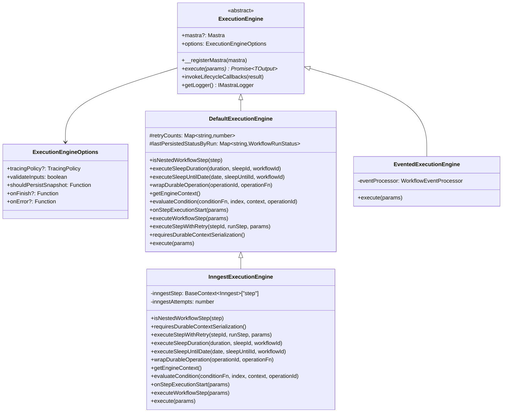

<!-- source: DeepWiki mcp.deepwiki.com · repo mastra-ai/mastra · page 4.2 Execution Engines · fetched 2026-10-26 -->

# Execution Engines

<details>
<summary>Relevant source files</summary>

The following files were used as context for generating this wiki page:

- [.changeset/evented-foreach-running-status.md](.changeset/evented-foreach-running-status.md)
- [.changeset/strong-gifts-smell.md](.changeset/strong-gifts-smell.md)
- [packages/core/src/processors/index.ts](packages/core/src/processors/index.ts)
- [packages/core/src/processors/processor-model-settings.test-d.ts](packages/core/src/processors/processor-model-settings.test-d.ts)
- [packages/core/src/processors/runner.test.ts](packages/core/src/processors/runner.test.ts)
- [packages/core/src/processors/runner.ts](packages/core/src/processors/runner.ts)
- [packages/core/src/processors/step-schema.ts](packages/core/src/processors/step-schema.ts)
- [packages/core/src/workflows/concurrent-resume.test.ts](packages/core/src/workflows/concurrent-resume.test.ts)
- [packages/core/src/workflows/default.test.ts](packages/core/src/workflows/default.test.ts)
- [packages/core/src/workflows/default.ts](packages/core/src/workflows/default.ts)
- [packages/core/src/workflows/evented/evented-workflow.test.ts](packages/core/src/workflows/evented/evented-workflow.test.ts)
- [packages/core/src/workflows/evented/foreach-running-status.test.ts](packages/core/src/workflows/evented/foreach-running-status.test.ts)
- [packages/core/src/workflows/evented/step-executor.test.ts](packages/core/src/workflows/evented/step-executor.test.ts)
- [packages/core/src/workflows/evented/step-executor.ts](packages/core/src/workflows/evented/step-executor.ts)
- [packages/core/src/workflows/evented/workflow-event-processor/index.ts](packages/core/src/workflows/evented/workflow-event-processor/index.ts)
- [packages/core/src/workflows/evented/workflow-event-processor/loop.ts](packages/core/src/workflows/evented/workflow-event-processor/loop.ts)
- [packages/core/src/workflows/evented/workflow.ts](packages/core/src/workflows/evented/workflow.ts)
- [packages/core/src/workflows/execution-engine.ts](packages/core/src/workflows/execution-engine.ts)
- [packages/core/src/workflows/foreach-nested-workflow.test.ts](packages/core/src/workflows/foreach-nested-workflow.test.ts)
- [packages/core/src/workflows/foreach-running-status.test.ts](packages/core/src/workflows/foreach-running-status.test.ts)
- [packages/core/src/workflows/handlers/control-flow.ts](packages/core/src/workflows/handlers/control-flow.ts)
- [packages/core/src/workflows/handlers/entry.ts](packages/core/src/workflows/handlers/entry.ts)
- [packages/core/src/workflows/handlers/sleep.ts](packages/core/src/workflows/handlers/sleep.ts)
- [packages/core/src/workflows/handlers/step.ts](packages/core/src/workflows/handlers/step.ts)
- [packages/core/src/workflows/types.ts](packages/core/src/workflows/types.ts)
- [packages/core/src/workflows/utils.ts](packages/core/src/workflows/utils.ts)
- [packages/core/src/workflows/workflow.test.ts](packages/core/src/workflows/workflow.test.ts)
- [packages/core/src/workflows/workflow.ts](packages/core/src/workflows/workflow.ts)
- [workflows/inngest/CHANGELOG.md](workflows/inngest/CHANGELOG.md)
- [workflows/inngest/package.json](workflows/inngest/package.json)
- [workflows/inngest/src/index.ts](workflows/inngest/src/index.ts)

</details>


Execution engines orchestrate workflow runs by managing step execution order, state persistence, control flow patterns, and platform-specific durability primitives. Mastra provides three execution engines: `DefaultExecutionEngine` for in-memory execution, `InngestExecutionEngine` for durable serverless execution, and `EventedExecutionEngine` for event-driven distributed execution.

The engine abstraction uses a hook pattern that allows subclasses to override specific behaviors while inheriting common execution logic. This enables engines to integrate with platform-specific primitives (like Inngest's `step.run()` or sleep APIs) without duplicating workflow orchestration code.

Sources: `[packages/core/src/workflows/execution-engine.ts:59-193]()`, `[packages/core/src/workflows/default.ts:71-107]()`, `[workflows/inngest/src/index.ts:10-10]()`, `[packages/core/src/workflows/evented/execution-engine.ts:19-21]()`

---

## ExecutionEngine Base Class

The `ExecutionEngine` abstract class defines the interface all engines implement and provides lifecycle callback management. Engines must implement the `execute()` method to orchestrate workflow runs.

### Class Hierarchy

Title: Workflow Execution Engine Class Hierarchy



Sources: `[packages/core/src/workflows/execution-engine.ts:59-193]`, `[packages/core/src/workflows/default.ts:71-107]`, `[workflows/inngest/src/index.ts:10-10]`, `[packages/core/src/workflows/evented/execution-engine.ts:19-21]`

### Execute Method Signature

The `execute()` method orchestrates a complete workflow run:

| Parameter | Type | Description |
|-----------|------|-------------|
| `workflowId` | `string` | Unique workflow identifier |
| `runId` | `string` | Unique run identifier |
| `resourceId` | `string?` | Optional resource scoping identifier |
| `disableScorers` | `boolean?` | Disable evaluation scorers |
| `graph` | `ExecutionGraph` | Execution graph with step flow entries |
| `serializedStepGraph` | `SerializedStepFlowEntry[]` | Serialized version for persistence |
| `input` | `TInput?` | Initial workflow input data |
| `initialState` | `TState?` | Initial workflow state |
| `restart` | `RestartExecutionParams?` | Restart from specific paths |
| `timeTravel` | `TimeTravelExecutionParams?` | Time-travel debugging parameters |
| `resume` | `object?` | Resume from suspended state |
| `pubsub` | `PubSub` | Event bus for streaming |
| `requestContext` | `RequestContext` | Per-request context map |
| `workflowSpan` | `Span?` | Observability span |
| `retryConfig` | `object?` | Retry attempts and delay |
| `abortController` | `AbortController` | Cancellation control |
| `outputWriter` | `OutputWriter?` | Stream output writer |
| `format` | `'legacy'\|'vnext'?` | Streaming format |
| `outputOptions` | `object?` | Output formatting options |
| `perStep` | `boolean?` | Execute single step and pause |

Sources: `[packages/core/src/workflows/execution-engine.ts:156-192]()`

### Lifecycle Callbacks

Engines invoke `onFinish` and `onError` callbacks when workflows complete or fail. These callbacks run server-side without requiring client-side streaming.

The `invokeLifecycleCallbacks()` method calls these callbacks and catches errors to prevent propagation:
- `onFinish` is called for all terminal states (success, failed, suspended, or tripwire) `[packages/core/src/workflows/execution-engine.ts:115-130]()`.
- `onError` is called only for failure states (failed or tripwire) `[packages/core/src/workflows/execution-engine.ts:133-147]()`.
- Errors thrown in callbacks are logged via `this.logger.error` but do not affect workflow execution `[packages/core/src/workflows/execution-engine.ts:128-128]`, `[packages/core/src/workflows/execution-engine.ts:145-145]()`.

Sources: `[packages/core/src/workflows/execution-engine.ts:85-148]`, `[packages/core/src/workflows/execution-engine.ts:29-54]()`

---

## DefaultExecutionEngine (In-Memory)

The `DefaultExecutionEngine` executes workflows synchronously in-memory within a single process. It implements the core execution logic and provides hook methods that subclasses can override to integrate with platform-specific primitives.

### Status Guarding and Persistence

The engine maintains a `lastPersistedStatusByRun` map to guard against overwriting terminal snapshots with "running" updates during a resume cycle `[packages/core/src/workflows/default.ts:93-93]()`. This is process-local and ensures that a `suspended` record in storage is not clobbered by a transition back to `running` before the next step update is ready `[packages/core/src/workflows/default.ts:83-86]()`.

Sources: `[packages/core/src/workflows/default.ts:79-108]()`

### Execution Flow

The `DefaultExecutionEngine.execute()` method coordinates workflow execution by iterating through the execution graph. It handles resuming from specific steps, time travel, and parallel execution paths.

The engine delegates specialized logic to handlers:
- `executeEntry` in `packages/core/src/workflows/handlers/entry.ts` manages the routing to specific step types `[packages/core/src/workflows/handlers/entry.ts:26-26]()`.
- Control flow (parallel, conditional, loop, foreach) is managed in `packages/core/src/workflows/handlers/control-flow.ts` `[packages/core/src/workflows/default.ts:20-25]()`.

Sources: `[packages/core/src/workflows/default.ts:13-31]`, `[packages/core/src/workflows/handlers/entry.ts:24-150]()`

### Execution Hook Pattern

The `DefaultExecutionEngine` defines hook methods that subclasses can override to customize behavior for platform-specific primitives. This pattern enables `InngestExecutionEngine` to use Inngest's `step.run()` and sleep APIs while inheriting the core execution logic.

#### Hook Methods

| Hook Method | Purpose | Default Behavior |
|-------------|---------|------------------|
| `isNestedWorkflowStep(step)` | Detect nested workflows | Returns `false` `[packages/core/src/workflows/default.ts:147-149]()` |
| `executeSleepDuration(duration, sleepId, workflowId)` | Execute sleep for duration | `setTimeout(resolve, duration)` `[packages/core/src/workflows/default.ts:158-165]()` |
| `executeSleepUntilDate(date, sleepUntilId, workflowId)` | Execute sleep until date | `setTimeout(resolve, date - now)` `[packages/core/src/workflows/default.ts:174-181]()` |
| `wrapDurableOperation(operationId, operationFn)` | Wrap operation for durability | Directly calls `operationFn()` `[packages/core/src/workflows/default.ts:191-193]()` |
| `getEngineContext()` | Provide engine context to steps | Returns `{}` `[packages/core/src/workflows/default.ts:201-203]()` |
| `evaluateCondition(conditionFn, ...)` | Evaluate condition with durability | Wraps in `wrapDurableOperation()` `[packages/core/src/workflows/default.ts:215-225]()` |
| `onStepExecutionStart(params)` | Handle step start | Emits event, returns timestamp `[packages/core/src/workflows/default.ts:234-250]()` |
| `executeWorkflowStep(params)` | Execute nested workflow | Returns `null` (use default) `[packages/core/src/workflows/default.ts:262-275]()` |
| `executeStepWithRetry(stepId, runStep, params)` | Execute with retry logic | Loops with delay between attempts `[packages/core/src/workflows/default.ts:437-530]()` |
| `requiresDurableContextSerialization()` | Whether to serialize requestContext | Returns `false` `[packages/core/src/workflows/default.ts:539-541]()` |

Sources: `[packages/core/src/workflows/default.ts:139-541]()`

---

## InngestExecutionEngine (Durable)

The `InngestExecutionEngine` extends `DefaultExecutionEngine` and overrides hooks to use Inngest's durable primitives. It wraps the default execution logic inside Inngest functions that survive process restarts and provide built-in retry handling.

### Durable Agent and PubSub Integration

The `InngestWorkflow` class supports a `#pubsubFactory` that allows hosts (like `DurableAgent`) to provide a custom PubSub instance, such as a `CachingPubSub`, which enables replaying history during `observe()` calls `[workflows/inngest/src/index.ts:140-156]()`. This factory is automatically propagated to all nested workflows in the graph `[workflows/inngest/src/index.ts:159-171]()`.

### Code Entity Space Mapping: Inngest Execution Flow

Title: InngestExecutionEngine Durability Mapping

```mermaid
flowchart TD
    subcode ["Workflow Execution Space"]
        W[Workflow.createRun] --> E[InngestExecutionEngine.execute]
        E --> H[executeStepWithRetry]
    end
    subcode2 ["Inngest Runtime Space"]
        H --> IR["inngestStep.run(operationId, fn)"]
        IR --> IS["inngestStep.sleep(sleepId, duration)"]
        IR --> ISU["inngestStep.sleepUntil(sleepId, date)"]
    end
    subcode --> subcode2
```

Sources: `[workflows/inngest/src/index.ts:139-172]`, `[workflows/inngest/src/index.ts:20-287]()`

#### Hook Overrides

The `InngestExecutionEngine` overrides key hooks to integrate with Inngest:

| Hook | Override Behavior |
|------|------------------|
| `isNestedWorkflowStep()` | Returns `true` if step is `InngestWorkflow` instance `[workflows/inngest/src/index.ts:50-52]()` |
| `requiresDurableContextSerialization()` | Returns `true` (needed for memoization) `[workflows/inngest/src/index.ts:43-45]()` |
| `executeStepWithRetry()` | Throws `NonRetriableError` for fatal errors or relies on Inngest retry policy `[workflows/inngest/src/index.ts:128-130]()` |
| `executeSleepDuration()` | Uses `inngestStep.sleep(id, duration)` `[workflows/inngest/src/index.ts:53-55]()` |
| `executeSleepUntilDate()` | Uses `inngestStep.sleepUntil(id, date)` `[workflows/inngest/src/index.ts:63-65]()` |
| `wrapDurableOperation()` | Wraps in `inngestStep.run(id, fn)` for memoization `[workflows/inngest/src/index.ts:75-77]()` |
| `getEngineContext()` | Returns an object containing `inngestStep` and `inngestAttempts` `[workflows/inngest/src/index.ts:80-84]()` |

Sources: `[workflows/inngest/src/index.ts:20-287]`, `[workflows/inngest/src/index.ts:50-52]()`

---

## EventedExecutionEngine (Event-Driven)

The `EventedExecutionEngine` orchestrates workflows through PubSub events. Instead of executing steps directly, the engine publishes events that trigger step execution in separate event handlers managed by the `WorkflowEventProcessor`.

### WorkflowEventProcessor and Redelivery

The `WorkflowEventProcessor` manages delivery attempts to prevent "poisoned" events from hanging the system. It uses a `MAX_DELIVERY_ATTEMPTS` (default 3) before declaring a terminal failure `[packages/core/src/workflows/evented/workflow-event-processor/index.ts:166-166]()`. It also handles topic cleanup after a run reaches a terminal state, with a default delay of 30 seconds to allow watchers to drain the final events `[packages/core/src/workflows/evented/workflow-event-processor/index.ts:167-168]()`.

### Event Types and Flow

The `WorkflowEventProcessor` handles these event types:

| Event Type | Trigger | Handler |
|------------|---------|---------|
| `workflow.start` | `EventedRun.start()` | `processWorkflowStart()` `[packages/core/src/workflows/evented/workflow-event-processor/index.ts:182-197]()` |
| `workflow.step.run` | Step ready to execute | `processWorkflowStepRun()` `[packages/core/src/workflows/evented/workflow-event-processor/index.ts:199-260]()` |
| `workflow.step.end` | Step completed | `processWorkflowStepEnd()` `[packages/core/src/workflows/evented/workflow-event-processor/index.ts:262-472]()` |
| `workflow.fail` | Step failed or workflow error | `processWorkflowFail()` `[packages/core/src/workflows/evented/workflow-event-processor/index.ts:474-571]()` |
| `workflow.end` | Workflow completed | `processWorkflowEnd()` `[packages/core/src/workflows/evented/workflow-event-processor/index.ts:573-671]()` |

Sources: `[packages/core/src/workflows/evented/workflow-event-processor/index.ts:125-671]()`

---

## Comparison and Selection

### Engine Comparison Matrix

| Feature | DefaultExecutionEngine | InngestExecutionEngine | EventedExecutionEngine |
|---------|------------------------|------------------------|------------------------|
| **Execution Model** | In-memory loop | Inngest function with hooks | Event-driven PubSub |
| **Durability** | Process-bound | Survives restarts (Inngest) | Survives restarts (PubSub) |
| **State Persistence** | Optional | Automatic (Inngest + Storage) | Automatic (Storage) |
| **Retry Handling** | Internal loop | Delegates to Inngest | Internal loop |
| **Sleep Primitives** | `setTimeout()` | `inngestStep.sleep()` | `setTimeout()` |
| **Best For** | Simple workflows, dev | Production, long-running | Distributed, event-driven |

Sources: `[packages/core/src/workflows/execution-engine.ts:59-193]`, `[workflows/inngest/src/index.ts:20-287]`, `[packages/core/src/workflows/evented/execution-engine.ts:19-21]()`

---

