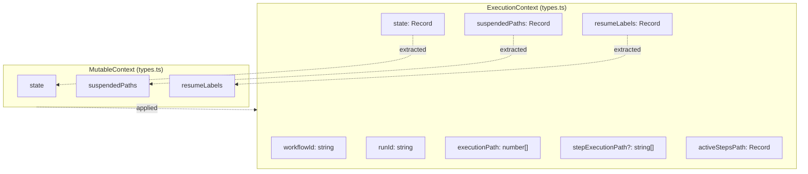
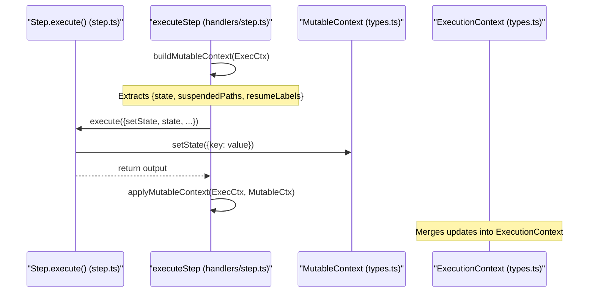
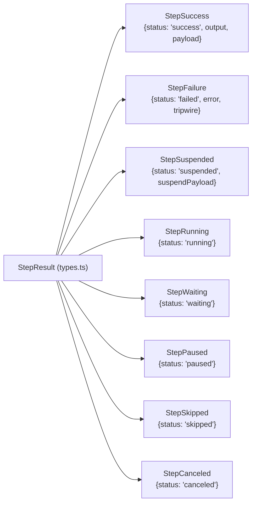
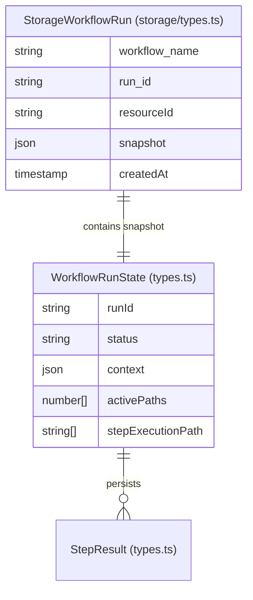

<!-- source: DeepWiki mcp.deepwiki.com · repo mastra-ai/mastra · page 4.3 Workflow State Management and Persistence · fetched 2026-10-26 -->

# Workflow State Management and Persistence

<details>
<summary>Relevant source files</summary>

The following files were used as context for generating this wiki page:

- [.changeset/dynamodb-consistent-snapshot-reads.md](.changeset/dynamodb-consistent-snapshot-reads.md)
- [.changeset/evented-foreach-running-status.md](.changeset/evented-foreach-running-status.md)
- [.changeset/strong-gifts-smell.md](.changeset/strong-gifts-smell.md)
- [docs/src/content/en/integrations/databases/cloudflare-kv.mdx](docs/src/content/en/integrations/databases/cloudflare-kv.mdx)
- [docs/src/content/en/integrations/databases/postgresql.mdx](docs/src/content/en/integrations/databases/postgresql.mdx)
- [packages/core/src/agent/__tests__/suspended-run-discovery.test.ts](packages/core/src/agent/__tests__/suspended-run-discovery.test.ts)
- [packages/core/src/processors/index.ts](packages/core/src/processors/index.ts)
- [packages/core/src/processors/processor-model-settings.test-d.ts](packages/core/src/processors/processor-model-settings.test-d.ts)
- [packages/core/src/processors/runner.test.ts](packages/core/src/processors/runner.test.ts)
- [packages/core/src/processors/runner.ts](packages/core/src/processors/runner.ts)
- [packages/core/src/processors/step-schema.ts](packages/core/src/processors/step-schema.ts)
- [packages/core/src/storage/domains/workflows/inmemory-get-by-id.test.ts](packages/core/src/storage/domains/workflows/inmemory-get-by-id.test.ts)
- [packages/core/src/storage/domains/workflows/inmemory.ts](packages/core/src/storage/domains/workflows/inmemory.ts)
- [packages/core/src/workflows/concurrent-resume.test.ts](packages/core/src/workflows/concurrent-resume.test.ts)
- [packages/core/src/workflows/default.test.ts](packages/core/src/workflows/default.test.ts)
- [packages/core/src/workflows/default.ts](packages/core/src/workflows/default.ts)
- [packages/core/src/workflows/evented/evented-workflow.test.ts](packages/core/src/workflows/evented/evented-workflow.test.ts)
- [packages/core/src/workflows/evented/foreach-running-status.test.ts](packages/core/src/workflows/evented/foreach-running-status.test.ts)
- [packages/core/src/workflows/evented/step-executor.test.ts](packages/core/src/workflows/evented/step-executor.test.ts)
- [packages/core/src/workflows/evented/step-executor.ts](packages/core/src/workflows/evented/step-executor.ts)
- [packages/core/src/workflows/evented/workflow-event-processor/index.ts](packages/core/src/workflows/evented/workflow-event-processor/index.ts)
- [packages/core/src/workflows/evented/workflow-event-processor/loop.ts](packages/core/src/workflows/evented/workflow-event-processor/loop.ts)
- [packages/core/src/workflows/evented/workflow.ts](packages/core/src/workflows/evented/workflow.ts)
- [packages/core/src/workflows/execution-engine.ts](packages/core/src/workflows/execution-engine.ts)
- [packages/core/src/workflows/foreach-nested-workflow.test.ts](packages/core/src/workflows/foreach-nested-workflow.test.ts)
- [packages/core/src/workflows/foreach-running-status.test.ts](packages/core/src/workflows/foreach-running-status.test.ts)
- [packages/core/src/workflows/handlers/control-flow.ts](packages/core/src/workflows/handlers/control-flow.ts)
- [packages/core/src/workflows/handlers/entry.ts](packages/core/src/workflows/handlers/entry.ts)
- [packages/core/src/workflows/handlers/sleep.ts](packages/core/src/workflows/handlers/sleep.ts)
- [packages/core/src/workflows/handlers/step.ts](packages/core/src/workflows/handlers/step.ts)
- [packages/core/src/workflows/types.ts](packages/core/src/workflows/types.ts)
- [packages/core/src/workflows/utils.ts](packages/core/src/workflows/utils.ts)
- [packages/core/src/workflows/workflow.test.ts](packages/core/src/workflows/workflow.test.ts)
- [packages/core/src/workflows/workflow.ts](packages/core/src/workflows/workflow.ts)
- [stores/_test-utils/src/domains/workflows/index.ts](stores/_test-utils/src/domains/workflows/index.ts)
- [stores/dsql/src/storage/client.ts](stores/dsql/src/storage/client.ts)
- [stores/dsql/src/storage/client.tx-serialize.test.ts](stores/dsql/src/storage/client.tx-serialize.test.ts)
- [stores/dsql/src/storage/domains/observability/index.ts](stores/dsql/src/storage/domains/observability/index.ts)
- [stores/dynamodb/src/storage/domains/workflows/consistent-reads.test.ts](stores/dynamodb/src/storage/domains/workflows/consistent-reads.test.ts)
- [stores/dynamodb/src/storage/domains/workflows/index.ts](stores/dynamodb/src/storage/domains/workflows/index.ts)
- [stores/libsql/src/storage/db/index.ts](stores/libsql/src/storage/db/index.ts)
- [stores/libsql/src/storage/db/safe-stringify.test.ts](stores/libsql/src/storage/db/safe-stringify.test.ts)
- [stores/libsql/src/storage/db/spans-read-indexes.test.ts](stores/libsql/src/storage/db/spans-read-indexes.test.ts)
- [stores/libsql/src/storage/db/utils.ts](stores/libsql/src/storage/db/utils.ts)
- [stores/libsql/src/storage/domains/workflows/index.test.ts](stores/libsql/src/storage/domains/workflows/index.test.ts)
- [stores/libsql/src/storage/domains/workflows/index.ts](stores/libsql/src/storage/domains/workflows/index.ts)
- [stores/libsql/src/storage/remote-init.unit.test.ts](stores/libsql/src/storage/remote-init.unit.test.ts)
- [stores/mysql/src/storage/db/schema-snapshot.test.ts](stores/mysql/src/storage/db/schema-snapshot.test.ts)
- [stores/mysql/src/storage/db/schema-snapshot.ts](stores/mysql/src/storage/db/schema-snapshot.ts)
- [stores/mysql/src/storage/domains/observability/index.ts](stores/mysql/src/storage/domains/observability/index.ts)
- [stores/mysql/src/storage/domains/operations/alter-table.unit.test.ts](stores/mysql/src/storage/domains/operations/alter-table.unit.test.ts)
- [stores/mysql/src/storage/domains/operations/index.ts](stores/mysql/src/storage/domains/operations/index.ts)
- [stores/mysql/src/storage/domains/workflows/index.ts](stores/mysql/src/storage/domains/workflows/index.ts)
- [stores/mysql/src/storage/index.ts](stores/mysql/src/storage/index.ts)
- [stores/pg/docker-compose.benchmark.yaml](stores/pg/docker-compose.benchmark.yaml)
- [stores/pg/scripts/init-benchmark.ts](stores/pg/scripts/init-benchmark.ts)
- [stores/pg/src/storage/client.ts](stores/pg/src/storage/client.ts)
- [stores/pg/src/storage/client.tx-serialize.test.ts](stores/pg/src/storage/client.tx-serialize.test.ts)
- [stores/pg/src/storage/db/constraint-utils.test.ts](stores/pg/src/storage/db/constraint-utils.test.ts)
- [stores/pg/src/storage/db/constraint-utils.ts](stores/pg/src/storage/db/constraint-utils.ts)
- [stores/pg/src/storage/db/index.ts](stores/pg/src/storage/db/index.ts)
- [stores/pg/src/storage/db/schema-snapshot.stress.test.ts](stores/pg/src/storage/db/schema-snapshot.stress.test.ts)
- [stores/pg/src/storage/db/schema-snapshot.test.ts](stores/pg/src/storage/db/schema-snapshot.test.ts)
- [stores/pg/src/storage/db/schema-snapshot.ts](stores/pg/src/storage/db/schema-snapshot.ts)
- [stores/pg/src/storage/db/timestamp-trigger.test.ts](stores/pg/src/storage/db/timestamp-trigger.test.ts)
- [stores/pg/src/storage/db/transaction-client.test.ts](stores/pg/src/storage/db/transaction-client.test.ts)
- [stores/pg/src/storage/domains/experiments/relax-not-null.test.ts](stores/pg/src/storage/domains/experiments/relax-not-null.test.ts)
- [stores/pg/src/storage/domains/favorites/index.ts](stores/pg/src/storage/domains/favorites/index.ts)
- [stores/pg/src/storage/domains/memory/save-messages.test.ts](stores/pg/src/storage/domains/memory/save-messages.test.ts)
- [stores/pg/src/storage/domains/memory/test-utils.ts](stores/pg/src/storage/domains/memory/test-utils.ts)
- [stores/pg/src/storage/domains/observability/v-next/integration.test.ts](stores/pg/src/storage/domains/observability/v-next/integration.test.ts)
- [stores/pg/src/storage/domains/workflows/concurrent-index-build.test.ts](stores/pg/src/storage/domains/workflows/concurrent-index-build.test.ts)
- [stores/pg/src/storage/domains/workflows/index.ts](stores/pg/src/storage/domains/workflows/index.ts)
- [stores/pg/src/storage/domains/workflows/sanitize-json.test.ts](stores/pg/src/storage/domains/workflows/sanitize-json.test.ts)
- [stores/pg/src/storage/domains/workflows/status-index.test.ts](stores/pg/src/storage/domains/workflows/status-index.test.ts)
- [stores/pg/src/storage/index.test.ts](stores/pg/src/storage/index.test.ts)
- [stores/pg/src/storage/index.ts](stores/pg/src/storage/index.ts)
- [stores/pg/src/storage/performance-indexes/performance-indexes.test.ts](stores/pg/src/storage/performance-indexes/performance-indexes.test.ts)
- [stores/pg/src/storage/pooler-init.pooler.test.ts](stores/pg/src/storage/pooler-init.pooler.test.ts)
- [stores/pg/src/storage/test-utils.ts](stores/pg/src/storage/test-utils.ts)
- [stores/pg/tsconfig.json](stores/pg/tsconfig.json)
- [stores/pg/vitest.config.ts](stores/pg/vitest.config.ts)
- [stores/upstash/src/storage/domains/workflows/index.ts](stores/upstash/src/storage/domains/workflows/index.ts)
- [workflows/inngest/src/index.ts](workflows/inngest/src/index.ts)

</details>


This page details how workflow execution state is structured, managed, and persisted across workflow runs in the Mastra framework. It covers the `ExecutionContext` and `MutableContext` abstractions, state update mechanisms (`setState`), step result tracking (`StepResult`), snapshot persistence across engines (`DefaultExecutionEngine`, `EventedExecutionEngine`, and `InngestExecutionEngine`), and storage integration via `MastraCompositeStore` and domain storage adapters.

---

## State Architecture Overview

Workflow execution state is split between immutable run metadata and mutable user state, managed via `ExecutionContext` and `MutableContext` respectively [packages/core/src/workflows/types.ts:830-878]().

| Structure | Mutability | Purpose | Code Entity |
|-----------|-----------|---------|-------------|
| `ExecutionContext` | Immutable during execution | Complete execution state including paths, configuration, and workflow state. | [packages/core/src/workflows/types.ts:830-855]() |
| `MutableContext` | Mutable via steps | Subset of fields that steps can modify: `state`, `suspendedPaths`, and `resumeLabels`. | [packages/core/src/workflows/types.ts:867-878]() |

**Sources:** [packages/core/src/workflows/types.ts:830-878]()

---

## ExecutionContext and MutableContext

The `ExecutionContext` tracks progress, path execution, and branching within the `ExecutionEngine`. 

Title: ExecutionContext and MutableContext Relationship

Sources: [packages/core/src/workflows/types.ts:830-878]()

### State Updates via setState()

Steps interact with workflow-level state through the `setState` function provided in execution parameters [packages/core/src/workflows/step.ts:41]().

Title: Workflow State Update Flow

Sources: [packages/core/src/workflows/default.ts:645-660](), [packages/core/src/workflows/step.ts:24-72]()

---

## Step Result Tracking

Every step execution produces a `StepResult` union tracking status, payloads, output, and execution timestamps [packages/core/src/workflows/types.ts:180-188]().

Title: StepResult Status Hierarchy

Sources: [packages/core/src/workflows/types.ts:73-188]()

---

## WorkflowRunState and Snapshot Persistence

The persistence layer maps runtime states to storage records via `WorkflowRunState` and domain storage adapters.

Title: Persistence Layer Entities

Sources: [packages/core/src/workflows/types.ts:296-324](), [packages/core/src/storage/types.ts:36-43]()

### Persistence Mechanisms Across Engines

- **`DefaultExecutionEngine`**: Manages process-local status tracking via `lastPersistedStatusByRun` to prevent overwriting suspended snapshots with intermediate running states [packages/core/src/workflows/default.ts:78-108](). The `persistStepUpdate` handler is responsible for writing the current workflow state to storage [packages/core/src/workflows/handlers/entry.ts:100-101]().
- **`EventedExecutionEngine` & `WorkflowEventProcessor`**: Publishes asynchronous execution events, tracks `deliveryAttempts` for poisoned event redelivery limits, and handles topic cleanup [packages/core/src/workflows/evented/workflow-event-processor/index.ts:155-166](). The `WorkflowEventProcessor` is responsible for persisting workflow run state changes by calling `workflowsStorage.saveWorkflowRun` [packages/core/src/workflows/evented/workflow-event-processor/index.ts:2900-2901]().
- **`InngestExecutionEngine` & `InngestWorkflow`**: Delegates execution durability to Inngest step wrappers (`step.run`, `step.sleep`) [workflows/inngest/src/index.ts:108-207]().

Sources: [packages/core/src/workflows/default.ts:78-108](), [packages/core/src/workflows/handlers/entry.ts:100-101](), [packages/core/src/workflows/evented/workflow-event-processor/index.ts:155-166](), [packages/core/src/workflows/evented/workflow-event-processor/index.ts:2900-2901](), [workflows/inngest/src/index.ts:108-207]()

---

## Storage Integration

Mastra connects workflows to persistent backends via `MastraCompositeStore` and domain-specific `WorkflowsStorage` interfaces.

Title: Workflow Storage Integration
```mermaid
graph TD
    MastraWorkflowRun["Mastra Workflow Run"] -->|Persists/Loads| MastraCompositeStore["MastraCompositeStore (base.ts)"]
    MastraCompositeStore -->|Delegates 'workflows' domain to| WorkflowsStorage["WorkflowsStorage Interface (base.ts)"]
    
    subgraph Implementations
        WorkflowsPG["WorkflowsPG (stores/pg/src/storage/domains/workflows/index.ts)"]
        WorkflowsLibSQL["WorkflowsLibSQL (stores/libsql/src/storage/domains/workflows/index.ts)"]
        WorkflowsDynamoDB["WorkflowsDynamoDB (stores/dynamodb/src/storage/domains/workflows/index.ts)"]
        WorkflowsInMemory["WorkflowsInMemory (packages/core/src/storage/domains/workflows/inmemory.ts)"]
    end

    WorkflowsStorage <|-- WorkflowsPG
    WorkflowsStorage <|-- WorkflowsLibSQL
    WorkflowsStorage <|-- WorkflowsDynamoDB
    WorkflowsStorage <|-- WorkflowsInMemory
```
Sources: [packages/core/src/storage/base.ts](), [stores/pg/src/storage/domains/workflows/index.ts](), [stores/libsql/src/storage/domains/workflows/index.ts](), [stores/dynamodb/src/storage/domains/workflows/index.ts](), [packages/core/src/storage/domains/workflows/inmemory.ts]()

---

