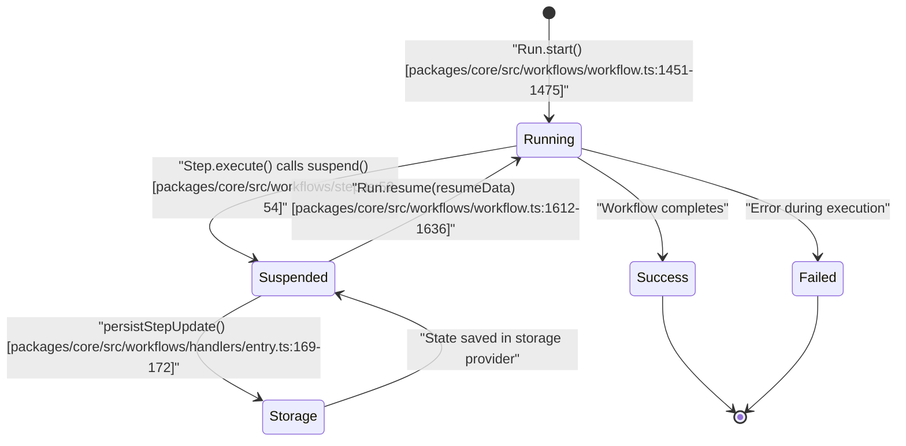
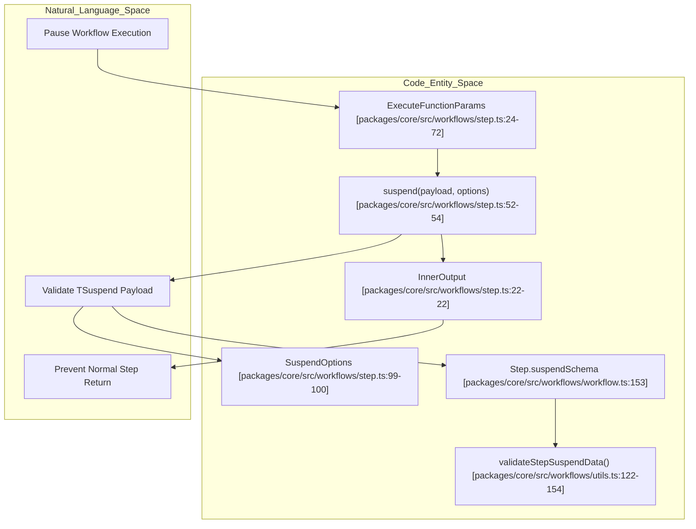
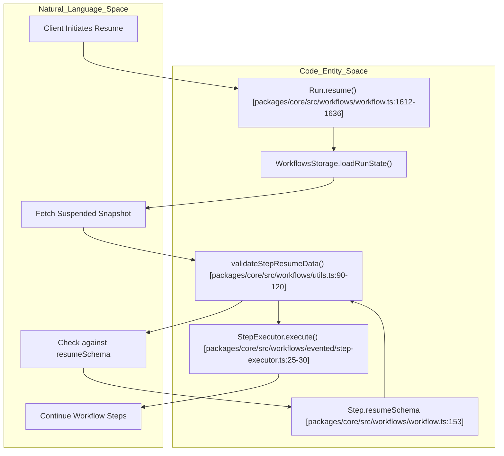

<!-- source: DeepWiki mcp.deepwiki.com · repo mastra-ai/mastra · page 4.4 Suspend and Resume Mechanism · fetched 2026-10-26 -->

# Suspend and Resume Mechanism

Relevant source files

The following files were used as context for generating this wiki page:

- [.changeset/evented-foreach-running-status.md](.changeset/evented-foreach-running-status.md)
- [.changeset/strong-gifts-smell.md](.changeset/strong-gifts-smell.md)
- [client-sdks/ai-sdk/src/__tests__/chat-route-credential-headers.test.ts](client-sdks/ai-sdk/src/__tests__/chat-route-credential-headers.test.ts)
- [deployers/cloud/src/utils/execa.ts](deployers/cloud/src/utils/execa.ts)
- [docs/src/content/en/docs/workflows/time-travel.mdx](docs/src/content/en/docs/workflows/time-travel.mdx)
- [docs/src/content/en/reference/client-js/workflows.mdx](docs/src/content/en/reference/client-js/workflows.mdx)
- [docs/src/content/en/reference/streaming/workflows/resumeStream.mdx](docs/src/content/en/reference/streaming/workflows/resumeStream.mdx)
- [docs/src/content/en/reference/workflows/run-methods/restart.mdx](docs/src/content/en/reference/workflows/run-methods/restart.mdx)
- [docs/src/content/en/reference/workflows/run-methods/resume.mdx](docs/src/content/en/reference/workflows/run-methods/resume.mdx)
- [docs/src/content/en/reference/workflows/run-methods/start.mdx](docs/src/content/en/reference/workflows/run-methods/start.mdx)
- [docs/src/content/en/reference/workflows/run-methods/timeTravel.mdx](docs/src/content/en/reference/workflows/run-methods/timeTravel.mdx)
- [docs/src/content/en/reference/workflows/workflow-methods/foreach.mdx](docs/src/content/en/reference/workflows/workflow-methods/foreach.mdx)
- [e2e-tests/deployers/template/cloudflare/src/mastra/index.ts](e2e-tests/deployers/template/cloudflare/src/mastra/index.ts)
- [packages/agent-builder/integration-tests/src/agent-template-behavior.test.ts](packages/agent-builder/integration-tests/src/agent-template-behavior.test.ts)
- [packages/agent-builder/integration-tests/src/workflow-builder-integration.test.ts](packages/agent-builder/integration-tests/src/workflow-builder-integration.test.ts)
- [packages/core/src/processors/index.ts](packages/core/src/processors/index.ts)
- [packages/core/src/processors/processor-model-settings.test-d.ts](packages/core/src/processors/processor-model-settings.test-d.ts)
- [packages/core/src/processors/runner.test.ts](packages/core/src/processors/runner.test.ts)
- [packages/core/src/processors/runner.ts](packages/core/src/processors/runner.ts)
- [packages/core/src/processors/step-schema.ts](packages/core/src/processors/step-schema.ts)
- [packages/core/src/workflows/concurrent-resume.test.ts](packages/core/src/workflows/concurrent-resume.test.ts)
- [packages/core/src/workflows/concurrent-time-travel.test.ts](packages/core/src/workflows/concurrent-time-travel.test.ts)
- [packages/core/src/workflows/default.test.ts](packages/core/src/workflows/default.test.ts)
- [packages/core/src/workflows/default.ts](packages/core/src/workflows/default.ts)
- [packages/core/src/workflows/evented/concurrent-time-travel.test.ts](packages/core/src/workflows/evented/concurrent-time-travel.test.ts)
- [packages/core/src/workflows/evented/evented-workflow.test.ts](packages/core/src/workflows/evented/evented-workflow.test.ts)
- [packages/core/src/workflows/evented/foreach-running-status.test.ts](packages/core/src/workflows/evented/foreach-running-status.test.ts)
- [packages/core/src/workflows/evented/step-executor.test.ts](packages/core/src/workflows/evented/step-executor.test.ts)
- [packages/core/src/workflows/evented/step-executor.ts](packages/core/src/workflows/evented/step-executor.ts)
- [packages/core/src/workflows/evented/workflow-event-processor/index.ts](packages/core/src/workflows/evented/workflow-event-processor/index.ts)
- [packages/core/src/workflows/evented/workflow-event-processor/loop.ts](packages/core/src/workflows/evented/workflow-event-processor/loop.ts)
- [packages/core/src/workflows/evented/workflow.ts](packages/core/src/workflows/evented/workflow.ts)
- [packages/core/src/workflows/execution-engine.ts](packages/core/src/workflows/execution-engine.ts)
- [packages/core/src/workflows/foreach-nested-workflow.test.ts](packages/core/src/workflows/foreach-nested-workflow.test.ts)
- [packages/core/src/workflows/foreach-running-status.test.ts](packages/core/src/workflows/foreach-running-status.test.ts)
- [packages/core/src/workflows/handlers/control-flow.ts](packages/core/src/workflows/handlers/control-flow.ts)
- [packages/core/src/workflows/handlers/entry.ts](packages/core/src/workflows/handlers/entry.ts)
- [packages/core/src/workflows/handlers/sleep.ts](packages/core/src/workflows/handlers/sleep.ts)
- [packages/core/src/workflows/handlers/step.ts](packages/core/src/workflows/handlers/step.ts)
- [packages/core/src/workflows/types.ts](packages/core/src/workflows/types.ts)
- [packages/core/src/workflows/utils.ts](packages/core/src/workflows/utils.ts)
- [packages/core/src/workflows/workflow.test.ts](packages/core/src/workflows/workflow.test.ts)
- [packages/core/src/workflows/workflow.ts](packages/core/src/workflows/workflow.ts)
- [packages/deployer/src/build/analyze/constants.ts](packages/deployer/src/build/analyze/constants.ts)
- [packages/deployer/src/deploy/log.ts](packages/deployer/src/deploy/log.ts)
- [packages/deployer/src/validator/custom-resolver.ts](packages/deployer/src/validator/custom-resolver.ts)
- [packages/deployer/src/validator/validate.test.ts](packages/deployer/src/validator/validate.test.ts)
- [packages/deployer/src/validator/validate.ts](packages/deployer/src/validator/validate.ts)
- [packages/server/src/server/agent-builder-ee-static-imports.test.ts](packages/server/src/server/agent-builder-ee-static-imports.test.ts)
- [packages/server/src/server/handlers/agent-builder.test.ts](packages/server/src/server/handlers/agent-builder.test.ts)
- [packages/server/src/server/handlers/authorship.ts](packages/server/src/server/handlers/authorship.ts)
- [packages/server/src/server/handlers/editor-builder.test.ts](packages/server/src/server/handlers/editor-builder.test.ts)
- [packages/server/src/server/handlers/editor-builder.ts](packages/server/src/server/handlers/editor-builder.ts)
- [packages/server/src/server/handlers/error.test.ts](packages/server/src/server/handlers/error.test.ts)
- [packages/server/src/server/handlers/error.ts](packages/server/src/server/handlers/error.ts)
- [packages/server/src/server/handlers/mcp.ts](packages/server/src/server/handlers/mcp.ts)
- [packages/server/src/server/handlers/tool-schema-overrides.ts](packages/server/src/server/handlers/tool-schema-overrides.ts)
- [packages/server/src/server/handlers/tools.test.ts](packages/server/src/server/handlers/tools.test.ts)
- [packages/server/src/server/handlers/tools.ts](packages/server/src/server/handlers/tools.ts)
- [packages/server/src/server/handlers/utils.test.ts](packages/server/src/server/handlers/utils.test.ts)
- [packages/server/src/server/handlers/utils.ts](packages/server/src/server/handlers/utils.ts)
- [packages/server/src/server/handlers/workflow-builder.test.ts](packages/server/src/server/handlers/workflow-builder.test.ts)
- [packages/server/src/server/handlers/workflow-builder.ts](packages/server/src/server/handlers/workflow-builder.ts)
- [packages/server/src/server/handlers/workflows.restart.test.ts](packages/server/src/server/handlers/workflows.restart.test.ts)
- [packages/server/src/server/handlers/workflows.test.ts](packages/server/src/server/handlers/workflows.test.ts)
- [packages/server/src/server/handlers/workflows.ts](packages/server/src/server/handlers/workflows.ts)
- [packages/server/src/server/schemas/editor-builder.ts](packages/server/src/server/schemas/editor-builder.ts)
- [packages/server/src/server/schemas/workflows.ts](packages/server/src/server/schemas/workflows.ts)
- [packages/server/src/server/server-adapter/mcp-auth.ts](packages/server/src/server/server-adapter/mcp-auth.ts)
- [packages/server/src/server/server-adapter/routes/editor-builder.ts](packages/server/src/server/server-adapter/routes/editor-builder.ts)
- [packages/server/src/server/utils.ts](packages/server/src/server/utils.ts)
- [packages/server/src/server/utils/resolve-builder-model-policy.ts](packages/server/src/server/utils/resolve-builder-model-policy.ts)
- [workflows/inngest/src/index.ts](workflows/inngest/src/index.ts)

## Purpose and Scope
This document explains the suspend and resume mechanism in Mastra workflows (`Workflow`, `DefaultExecutionEngine`, `EventedExecutionEngine`), allowing execution to pause at any step and later continue with new data (`resumeData`). This architecture powers human-in-the-loop approvals, external event integrations, and long-running workflows that survive server restarts through storage persistence.

Sources: [packages/core/src/workflows/workflow.ts:1-131](), [packages/core/src/workflows/default.ts:1-115]()

---

## Suspend and Resume Lifecycle
The lifecycle transitions a workflow run into a `suspended` status, persists its snapshot via `persistStepUpdate` [packages/core/src/workflows/handlers/entry.ts:169-172](), and resumes via `Run.resume()` [packages/core/src/workflows/workflow.ts:1612-1636]().

### Diagram: Lifecycle Flow from Natural Language to Code Entities

Sources: [packages/core/src/workflows/workflow.ts:1451-1475](), [packages/core/src/workflows/workflow.ts:1612-1636](), [packages/core/src/workflows/step.ts:52-54](), [packages/core/src/workflows/handlers/entry.ts:169-172]()

---

## Suspend Function and Options
Steps suspend execution by invoking the `suspend` callback provided in `ExecuteFunctionParams` [packages/core/src/workflows/step.ts:52-54](). The `suspend` function takes a `payload` and `SuspendOptions` [packages/core/src/workflows/step.ts:99-100](). The `suspendSchema` defined on a `Step` [packages/core/src/workflows/workflow.ts:153]() is used to validate the `payload` provided to `suspend()` [packages/core/src/workflows/utils.ts:122-154]().

### Diagram: Suspend Function Signature and Branded Type

Sources: [packages/core/src/workflows/step.ts:24-72](), [packages/core/src/workflows/step.ts:99-100](), [packages/core/src/workflows/workflow.ts:153](), [packages/core/src/workflows/utils.ts:122-154]()

---

## Resume Mechanism and Data Flow
Resuming loads the `WorkflowRunState` from storage and invokes `Run.resume()` [packages/core/src/workflows/workflow.ts:1612-1636](). The `resumeData` provided to `Run.resume()` is validated against the `resumeSchema` defined on the `Step` [packages/core/src/workflows/workflow.ts:153]() using `validateStepResumeData` [packages/core/src/workflows/utils.ts:90-120]().

### Diagram: Resume Data Flow and Validation

Sources: [packages/core/src/workflows/workflow.ts:1612-1636](), [packages/core/src/workflows/workflow.ts:153](), [packages/core/src/workflows/utils.ts:90-120](), [packages/core/src/workflows/evented/step-executor.ts:25-30]()

---

## Execution Engine Implementations
- **`DefaultExecutionEngine`**: Manages state snapshots using `persistStepUpdate` [packages/core/src/workflows/handlers/entry.ts:169-172]() and guards against race conditions via `lastPersistedStatusByRun` [packages/core/src/workflows/default.ts:93-108](). When a step is resumed, `recordResumedStepStart` is used in `persistStepUpdate` to ensure the `running` status is persisted, allowing the resume data to survive a crash mid-step [packages/core/src/workflows/handlers/entry.ts:164-166]().
- **`EventedExecutionEngine`**: Publishes suspension events handled by `WorkflowEventProcessor` [packages/core/src/workflows/evented/workflow-event-processor/index.ts:148-149](). The `WorkflowEventProcessor` handles `workflow.step.suspended` events and processes `resumeData` when a step is resumed [packages/core/src/workflows/evented/workflow-event-processor/index.ts:62-62]().
- **`InngestExecutionEngine`**: Maps suspend/resume onto durable platform primitives in Inngest [workflows/inngest/src/index.ts:108-126]().

Sources: [packages/core/src/workflows/default.ts:93-108](), [packages/core/src/workflows/handlers/entry.ts:164-172](), [packages/core/src/workflows/evented/workflow-event-processor/index.ts:62-62](), [packages/core/src/workflows/evented/workflow-event-processor/index.ts:148-149](), [workflows/inngest/src/index.ts:108-126]()

---

## Code Entities Reference

| Entity | File Path | Role |
|--------|-----------|------|
| `Step` | [packages/core/src/workflows/workflow.ts:98-100]() | Defines `suspendSchema` and `resumeSchema` on a step. |
| `ExecuteFunctionParams` | [packages/core/src/workflows/step.ts:24-72]() | Provides `suspend` and `resumeData` to step execution logic. |
| `InnerOutput` | [packages/core/src/workflows/step.ts:22-22]() | Branded type returned by `suspend()`. |
| `StepSuspended` | [packages/core/src/workflows/types.ts:115-123]() | Status container for suspended steps. |
| `persistStepUpdate` | [packages/core/src/workflows/handlers/entry.ts:169-172]() | Persists state updates to storage, including `suspended` status. |
| `DefaultExecutionEngine` | [packages/core/src/workflows/default.ts:78-115]() | Default engine for local workflow runs and snapshots, manages `lastPersistedStatusByRun`. |
| `validateStepResumeData` | [packages/core/src/workflows/utils.ts:90-120]() | Validates `resumeData` against `resumeSchema`. |
| `validateStepSuspendData` | [packages/core/src/workflows/utils.ts:122-154]() | Validates `suspendData` against `suspendSchema`. |

Sources: [packages/core/src/workflows/workflow.ts:98-100](), [packages/core/src/workflows/workflow.ts:153](), [packages/core/src/workflows/step.ts:22-72](), [packages/core/src/workflows/types.ts:115-123](), [packages/core/src/workflows/handlers/entry.ts:169-172](), [packages/core/src/workflows/default.ts:78-115](), [packages/core/src/workflows/utils.ts:90-154]()

---

