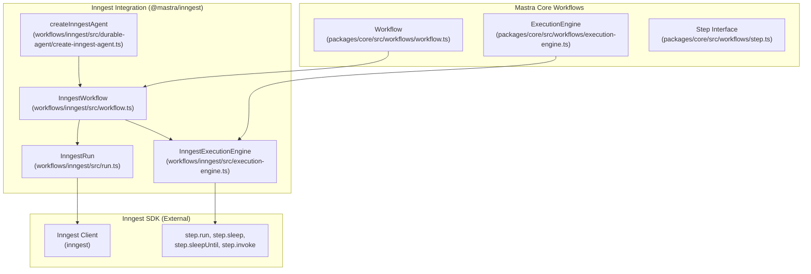
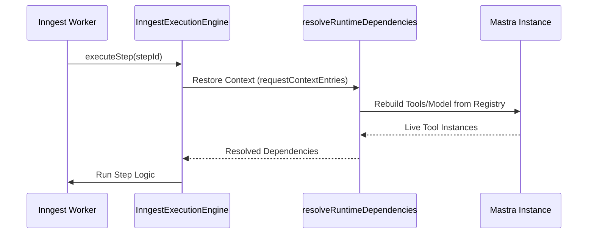
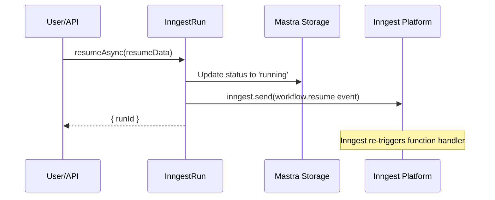

<!-- source: DeepWiki mcp.deepwiki.com · repo mastra-ai/mastra · page 4.7 Inngest Durability Integration · fetched 2026-10-26 -->

# Inngest Durability Integration

Relevant source files

The following files were used as context for generating this wiki page:

- [docs/src/content/en/integrations/deploy/inngest.mdx](docs/src/content/en/integrations/deploy/inngest.mdx)
- [docs/src/content/en/reference/agents/inngest-agent.mdx](docs/src/content/en/reference/agents/inngest-agent.mdx)
- [examples/inngest/README.md](examples/inngest/README.md)
- [examples/inngest/package.json](examples/inngest/package.json)
- [packages/core/src/agent/durable/constants.ts](packages/core/src/agent/durable/constants.ts)
- [packages/core/src/agent/durable/index.ts](packages/core/src/agent/durable/index.ts)
- [workflows/inngest/CHANGELOG.md](workflows/inngest/CHANGELOG.md)
- [workflows/inngest/package.json](workflows/inngest/package.json)
- [workflows/inngest/src/__tests__/create-inngest-agent.test.ts](workflows/inngest/src/__tests__/create-inngest-agent.test.ts)
- [workflows/inngest/src/__tests__/durable-abort.test.ts](workflows/inngest/src/__tests__/durable-abort.test.ts)
- [workflows/inngest/src/__tests__/durable-agent.test.utils.ts](workflows/inngest/src/__tests__/durable-agent.test.utils.ts)
- [workflows/inngest/src/__tests__/durable-finish-side-effects-serve.test.ts](workflows/inngest/src/__tests__/durable-finish-side-effects-serve.test.ts)
- [workflows/inngest/src/__tests__/fixtures/abort-agent.ts](workflows/inngest/src/__tests__/fixtures/abort-agent.ts)
- [workflows/inngest/src/__tests__/fixtures/abort-worker.ts](workflows/inngest/src/__tests__/fixtures/abort-worker.ts)
- [workflows/inngest/src/__tests__/inngest-agent-delegation-retry.test.ts](workflows/inngest/src/__tests__/inngest-agent-delegation-retry.test.ts)
- [workflows/inngest/src/connect.test.ts](workflows/inngest/src/connect.test.ts)
- [workflows/inngest/src/connect.ts](workflows/inngest/src/connect.ts)
- [workflows/inngest/src/durable-agent/create-inngest-agent.ts](workflows/inngest/src/durable-agent/create-inngest-agent.ts)
- [workflows/inngest/src/durable-agent/create-inngest-agentic-workflow.test.ts](workflows/inngest/src/durable-agent/create-inngest-agentic-workflow.test.ts)
- [workflows/inngest/src/durable-agent/create-inngest-agentic-workflow.ts](workflows/inngest/src/durable-agent/create-inngest-agentic-workflow.ts)
- [workflows/inngest/src/execution-engine.test.ts](workflows/inngest/src/execution-engine.test.ts)
- [workflows/inngest/src/execution-engine.ts](workflows/inngest/src/execution-engine.ts)
- [workflows/inngest/src/function-retries.test.ts](workflows/inngest/src/function-retries.test.ts)
- [workflows/inngest/src/functions.test.ts](workflows/inngest/src/functions.test.ts)
- [workflows/inngest/src/functions.ts](workflows/inngest/src/functions.ts)
- [workflows/inngest/src/index.test.ts](workflows/inngest/src/index.test.ts)
- [workflows/inngest/src/pubsub.ts](workflows/inngest/src/pubsub.ts)
- [workflows/inngest/src/realtime-subscription.test.ts](workflows/inngest/src/realtime-subscription.test.ts)
- [workflows/inngest/src/resume-async.test.ts](workflows/inngest/src/resume-async.test.ts)
- [workflows/inngest/src/resume-nested-workflow.test.ts](workflows/inngest/src/resume-nested-workflow.test.ts)
- [workflows/inngest/src/resume-snapshot-rehydration.test.ts](workflows/inngest/src/resume-snapshot-rehydration.test.ts)
- [workflows/inngest/src/run.ts](workflows/inngest/src/run.ts)
- [workflows/inngest/src/serve.test.ts](workflows/inngest/src/serve.test.ts)
- [workflows/inngest/src/serve.ts](workflows/inngest/src/serve.ts)
- [workflows/inngest/src/types.ts](workflows/inngest/src/types.ts)
- [workflows/inngest/src/workflow.ts](workflows/inngest/src/workflow.ts)
- [workflows/inngest/vitest.config.ts](workflows/inngest/vitest.config.ts)

The Inngest Durability Integration provides durable, resilient workflow execution by leveraging the Inngest platform's built-in primitives for automatic memoization, retries, and state persistence. This integration extends the standard Mastra workflow system [workflows/inngest/src/workflow.ts:1-50]() with Inngest-specific capabilities that ensure workflows can survive failures and resume from the last successful step.

**Key capabilities:**
- **Automatic memoization**: Steps executed via `step.run()` are cached and never re-executed on retry [workflows/inngest/src/execution-engine.ts:143-143]().
- **Durable sleep**: `step.sleep()` and `step.sleepUntil()` primitives for time-based orchestration [workflows/inngest/src/execution-engine.ts:12-13]().
- **Durable Agents**: Specialized support for running agentic loops as durable Inngest functions [workflows/inngest/src/durable-agent/create-inngest-agent.ts:1-37]().
- **Nested workflows**: Detection and handling of platform-specific workflow types, allowing one Inngest workflow to invoke another as a durable step [workflows/inngest/src/execution-engine.ts:105-107]().
- **Built-in retries**: Failed steps automatically retry, with support for `MastraNonRetryableError` to bail early [workflows/inngest/src/execution-engine.ts:124-190]().

Sources: [workflows/inngest/src/workflow.ts:1-117](), [workflows/inngest/src/execution-engine.ts:1-70](), [workflows/inngest/src/durable-agent/create-inngest-agent.ts:39-63]()

---

## Architecture Overview

The Inngest integration introduces specialized workflow and execution components that wrap Inngest SDK primitives while maintaining compatibility with Mastra's standard workflow API.

### Natural Language to Code Entity Mapping
This diagram associates high-level durability concepts with the specific classes and functions in the `@mastra/inngest` package.

Sources: [workflows/inngest/src/workflow.ts:52-70](), [workflows/inngest/src/execution-engine.ts:57-70](), [workflows/inngest/src/run.ts:27-42](), [workflows/inngest/src/durable-agent/create-inngest-agent.ts:92-113]()

---

## Core Classes and Functions

### InngestWorkflow Class
`InngestWorkflow` extends the base `Workflow` class to integrate with Inngest's execution model. It manages the conversion of Mastra workflow steps into Inngest-compatible function definitions [workflows/inngest/src/workflow.ts:147-165]().

| Property | Type | Description |
|----------|------|-------------|
| `inngest` | `Inngest` | The Inngest client instance [workflows/inngest/src/workflow.ts:167]() |
| `flowControlConfig` | `InngestFlowControlConfig` | Inngest-specific configuration (concurrency, rateLimit, throttle) [workflows/inngest/src/workflow.ts:171]() |
| `cronConfig` | `InngestFlowCronConfig` | Configuration for scheduled workflows [workflows/inngest/src/workflow.ts:173]() |

**Key methods:**
- `__setPubsubFactory()`: Propagates a PubSub factory to nested workflows, enabling `DurableAgent` to share a `CachingPubSub` across steps [workflows/inngest/src/workflow.ts:177-178]().
- `listWorkflowRuns()`: Retrieves run history from the Mastra storage layer [workflows/inngest/src/workflow.ts:290-308]().

Sources: [workflows/inngest/src/workflow.ts:147-308]()

### InngestExecutionEngine Class
`InngestExecutionEngine` implements the `ExecutionEngine` interface using Inngest's durable primitives [workflows/inngest/src/execution-engine.ts:61-75]().

**Key Differences from DefaultExecutionEngine:**

| Aspect | DefaultExecutionEngine | InngestExecutionEngine |
|--------|------------------------|------------------------|
| **Memoization** | In-memory retry count | Automatic via `step.run()` [workflows/inngest/src/execution-engine.ts:143-143]() |
| **Sleep** | `setTimeout` | Native `step.sleep()` primitive [workflows/inngest/src/execution-engine.ts:12-13]() |
| **Context Serialization** | Not required | `requiresDurableContextSerialization()` returns `true` [workflows/inngest/src/execution-engine.ts:110-112]() |
| **Error Handling** | Basic retry loop | Preserves `SerializedError` for Inngest debugging [workflows/inngest/src/execution-engine.ts:94-103]() |

Sources: [workflows/inngest/src/execution-engine.ts:61-190]()

---

## Durable Agent Integration

Mastra allows wrapping standard Agents in an Inngest durable layer using `createInngestAgent`. This creates a workflow that manages the agentic loop (LLM calls and tool executions) as a series of durable steps [workflows/inngest/src/durable-agent/create-inngest-agent.ts:1-37]().

### Replay and Observability Mapping
This diagram outlines how runtime execution states are restored during Inngest step replays across process boundaries.

Sources: [workflows/inngest/src/durable-agent/create-inngest-agentic-workflow.ts:61-82](), [workflows/inngest/src/durable-agent/create-inngest-agent.ts:1-60]()

---

## Durable Primitives and Replay Safety

Replay safety is critical in durable workflows. `InngestExecutionEngine` ensures that side effects are only executed once by wrapping them in `step.run` identifiers derived from the Mastra step ID [workflows/inngest/src/execution-engine.ts:143-143]().

### executeStepWithRetry
The engine implements a manual retry loop that respects Inngest's `NonRetriableError`. If an error is flagged as non-retryable (e.g., via `MastraNonRetryableError`), the engine bails immediately to prevent infinite loops in the Inngest platform [workflows/inngest/src/execution-engine.ts:124-190]().

### Resume Mechanism
Inngest workflows support asynchronous resumption. `InngestRun.resumeAsync()` dispatches a resume event to the Inngest platform and returns the `runId` immediately, without waiting for the workflow to finish. This is useful for human-in-the-loop tool approvals [workflows/inngest/src/run.ts:290-320]().

Sources: [workflows/inngest/src/run.ts:290-320](), [workflows/inngest/src/execution-engine.ts:124-190]()

---

## Observability and Realtime Streams

`InngestRun` uses a hybrid approach to provide realtime feedback to clients. It combines Inngest's `realtime.subscribe` mechanism for "watch" topics with a polling fallback against the Mastra storage layer [workflows/inngest/src/run.ts:84-176]().

### Resumable Streams
By wrapping the internal PubSub in a `CachingPubSub`, `InngestAgent` allows clients to disconnect and reconnect to a running agent. When a client calls `observe()`, the `CachingPubSub` replays all missed events from the configured `MastraServerCache` (e.g., Redis or memory) [workflows/inngest/src/durable-agent/create-inngest-agent.ts:104-110]().

Sources: [workflows/inngest/src/run.ts:84-176](), [workflows/inngest/src/durable-agent/create-inngest-agent.ts:104-110](), [workflows/inngest/src/workflow.ts:177-178]()

---

