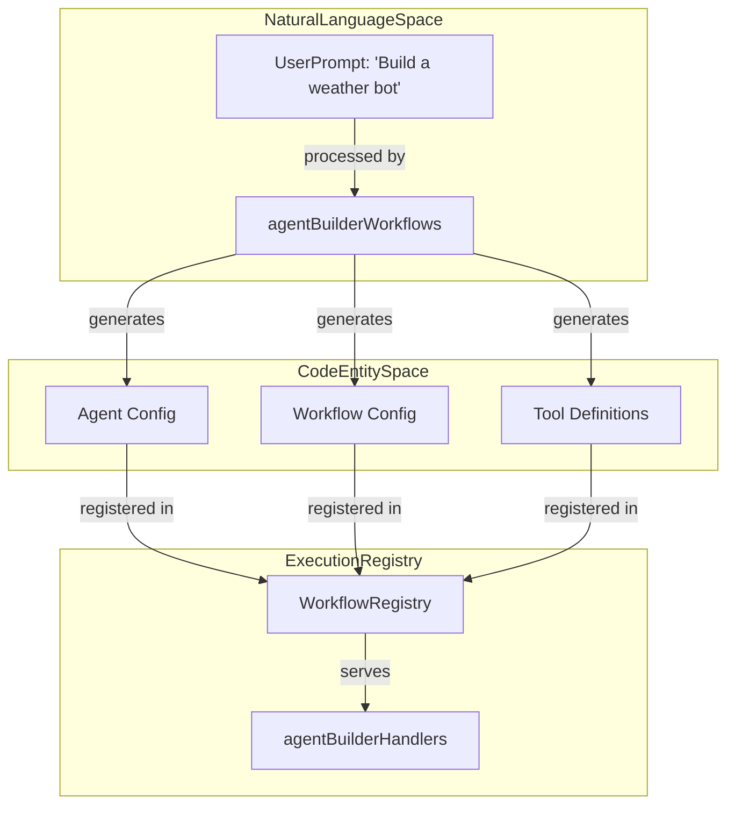
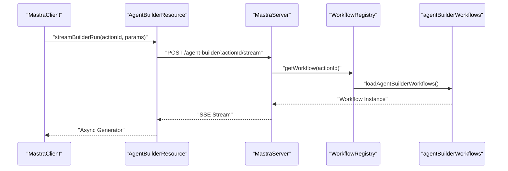

<!-- source: DeepWiki mcp.deepwiki.com · repo mastra-ai/mastra · page 4.8 Agent Builder and Template Merge Workflows · fetched 2026-10-26 -->

# Agent Builder and Template Merge Workflows

Relevant source files

The following files were used as context for generating this wiki page:

- [packages/agent-builder/CHANGELOG.md](packages/agent-builder/CHANGELOG.md)
- [packages/agent-builder/package.json](packages/agent-builder/package.json)
- [packages/editor/CHANGELOG.md](packages/editor/CHANGELOG.md)
- [packages/editor/package.json](packages/editor/package.json)
- [packages/memory/CHANGELOG.md](packages/memory/CHANGELOG.md)
- [packages/memory/package.json](packages/memory/package.json)

The purpose of this page is to explain the `@mastra/agent-builder` system, detailing agent-builder workflows (such as template merge and code editor modes), server endpoints, and client SDK operations that drive builder runs.

## Overview of Agent Builder

The Agent Builder transforms plain-language descriptions into fully configured Mastra agents (including names, descriptions, models, capabilities, and system prompts) without requiring continuous user interaction.

### Authoring Loop
The builder operates through a structured execution loop:
1. **Step A — Understand Outcome**: Analyze the desired result.
2. **Step B — Define Identity**: Determine a concise name and description.
3. **Step C — Decide Capabilities**: Select the minimal necessary tools, workflows, or stored skills.
4. **Step D — Synthesize Instructions**: Formulate the internal execution contract.
5. **Step E — Finalize and Summarize**: Execute setters and return a summary of capabilities.

### System Architecture

The Agent Builder bridges natural language intents with underlying code entities via specialized workflows registered in the server.

Title: "Agent Builder Natural Language to Code Bridge"

Sources: [packages/server/src/server/utils.ts:124-132](), [packages/server/src/server/handlers/agent-builder.ts:31-42]()

---

## Server Endpoints and Client SDK Operations

Builder operations are exposed through specific server handlers and consumed via the client SDK.

### Server Handlers
The server exposes routes for executing and streaming builder workflows:
* `LIST_AGENT_BUILDER_ACTIONS_ROUTE`: Lists available actions [packages/server/src/server/handlers/agent-builder.ts:48-73]().
* `GET_AGENT_BUILDER_ACTION_BY_ID_ROUTE`: Retrieves specific action details [packages/server/src/server/handlers/agent-builder.ts:75-107]().
* `CREATE_AGENT_BUILDER_ACTION_RUN_ROUTE`: Instantiates a builder run [packages/server/src/server/handlers/agent-builder.ts:182-205]().
* `STREAM_AGENT_BUILDER_ACTION_RUN_ROUTE`: Streams execution chunks [packages/server/src/server/handlers/agent-builder.ts:327-360]().

These handlers use `WorkflowRegistry.registerTemporaryWorkflows` to make builder workflows available [packages/server/src/server/handlers/agent-builder.ts:36-42]().

### Client SDK Operations
The client SDK provides an `AgentBuilder` resource that communicates with these endpoints.

Title: "Agent Builder Request Flow"

Sources: [packages/server/src/server/handlers/agent-builder.ts:31-42](), [packages/server/src/server/utils.ts:124-132]()

---

## Template Merge Workflows and Code Editor Mode

Template merge workflows allow users to merge new requirements or project versions into existing templates. The `@mastra/agent-builder` package itself depends on various AI SDKs for different LLM providers, indicating its role in orchestrating LLM interactions for agent creation [packages/agent-builder/package.json:32-42](). It also leverages `@mastra/memory` and `@mastra/schema-compat` for memory management and schema compatibility during the building process [packages/agent-builder/package.json:43-44]().

### Workflow Integration and Lifecycle
Builder runs follow the standard workflow execution states (such as `success`, `failed`, and `tripwire`) and support cancellation through `CANCEL_AGENT_BUILDER_ACTION_RUN_ROUTE` [packages/server/src/server/handlers/agent-builder.ts:297-325](), [packages/server/src/server/handlers/workflows.ts:51-52](). Stream duplication is avoided by caching stream outputs [packages/server/src/server/handlers/workflows.ts:72-106]().

### Code Editor Mode
The builder supports a "code editor" mode utilizing `AgentEditorConfig` to adjust agent definitions directly [client-sdks/client-js/src/types.ts:11-12](). Default settings for observational memory and workspaces are automatically provisioned when not explicitly specified [packages/editor/src/namespaces/agent.ts:82-130](). The `@mastra/editor` package, which provides the `MastraEditor` system, is a key component for agent management and instantiation, allowing for CMS-style editing of agent configurations [packages/editor/package.json:4](). It integrates with `@mastra/memory` and `@mastra/schema-compat` [packages/editor/package.json:86-87]().

Sources: [packages/server/src/server/handlers/agent-builder.ts:297-325](), [packages/server/src/server/handlers/workflows.ts:51-106](), [client-sdks/client-js/src/types.ts:11-12](), [packages/editor/src/namespaces/agent.ts:82-130](), [packages/agent-builder/package.json:32-44](), [packages/editor/package.json:4](), [packages/editor/package.json:86-87]()

---

