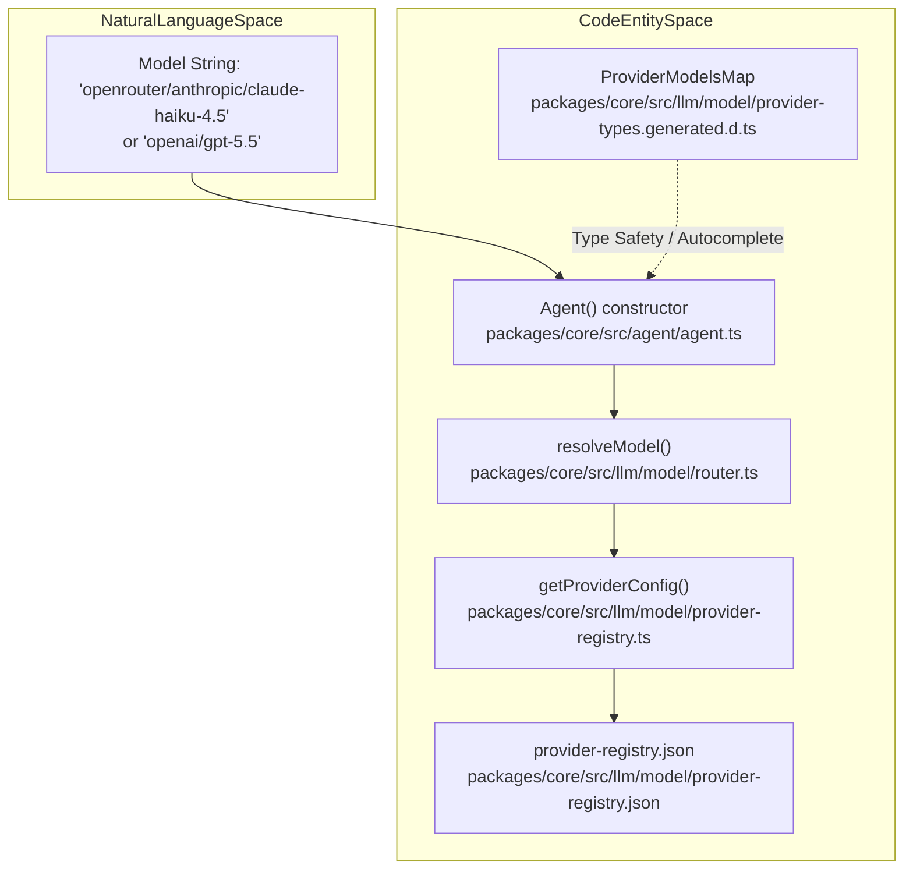
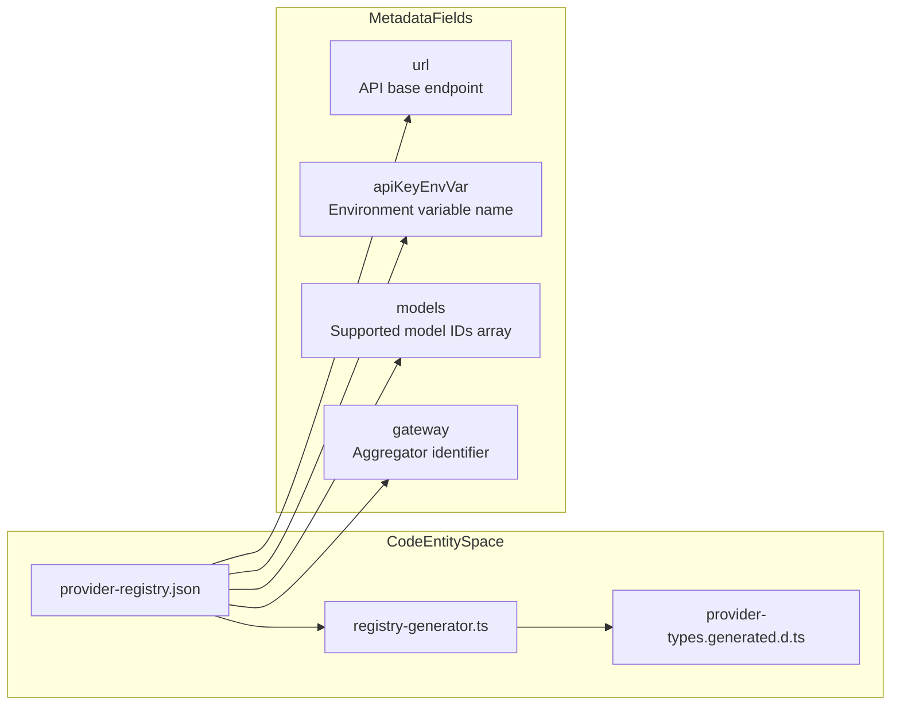
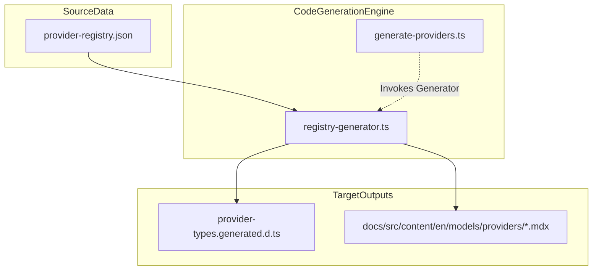

<!-- source: DeepWiki mcp.deepwiki.com · repo mastra-ai/mastra · page 5.1 Provider Registry and Model Catalog · fetched 2026-10-26 -->

# Provider Registry and Model Catalog

Relevant source files

The following files were used as context for generating this wiki page:

- [docs/src/content/en/models/gateways/index.mdx](docs/src/content/en/models/gateways/index.mdx)
- [docs/src/content/en/models/gateways/netlify.mdx](docs/src/content/en/models/gateways/netlify.mdx)
- [docs/src/content/en/models/gateways/openrouter.mdx](docs/src/content/en/models/gateways/openrouter.mdx)
- [docs/src/content/en/models/gateways/vercel.mdx](docs/src/content/en/models/gateways/vercel.mdx)
- [docs/src/content/en/models/index.mdx](docs/src/content/en/models/index.mdx)
- [docs/src/content/en/models/providers/anthropic.mdx](docs/src/content/en/models/providers/anthropic.mdx)
- [docs/src/content/en/models/providers/deepseek.mdx](docs/src/content/en/models/providers/deepseek.mdx)
- [docs/src/content/en/models/providers/edenai.mdx](docs/src/content/en/models/providers/edenai.mdx)
- [docs/src/content/en/models/providers/google.mdx](docs/src/content/en/models/providers/google.mdx)
- [docs/src/content/en/models/providers/index.mdx](docs/src/content/en/models/providers/index.mdx)
- [docs/src/content/en/models/providers/kilo.mdx](docs/src/content/en/models/providers/kilo.mdx)
- [docs/src/content/en/models/providers/nano-gpt.mdx](docs/src/content/en/models/providers/nano-gpt.mdx)
- [docs/src/content/en/models/providers/openai.mdx](docs/src/content/en/models/providers/openai.mdx)
- [docs/src/content/en/models/providers/opencode.mdx](docs/src/content/en/models/providers/opencode.mdx)
- [packages/core/src/llm/model/capabilities/anthropic.json](packages/core/src/llm/model/capabilities/anthropic.json)
- [packages/core/src/llm/model/capabilities/edenai.json](packages/core/src/llm/model/capabilities/edenai.json)
- [packages/core/src/llm/model/capabilities/kilo.json](packages/core/src/llm/model/capabilities/kilo.json)
- [packages/core/src/llm/model/capabilities/nano-gpt.json](packages/core/src/llm/model/capabilities/nano-gpt.json)
- [packages/core/src/llm/model/capabilities/openrouter.json](packages/core/src/llm/model/capabilities/openrouter.json)
- [packages/core/src/llm/model/capabilities/vercel.json](packages/core/src/llm/model/capabilities/vercel.json)
- [packages/core/src/llm/model/provider-registry.json](packages/core/src/llm/model/provider-registry.json)
- [packages/core/src/llm/model/provider-types.generated.d.ts](packages/core/src/llm/model/provider-types.generated.d.ts)

This document describes the provider registry system that maintains Mastra's catalog of providers and models. The registry provides a single source of truth for provider configurations, model availability, authentication requirements, and API endpoints. This system powers Mastra's unified model router interface where any model can be accessed using the `"provider/model-name"` string format.

Sources: [packages/core/src/llm/model/provider-registry.json:1-50](), [packages/core/src/llm/model/provider-types.generated.d.ts:1-10](), [docs/src/content/en/models/index.mdx:6-15]()

## Provider Registry Architecture and Routing Flow

The provider registry links human-readable configuration strings (Natural Language Space) to runtime execution and type definitions (Code Entity Space). When an agent is initialized with a model string, the routing subsystem resolves the provider, validates environment variables, and delegates to the appropriate Vercel AI SDK provider or gateway.

Title: Model Resolution Flow from Config String to Code Entities

Sources: [packages/core/src/llm/model/provider-registry.json:1-50](), [packages/core/src/llm/model/provider-types.generated.d.ts:10-25](), [docs/src/content/en/models/index.mdx:27-45]()

## Provider Registry JSON Structure

The `provider-registry.json` file at [packages/core/src/llm/model/provider-registry.json]() defines each provider's configuration. Each entry maps a provider key to its metadata, endpoints, authentication headers, and supported models.

Title: Registry Entry Schema and Code Mapping

Sources: [packages/core/src/llm/model/provider-registry.json:1-124](), [packages/core/src/llm/model/provider-types.generated.d.ts:1-35]()

### Field Specifications

| Field | Type | Required | Purpose | Example |
|-------|------|----------|---------|---------
| `url` | string | Yes | API base endpoint | `"https://api.kilo.ai/api/gateway"` |
| `apiKeyEnvVar` | string | Yes | Env var for API key | `"KILO_API_KEY"` |
| `apiKeyHeader` | string | No | Header for auth | `"Authorization"` |
| `name` | string | Yes | Display name | `"Kilo Gateway"` |
| `models` | string[] | Yes | Array of model IDs | `["aion-labs/aion-2.0", "aion-labs/aion-3.0"]` |
| `docUrl` | string | No | Documentation link | `"https://kilo.ai"` |
| `gateway` | string | No | Aggregator indicator | `"models.dev"` |

Sources: [packages/core/src/llm/model/provider-registry.json:3-8]()

## Type Generation Pipeline

To ensure compile-time safety and IDE autocomplete for model strings, Mastra includes an automated generation pipeline managed by `registry-generator.ts`.

Title: Type Generation Pipeline from JSON to Generated Definitions

The resulting `ProviderModelsMap` type [packages/core/src/llm/model/provider-types.generated.d.ts:10-85]() guarantees that any model reference supplied in agent configurations is validated against the registry.

Sources: [packages/core/src/llm/model/provider-types.generated.d.ts:1-85](), [docs/src/content/en/models/index.mdx:157-159]()

## Model Catalog Organization and Naming

Mastra organizes thousands of models across direct providers and aggregators. Model identifiers follow strict naming conventions depending on whether they target a direct vendor or a gateway.

### Naming Conventions

| Provider Category | Identifier Format | Example Code Reference |
|-------------------|-------------------|------------------------|
| Direct Provider | `provider/model-id` | `"xai/grok-4.3"` [docs/src/content/en/models/index.mdx:85]() |
| Gateway Pass-through | `gateway/provider/model-id` | `"openrouter/anthropic/claude-haiku-4.5"` [docs/src/content/en/models/index.mdx:99]() |
| Gateway Normalized | `gateway/model-id` | `"kilo/aion-labs/aion-2.0"` [docs/src/content/en/models/providers/kilo.mdx:25]() |

Sources: [docs/src/content/en/models/index.mdx:27-104](), [docs/src/content/en/models/providers/kilo.mdx:18-27]()

### Direct vs. Gateway Providers

- **Direct Providers**: Connect directly to vendor infrastructure (e.g., OpenAI, Anthropic, Google, DeepSeek, Groq, Mistral, xAI). Authentication reads provider-specific environment variables like `ANTHROPIC_API_KEY` or `OPENAI_API_KEY`.
- **Gateway Providers**: Aggregate multiple backends under a single API (e.g., OpenRouter, Vercel, Netlify, Kilo Gateway, NanoGPT). Gateways provide failover, rate-limiting, and cost tracking.

Sources: [docs/src/content/en/models/gateways/index.mdx:11-68](), [docs/src/content/en/models/providers/index.mdx:10-55]()

## Capability Maps and Metadata Integration

In addition to model lists, Mastra maintains capability files under `packages/core/src/llm/model/capabilities/` that record specific model features such as image inputs, audio inputs, tool calling, reasoning tokens, and context window limits.

- **OpenRouter Capabilities**: Defined in `packages/core/src/llm/model/capabilities/openrouter.json`, tracking attachment support and multimodal capabilities.
- **Kilo Capabilities**: Defined in `packages/core/src/llm/model/capabilities/kilo.json`, tracking attachment support and multimodal capabilities.
- **NanoGPT Capabilities**: Defined in `packages/core/src/llm/model/capabilities/nano-gpt.json`, tracking attachment support and multimodal capabilities.
- **Cost and Limits**: Model documentation pages (such as Kilo [docs/src/content/en/models/providers/kilo.mdx:46-60]() and NanoGPT [docs/src/content/en/models/providers/nano-gpt.mdx:46-60]()) expose input/output token pricing, context windows, and maximum output lengths for runtime router decisions.

Sources: [packages/core/src/llm/model/capabilities/openrouter.json:1-50](), [packages/core/src/llm/model/capabilities/kilo.json:1-50](), [packages/core/src/llm/model/capabilities/nano-gpt.json:1-50](), [docs/src/content/en/models/providers/kilo.mdx:46-60](), [docs/src/content/en/models/providers/nano-gpt.mdx:46-60]()

---

