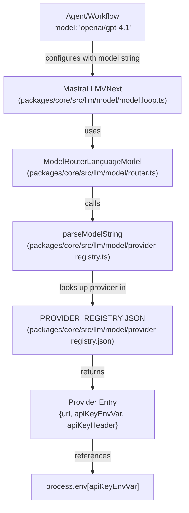
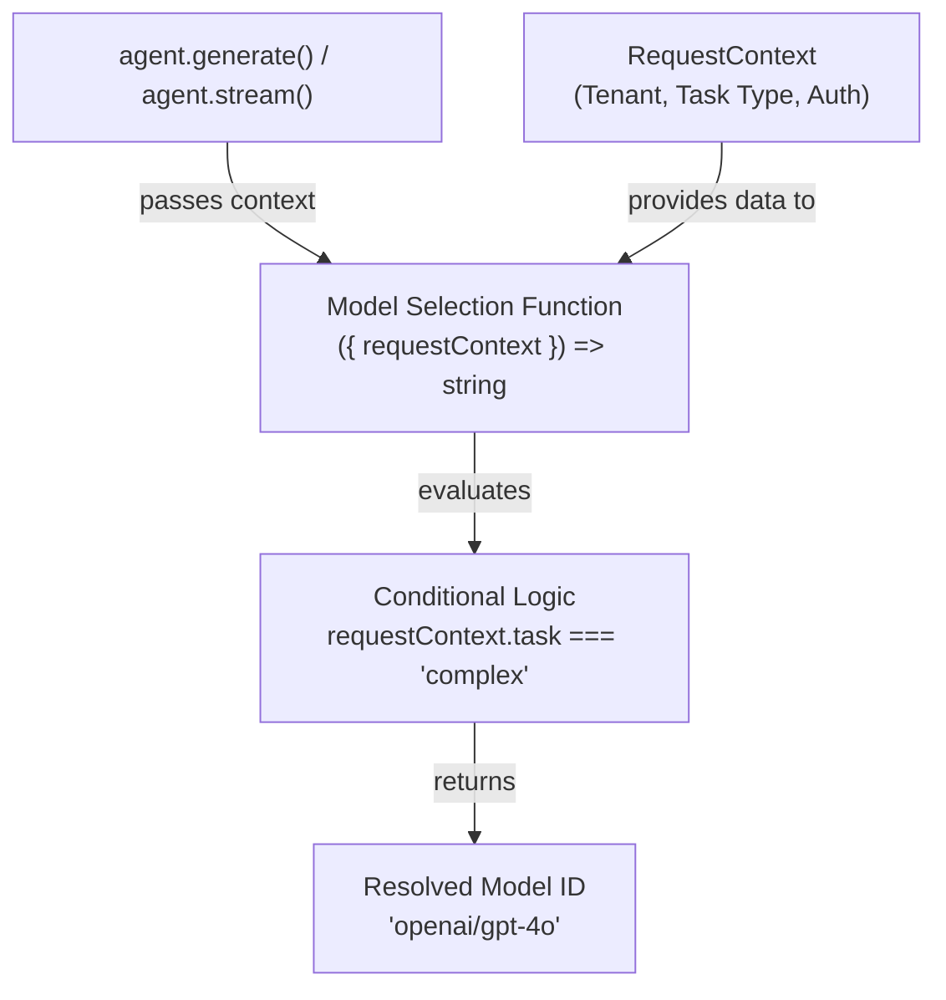

<!-- source: DeepWiki mcp.deepwiki.com · repo mastra-ai/mastra · page 5.2 Model Configuration Patterns · fetched 2026-10-26 -->

# Model Configuration Patterns

<details>
<summary>Relevant source files</summary>

The following files were used as context for generating this wiki page:

- [docs/src/content/en/models/environment-variables.mdx](docs/src/content/en/models/environment-variables.mdx)
- [docs/src/content/en/models/gateways/index.mdx](docs/src/content/en/models/gateways/index.mdx)
- [docs/src/content/en/models/gateways/netlify.mdx](docs/src/content/en/models/gateways/netlify.mdx)
- [docs/src/content/en/models/gateways/openrouter.mdx](docs/src/content/en/models/gateways/openrouter.mdx)
- [docs/src/content/en/models/gateways/vercel.mdx](docs/src/content/en/models/gateways/vercel.mdx)
- [docs/src/content/en/models/index.mdx](docs/src/content/en/models/index.mdx)
- [docs/src/content/en/models/providers/edenai.mdx](docs/src/content/en/models/providers/edenai.mdx)
- [docs/src/content/en/models/providers/index.mdx](docs/src/content/en/models/providers/index.mdx)
- [docs/src/content/en/models/providers/kilo.mdx](docs/src/content/en/models/providers/kilo.mdx)
- [docs/src/content/en/models/providers/nano-gpt.mdx](docs/src/content/en/models/providers/nano-gpt.mdx)
- [docs/src/content/en/models/providers/opencode.mdx](docs/src/content/en/models/providers/opencode.mdx)
- [docs/src/content/en/models/sidebars.js](docs/src/content/en/models/sidebars.js)
- [packages/core/src/llm/model/capabilities/edenai.json](packages/core/src/llm/model/capabilities/edenai.json)
- [packages/core/src/llm/model/capabilities/kilo.json](packages/core/src/llm/model/capabilities/kilo.json)
- [packages/core/src/llm/model/capabilities/nano-gpt.json](packages/core/src/llm/model/capabilities/nano-gpt.json)
- [packages/core/src/llm/model/capabilities/openrouter.json](packages/core/src/llm/model/capabilities/openrouter.json)
- [packages/core/src/llm/model/capabilities/vercel.json](packages/core/src/llm/model/capabilities/vercel.json)
- [packages/core/src/llm/model/provider-registry.json](packages/core/src/llm/model/provider-registry.json)
- [packages/core/src/llm/model/provider-types.generated.d.ts](packages/core/src/llm/model/provider-types.generated.d.ts)

</details>


This document describes the various patterns for configuring LLM models in Mastra agents and workflows. It covers model ID strings (`provider/model-name`), configuration objects, environment variable management, gateway routing, and dynamic selection strategies. Mastra abstracts numerous providers and models through a unified provider registry and model router [docs/src/content/en/models/index.mdx:15]().

## Overview

Mastra supports multiple configuration patterns for specifying which LLM model an agent or workflow should use. Configuration ranges from simple string identifiers to complex objects with custom authentication, headers, and dynamic resolution logic based on runtime context.

Model configuration accepts several primary formats:
1. **String format**: `"provider/model-name"` for registry-based models [docs/src/content/en/models/index.mdx:29]().
2. **Object format**: Configuration object specifying explicit model IDs, provider options, and custom headers.
3. **Dynamic function format**: A function taking `requestContext` to resolve the model ID at runtime.

Sources: [docs/src/content/en/models/index.mdx:29]()

## String-Based Model Configuration

The simplest and most common pattern uses a string in the format `"provider/model-name"`. This leverages the provider registry to automatically resolve API endpoints, authentication headers, and model-specific capabilities.

**Natural Language to Code Entity Space: String Resolution & Routing**



Sources: [docs/src/content/en/models/index.mdx:43](), [packages/core/src/llm/model/provider-registry.json:1-181]()

### String Format Parsing and Execution Flow

When an agent initializes with a string model identifier (e.g., `"google/gemini-2.5-flash"` or `"kilo/aion-labs/aion-2.0"`), Mastra splits the string into provider and model segments [docs/src/content/en/models/index.mdx:68](), [docs/src/content/en/models/providers/kilo.mdx:25](). 

1. **Extraction**: `parseModelString` extracts the provider prefix (e.g., `google`) and model name (`gemini-2.5-flash`).
2. **Registry Lookup**: The registry maps the provider prefix to its configuration endpoint and required environment variables [packages/core/src/llm/model/provider-registry.json:3-7]().
3. **Client Initialization**: The AI SDK integration builds the underlying language model instance with automatic authentication.

Sources: [docs/src/content/en/models/index.mdx:68](), [docs/src/content/en/models/providers/kilo.mdx:25](), [packages/core/src/llm/model/provider-registry.json:3-7]()

## Object-Based Model Configuration & Advanced Options

For advanced scenarios—such as custom headers, explicit API keys, or provider-specific parameters—models can be configured using an object structure.

```typescript
const agent = new Agent({
  id: "custom-agent",
  name: "custom-agent",
  model: {
    id: "anthropic/claude-fable-5",
    apiKey: process.env.ANTHROPIC_API_KEY,
    headers: {
      "X-Custom-Header": "value"
    }
  }
});
```

### Provider Options and Reasoning Effort

Some providers support specialized configuration options (such as `reasoningEffort`, `parallel_function_calling`, or `logprobs`) passed via `providerOptions`. These are typically specific to the underlying LLM API.

```typescript
const response = await agent.generate("Hello!", {
  providerOptions: {
    openai: {
      logprobs: true
    }
  }
});
```

## Environment Variable Management

Mastra automatically resolves the correct environment variable for each provider based on the registry entry (`apiKeyEnvVar`) [packages/core/src/llm/model/provider-registry.json:5](). If an API key is missing at runtime, a descriptive error is thrown indicating which environment variable must be populated.

| Provider | Environment Variable | Source |
| :--- | :--- | :--- |
| **OpenAI** | `OPENAI_API_KEY` | [docs/src/content/en/models/environment-variables.mdx]() |
| **Anthropic** | `ANTHROPIC_API_KEY` | [docs/src/content/en/models/environment-variables.mdx]() |
| **Google** | `GOOGLE_API_KEY`, `GOOGLE_GENERATIVE_AI_API_KEY` | [docs/src/content/en/models/environment-variables.mdx]() |
| **DeepSeek** | `DEEPSEEK_API_KEY` | [docs/src/content/en/models/environment-variables.mdx]() |
| **Groq** | `GROQ_API_KEY` | [docs/src/content/en/models/environment-variables.mdx]() |
| **Mistral** | `MISTRAL_API_KEY` | [docs/src/content/en/models/environment-variables.mdx]() |
| **xAI** | `XAI_API_KEY` | [docs/src/content/en/models/environment-variables.mdx]() |
| **Kilo Gateway** | `KILO_API_KEY` | [docs/src/content/en/models/providers/kilo.mdx:10](), [packages/core/src/llm/model/provider-registry.json:5]() |
| **OpenRouter** | `OPENROUTER_API_KEY` | [docs/src/content/en/models/gateways/openrouter.mdx:39]() |
| **Vercel** | `AI_GATEWAY_API_KEY` | [docs/src/content/en/models/gateways/vercel.mdx:39]() |
| **Netlify** | `NETLIFY_API_KEY` | [docs/src/content/en/models/gateways/netlify.mdx]() |
| **NanoGPT** | `NANO_GPT_API_KEY` | [docs/src/content/en/models/providers/nano-gpt.mdx:15]() |
| **OpenCode** | `OPENCODE_API_KEY` | [docs/src/content/en/models/providers/opencode.mdx:15]() |
| **EdenAI** | `EDENAI_API_KEY` | [docs/src/content/en/models/providers/edenai.mdx]() |

Sources: [docs/src/content/en/models/environment-variables.mdx](), [docs/src/content/en/models/providers/kilo.mdx:10](), [packages/core/src/llm/model/provider-registry.json:5](), [docs/src/content/en/models/gateways/openrouter.mdx:39](), [docs/src/content/en/models/gateways/vercel.mdx:39](), [docs/src/content/en/models/gateways/netlify.mdx](), [docs/src/content/en/models/providers/nano-gpt.mdx:15](), [docs/src/content/en/models/providers/opencode.mdx:15](), [docs/src/content/en/models/providers/edenai.mdx]()

## Dynamic Model Selection

Mastra agents support dynamic model selection using a function that evaluates `requestContext` at runtime. This enables multi-tenant routing, task-complexity switching, or cost optimization.

**Natural Language to Code Entity Space: Dynamic Resolution Flow**



Example implementation for runtime model switching:

```typescript
const agent = new Agent({
  id: "dynamic-agent",
  name: "Dynamic Agent",
  model: ({ requestContext }) => {
    const useAdvanced = requestContext.task === "complex";
    return useAdvanced
      ? "openai/gpt-4o"
      : "openai/gpt-3.5-turbo";
  }
});
```

---

