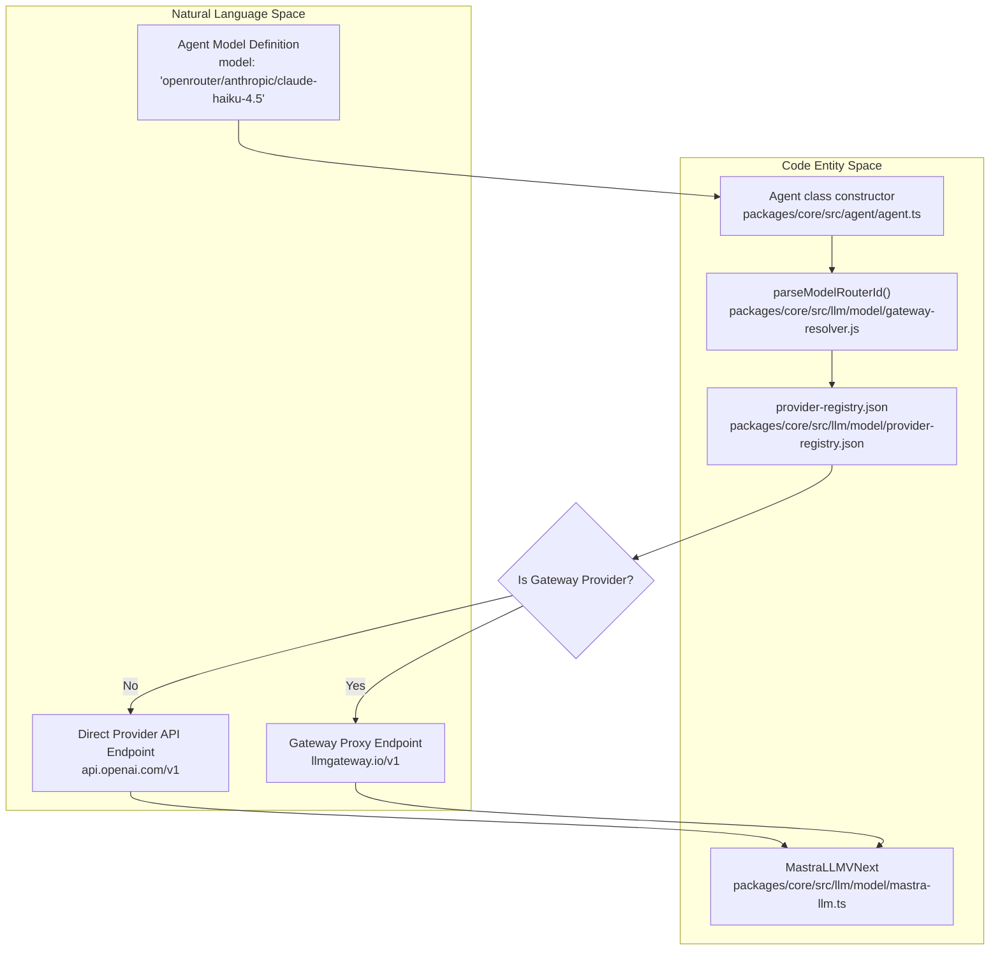
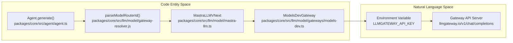

<!-- source: DeepWiki mcp.deepwiki.com · repo mastra-ai/mastra · page 5.3 Gateway vs Direct Providers · fetched 2026-10-26 -->

# Gateway vs Direct Providers

<details>
<summary>Relevant source files</summary>

The following files were used as context for generating this wiki page:

- [docs/src/content/en/models/gateways/custom-gateways.mdx](docs/src/content/en/models/gateways/custom-gateways.mdx)
- [docs/src/content/en/models/providers/cortecs.mdx](docs/src/content/en/models/providers/cortecs.mdx)
- [docs/src/content/en/models/providers/deepinfra.mdx](docs/src/content/en/models/providers/deepinfra.mdx)
- [docs/src/content/en/models/providers/llmgateway-providers.mdx](docs/src/content/en/models/providers/llmgateway-providers.mdx)
- [docs/src/content/en/models/providers/llmgateway.mdx](docs/src/content/en/models/providers/llmgateway.mdx)
- [docs/src/content/en/models/providers/opencode-go.mdx](docs/src/content/en/models/providers/opencode-go.mdx)
- [docs/src/content/en/reference/core/mastra-model-gateway.mdx](docs/src/content/en/reference/core/mastra-model-gateway.mdx)
- [mastracode/sdk/src/agents/mastracode-gateway-thinking.test.ts](mastracode/sdk/src/agents/mastracode-gateway-thinking.test.ts)
- [mastracode/sdk/src/providers/thinking-request.ts](mastracode/sdk/src/providers/thinking-request.ts)
- [mastracode/sdk/src/thinking.test.ts](mastracode/sdk/src/thinking.test.ts)
- [mastracode/tui/e2e/tui/think-picker-per-model.ts](mastracode/tui/e2e/tui/think-picker-per-model.ts)
- [packages/core/scripts/generate-providers.ts](packages/core/scripts/generate-providers.ts)
- [packages/core/src/llm/index.ts](packages/core/src/llm/index.ts)
- [packages/core/src/llm/model/capabilities/cortecs.json](packages/core/src/llm/model/capabilities/cortecs.json)
- [packages/core/src/llm/model/capabilities/llmgateway-providers.json](packages/core/src/llm/model/capabilities/llmgateway-providers.json)
- [packages/core/src/llm/model/capabilities/llmgateway.json](packages/core/src/llm/model/capabilities/llmgateway.json)
- [packages/core/src/llm/model/capabilities/opencode-go.json](packages/core/src/llm/model/capabilities/opencode-go.json)
- [packages/core/src/llm/model/gateways/base.ts](packages/core/src/llm/model/gateways/base.ts)
- [packages/core/src/llm/model/gateways/index.ts](packages/core/src/llm/model/gateways/index.ts)
- [packages/core/src/llm/model/gateways/models-dev.e2e.test.ts](packages/core/src/llm/model/gateways/models-dev.e2e.test.ts)
- [packages/core/src/llm/model/gateways/models-dev.test.ts](packages/core/src/llm/model/gateways/models-dev.test.ts)
- [packages/core/src/llm/model/gateways/models-dev.ts](packages/core/src/llm/model/gateways/models-dev.ts)
- [packages/core/src/llm/model/index.ts](packages/core/src/llm/model/index.ts)
- [packages/core/src/llm/model/provider-options.ts](packages/core/src/llm/model/provider-options.ts)
- [packages/core/src/llm/model/provider-registry.test.ts](packages/core/src/llm/model/provider-registry.test.ts)
- [packages/core/src/llm/model/provider-registry.ts](packages/core/src/llm/model/provider-registry.ts)
- [packages/core/src/llm/model/registry-generator.test.ts](packages/core/src/llm/model/registry-generator.test.ts)
- [packages/core/src/llm/model/registry-generator.ts](packages/core/src/llm/model/registry-generator.ts)

</details>


This page details the architectural and configuration differences between gateway providers (such as OpenRouter, Vercel, Netlify, and LLMGateway) and direct providers within Mastra's model provider registry and model router system.

## Provider Type Overview

Mastra provides two distinct integration paths for Large Language Models (LLMs):
1.  **Direct Providers**: First-party creator APIs (e.g., OpenAI, Anthropic, Google) that communicate directly with model endpoints [docs/src/content/en/models/providers/llmgateway-providers.mdx:1-4]().
2.  **Gateway Providers**: Aggregation and proxy layers (e.g., OpenRouter, Vercel, Netlify, LLMGateway) that expose unified OpenAI-compatible `/chat/completions` endpoints, routing requests across multiple backends while providing centralized billing, caching, and rate limiting [docs/src/content/en/models/providers/llmgateway.mdx:38-42](), [docs/src/content/en/models/providers/llmgateway-providers.mdx:38-42]().

**Diagram: Provider Resolution & Architecture**


Sources: [packages/core/src/llm/model/provider-registry.ts:28-30](), [packages/core/src/llm/model/gateways/models-dev.ts:16-16](), [docs/src/content/en/models/providers/llmgateway.mdx:18-26]()

## Direct Providers

Direct providers map directly to primary model creators. Mastra stores their routing configurations in `provider-registry.json`, mapping identifiers to specific base URLs and environment variables [packages/core/src/llm/model/provider-registry.ts:36-36]().

### Configuration & Access

Direct configurations define specific authentication headers and endpoint URLs. For example, using an OpenAI model directly:

```typescript
import { Agent } from "@mastra/core/agent";

const agent = new Agent({
  id: "my-agent",
  name: "My Agent",
  instructions: "You are a helpful assistant",
  model: "openai/gpt-4o"
});
```
Sources: [packages/core/src/llm/model/provider-registry.ts:36-36]()

## Gateway Providers

Gateway providers aggregate multi-vendor models under unified endpoints. Gateways such as `llmgateway`, `opencode-go`, and `cortecs` expose extensive catalogs via OpenAI-compatible endpoints [docs/src/content/en/models/providers/llmgateway.mdx:38-42](), [docs/src/content/en/models/providers/opencode-go.mdx:38-42](), [docs/src/content/en/models/providers/cortecs.mdx:38-42]().

### Gateway Model Integration

Models routed via gateways use prefixed IDs corresponding to the gateway's registry definition. For example, using a model from LLMGateway:

```typescript
import { Agent } from "@mastra/core/agent";

const agent = new Agent({
  id: "gateway-agent",
  name: "My Agent",
  instructions: "You are a helpful assistant",
  model: "llmgateway/Qwen3.8-27B"
});
```
Sources: [docs/src/content/en/models/providers/llmgateway.mdx:18-26](), [docs/src/content/en/models/providers/opencode-go.mdx:18-26]()

**Diagram: Gateway Execution Flow**


Sources: [docs/src/content/en/models/providers/llmgateway.mdx:10-16](), [docs/src/content/en/models/providers/cortecs.mdx:10-16](), [packages/core/src/llm/model/gateways/models-dev.ts:149-150]()

## Implementation Details

### Type Generation and Autocomplete

Mastra statically generates TypeScript types from `provider-registry.json` and capabilities JSON files (`packages/core/src/llm/model/capabilities/`) to ensure full IDE autocomplete across thousands of provider models [packages/core/src/llm/model/capabilities/llmgateway.json:1-147](), [packages/core/src/llm/model/capabilities/opencode-go.json:1-77]().

The `ModelsDevGateway` class [packages/core/src/llm/model/gateways/models-dev.ts:149-149]() is responsible for fetching provider information from `https://models.dev/api.json` [packages/core/src/llm/model/gateways/models-dev.ts:165-165]() and populating the `providerConfigs` [packages/core/src/llm/model/gateways/models-dev.ts:153-153](), `attachmentCapabilities` [packages/core/src/llm/model/gateways/models-dev.ts:154-154](), `temperatureCapabilities` [packages/core/src/llm/model/gateways/models-dev.ts:155-155](), `structuredOutputCapabilities` [packages/core/src/llm/model/gateways/models-dev.ts:156-156](), and `reasoningCapabilities` [packages/core/src/llm/model/gateways/models-dev.ts:157-157]() maps. This data is then used by the `registry-generator.ts` script [packages/core/src/llm/model/registry-generator.ts:1-1]() to create the static `provider-registry.json` and `provider-types.generated.d.ts` files.

*   **Registry Source**: `packages/core/src/llm/model/provider-registry.json` [packages/core/src/llm/model/provider-registry.ts:18-18]()
*   **Generated Types**: `packages/core/src/llm/model/provider-types.generated.d.ts` [packages/core/src/llm/model/provider-registry.ts:21-21]()

Sources: [packages/core/src/llm/model/capabilities/llmgateway.json:1-10](), [packages/core/src/llm/model/capabilities/opencode-go.json:1-10](), [packages/core/src/llm/model/gateways/models-dev.ts:149-179](), [packages/core/src/llm/model/provider-registry.ts:18-21]()

## Summary Comparison

| Feature | Direct Providers | Gateway Providers |
| :--- | :--- | :--- |
| **Model ID Format** | `provider/model` | `gateway/model` or `gateway/provider/model` |
| **Authentication** | Provider-specific API key (e.g., `OPENAI_API_KEY`) | Unified gateway token (e.g., `LLMGATEWAY_API_KEY`) [packages/core/src/llm/model/gateways/models-dev.ts:86-97]() |
| **Routing** | Direct creator endpoints | Aggregated proxy endpoints [packages/core/src/llm/model/gateways/models-dev.ts:100-110]() |
| **Use Case** | Strict feature adherence, lower latency | High model variety, failover routing, cost tracking |

Sources: [docs/src/content/en/models/providers/llmgateway.mdx:10-16](), [docs/src/content/en/models/providers/llmgateway-providers.mdx:10-16](), [packages/core/src/llm/model/gateways/models-dev.ts:86-110]()

---

