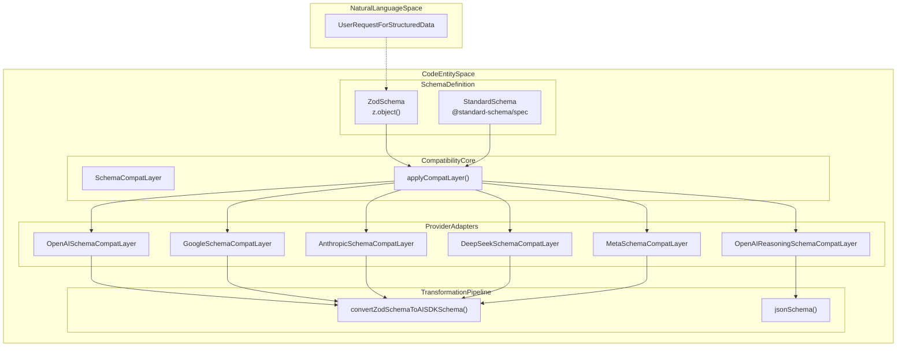
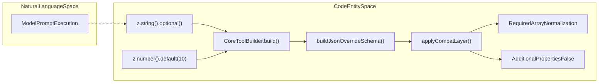
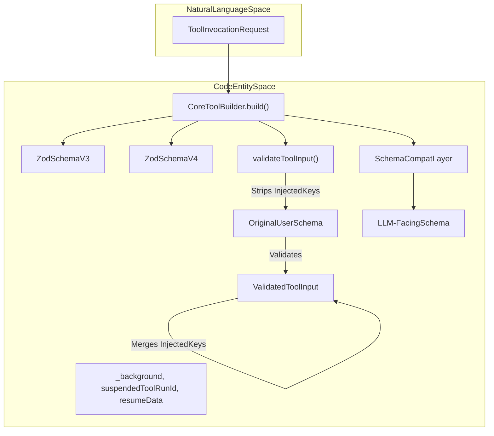
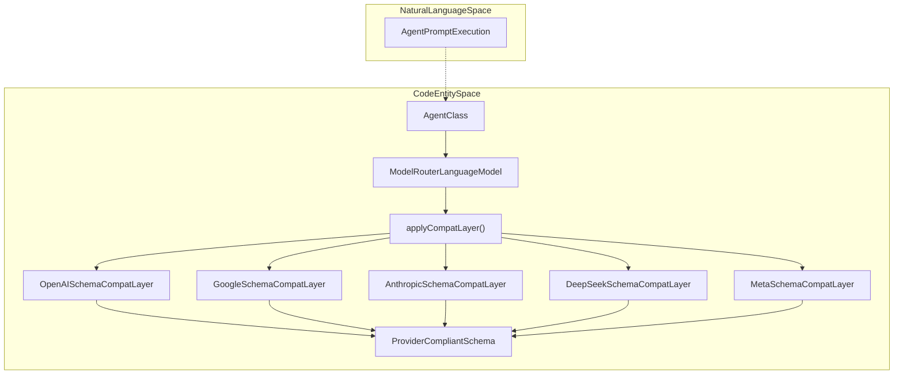

<!-- source: DeepWiki mcp.deepwiki.com · repo mastra-ai/mastra · page 5.6 Schema Compatibility Layers · fetched 2026-10-26 -->

# Schema Compatibility Layers

Relevant source files

The following files were used as context for generating this wiki page:

- [.changeset/fluffy-oranges-end.md](.changeset/fluffy-oranges-end.md)
- [client-sdks/ai-sdk/src/__tests__/background-task-stream.test.ts](client-sdks/ai-sdk/src/__tests__/background-task-stream.test.ts)
- [docs/src/content/en/reference/agents/agent.mdx](docs/src/content/en/reference/agents/agent.mdx)
- [docs/src/content/en/reference/tools/create-tool.mdx](docs/src/content/en/reference/tools/create-tool.mdx)
- [packages/core/src/agent/__tests__/tools.test.ts](packages/core/src/agent/__tests__/tools.test.ts)
- [packages/core/src/agent/__tests__/working-memory-context.test.ts](packages/core/src/agent/__tests__/working-memory-context.test.ts)
- [packages/core/src/agent/durable/__tests__/durable-agent-client-tool-pending.test.ts](packages/core/src/agent/durable/__tests__/durable-agent-client-tool-pending.test.ts)
- [packages/core/src/agent/durable/__tests__/durable-agent-tools.test.ts](packages/core/src/agent/durable/__tests__/durable-agent-tools.test.ts)
- [packages/core/src/agent/durable/workflows/steps/llm-mapping-pending-client-tool.test.ts](packages/core/src/agent/durable/workflows/steps/llm-mapping-pending-client-tool.test.ts)
- [packages/core/src/loop/shared/auto-resume-system-message.test.ts](packages/core/src/loop/shared/auto-resume-system-message.test.ts)
- [packages/core/src/loop/shared/auto-resume-system-message.ts](packages/core/src/loop/shared/auto-resume-system-message.ts)
- [packages/core/src/loop/test-utils/aimock/scenarios/approval-conditional.scenario.test.ts](packages/core/src/loop/test-utils/aimock/scenarios/approval-conditional.scenario.test.ts)
- [packages/core/src/loop/test-utils/aimock/scenarios/approval-input-validation.scenario.test.ts](packages/core/src/loop/test-utils/aimock/scenarios/approval-input-validation.scenario.test.ts)
- [packages/core/src/loop/test-utils/aimock/scenarios/auto-resume-suspended-tools.scenario.test.ts](packages/core/src/loop/test-utils/aimock/scenarios/auto-resume-suspended-tools.scenario.test.ts)
- [packages/core/src/loop/test-utils/aimock/scenarios/background-task-agent-level.scenario.test.ts](packages/core/src/loop/test-utils/aimock/scenarios/background-task-agent-level.scenario.test.ts)
- [packages/core/src/loop/test-utils/aimock/scenarios/background-task-tool-level.scenario.test.ts](packages/core/src/loop/test-utils/aimock/scenarios/background-task-tool-level.scenario.test.ts)
- [packages/core/src/loop/test-utils/aimock/scenarios/client-tools.scenario.test.ts](packages/core/src/loop/test-utils/aimock/scenarios/client-tools.scenario.test.ts)
- [packages/core/src/loop/test-utils/aimock/scenarios/prepare-step.scenario.test.ts](packages/core/src/loop/test-utils/aimock/scenarios/prepare-step.scenario.test.ts)
- [packages/core/src/loop/test-utils/aimock/scenarios/supervisor-delegation-hooks.scenario.test.ts](packages/core/src/loop/test-utils/aimock/scenarios/supervisor-delegation-hooks.scenario.test.ts)
- [packages/core/src/loop/test-utils/aimock/scenarios/tool-lifecycle-hooks.scenario.test.ts](packages/core/src/loop/test-utils/aimock/scenarios/tool-lifecycle-hooks.scenario.test.ts)
- [packages/core/src/loop/workflows/agentic-execution/tool-approval-verdict.ts](packages/core/src/loop/workflows/agentic-execution/tool-approval-verdict.ts)
- [packages/core/src/loop/workflows/agentic-execution/tool-call-step-before-approval.test.ts](packages/core/src/loop/workflows/agentic-execution/tool-call-step-before-approval.test.ts)
- [packages/core/src/loop/workflows/agentic-execution/tool-call-step.test.ts](packages/core/src/loop/workflows/agentic-execution/tool-call-step.test.ts)
- [packages/core/src/loop/workflows/agentic-execution/tool-call-step.ts](packages/core/src/loop/workflows/agentic-execution/tool-call-step.ts)
- [packages/core/src/processors/processor-tool-request-context.test.ts](packages/core/src/processors/processor-tool-request-context.test.ts)
- [packages/core/src/tools/builtin/web-fetch.test.ts](packages/core/src/tools/builtin/web-fetch.test.ts)
- [packages/core/src/tools/builtin/web-fetch.ts](packages/core/src/tools/builtin/web-fetch.ts)
- [packages/core/src/tools/index.ts](packages/core/src/tools/index.ts)
- [packages/core/src/tools/tool-builder/background-override-injection.test.ts](packages/core/src/tools/tool-builder/background-override-injection.test.ts)
- [packages/core/src/tools/tool-builder/builder.e2e.test.ts](packages/core/src/tools/tool-builder/builder.e2e.test.ts)
- [packages/core/src/tools/tool-builder/builder.test.ts](packages/core/src/tools/tool-builder/builder.test.ts)
- [packages/core/src/tools/tool-builder/builder.ts](packages/core/src/tools/tool-builder/builder.ts)
- [packages/core/src/tools/tool-builder/schema-compat-validation.test.ts](packages/core/src/tools/tool-builder/schema-compat-validation.test.ts)
- [packages/core/src/tools/tool-builder/validation-error-paths.test.ts](packages/core/src/tools/tool-builder/validation-error-paths.test.ts)
- [packages/core/src/tools/tool.test.ts](packages/core/src/tools/tool.test.ts)
- [packages/core/src/tools/tool.ts](packages/core/src/tools/tool.ts)
- [packages/core/src/tools/toolchecks.ts](packages/core/src/tools/toolchecks.ts)
- [packages/core/src/tools/types.ts](packages/core/src/tools/types.ts)
- [packages/core/src/tools/validation.test.ts](packages/core/src/tools/validation.test.ts)
- [packages/core/src/tools/validation.ts](packages/core/src/tools/validation.ts)

Schema compatibility layers transform Zod and JSON schemas to accommodate provider-specific limitations and requirements. These layers reside in `@mastra/schema-compat` and ensure that tool definitions and structured output schemas work correctly across the model catalog, handling strict mode requirements, regex pattern restrictions, and field limitations [packages/core/src/tools/tool-builder/builder.ts:1-16]().

---

## Provider-Specific Schema Constraints

Different LLM providers impose strict constraints on the JSON schemas they accept for tool calling and structured output. Schema compatibility layers automatically apply transformations via `applyCompatLayer` to ensure compliance [packages/core/src/tools/tool-builder/builder.ts:3-13]().

| Provider | Compatibility Layer Class | Primary Constraints |
|----------|-------------------|-------------------|
| OpenAI | `OpenAISchemaCompatLayer` | Strict mode enforcement, `additionalProperties: false`, required field normalization [packages/core/src/tools/tool-builder/builder.ts:5]() |
| OpenAI (Reasoning) | `OpenAIReasoningSchemaCompatLayer` | Removal of regex patterns, specific type casting for `any`, compatibility for models like `o1`, `o3` [packages/core/src/tools/tool-builder/builder.ts:4]() |
| Google | `GoogleSchemaCompatLayer` | Gemini-specific format transformations, `nullable: true` usage, inlining `$ref` [packages/core/src/tools/tool-builder/builder.ts:6]() |
| Anthropic | `AnthropicSchemaCompatLayer` | Field description length limits and prompt caching adaptations [packages/core/src/tools/tool-builder/builder.ts:7]() |
| DeepSeek | `DeepSeekSchemaCompatLayer` | Handling for complex `anyOf` and `oneOf` types [packages/core/src/tools/tool-builder/builder.ts:8]() |
| Meta | `MetaSchemaCompatLayer` | Llama-specific JSON schema adaptations [packages/core/src/tools/tool-builder/builder.ts:9]() |

Sources: [packages/core/src/tools/tool-builder/builder.ts:1-16]()

---

## Architecture Overview

**Schema Compatibility Layer Architecture**

The compatibility system uses `applyCompatLayer` inside `CoreToolBuilder` to dispatch the appropriate transformation logic based on the target model provider [packages/core/src/tools/tool-builder/builder.ts:3-13]().

Sources: [packages/core/src/tools/tool-builder/builder.ts:1-16]()

---

## OpenAI Strict Mode & Reasoning Transformations

OpenAI strict mode and reasoning models (`o1`, `o3`) enforce strict schema rules, such as requiring all object properties to be listed in `required` and `additionalProperties` set to `false`.

### Strict Mode Normalization
`CoreToolBuilder` builds model-facing schemas using `buildJsonOverrideSchema`, ensuring that internal runner fields (like `_background` or suspension run IDs) are correctly spliced into the schema passed to the LLM without breaking author-defined Zod validations [packages/core/src/tools/tool-builder/builder.ts:156-166]().

**OpenAI Strict Mode Transformation**

### Reasoning Model Restrictions
Reasoning models do not support regex patterns (`regex()`, `email()`, etc.). The `OpenAIReasoningSchemaCompatLayer` strips or adapts these patterns so tool registration succeeds [packages/core/src/tools/tool-builder/builder.ts:4]().

Sources: [packages/core/src/tools/tool-builder/builder.ts:4-16](), [packages/core/src/tools/tool-builder/background-override-injection.test.ts:1-100]()

---

## Schema Validation and Compat Integration

When tools are invoked, `CoreToolBuilder` and `validateToolInput` ensure that user schemas (whether Zod v3, Zod v4, or raw JSON Schema) execute correctly. Transformations like `min()`, `max()`, or `.transform()` are preserved during runtime validation even when the LLM-facing schema has been flattened or adapted by a compatibility layer [packages/core/src/tools/tool-builder/schema-compat-validation.test.ts:33-118]().

The `CoreToolBuilder` handles different Zod versions (v3 vs v4) by checking the schema definition structure (`_def.typeName` vs `_def.type`) to ensure correct schema processing [packages/core/src/tools/tool-builder/builder.ts:148-156](). It also ensures that injected override keys like `_background`, `suspendedToolRunId`, and `resumeData` are stripped before delegating validation to the original schema, then merged back into the validated value [packages/core/src/tools/tool-builder/builder.ts:167-171]().

**Schema Validation Flow with Compatibility Layers**

Sources: [packages/core/src/tools/tool-builder/schema-compat-validation.test.ts:33-118](), [packages/core/src/tools/tool-builder/builder.ts:148-171]()

---

## Model Router and Schema Compatibility

**Model Router and Schema Compatibility**

The model router resolves model identifiers to concrete provider specifications, which dictate which `SchemaCompatLayer` implementation is initialized during tool and structured output generation [packages/core/src/tools/tool-builder/builder.ts:3-13]().

Sources: [packages/core/src/tools/tool-builder/builder.ts:3-13]()

---

