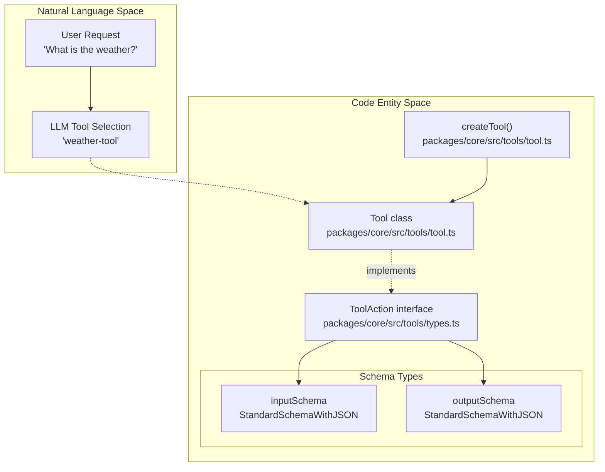
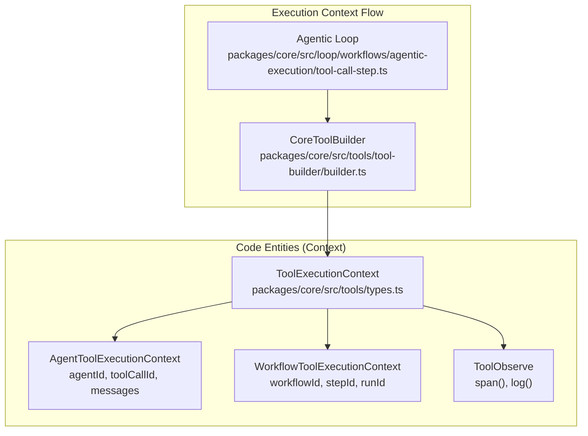
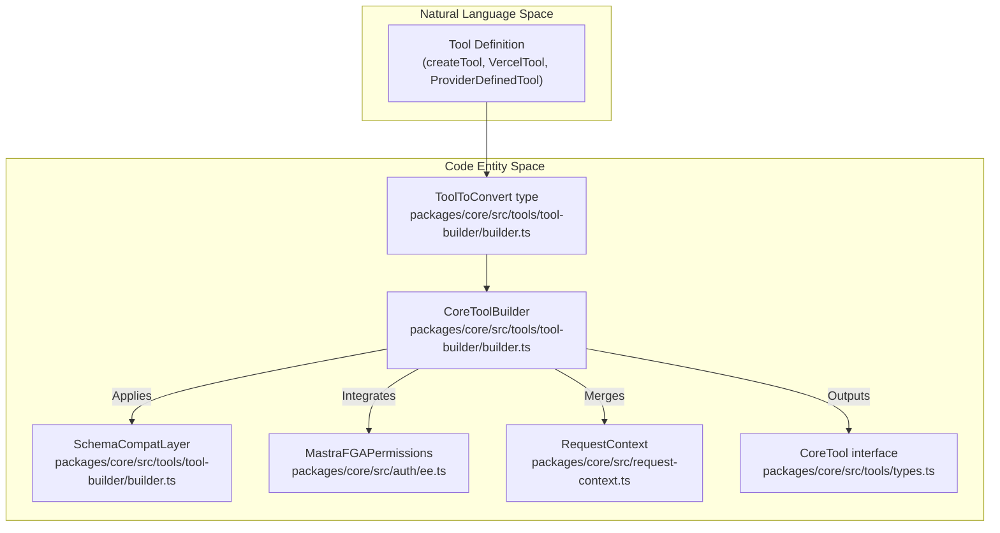

<!-- source: DeepWiki mcp.deepwiki.com · repo mastra-ai/mastra · page 6 Tool System · fetched 2026-10-26 -->

# Tool System

Relevant source files

The following files were used as context for generating this wiki page:

- [.changeset/fluffy-oranges-end.md](.changeset/fluffy-oranges-end.md)
- [client-sdks/ai-sdk/src/__tests__/background-task-stream.test.ts](client-sdks/ai-sdk/src/__tests__/background-task-stream.test.ts)
- [docs/src/content/en/reference/agents/agent.mdx](docs/src/content/en/reference/agents/agent.mdx)
- [docs/src/content/en/reference/tools/create-tool.mdx](docs/src/content/en/reference/tools/create-tool.mdx)
- [packages/core/src/agent/__tests__/tools.test.ts](packages/core/src/agent/__tests__/tools.test.ts)
- [packages/core/src/agent/__tests__/working-memory-context.test.ts](packages/core/src/agent/__tests__/working-memory-context.test.ts)
- [packages/core/src/agent/durable/__tests__/durable-agent-client-tool-pending.test.ts](packages/core/src/agent/durable/__tests__/durable-agent-client-tool-pending.test.ts)
- [packages/core/src/agent/durable/__tests__/durable-agent-tools.test.ts](packages/core/src/agent/durable/__tests__/durable-agent-tools.test.ts)
- [packages/core/src/agent/durable/workflows/steps/llm-mapping-pending-client-tool.test.ts](packages/core/src/agent/durable/workflows/steps/llm-mapping-pending-client-tool.test.ts)
- [packages/core/src/loop/shared/auto-resume-system-message.test.ts](packages/core/src/loop/shared/auto-resume-system-message.test.ts)
- [packages/core/src/loop/shared/auto-resume-system-message.ts](packages/core/src/loop/shared/auto-resume-system-message.ts)
- [packages/core/src/loop/test-utils/aimock/scenarios/approval-conditional.scenario.test.ts](packages/core/src/loop/test-utils/aimock/scenarios/approval-conditional.scenario.test.ts)
- [packages/core/src/loop/test-utils/aimock/scenarios/approval-input-validation.scenario.test.ts](packages/core/src/loop/test-utils/aimock/scenarios/approval-input-validation.scenario.test.ts)
- [packages/core/src/loop/test-utils/aimock/scenarios/auto-resume-suspended-tools.scenario.test.ts](packages/core/src/loop/test-utils/aimock/scenarios/auto-resume-suspended-tools.scenario.test.ts)
- [packages/core/src/loop/test-utils/aimock/scenarios/background-task-agent-level.scenario.test.ts](packages/core/src/loop/test-utils/aimock/scenarios/background-task-agent-level.scenario.test.ts)
- [packages/core/src/loop/test-utils/aimock/scenarios/background-task-tool-level.scenario.test.ts](packages/core/src/loop/test-utils/aimock/scenarios/background-task-tool-level.scenario.test.ts)
- [packages/core/src/loop/test-utils/aimock/scenarios/client-tools.scenario.test.ts](packages/core/src/loop/test-utils/aimock/scenarios/client-tools.scenario.test.ts)
- [packages/core/src/loop/test-utils/aimock/scenarios/prepare-step.scenario.test.ts](packages/core/src/loop/test-utils/aimock/scenarios/prepare-step.scenario.test.ts)
- [packages/core/src/loop/test-utils/aimock/scenarios/supervisor-delegation-hooks.scenario.test.ts](packages/core/src/loop/test-utils/aimock/scenarios/supervisor-delegation-hooks.scenario.test.ts)
- [packages/core/src/loop/test-utils/aimock/scenarios/tool-lifecycle-hooks.scenario.test.ts](packages/core/src/loop/test-utils/aimock/scenarios/tool-lifecycle-hooks.scenario.test.ts)
- [packages/core/src/loop/workflows/agentic-execution/tool-approval-verdict.ts](packages/core/src/loop/workflows/agentic-execution/tool-approval-verdict.ts)
- [packages/core/src/loop/workflows/agentic-execution/tool-call-step-before-approval.test.ts](packages/core/src/loop/workflows/agentic-execution/tool-call-step-before-approval.test.ts)
- [packages/core/src/loop/workflows/agentic-execution/tool-call-step.test.ts](packages/core/src/loop/workflows/agentic-execution/tool-call-step.test.ts)
- [packages/core/src/loop/workflows/agentic-execution/tool-call-step.ts](packages/core/src/loop/workflows/agentic-execution/tool-call-step.ts)
- [packages/core/src/processors/processor-tool-request-context.test.ts](packages/core/src/processors/processor-tool-request-context.test.ts)
- [packages/core/src/tools/builtin/web-fetch.test.ts](packages/core/src/tools/builtin/web-fetch.test.ts)
- [packages/core/src/tools/builtin/web-fetch.ts](packages/core/src/tools/builtin/web-fetch.ts)
- [packages/core/src/tools/index.ts](packages/core/src/tools/index.ts)
- [packages/core/src/tools/tool-builder/background-override-injection.test.ts](packages/core/src/tools/tool-builder/background-override-injection.test.ts)
- [packages/core/src/tools/tool-builder/builder.e2e.test.ts](packages/core/src/tools/tool-builder/builder.e2e.test.ts)
- [packages/core/src/tools/tool-builder/builder.test.ts](packages/core/src/tools/tool-builder/builder.test.ts)
- [packages/core/src/tools/tool-builder/builder.ts](packages/core/src/tools/tool-builder/builder.ts)
- [packages/core/src/tools/tool-builder/schema-compat-validation.test.ts](packages/core/src/tools/tool-builder/schema-compat-validation.test.ts)
- [packages/core/src/tools/tool-builder/validation-error-paths.test.ts](packages/core/src/tools/tool-builder/validation-error-paths.test.ts)
- [packages/core/src/tools/tool.test.ts](packages/core/src/tools/tool.test.ts)
- [packages/core/src/tools/tool.ts](packages/core/src/tools/tool.ts)
- [packages/core/src/tools/toolchecks.ts](packages/core/src/tools/toolchecks.ts)
- [packages/core/src/tools/types.ts](packages/core/src/tools/types.ts)
- [packages/core/src/tools/validation.test.ts](packages/core/src/tools/validation.test.ts)
- [packages/core/src/tools/validation.ts](packages/core/src/tools/validation.ts)

The Tool System provides a unified interface for defining, converting, and executing functions that agents and workflows can call. It handles schema validation, context injection, observability tracing, and format conversion between Mastra tools, Vercel AI SDK tools, and provider-defined tools. For model provider integration, see [Model Provider System](#5). For agent execution that calls tools, see [Agent System](#3).

## Tool Definition and Types

Tools in Mastra are defined using the `Tool` class [packages/core/src/tools/tool.ts:193-204]() or the `createTool` helper function [packages/core/src/tools/tool.ts:152-191](). A tool consists of an identifier, description, input/output schemas, and an execute function. Mastra supports multiple schema libraries via the Standard Schema specification [packages/core/src/schema/index.ts:16]().

### Tool Definition Overview

Sources: [packages/core/src/tools/tool.ts:152-204](), [packages/core/src/tools/types.ts:193-204](), [packages/core/src/tools/tool-builder/builder.ts:152-167]()

**Tool Format Types**

| Format | Signature | Use Case |
|--------|-----------|----------|
| **Mastra Tool** | `execute(inputData, context)` | User-defined tools with full Mastra context [packages/core/src/tools/tool.ts:142-191]() |
| **Vercel Tool** | `VercelTool` / `VercelToolV5` | AI SDK compatibility [packages/core/src/tools/types.ts:26-27]() |
| **Provider-Defined Tool** | `ProviderDefinedTool` | Native LLM tools like `openai.web_search` [packages/core/src/tools/tool-builder/builder.ts:132-132]() |
| **MCP Tool** | `mcpMetadata` | Tools from Model Context Protocol servers [packages/core/src/tools/types.ts:52-53]() |

For detailed information on defining tools, including interfaces and lifecycle, see [Tool Definition and Execution Context](#6.1).

Sources: [packages/core/src/tools/tool.ts:142-204](), [packages/core/src/tools/types.ts:26-27](), [packages/core/src/tools/tool-builder/builder.ts:132-132](), [packages/core/src/tools/types.ts:52-53]()

## Tool Execution Context

Tools receive different execution contexts based on their invocation source. The `ToolExecutionContext` type provides properties for each environment, including access to the Mastra instance, memory, and observability helpers [packages/core/src/tools/types.ts:215-261]().

### Tool Execution Context Flow

Sources: [packages/core/src/tools/types.ts:215-261](), [packages/core/src/tools/tool-builder/builder.ts:78-98](), [packages/core/src/loop/workflows/agentic-execution/tool-call-step.ts:94-106]()

For details on the various contexts and their properties, see [Tool Definition and Execution Context](#6.1).

Sources: [packages/core/src/tools/types.ts:215-261](), [packages/core/src/tools/tool-builder/builder.ts:78-98]()

## CoreToolBuilder: Format Conversion

The `CoreToolBuilder` class converts between different tool formats and creates the AI SDK-compatible `CoreTool` format. It acts as an adapter layer that handles FGA (Fine-Grained Authorization) and observability wrapping [packages/core/src/tools/tool-builder/builder.ts:22-24]().

### CoreToolBuilder Overview

Sources: [packages/core/src/tools/tool-builder/builder.ts:22-24](), [packages/core/src/tools/tool-builder/builder.ts:132-132](), [packages/core/src/tools/tool-builder/builder.ts:3-13](), [packages/core/src/tools/tool-builder/builder.ts:17-17](), [packages/core/src/tools/tool-builder/builder.ts:78-98]()

**Key Responsibilities:**
- **FGA Checks**: Evaluates `MastraFGAPermissions` before tool execution [packages/core/src/tools/tool-builder/builder.ts:18-18]().
- **Schema Mapping**: Maps Zod or Standard Schemas to provider-specific compat layers (OpenAI, Anthropic, Google, etc.) [packages/core/src/tools/tool-builder/builder.ts:3-13]().
- **Context Merging**: Merges `RequestContext` from closures and execution snapshots [packages/core/src/tools/tool-builder/builder.ts:78-98]().

For a deep dive into `CoreToolBuilder` and schema conversion, see [Tool Builder and Schema Conversion](#6.2).

Sources: [packages/core/src/tools/tool-builder/builder.ts:3-98](), [packages/core/src/tools/tool-builder/builder.test.ts:55-112]()

## Schema Validation System

Tools support schemas for comprehensive validation and type safety. Mastra uses a `StandardSchemaWithJSON` wrapper to ensure compatibility across Zod versions and other schema libraries [packages/core/src/schema/index.ts:16]().

**Validation Lifecycle**

| Stage | Function | Purpose |
|-------|----------|---------|
| **Before Execution** | `validateToolInput()` | Validate tool parameters before `execute()` [packages/core/src/tools/validation.ts:228-228]() |
| **After Execution** | `validateToolOutput()` | Validate tool result before returning to LLM [packages/core/src/tools/validation.ts:271-271]() |
| **On Suspend** | `validateToolSuspendData()` | Validate suspension payload [packages/core/src/tools/validation.ts:305-305]() |
| **Context Check** | `validateRequestContext()` | Validate `requestContext` against schema [packages/core/src/tools/validation.ts:311-311]() |

For more details on schema conversion and validation, see [Tool Builder and Schema Conversion](#6.2).

Sources: [packages/core/src/tools/validation.ts:228-311](), [packages/core/src/tools/tool-builder/builder.ts:146-167]()

## Tool Execution and Observability

Tool execution is wrapped with observability spans and structured logs. The system distinguishes between standard tool calls and `MCP_TOOL_CALL` spans for remote tools [packages/core/src/tools/tool-builder/builder.test.ts:204-215]().

**Observability Helpers:**
The `ToolObserve` interface provides `span()` and `log()` methods that are null-safe. When no tracing context is active, they act as no-ops or run functions directly [packages/core/src/tools/types.ts:185-199]().

Sources: [packages/core/src/tools/tool-builder/builder.ts:28-29](), [packages/core/src/tools/types.ts:185-199](), [packages/core/src/tools/tool-builder/builder.test.ts:204-215]()

## Suspend and Resume Mechanism

Tools can suspend execution to request human approval or additional input, then resume later with the provided data. This is enabled by the `suspendSchema` and `resumeSchema` defined on the tool [packages/core/src/tools/tool.ts:135-140]().

**Suspension Logic:**
- **Human-in-the-Loop**: `requireApproval` can be a boolean or a `RequireToolApprovalFn` [packages/core/src/tools/types.ts:51-55]().
- **NeedsApprovalFn**: A runtime-resolved predicate evaluated per call to decide if approval is required [packages/core/src/tools/types.ts:80-80]().
- **Auto-Resume**: Agents can automatically resume suspended tools by analyzing messages for required data [packages/core/src/loop/shared/auto-resume-system-message.ts:6-9]().

Sources: [packages/core/src/tools/tool.ts:135-140](), [packages/core/src/tools/types.ts:51-80](), [packages/core/src/loop/shared/auto-resume-system-message.ts:6-9]()

## Tool Streaming and Payloads

Tools can stream results using the `ToolStream` writer [packages/core/src/tools/stream.ts:35-35]() or the AI SDK `WritableStream`. This enables real-time feedback for long-running operations.

**Payload Transformation:**
Mastra provides a `transform` property on tools to adjust how inputs, outputs, and errors appear in display streams vs. transcripts [packages/core/src/tools/tool.ts:16-17](). This uses the `ToolPayloadTransform` interface to define functions for different phases like `input-delta` or `output-available` [packages/core/src/tools/types.ts:162-171]().

Sources: [packages/core/src/tools/tool.ts:16-17](), [packages/core/src/tools/types.ts:162-171](), [packages/core/src/tools/stream.ts:35-35]()

---

