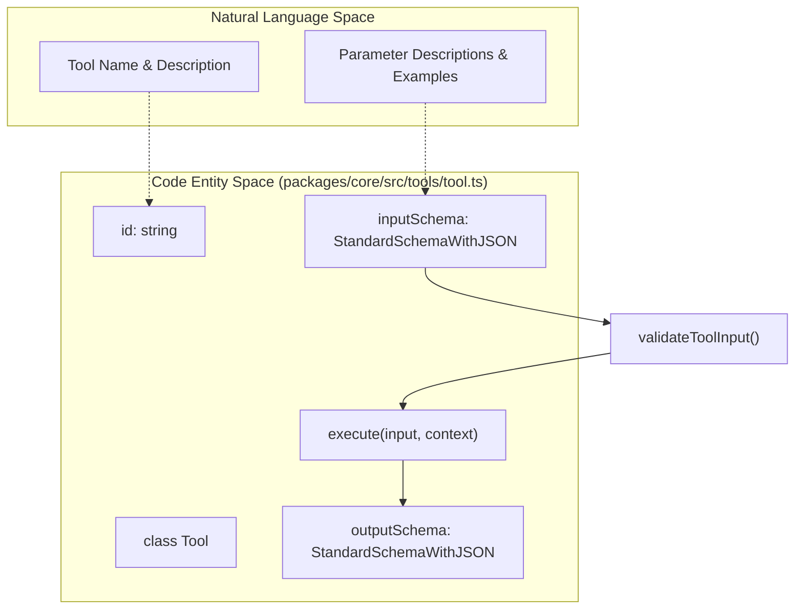
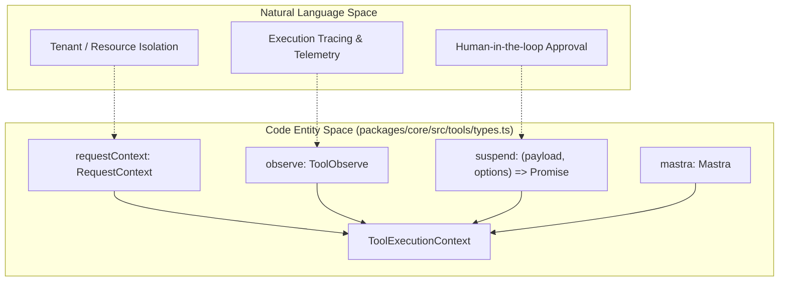

<!-- source: DeepWiki mcp.deepwiki.com · repo mastra-ai/mastra · page 6.1 Tool Definition and Execution Context · fetched 2026-10-26 -->

# Tool Definition and Execution Context

<details>
<summary>Relevant source files</summary>

The following files were used as context for generating this wiki page:

- [.changeset/fluffy-oranges-end.md](.changeset/fluffy-oranges-end.md)
- [client-sdks/ai-sdk/src/__tests__/background-task-stream.test.ts](client-sdks/ai-sdk/src/__tests__/background-task-stream.test.ts)
- [docs/src/content/en/reference/agents/agent.mdx](docs/src/content/en/reference/agents/agent.mdx)
- [docs/src/content/en/reference/tools/create-tool.mdx](docs/src/content/en/reference/tools/create-tool.mdx)
- [packages/core/src/agent/__tests__/tools.test.ts](packages/core/src/agent/__tests__/tools.test.ts)
- [packages/core/src/agent/__tests__/working-memory-context.test.ts](packages/core/src/agent/__tests__/working-memory-context.test.ts)
- [packages/core/src/agent/durable/__tests__/durable-agent-client-tool-pending.test.ts](packages/core/src/agent/durable/__tests__/durable-agent-client-tool-pending.test.ts)
- [packages/core/src/agent/durable/__tests__/durable-agent-tools.test.ts](packages/core/src/agent/durable/__tests__/durable-agent-tools.test.ts)
- [packages/core/src/agent/durable/workflows/steps/llm-mapping-pending-client-tool.test.ts](packages/core/src/agent/durable/workflows/steps/llm-mapping-pending-client-tool.test.ts)
- [packages/core/src/loop/shared/auto-resume-system-message.test.ts](packages/core/src/loop/shared/auto-resume-system-message.test.ts)
- [packages/core/src/loop/shared/auto-resume-system-message.ts](packages/core/src/loop/shared/auto-resume-system-message.ts)
- [packages/core/src/loop/test-utils/aimock/scenarios/approval-conditional.scenario.test.ts](packages/core/src/loop/test-utils/aimock/scenarios/approval-conditional.scenario.test.ts)
- [packages/core/src/loop/test-utils/aimock/scenarios/approval-input-validation.scenario.test.ts](packages/core/src/loop/test-utils/aimock/scenarios/approval-input-validation.scenario.test.ts)
- [packages/core/src/loop/test-utils/aimock/scenarios/auto-resume-suspended-tools.scenario.test.ts](packages/core/src/loop/test-utils/aimock/scenarios/auto-resume-suspended-tools.scenario.test.ts)
- [packages/core/src/loop/test-utils/aimock/scenarios/background-task-agent-level.scenario.test.ts](packages/core/src/loop/test-utils/aimock/scenarios/background-task-agent-level.scenario.test.ts)
- [packages/core/src/loop/test-utils/aimock/scenarios/background-task-tool-level.scenario.test.ts](packages/core/src/loop/test-utils/aimock/scenarios/background-task-tool-level.scenario.test.ts)
- [packages/core/src/loop/test-utils/aimock/scenarios/client-tools.scenario.test.ts](packages/core/src/loop/test-utils/aimock/scenarios/client-tools.scenario.test.ts)
- [packages/core/src/loop/test-utils/aimock/scenarios/prepare-step.scenario.test.ts](packages/core/src/loop/test-utils/aimock/scenarios/prepare-step.scenario.test.ts)
- [packages/core/src/loop/test-utils/aimock/scenarios/supervisor-delegation-hooks.scenario.test.ts](packages/core/src/loop/test-utils/aimock/scenarios/supervisor-delegation-hooks.scenario.test.ts)
- [packages/core/src/loop/test-utils/aimock/scenarios/tool-lifecycle-hooks.scenario.test.ts](packages/core/src/loop/test-utils/aimock/scenarios/tool-lifecycle-hooks.scenario.test.ts)
- [packages/core/src/loop/workflows/agentic-execution/tool-approval-verdict.ts](packages/core/src/loop/workflows/agentic-execution/tool-approval-verdict.ts)
- [packages/core/src/loop/workflows/agentic-execution/tool-call-step-before-approval.test.ts](packages/core/src/loop/workflows/agentic-execution/tool-call-step-before-approval.test.ts)
- [packages/core/src/loop/workflows/agentic-execution/tool-call-step.test.ts](packages/core/src/loop/workflows/agentic-execution/tool-call-step.test.ts)
- [packages/core/src/loop/workflows/agentic-execution/tool-call-step.ts](packages/core/src/loop/workflows/agentic-execution/tool-call-step.ts)
- [packages/core/src/processors/processor-tool-request-context.test.ts](packages/core/src/processors/processor-tool-request-context.test.ts)
- [packages/core/src/tools/builtin/web-fetch.test.ts](packages/core/src/tools/builtin/web-fetch.test.ts)
- [packages/core/src/tools/builtin/web-fetch.ts](packages/core/src/tools/builtin/web-fetch.ts)
- [packages/core/src/tools/index.ts](packages/core/src/tools/index.ts)
- [packages/core/src/tools/tool-builder/background-override-injection.test.ts](packages/core/src/tools/tool-builder/background-override-injection.test.ts)
- [packages/core/src/tools/tool-builder/builder.e2e.test.ts](packages/core/src/tools/tool-builder/builder.e2e.test.ts)
- [packages/core/src/tools/tool-builder/builder.test.ts](packages/core/src/tools/tool-builder/builder.test.ts)
- [packages/core/src/tools/tool-builder/builder.ts](packages/core/src/tools/tool-builder/builder.ts)
- [packages/core/src/tools/tool-builder/schema-compat-validation.test.ts](packages/core/src/tools/tool-builder/schema-compat-validation.test.ts)
- [packages/core/src/tools/tool-builder/validation-error-paths.test.ts](packages/core/src/tools/tool-builder/validation-error-paths.test.ts)
- [packages/core/src/tools/tool.test.ts](packages/core/src/tools/tool.test.ts)
- [packages/core/src/tools/tool.ts](packages/core/src/tools/tool.ts)
- [packages/core/src/tools/toolchecks.ts](packages/core/src/tools/toolchecks.ts)
- [packages/core/src/tools/types.ts](packages/core/src/tools/types.ts)
- [packages/core/src/tools/validation.test.ts](packages/core/src/tools/validation.test.ts)
- [packages/core/src/tools/validation.ts](packages/core/src/tools/validation.ts)

</details>


This page details the implementation, data flow, key classes, and execution context of the Mastra tool system. It covers how tools are defined with `createTool()`, adapted via `CoreToolBuilder`, executed within agent, workflow, or Model Context Protocol (MCP) environments, and validated through standard schema pipelines.

---

## Purpose and Scope

Tools extend Mastra agents and workflows by connecting them to external APIs, databases, filesystems, and code execution environments. This document explains:
- The `Tool` class and `createTool()` definition interface [packages/core/src/tools/tool.ts:193]().
- The `CoreToolBuilder` adaptation pipeline and compatibility layers [packages/core/src/tools/tool-builder/builder.ts:3-13]().
- The `ToolExecutionContext` family and request context propagation [packages/core/src/tools/tool.ts:79-139]().
- The validation, authorization (FGA), and background execution lifecycles [packages/core/src/tools/tool-builder/builder.ts:17-54]().

---

## Tool Definition Structure

Custom tools are created using `createTool()`, which instantiates the `Tool` class [packages/core/src/tools/tool.ts:193](). A tool definition contract includes a unique identifier (`id`), descriptions for model routing, input and output schemas, and an asynchronous `execute` function [docs/src/content/en/reference/tools/create-tool.mdx:21-40]().

### Natural Language to Code Entity Mapping: Tool Definitions


Sources: [packages/core/src/tools/tool.ts:193](), [docs/src/content/en/reference/tools/create-tool.mdx:21-40]()

### Accepted Tool Formats

Mastra unifies multiple tool providers through `CoreToolBuilder` [packages/core/src/tools/tool-builder/builder.ts:104]():
- **Native Mastra Tools**: Created via `createTool()` [docs/src/content/en/reference/tools/create-tool.mdx:21]().
- **Vercel AI SDK Tools**: Tools from AI SDK v4/v5 (`tool()` function) [packages/core/src/tools/types.ts:25-26]().
- **ProviderDefinedTool**: Native tools supplied by external SDK integrations or MCP servers [packages/core/src/tools/tool-builder/builder.ts:104]().

Sources: [packages/core/src/tools/tool-builder/builder.ts:104](), [packages/core/src/tools/types.ts:25-26]()

---

## Tool Execution Context

When a tool's `execute` function runs, it receives two arguments: the validated/parsed input data, and a `ToolExecutionContext` object providing access to runtime services [docs/src/content/en/reference/tools/create-tool.mdx:42]().

### Natural Language to Code Entity Mapping: Execution Contexts


Sources: [packages/core/src/tools/types.ts:180-212](), [packages/core/src/tools/tool.ts:185-190]()

### Key Context Properties

1.  **`requestContext`**: Provides access to tenant data, authorization rules, and request-scoped variables [packages/core/src/request-context/index.ts](). Tools can use `TransformedRequestContext` to safely sync schema-transformed values back to the parent context [packages/core/src/tools/tool.ts:79-118]().
2.  **`suspend()`**: Allows a tool to halt execution and return control to the agent loop or workflow engine (e.g., waiting for human intervention or background completion) [docs/src/content/en/reference/tools/create-tool.mdx:101-105]().
3.  **`observe`**: Integrates tool calls into Mastra's telemetry and OpenTelemetry tracing engine [packages/core/src/observability/]().

Sources: [packages/core/src/tools/tool.ts:79-118](), [packages/core/src/tools/types.ts:180-212]()

---

## Tool Lifecycle and CoreToolBuilder

Before a tool is presented to an LLM or workflow step, it passes through `CoreToolBuilder` [packages/core/src/tools/tool-builder/builder.ts:104](). The builder handles schema compatibility adjustments, background task configuration injection, Fine-Grained Authorization (FGA) checks, and request context merging [packages/core/src/tools/tool-builder/builder.ts:17-106]().

### Request Context Merging

When workflows execute across asynchronous event boundaries, `RequestContext` objects are serialized [packages/core/src/tools/tool-builder/builder.ts:56-69](). `mergeRequestContexts()` ensures that non-serializable references (such as controllers or specialized function bindings) captured in the closure are restored at execution time [packages/core/src/tools/tool-builder/builder.ts:86-106]().

```typescript
function mergeRequestContexts(
  closureRC: RequestContext | undefined,
  execRC: RequestContext | undefined,
): RequestContext { ... }
```
Sources: [packages/core/src/tools/tool-builder/builder.ts:56-106]()

### Authorization and FGA

During tool execution, `CoreToolBuilder` evaluates Fine-Grained Authorization policies if a user session is active within the `requestContext`, verifying `tools:execute` permissions against the target resource [packages/core/src/tools/tool-builder/builder.test.ts:55-112]().

Sources: [packages/core/src/tools/tool-builder/builder.ts:17](), [packages/core/src/tools/tool-builder/builder.test.ts:55-112]()

---

## Schema Validation Pipeline

Mastra employs a multi-stage validation architecture to ensure payload reliability between models, runtimes, and user code:

| Validation Stage | Function / Module | Description |
|------------------|-------------------|-------------|
| **Input Validation** | `validateToolInput` | Validates model-generated JSON arguments against the tool's `inputSchema` [packages/core/src/tools/tool-builder/builder.ts:51]() |
| **Output Validation** | `validateToolOutput` | Validates data returned by `execute()` against `outputSchema` [packages/core/src/tools/tool-builder/builder.ts:52]() |
| **Suspend Validation** | `validateToolSuspendData` | Verifies payloads passed during tool suspension [packages/core/src/tools/tool-builder/builder.ts:53]() |

Sources: [packages/core/src/tools/tool-builder/builder.ts:50-54]()

---

