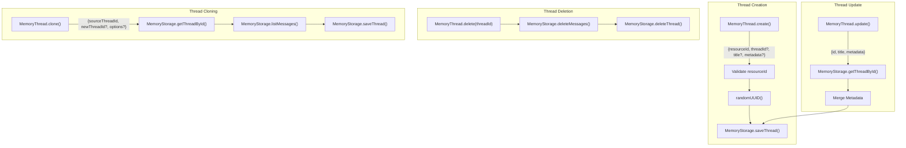
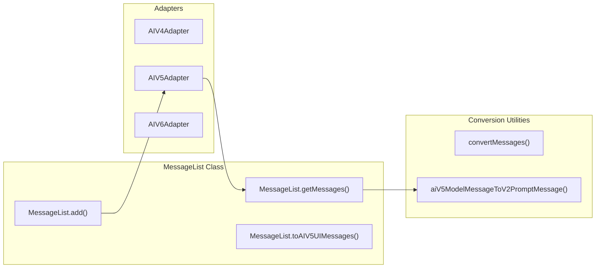
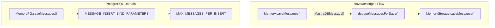
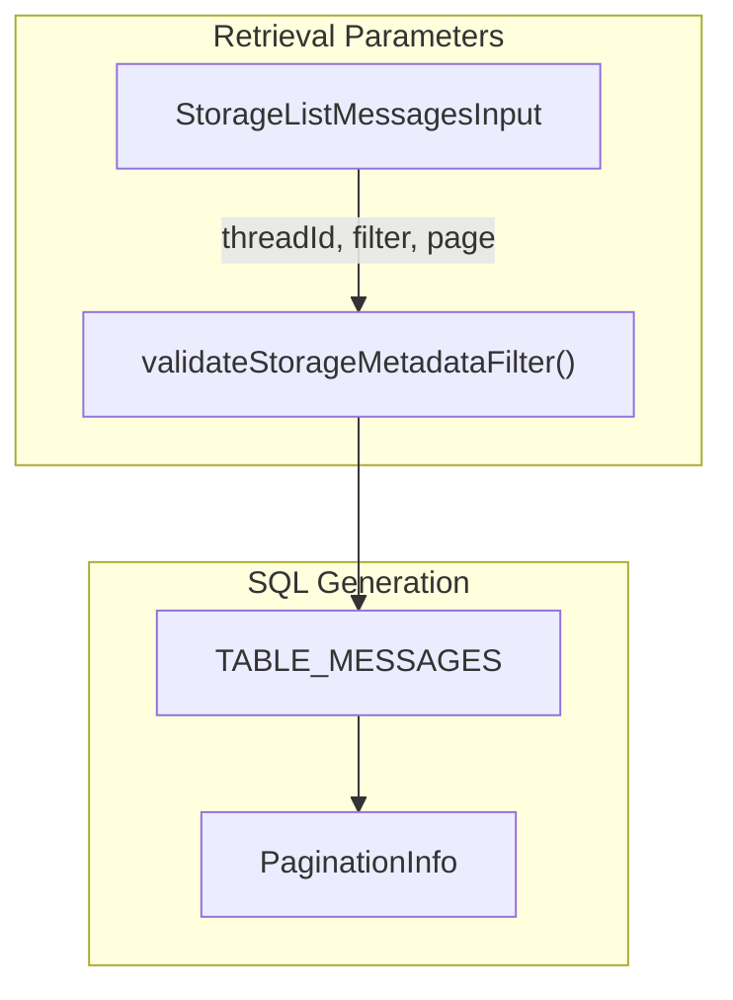

<!-- source: DeepWiki mcp.deepwiki.com · repo mastra-ai/mastra · page 7.2 Thread Management and Message Storage · fetched 2026-10-26 -->

# Thread Management and Message Storage

<details>
<summary>Relevant source files</summary>

The following files were used as context for generating this wiki page:

- [.changeset/replay-tool-call-without-args.md](.changeset/replay-tool-call-without-args.md)
- [client-sdks/ai-sdk/src/__tests__/chat-route-v7.test.ts](client-sdks/ai-sdk/src/__tests__/chat-route-v7.test.ts)
- [client-sdks/ai-sdk/src/__tests__/convert-messages.test.ts](client-sdks/ai-sdk/src/__tests__/convert-messages.test.ts)
- [client-sdks/ai-sdk/src/__tests__/workflow-route.test.ts](client-sdks/ai-sdk/src/__tests__/workflow-route.test.ts)
- [client-sdks/ai-sdk/src/convert-messages.ts](client-sdks/ai-sdk/src/convert-messages.ts)
- [client-sdks/ai-sdk/src/workflow-route.ts](client-sdks/ai-sdk/src/workflow-route.ts)
- [docs/src/content/en/reference/ai-sdk/to-ai-sdk-messages.mdx](docs/src/content/en/reference/ai-sdk/to-ai-sdk-messages.mdx)
- [packages/core/src/agent-builder/ee/normalize-candidate.ts](packages/core/src/agent-builder/ee/normalize-candidate.ts)
- [packages/core/src/agent/durable/__tests__/durable-agent-background-task-prompt.test.ts](packages/core/src/agent/durable/__tests__/durable-agent-background-task-prompt.test.ts)
- [packages/core/src/agent/durable/workflows/steps/scorer-execution.ts](packages/core/src/agent/durable/workflows/steps/scorer-execution.ts)
- [packages/core/src/agent/message-list/adapters/AIV5Adapter-file-ui-part.test.ts](packages/core/src/agent/message-list/adapters/AIV5Adapter-file-ui-part.test.ts)
- [packages/core/src/agent/message-list/adapters/AIV5Adapter.ts](packages/core/src/agent/message-list/adapters/AIV5Adapter.ts)
- [packages/core/src/agent/message-list/adapters/AIV6Adapter-suspended-parts.test.ts](packages/core/src/agent/message-list/adapters/AIV6Adapter-suspended-parts.test.ts)
- [packages/core/src/agent/message-list/adapters/AIV6Adapter.ts](packages/core/src/agent/message-list/adapters/AIV6Adapter.ts)
- [packages/core/src/agent/message-list/adapters/agent-signal-ui-conversion.test.ts](packages/core/src/agent/message-list/adapters/agent-signal-ui-conversion.test.ts)
- [packages/core/src/agent/message-list/conversion/index.ts](packages/core/src/agent/message-list/conversion/index.ts)
- [packages/core/src/agent/message-list/conversion/output-converter-file-metadata.test.ts](packages/core/src/agent/message-list/conversion/output-converter-file-metadata.test.ts)
- [packages/core/src/agent/message-list/conversion/output-converter-mcp-media.test.ts](packages/core/src/agent/message-list/conversion/output-converter-mcp-media.test.ts)
- [packages/core/src/agent/message-list/conversion/output-converter-provider-executed.test.ts](packages/core/src/agent/message-list/conversion/output-converter-provider-executed.test.ts)
- [packages/core/src/agent/message-list/conversion/output-converter-provider-file-id.test.ts](packages/core/src/agent/message-list/conversion/output-converter-provider-file-id.test.ts)
- [packages/core/src/agent/message-list/conversion/output-converter.ts](packages/core/src/agent/message-list/conversion/output-converter.ts)
- [packages/core/src/agent/message-list/conversion/to-prompt-tool-name-sanitization.test.ts](packages/core/src/agent/message-list/conversion/to-prompt-tool-name-sanitization.test.ts)
- [packages/core/src/agent/message-list/conversion/to-prompt.ts](packages/core/src/agent/message-list/conversion/to-prompt.ts)
- [packages/core/src/agent/message-list/detection/TypeDetector.ts](packages/core/src/agent/message-list/detection/TypeDetector.ts)
- [packages/core/src/agent/message-list/index.ts](packages/core/src/agent/message-list/index.ts)
- [packages/core/src/agent/message-list/message-list-suspended-tool-calls.test.ts](packages/core/src/agent/message-list/message-list-suspended-tool-calls.test.ts)
- [packages/core/src/agent/message-list/message-list.ts](packages/core/src/agent/message-list/message-list.ts)
- [packages/core/src/agent/message-list/prompt/attachments-to-parts.test.ts](packages/core/src/agent/message-list/prompt/attachments-to-parts.test.ts)
- [packages/core/src/agent/message-list/prompt/attachments-to-parts.ts](packages/core/src/agent/message-list/prompt/attachments-to-parts.ts)
- [packages/core/src/agent/message-list/prompt/image-utils.test.ts](packages/core/src/agent/message-list/prompt/image-utils.test.ts)
- [packages/core/src/agent/message-list/prompt/image-utils.ts](packages/core/src/agent/message-list/prompt/image-utils.ts)
- [packages/core/src/agent/message-list/tests/message-list-v5.test.ts](packages/core/src/agent/message-list/tests/message-list-v5.test.ts)
- [packages/core/src/agent/message-list/tests/message-list-v6.test.ts](packages/core/src/agent/message-list/tests/message-list-v6.test.ts)
- [packages/core/src/agent/message-list/tests/split-tool-call-args.test.ts](packages/core/src/agent/message-list/tests/split-tool-call-args.test.ts)
- [packages/core/src/agent/message-list/tests/update-tool-invocation.test.ts](packages/core/src/agent/message-list/tests/update-tool-invocation.test.ts)
- [packages/core/src/agent/message-list/utils/provider-compat.test.ts](packages/core/src/agent/message-list/utils/provider-compat.test.ts)
- [packages/core/src/agent/message-list/utils/provider-compat.ts](packages/core/src/agent/message-list/utils/provider-compat.ts)
- [packages/core/src/loop/shared/build-llm-prompt-args.test.ts](packages/core/src/loop/shared/build-llm-prompt-args.test.ts)
- [packages/core/src/loop/shared/build-llm-prompt-args.ts](packages/core/src/loop/shared/build-llm-prompt-args.ts)
- [packages/core/src/loop/shared/compose-step-input.test.ts](packages/core/src/loop/shared/compose-step-input.test.ts)
- [packages/core/src/loop/shared/inject-background-task-prompt.test.ts](packages/core/src/loop/shared/inject-background-task-prompt.test.ts)
- [packages/core/src/loop/shared/inject-background-task-prompt.ts](packages/core/src/loop/shared/inject-background-task-prompt.ts)
- [packages/core/src/loop/test-utils/aimock/scenarios/invalid-tool-args-replay.scenario.test.ts](packages/core/src/loop/test-utils/aimock/scenarios/invalid-tool-args-replay.scenario.test.ts)
- [packages/core/src/storage/domains/memory/base.ts](packages/core/src/storage/domains/memory/base.ts)
- [packages/core/src/storage/domains/memory/inmemory.ts](packages/core/src/storage/domains/memory/inmemory.ts)
- [packages/core/src/storage/types.ts](packages/core/src/storage/types.ts)
- [packages/core/src/utils/deep-equal.test.ts](packages/core/src/utils/deep-equal.test.ts)
- [packages/core/src/utils/deep-equal.ts](packages/core/src/utils/deep-equal.ts)
- [packages/server/src/server/handlers/memory.test.ts](packages/server/src/server/handlers/memory.test.ts)
- [packages/server/src/server/handlers/memory.ts](packages/server/src/server/handlers/memory.ts)
- [packages/server/src/server/schemas/memory.test.ts](packages/server/src/server/schemas/memory.test.ts)
- [packages/server/src/server/schemas/memory.ts](packages/server/src/server/schemas/memory.ts)
- [stores/dsql/src/storage/domains/memory/index.ts](stores/dsql/src/storage/domains/memory/index.ts)
- [stores/dsql/src/storage/domains/memory/save-timestamps.test.ts](stores/dsql/src/storage/domains/memory/save-timestamps.test.ts)
- [stores/dsql/src/storage/domains/workflows/index.ts](stores/dsql/src/storage/domains/workflows/index.ts)
- [stores/libsql/src/storage/domains/memory/index.ts](stores/libsql/src/storage/domains/memory/index.ts)
- [stores/mongodb/src/storage/domains/memory/index.ts](stores/mongodb/src/storage/domains/memory/index.ts)
- [stores/mssql/src/storage/domains/workflows/index.ts](stores/mssql/src/storage/domains/workflows/index.ts)
- [stores/mysql/src/storage/domains/memory/index.ts](stores/mysql/src/storage/domains/memory/index.ts)
- [stores/oracledb/src/storage/domains/workflows/index.ts](stores/oracledb/src/storage/domains/workflows/index.ts)
- [stores/pg/src/storage/domains/memory/index.ts](stores/pg/src/storage/domains/memory/index.ts)
- [stores/spanner/src/storage/domains/memory/index.ts](stores/spanner/src/storage/domains/memory/index.ts)
- [stores/spanner/src/storage/domains/memory/list-messages-where.test.ts](stores/spanner/src/storage/domains/memory/list-messages-where.test.ts)
- [stores/spanner/src/storage/domains/workflows/index.ts](stores/spanner/src/storage/domains/workflows/index.ts)
- [stores/spanner/src/storage/domains/workflows/update-workflow-state.test.ts](stores/spanner/src/storage/domains/workflows/update-workflow-state.test.ts)

</details>


This page documents how Mastra Memory organizes conversations into threads and persists messages to storage. It covers thread lifecycle management, message storage and retrieval operations, and the `MessageList` abstraction that handles format conversions between different message representations.

For memory configuration and processor integration, see [Memory System Architecture](). For vector embeddings and semantic search, see [Vector Storage and Semantic Search](). For working memory that persists across threads, see [Working Memory and Tool Integration]().

---

## Thread Structure and Lifecycle

### Thread Data Model

Threads represent individual conversations owned by a resource (typically a user or tenant). Each thread maintains metadata, timestamps, and an optional title.

```typescript
type StorageThreadType = {
  id: string;                           // Unique thread identifier
  title?: string;                       // Optional display title
  resourceId: string;                   // Owner resource ID (required)
  createdAt: Date;                     // Thread creation timestamp
  updatedAt: Date;                     // Last modification timestamp
  metadata?: Record<string, unknown>;  // Arbitrary metadata storage
}
```
Sources: [packages/core/src/storage/types.ts:200-200]()

**Thread Metadata Structure**:
- **Working Memory**: Thread-scoped working memory content (when `scope: 'thread'`) [packages/core/src/memory/types.ts:180-189]().
- **Observational Memory (OM)**: Thread-specific OM metadata is stored under `thread.metadata.mastra.om`. This includes the `currentTask`, `suggestedResponse`, `threadTitle`, and the `lastObservedAt` timestamp [packages/core/src/memory/types.ts:54-68]().
- **Cloning**: Metadata tracking the origin of a cloned thread (`sourceThreadId`, `clonedAt`, `lastMessageId`) [packages/core/src/storage/types.ts:203-210]().

Sources: [packages/core/src/memory/types.ts:40-119](), [packages/core/src/storage/types.ts:196-210](), [packages/server/src/server/handlers/memory.ts:48-52]()

### Thread Lifecycle Operations

Mastra provides a high-level API for managing the lifecycle of conversation threads via the `MastraMemory` and `Memory` classes.

Title: "Thread Lifecycle Management"

Sources: [packages/core/src/storage/domains/memory/inmemory.ts:112-117](), [packages/core/src/storage/domains/memory/inmemory.ts:120-143](), [packages/core/src/storage/domains/memory/inmemory.ts:145-153]()

**Thread Creation Flow**:
1. User provides `resourceId` (required). If `threadId` is missing, a unique ID is generated using `node:crypto.randomUUID` [packages/core/src/agent/message-list/message-list.ts:4-4]().
2. `saveThread()` persists the thread to the storage adapter [stores/pg/src/storage/domains/memory/index.ts:112-117]().

**Thread Deletion Flow**:
1. Deletion involves removing both the thread record and all associated messages [packages/server/src/server/handlers/memory.ts:18-19]().
2. Storage adapters like `MemoryPG` handle cascading deletes and support `runPrune` for retention policies [stores/pg/src/storage/domains/memory/index.ts:135-136]().

Sources: [packages/server/src/server/handlers/memory.ts:36-47](), [stores/pg/src/storage/domains/memory/index.ts:1-200](), [packages/core/src/storage/types.ts:215-230]()

---

## Message Storage and Format

### MastraDBMessage Format

Messages use a structured format supporting multi-modal content and tool interactions.

```typescript
export type MastraDBMessage = {
  id: string;
  role: 'system' | 'user' | 'assistant' | 'tool' | 'signal';
  content: string | MastraMessageContentV2;
  type: 'text' | 'tool-call' | 'tool-result';
  createdAt: Date;
  threadId?: string;
  resourceId?: string;
};
```
Sources: [packages/core/src/agent/message-list/state/types.ts:49-57]()

**Content Parts**:
- `MastraMessageContentV2`: Uses a `parts` array [packages/core/src/agent/message-list/state/types.ts:50-50]().
- `MastraMessagePart`: Includes `text`, `image`, `tool-invocation`, and `tool-result` [packages/core/src/agent/message-list/state/types.ts:50-50]().
- `MastraToolInvocation`: Specifically handles tool calls and their results within the message stream [packages/core/src/agent/message-list/state/types.ts:58-58]().

Sources: [packages/core/src/agent/message-list/state/types.ts:49-59](), [packages/core/src/memory/types.ts:22-33]()

### MessageList: Format Conversion Abstraction

`MessageList` is the central class for managing message state and converting between Mastra's internal storage formats and LLM provider formats (AI SDK v4, v5, and v6).

Title: "MessageList Integration"

Sources: [packages/core/src/agent/message-list/message-list.ts:15-15](), [packages/core/src/agent/message-list/conversion/output-converter.ts:6-6](), [packages/core/src/agent/message-list/adapters/AIV5Adapter.ts:1-1](), [packages/core/src/agent/message-list/adapters/AIV6Adapter.ts:1-1]()

**Key Capabilities**:
- **Format Normalization**: Uses `AIV4Adapter`, `AIV5Adapter`, and `AIV6Adapter` to bridge different AI SDK versions [packages/core/src/agent/message-list/message-list.ts:15-15]().
- **Signal Handling**: `mergeSignalDataParts` merges non-user signal data into assistant messages to match active-streaming behavior [packages/core/src/agent/message-list/message-list.ts:77-98]().
- **State Management**: `MessageStateManager` tracks `memoryMessages`, `newUserMessages`, and `newResponseMessages` [packages/core/src/agent/message-list/message-list.ts:47-47]().

Sources: [packages/core/src/agent/message-list/message-list.ts:1-185](), [packages/core/src/agent/message-list/index.ts:1-80]()

---

## Message Storage Operations

### saveMessages: Persisting Conversation History

The `saveMessages` flow ensures conversation history is durable.

Title: "saveMessages Implementation Flow"

Sources: [stores/pg/src/storage/domains/memory/index.ts:48-49](), [stores/pg/src/storage/domains/memory/index.ts:48-49]()

**Deduplication and Batching**:
- `dedupeMessagesForSave`: Ensures messages with the same ID are not duplicated, favoring the earliest `createdAt` timestamp [stores/pg/src/storage/domains/memory/index.ts:166-168]().
- **Batching**: PostgreSQL limits bind parameters (65,535). Mastra calculates `MAX_MESSAGES_PER_INSERT` (approx 8,191) to optimize performance [stores/pg/src/storage/domains/memory/index.ts:48-49]().

Sources: [stores/pg/src/storage/domains/memory/index.ts:26-164](), [packages/core/src/storage/domains/memory/base.ts:1-1]()

### Message Retrieval and Filtering

Retrieval supports complex filtering including date ranges, metadata, and pagination.

Title: "Message Retrieval Logic"

Sources: [packages/core/src/storage/types.ts:143-145](), [packages/core/src/storage/types.ts:143-145]()

**Filtering Capabilities**:
- **Metadata Filtering**: `storageMessageMatchesMetadataFilter` allows filtering by shallow scalar metadata key-value pairs stored in message content [packages/core/src/storage/types.ts:107-113]().
- **Pagination**: Returns `PaginationInfo` containing `total`, `page`, `perPage`, and `hasMore` [packages/core/src/storage/types.ts:53-62]().
- **Resource Scoping**: `listMessagesByResourceId` allows querying all messages for a resource across all threads, used primarily by Observational Memory [packages/core/src/storage/types.ts:147-154]().

Sources: [packages/core/src/storage/types.ts:73-146](), [stores/pg/src/storage/domains/memory/index.ts:166-181]()

---

## Observational Memory Recall

When Observational Memory is enabled, raw message storage interacts with the observation log.

| Operation | Description | Source |
| :--- | :--- | :--- |
| `recallTool` | A tool registered to agents to browse raw history behind observations. | [packages/core/src/memory/types.ts:121-121]() |
| `getObservationsAsOf` | Retrieves observations valid at a specific point in time. | [stores/pg/src/storage/domains/memory/index.ts:102-102]() |
| `saveMessages` (OM) | OM triggers `saveMessages` during buffering to persist observed boundaries. | [stores/pg/src/storage/domains/memory/index.ts:166-168]() |

Sources: [packages/core/src/memory/types.ts:1-121](), [stores/pg/src/storage/domains/memory/index.ts:1-168]()

---

