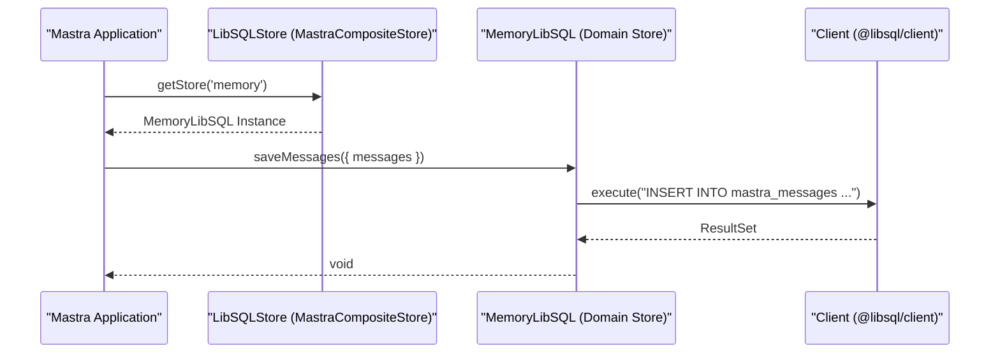

<!-- source: DeepWiki mcp.deepwiki.com · repo mastra-ai/mastra · page 7.5 LibSQL and Edge Storage · fetched 2026-10-26 -->

# LibSQL and Edge Storage

<details>
<summary>Relevant source files</summary>

The following files were used as context for generating this wiki page:

- [stores/libsql/CHANGELOG.md](stores/libsql/CHANGELOG.md)
- [stores/libsql/package.json](stores/libsql/package.json)
- [stores/mongodb/CHANGELOG.md](stores/mongodb/CHANGELOG.md)
- [stores/mongodb/package.json](stores/mongodb/package.json)

</details>


## Purpose and Scope
This page documents the LibSQL storage adapter, in-memory storage, and edge-compatible storage options provided by Mastra. It details how the `@mastra/libsql` package implements the `MastraCompositeStore` abstraction [stores/libsql/src/storage/index.ts:169-169](), handles structured and vector data [stores/libsql/package.json:4-4](), optimizes local and serverless SQLite connections, and integrates with other edge-native database providers such as Cloudflare D1 [stores/cloudflare-d1/package.json:4-4]() and Upstash [stores/upstash/package.json:4-4]().

Sources: [stores/libsql/src/storage/index.ts:169-169](), [stores/libsql/package.json:4-4](), [stores/cloudflare-d1/package.json:4-4](), [stores/upstash/package.json:4-4]()

## LibSQL Overview

LibSQL is a fork of SQLite designed for edge computing environments and serverless architectures. Mastra provides the `LibSQLStore` adapter as part of the `@mastra/libsql` package, implementing the `MastraCompositeStore` interface [stores/libsql/src/storage/index.ts:169-169](). It delivers structured relational database storage alongside vector embedding search capabilities [stores/libsql/package.json:4-4]().

| Adapter | Purpose | Edge Compatible | Package |
|---------|---------|-----------------|-----------|
| `LibSQLStore` | Structured data and vector storage | Yes | `@mastra/libsql` |
| `InMemoryThreadStateStorage` | Ephemeral thread state management | Yes | `@mastra/core` |
| `PostgresStore` | Full-featured relational storage | No (Node.js) | `@mastra/pg` |
| `UpstashStore` | HTTP-based serverless Redis storage | Yes | `@mastra/upstash` |
| `MongoDBStore` | Document storage with vector capabilities | Yes | `@mastra/mongodb` |
| `DynamoDBStore` | Key-value and document storage | Yes | `@mastra/dynamodb` |
| `ClickHouseStore` | OLAP database storage | Yes | `@mastra/clickhouse` |

Sources: [stores/libsql/package.json:4-4](), [packages/core/src/storage/base.ts:28-28](), [stores/pg/src/storage/index.ts:192-200](), [stores/upstash/package.json:4-4](), [stores/mongodb/package.json:4-4](), [stores/clickhouse/package.json:4-4]()

## Storage Architecture and Domains

Mastra uses a Composite Store architecture where a single store instance manages multiple functional domains. `LibSQLStore` aggregates domain-specific classes such as `MemoryLibSQL`, `WorkflowsLibSQL`, and `AgentsLibSQL` [stores/libsql/src/storage/index.ts:32-56]().

### LibSQL System Architecture
The following diagram bridges abstract storage concepts to specific code entities within the LibSQL implementation.

```mermaid
graph TB
    subgraph "Code Entity Space: @mastra/libsql"
        direction TB
        LSS["LibSQLStore"]
        LDB["Client (@libsql/client)"]
        
        subgraph "Domain Classes"
            D_MEM["MemoryLibSQL"]
            D_WF["WorkflowsLibSQL"]
            D_AG["AgentsLibSQL"]
            D_OBS["ObservabilityLibSQL"]
            D_TS["ThreadStateLibSQL"]
            D_SCHED["SchedulesLibSQL"]
            D_BG["BackgroundTasksLibSQL"]
            D_BLOBS["BlobsLibSQL"]
            D_CHANNELS["ChannelsLibSQL"]
            D_DATASETS["DatasetsLibSQL"]
            D_EXPERIMENTS["ExperimentsLibSQL"]
            D_FAVORITES["FavoritesLibSQL"]
            D_HARNESS["HarnessLibSQL"]
            D_MCPC["MCPClientsLibSQL"]
            D_MCPS["MCPServersLibSQL"]
            D_NOTIF["NotificationsLibSQL"]
            D_PROMPT["PromptBlocksLibSQL"]
            D_SCORERDEF["ScorerDefinitionsLibSQL"]
            D_SCORES["ScoresLibSQL"]
            D_SKILLS["SkillsLibSQL"]
            D_TOOLCONN["ToolProviderConnectionsLibSQL"]
            D_WORKSPACES["WorkspacesLibSQL"]
            D_WFDEF["WorkflowDefinitionsLibSQL"]
        end
    end

    subgraph "Natural Language Space: Storage Backend"
        TURSO["Turso / LibSQL Service"]
        LOCAL["Local SQLite File / :memory:"]
    end

    LSS -->|"manages"| D_MEM
    LSS -->|"manages"| D_WF
    LSS -->|"manages"| D_AG
    LSS -->|"manages"| D_OBS
    LSS -->|"manages"| D_TS
    LSS -->|"manages"| D_SCHED
    LSS -->|"manages"| D_BG
    LSS -->|"manages"| D_BLOBS
    LSS -->|"manages"| D_CHANNELS
    LSS -->|"manages"| D_DATASETS
    LSS -->|"manages"| D_EXPERIMENTS
    LSS -->|"manages"| D_FAVORITES
    LSS -->|"manages"| D_HARNESS
    LSS -->|"manages"| D_MCPC
    LSS -->|"manages"| D_MCPS
    LSS -->|"manages"| D_NOTIF
    LSS -->|"manages"| D_PROMPT
    LSS -->|"manages"| D_SCORERDEF
    LSS -->|"manages"| D_SCORES
    LSS -->|"manages"| D_SKILLS
    LSS -->|"manages"| D_TOOLCONN
    LSS -->|"manages"| D_WORKSPACES
    LSS -->|"manages"| D_WFDEF
    
    D_MEM & D_WF & D_AG & D_OBS & D_TS & D_SCHED & D_BG & D_BLOBS & D_CHANNELS & D_DATASETS & D_EXPERIMENTS & D_FAVORITES & D_HARNESS & D_MCPC & D_MCPS & D_NOTIF & D_PROMPT & D_SCORERDEF & D_SCORES & D_SKILLS & D_TOOLCONN & D_WORKSPACES & D_WFDEF -->|"executes via"| LDB
    LDB -->|"persists to"| TURSO
    LDB -->|"persists to"| LOCAL
```


Sources: [stores/libsql/src/storage/index.ts:7-29](), [stores/libsql/src/storage/index.ts:32-56]()

### Domain Implementation Details
The LibSQL domains handle SQL generation and execution for their respective subsystems:
- **MemoryLibSQL**: Manages thread persistence and message history. It implements the `MemoryStorage` interface and supports `createdAt`-based retention [stores/libsql/src/storage/domains/memory/index.ts:115-128](), as well as observational memory records [stores/libsql/src/storage/domains/memory/index.ts:18-18]().
- **WorkflowsLibSQL**: Manages workflow execution snapshots and run states [stores/libsql/src/storage/index.ts:28-28]().
- **WorkflowDefinitionsLibSQL**: Persists workflow definitions across application restarts [stores/libsql/src/storage/index.ts:27-27]().
- **ObservabilityLibSQL**: Stores OpenTelemetry spans, traces, and execution logs [stores/libsql/src/storage/index.ts:19-19]().
- **ThreadStateLibSQL**: Manages transient thread state for active executions [stores/libsql/src/storage/index.ts:25-25]().
- **SchedulesLibSQL**: Manages cron and scheduled task definitions [stores/libsql/src/storage/index.ts:21-21]().
- **BackgroundTasksLibSQL**: Tracks asynchronous background task metadata [stores/libsql/src/storage/index.ts:8-8]().
- **DatasetsLibSQL**: Stores evaluation datasets. The `listDatasets` method supports filtering by `datasetIds` [stores/libsql/CHANGELOG.md:5-7]().
- **ExperimentsLibSQL**: Manages experiment results, metrics, and provenance grouping [stores/libsql/src/storage/index.ts:12-12]().

Sources: [stores/libsql/src/storage/index.ts:7-29](), [stores/libsql/src/storage/domains/memory/index.ts:115-128](), [stores/libsql/CHANGELOG.md:5-7]()

## Configuration and Initialization

### LibSQLStore Setup
`LibSQLStore` can be initialized using connection credentials or a pre-configured client instance [stores/libsql/src/storage/index.ts:142-149]().

```typescript
import { LibSQLStore } from '@mastra/libsql';

// Option 1: Turso / Remote LibSQL URL and Auth Token
const storage = new LibSQLStore({
  id: 'my-store',
  url: 'libsql://your-db.turso.io',
  authToken: 'your-token',
});

// Option 2: In-memory for edge testing or ephemeral runs
const memoryStorage = new LibSQLStore({
  id: 'test-store',
  url: 'file::memory:',
});
```

### Performance Optimization
For local file and in-memory databases, `LibSQLStore` applies SQLite PRAGMAs to optimize performance. Default configurations apply a `cacheSize` of `-16000` (16MB) and `mmapSize` of `134217728` (128MB) [stores/libsql/src/storage/index.ts:62-63](). It also enforces a `connectionTimeoutMs` (default `5000ms`) to mitigate `SQLITE_BUSY` errors on concurrent local file accesses [stores/libsql/src/storage/index.ts:105-107]().
Recent updates have fixed `LibSQLStore` crashing on startup against remote databases (e.g., Turso) due to transient network errors. Domain initialization now runs at most 5 domains at a time and retries transient network errors with backoff [stores/libsql/CHANGELOG.md:17-18]().

### Initialization Control
All Mastra stores accept a `disableInit` flag [packages/core/src/storage/base.ts:208-208](). When set to `true`, the store skips automated table creation and schema migrations on startup [stores/libsql/src/storage/index.ts:132-132](). This is recommended for serverless production environments where migrations are executed separately via CI/CD pipelines [stores/libsql/src/storage/index.ts:119-121]().

Sources: [stores/libsql/src/storage/index.ts:62-63](), [stores/libsql/src/storage/index.ts:105-107](), [stores/libsql/src/storage/index.ts:119-121](), [stores/libsql/src/storage/index.ts:132-132](), [stores/libsql/src/storage/index.ts:142-149](), [packages/core/src/storage/base.ts:208-208](), [stores/libsql/CHANGELOG.md:17-18]()

## Data Flow: Domain Retrieval

The following sequence diagram illustrates request routing from the Mastra application down through the composite store to the underlying LibSQL domain driver and client.



Sources: [stores/libsql/src/storage/index.ts:169-178](), [packages/core/src/storage/base.ts:32-56]()

## Comparison of Edge Storage Options

Mastra supports multiple database adapters suited for serverless and edge runtimes such as Cloudflare Workers and Vercel Edge Functions.

| Store | Technology | Key Features | Package |
|-------|------------|--------------|-----------|
| `LibSQLStore` | LibSQL / Turso | Relational & Vector capabilities [stores/libsql/package.json:4-4]() | `@mastra/libsql` |
| `CloudflareD1Store` | Cloudflare D1 | Native serverless SQLite on Cloudflare [stores/cloudflare-d1/package.json:4-4]() | `@mastra/cloudflare-d1` |
| `UpstashStore` | Redis / Vector | HTTP-based serverless Redis & Vector [stores/upstash/package.json:34-35]() | `@mastra/upstash` |
| `MongoDBStore` | MongoDB | Document storage with vector capabilities [stores/mongodb/package.json:4-4]() | `@mastra/mongodb` |
| `DynamoDBStore` | DynamoDB | Key-value and document storage [stores/dynamodb/package.json:4-4]() | `@mastra/dynamodb` |

### Cloudflare Ecosystem Integration
Mastra offers specialized integration packages for Cloudflare deployments:
- **@mastra/cloudflare**: General Cloudflare provider including KV and Durable Object bindings [stores/cloudflare/package.json:2-4]().
- **@mastra/cloudflare-d1**: Specialized adapter targeting Cloudflare D1 serverless SQL databases [stores/cloudflare-d1/package.json:2-4]().
- **@mastra/voice-cloudflare**: Voice AI integration (TTS/STT) leveraging Cloudflare Workers AI [voice/cloudflare/package.json:2-4]().

Sources: [stores/cloudflare/package.json:2-4](), [stores/cloudflare-d1/package.json:2-4](), [stores/upstash/package.json:34-35](), [stores/mongodb/package.json:4-4](), [stores/dynamodb/package.json:4-4]()

---

