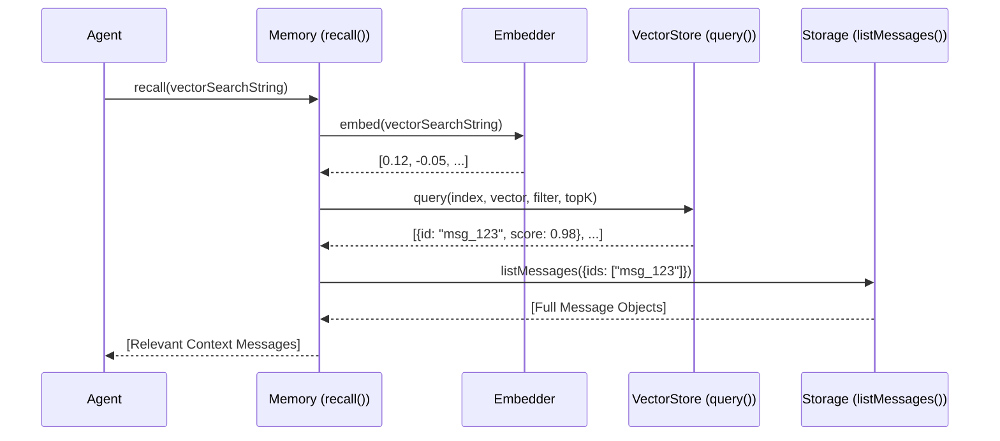

<!-- source: DeepWiki mcp.deepwiki.com · repo mastra-ai/mastra · page 7.6 Vector Storage and Semantic Search · fetched 2026-10-26 -->

# Vector Storage and Semantic Search

<details>
<summary>Relevant source files</summary>

The following files were used as context for generating this wiki page:

- [.changeset/tidy-pumas-invite.md](.changeset/tidy-pumas-invite.md)
- [.github/scripts/validate-pkg-json.mjs](.github/scripts/validate-pkg-json.mjs)
- [packages/_external-types/package.json](packages/_external-types/package.json)
- [packages/_vendored/ai_v4/package.json](packages/_vendored/ai_v4/package.json)
- [packages/_vendored/ai_v5/package.json](packages/_vendored/ai_v5/package.json)
- [packages/_vendored/ai_v6/package.json](packages/_vendored/ai_v6/package.json)
- [pubsub/google-cloud-pubsub/package.json](pubsub/google-cloud-pubsub/package.json)
- [pubsub/redis-streams/package.json](pubsub/redis-streams/package.json)
- [pubsub/valkey-streams/package.json](pubsub/valkey-streams/package.json)
- [stores/cloudflare-d1/package.json](stores/cloudflare-d1/package.json)
- [stores/cloudflare/package.json](stores/cloudflare/package.json)
- [stores/couchbase/package.json](stores/couchbase/package.json)
- [stores/dsql/package.json](stores/dsql/package.json)
- [stores/dynamodb/package.json](stores/dynamodb/package.json)
- [stores/elasticsearch/package.json](stores/elasticsearch/package.json)
- [stores/lance/package.json](stores/lance/package.json)
- [stores/opensearch/package.json](stores/opensearch/package.json)
- [stores/redis/CHANGELOG.md](stores/redis/CHANGELOG.md)
- [stores/redis/package.json](stores/redis/package.json)
- [stores/vectorize/package.json](stores/vectorize/package.json)
- [voice/cloudflare/package.json](voice/cloudflare/package.json)

</details>


This document describes the vector storage abstraction layer and semantic search capabilities in Mastra's memory system. It covers the `MastraVector` interface, vector database adapters (Pinecone, Qdrant, Chroma, Vectorize, Astra, Upstash, Couchbase, PG, LibSQL, Turbopuffer, and others), embedding model integration, and semantic recall functionality.

For information about:
- Overall memory architecture, see [Memory System Architecture](7.1)
- RAG document processing and chunking, see [RAG System and Document Processing](7.7)
- Message storage and thread management, see [Thread Management and Message Storage](7.2)

## MastraVector Interface

The `MastraVector` interface defines the contract that all vector database adapters must implement. Memory instances and RAG workflows use this interface to store and query vector embeddings for semantic search.

### System Architecture to Code Mapping

The following diagram bridges the high-level semantic search concept to the specific classes and files implementing the vector storage layer.

Title: Vector Storage Abstraction Mapping
```mermaid
graph TB
    subgraph "Natural Language Space"
        UserQuery[""What did we say about the project?""]
        MessageContent[""Message Text Content""]
    end

    subgraph "Code Entity Space (@mastra/core/vector)"
        MastraVector[""class MastraVector<br/>packages/core/src/vector/vector.ts:72-198""]
        QueryMethod[""MastraVector.query()<br/>packages/core/src/vector/vector.ts:94""]
        UpsertMethod[""MastraVector.upsert()<br/>packages/core/src/vector/vector.ts:96""]
        
        subgraph "Vector Adapters"
            PgVector[""class PgVector<br/>stores/pg/src/vector/index.ts:138-702""]
            QdrantVector[""class QdrantVector<br/>stores/qdrant/src/vector/index.ts:121-500""]
            ChromaVector[""class ChromaVector<br/>stores/chroma/src/vector/index.ts:54-300""]
            LibSQLVector[""class LibSQLVector<br/>stores/libsql/src/vector/index.ts:57-300""]
            PineconeVector[""class PineconeVector<br/>stores/pinecone/src/vector/index.ts:25-250""]
            UpstashVector[""class UpstashVector<br/>stores/upstash/package.json:35""]
            LanceVector[""class LanceVector<br/>stores/lance/package.json:4""]
            DynamoDBVector[""class DynamoDBVector<br/>stores/dynamodb/package.json:4""]
            CloudflareD1Vector[""class CloudflareD1Vector<br/>stores/cloudflare-d1/package.json:4""]
            CloudflareVector[""class CloudflareVector<br/>stores/cloudflare/package.json:4""]
            RedisVector[""class RedisVector<br/>stores/redis/package.json:4""]
            DSQLVector[""class DSQLVector<br/>stores/dsql/package.json:4""]
            ElasticsearchVector[""class ElasticsearchVector<br/>stores/elasticsearch/package.json:4""]
            OpenSearchVector[""class OpenSearchVector<br/>stores/opensearch/package.json:4""]
            CouchbaseVector[""class CouchbaseVector<br/>stores/couchbase/package.json:4""]
            VectorizeVector[""class VectorizeVector<br/>stores/vectorize/package.json:4""]
        end
    end

    UserQuery -->|embedded by| QueryMethod
    MessageContent -->|embedded by| UpsertMethod
    
    MastraVector -.->|abstracts| PgVector
    MastraVector -.->|abstracts| QdrantVector
    MastraVector -.->|abstracts| ChromaVector
    MastraVector -.->|abstracts| LibSQLVector
    MastraVector -.->|abstracts| PineconeVector
    MastraVector -.->|abstracts| UpstashVector
    MastraVector -.->|abstracts| LanceVector
    MastraVector -.->|abstracts| DynamoDBVector
    MastraVector -.->|abstracts| CloudflareD1Vector
    MastraVector -.->|abstracts| CloudflareVector
    MastraVector -.->|abstracts| RedisVector
    MastraVector -.->|abstracts| DSQLVector
    MastraVector -.->|abstracts| ElasticsearchVector
    MastraVector -.->|abstracts| OpenSearchVector
    MastraVector -.->|abstracts| CouchbaseVector
    MastraVector -.->|abstracts| VectorizeVector
```
Sources: [packages/core/src/vector/vector.ts:72-198](), [stores/pg/src/vector/index.ts:138-702](), [stores/upstash/package.json:35](), [packages/core/src/vector/vector.ts:94-96](), [stores/lance/package.json:4](), [stores/dynamodb/package.json:4](), [stores/cloudflare-d1/package.json:4](), [stores/cloudflare/package.json:4](), [stores/redis/package.json:4](), [stores/dsql/package.json:4](), [stores/elasticsearch/package.json:4](), [stores/opensearch/package.json:4](), [stores/couchbase/package.json:4](), [stores/vectorize/package.json:4]()

### Core Methods

The `MastraVector` interface requires implementations to provide:

| Method | Purpose | File Reference |
|--------|---------|----------------|
| `createIndex()` | Creates a vector index with specified dimensions and configuration | [packages/core/src/vector/vector.ts:98]() |
| `upsert()` | Inserts or updates vectors with associated metadata | [packages/core/src/vector/vector.ts:96]() |
| `query()` | Performs similarity search returning top-k nearest neighbors | [packages/core/src/vector/vector.ts:94]() |
| `describeIndex()`| Retrieves statistics (count, dimension, metric) about an index | [packages/core/src/vector/vector.ts:102]() |
| `deleteVectors()`| Bulk deletion by IDs or metadata filter | [packages/core/src/vector/vector.ts:146]() |

Sources: [packages/core/src/vector/vector.ts:94-147]()

## Embedding Integration

Mastra integrates with embedding models to convert text content into vector representations. It supports multiple AI SDK versions for broad compatibility, along with local and remote embedding providers.

### Local Embeddings with FastEmbed
The `@mastra/fastembed` package provides local embedding generation using ONNX runtimes via `onnxruntime-node`. It processes texts in batches and converts results to standard arrays, featuring caching and LRU eviction policies [packages/memory/src/embedding-cache.test.ts:120-132]().

Title: FastEmbed Execution Flow
```mermaid
graph LR
    subgraph "FastEmbed Integration"
        FE[""@mastra/fastembed<br/>packages/fastembed/src/index.ts""]
        ModelCache[""getCachedModel()<br/>packages/fastembed/src/model-cache.ts:14""]
        GenE[""generateEmbeddings()<br/>packages/fastembed/src/index.ts:40""]
    end
    
    subgraph "Mastra Core"
        Vect[""MastraVector<br/>packages/core/src/vector/vector.ts""]
        Router[""ModelRouterEmbeddingModel<br/>packages/core/src/llm/model/embedding-router.ts:114""]
    end
    
    FE --> GenE
    GenE --> ModelCache
    Router -.-> FE
    Vect --> Router
```
Sources: [packages/fastembed/src/index.ts:40-60](), [packages/fastembed/src/model-cache.ts:14-30](), [packages/core/src/llm/model/embedding-router.ts:114-123]()

### Provider Support
Mastra supports a wide range of embedding models:
1. **Remote Providers**: OpenAI, Google, VoyageAI, etc., via the `ModelRouterEmbeddingModel` which supports IDs like `openai/text-embedding-3-small` [docs/src/content/en/docs/memory/semantic-recall.mdx:65]().
2. **Local Providers**: `@mastra/fastembed` supporting local ONNX-backed embeddings [packages/fastembed/src/index.ts:20]().

Sources: [docs/src/content/en/docs/memory/semantic-recall.mdx:65-70](), [packages/fastembed/src/index.ts:20-40]()

## Vector Storage Operations

### PostgreSQL (pgvector) Implementation
The `PgVector` adapter utilizes the `pgvector` extension [stores/pg/src/vector/index.ts:138](). It supports advanced features like HNSW and IVFFlat indexes, namespace isolation [stores/pg/src/vector/index.test.ts:50](), disableInit configuration [stores/pg/src/vector/index.disable-init.test.ts:78](), and specific vector types for optimization.

| Feature | Code Entity / Constant | Purpose |
|---------|------------------------|---------|
| **Vector Types** | `vector`, `halfvec`, `bit`, `sparsevec` | Control storage precision and dimension limits [stores/pg/src/vector/index.ts:32-41]() |
| **Metrics** | `cosine`, `euclidean`, `dotproduct`, `hamming`, `jaccard` | Distance functions for similarity search [stores/pg/src/vector/index.ts:77-81]() |
| **Metadata** | `metadataIndexes` | Creates B-tree indexes on JSONB metadata fields for fast filtering [stores/pg/src/vector/index.ts:99-107]() |

`PgVector` implements robust connection pooling via `pg.Pool` with explicit configuration for connection timeouts, custom schema names, and SSL modes [stores/pg/src/vector/index.ts:138-177]().

Sources: [stores/pg/src/vector/index.ts:32-177](), [stores/pg/src/vector/index.test.ts:50-136](), [stores/pg/src/vector/index.disable-init.test.ts:78-150]()

### LibSQL and Turso
The `LibSQLVector` adapter supports SQLite-based vector search [docs/src/content/en/reference/vectors/libsql.mdx:11](). It is suitable for edge environments and local development.

- **Memory Mode**: Supports `:memory:` for ephemeral testing [docs/src/content/en/reference/vectors/libsql.mdx:71]().
- **Integration**: Works with `LibSQLStore` for unified storage and vector capabilities [docs/src/content/en/reference/vectors/libsql.mdx:11-14]().

Sources: [docs/src/content/en/reference/vectors/libsql.mdx:11-72]()

### Extended Provider Ecosystem
Mastra supports a diverse set of vector storage providers, each packaged as a separate store module:
- **Pinecone**: Integrates via `@mastra/pinecone` for real-time vector search and hybrid sparse-dense support [docs/src/content/en/reference/vectors/pinecone.mdx:10]().
- **Qdrant**: Integrates via `@mastra/qdrant` supporting named vector spaces [docs/src/content/en/reference/vectors/qdrant.mdx:10]().
- **Turbopuffer**: High-performance vector database optimized for RAG applications [docs/src/content/en/reference/vectors/turbopuffer.mdx:10]().
- **Couchbase**: Couchbase Vector Search integration [docs/src/content/en/reference/vectors/couchbase.mdx:10]().
- **Upstash**: Integrates `@upstash/vector` for serverless vector search [stores/upstash/package.json:35]().
- **Chroma**: Open-source vector database integration [docs/src/content/en/reference/vectors/chroma.package.json:4]().
- **LanceDB**: Provider for Lance vector store [stores/lance/package.json:4]().
- **DynamoDB**: DynamoDB storage adapter [stores/dynamodb/package.json:4]().
- **Cloudflare D1**: D1 provider for Mastra [stores/cloudflare-d1/package.json:4]().
- **Cloudflare**: Cloudflare provider for Mastra [stores/cloudflare/package.json:4]().
- **Redis**: Redis storage provider [stores/redis/package.json:4]().
- **DSQL**: Amazon Aurora DSQL storage provider [stores/dsql/package.json:4]().
- **Elasticsearch**: Elasticsearch storage provider [stores/elasticsearch/package.json:4]().
- **OpenSearch**: OpenSearch storage provider [stores/opensearch/package.json:4]().
- **Vectorize**: Vectorize storage provider [stores/vectorize/package.json:4]().

Sources: [docs/src/content/en/reference/vectors/pinecone.mdx:10-15](), [docs/src/content/en/reference/vectors/qdrant.mdx:10-65](), [docs/src/content/en/reference/vectors/turbopuffer.mdx:10](), [docs/src/content/en/reference/vectors/couchbase.mdx:10](), [stores/upstash/package.json:35](), [stores/lance/package.json:4](), [stores/dynamodb/package.json:4](), [stores/cloudflare-d1/package.json:4](), [stores/cloudflare/package.json:4](), [stores/redis/package.json:4](), [stores/dsql/package.json:4](), [stores/elasticsearch/package.json:4](), [stores/opensearch/package.json:4](), [stores/vectorize/package.json:4]()

## Semantic Recall and Retrieval Pipeline

Semantic recall enables agents to retrieve relevant past messages based on meaning rather than just recency.

### Retrieval Pipeline

The sequence below illustrates the data flow from a natural language query to retrieved message objects.

Title: Semantic Recall Sequence

Sources: [packages/core/src/vector/vector.ts:94](), [docs/src/content/en/docs/memory/semantic-recall.mdx:115-128]()

### Configuration
Semantic recall is configured via the `Memory` options. It can be scoped to a specific `resource` (searching all threads for a user) or a single `thread` [docs/src/content/en/docs/memory/semantic-recall.mdx:193-197]().

- **topK**: Number of similar messages to retrieve.
- **messageRange**: Number of surrounding messages (context window) to include with each match.
- **Scope**: `resource` (default) or `thread` [docs/src/content/en/docs/memory/working-memory.mdx:79-80]().

Sources: [docs/src/content/en/docs/memory/semantic-recall.mdx:193-197](), [docs/src/content/en/docs/memory/working-memory.mdx:79-80]()

---

