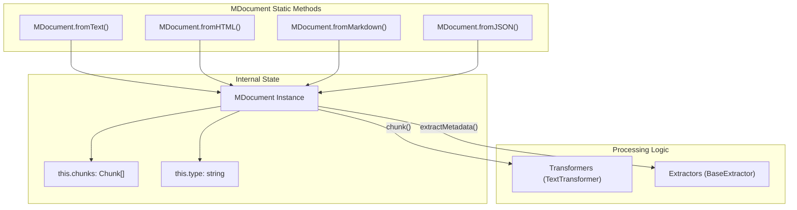
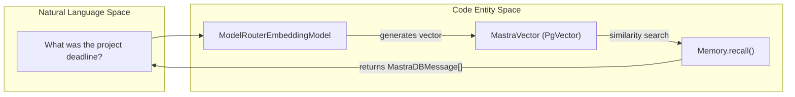
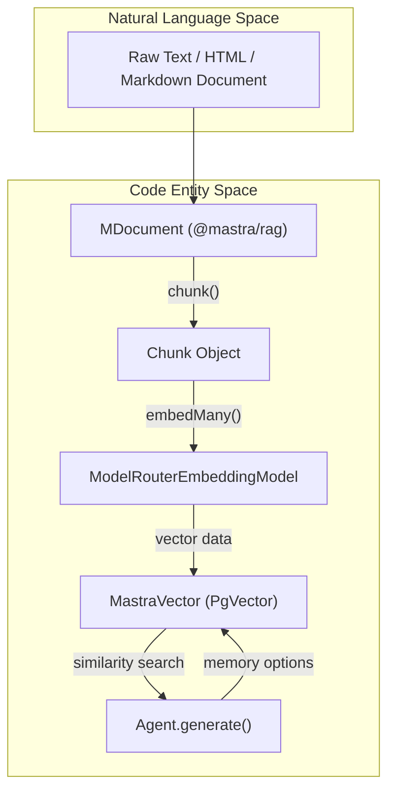

<!-- source: DeepWiki mcp.deepwiki.com · repo mastra-ai/mastra · page 7.7 RAG System and Document Processing · fetched 2026-10-26 -->

# RAG System and Document Processing

Relevant source files

The following files were used as context for generating this wiki page:

- [.changeset/peer-discovery-busy-caller.md](.changeset/peer-discovery-busy-caller.md)
- [.changeset/retake-lapsed-thread-lease.md](.changeset/retake-lapsed-thread-lease.md)
- [docs/src/content/en/docs/subagents.mdx](docs/src/content/en/docs/subagents.mdx)
- [mastracode/sdk/src/agent-connections/__tests__/cross-process-agent-signals.integration.test.ts](mastracode/sdk/src/agent-connections/__tests__/cross-process-agent-signals.integration.test.ts)
- [mastracode/sdk/src/agent-connections/__tests__/fixtures/cross-process-agent-signals-child.mts](mastracode/sdk/src/agent-connections/__tests__/fixtures/cross-process-agent-signals-child.mts)
- [observability/mastra/src/model-tracing.test.ts](observability/mastra/src/model-tracing.test.ts)
- [observability/mastra/src/model-tracing.ts](observability/mastra/src/model-tracing.ts)
- [packages/core/src/agent-controller/lease-lost-abort-reason.test.ts](packages/core/src/agent-controller/lease-lost-abort-reason.test.ts)
- [packages/core/src/agent/__tests__/delegation-thread-metadata.test.ts](packages/core/src/agent/__tests__/delegation-thread-metadata.test.ts)
- [packages/core/src/agent/__tests__/memory-metadata.test.ts](packages/core/src/agent/__tests__/memory-metadata.test.ts)
- [packages/core/src/agent/__tests__/signals-claimed-ownership.test.ts](packages/core/src/agent/__tests__/signals-claimed-ownership.test.ts)
- [packages/core/src/agent/__tests__/signals-idle-active-behavior.test.ts](packages/core/src/agent/__tests__/signals-idle-active-behavior.test.ts)
- [packages/core/src/agent/__tests__/stream.test.ts](packages/core/src/agent/__tests__/stream.test.ts)
- [packages/core/src/agent/__tests__/thread-lease-loss-abort.test.ts](packages/core/src/agent/__tests__/thread-lease-loss-abort.test.ts)
- [packages/core/src/agent/__tests__/tool-concurrency-called-strategy-resume.test.ts](packages/core/src/agent/__tests__/tool-concurrency-called-strategy-resume.test.ts)
- [packages/core/src/agent/__tests__/tool-concurrency-called-strategy.test.ts](packages/core/src/agent/__tests__/tool-concurrency-called-strategy.test.ts)
- [packages/core/src/agent/__tests__/tool-handling.test.ts](packages/core/src/agent/__tests__/tool-handling.test.ts)
- [packages/core/src/agent/agent-legacy.ts](packages/core/src/agent/agent-legacy.ts)
- [packages/core/src/agent/agent-types.test-d.ts](packages/core/src/agent/agent-types.test-d.ts)
- [packages/core/src/agent/agent.test.ts](packages/core/src/agent/agent.test.ts)
- [packages/core/src/agent/agent.ts](packages/core/src/agent/agent.ts)
- [packages/core/src/agent/agent.types.ts](packages/core/src/agent/agent.types.ts)
- [packages/core/src/agent/durable/durable-parity.test-d.ts](packages/core/src/agent/durable/durable-parity.test-d.ts)
- [packages/core/src/agent/subagent.ts](packages/core/src/agent/subagent.ts)
- [packages/core/src/agent/thread-stream-runtime.ts](packages/core/src/agent/thread-stream-runtime.ts)
- [packages/core/src/agent/types.ts](packages/core/src/agent/types.ts)
- [packages/core/src/agent/workflows/prepare-stream/index.ts](packages/core/src/agent/workflows/prepare-stream/index.ts)
- [packages/core/src/agent/workflows/prepare-stream/map-results-step.ts](packages/core/src/agent/workflows/prepare-stream/map-results-step.ts)
- [packages/core/src/agent/workflows/prepare-stream/prepare-memory-step.ts](packages/core/src/agent/workflows/prepare-stream/prepare-memory-step.ts)
- [packages/core/src/agent/workflows/prepare-stream/prepare-tools-step.ts](packages/core/src/agent/workflows/prepare-stream/prepare-tools-step.ts)
- [packages/core/src/agent/workflows/prepare-stream/run-scope-keys.ts](packages/core/src/agent/workflows/prepare-stream/run-scope-keys.ts)
- [packages/core/src/agent/workflows/prepare-stream/schema.ts](packages/core/src/agent/workflows/prepare-stream/schema.ts)
- [packages/core/src/agent/workflows/prepare-stream/stream-step.ts](packages/core/src/agent/workflows/prepare-stream/stream-step.ts)
- [packages/core/src/llm/model/model.loop.ts](packages/core/src/llm/model/model.loop.ts)
- [packages/core/src/loop/loop.ts](packages/core/src/loop/loop.ts)
- [packages/core/src/loop/network/index.ts](packages/core/src/loop/network/index.ts)
- [packages/core/src/loop/network/validation.test.ts](packages/core/src/loop/network/validation.test.ts)
- [packages/core/src/loop/network/validation.ts](packages/core/src/loop/network/validation.ts)
- [packages/core/src/loop/types.ts](packages/core/src/loop/types.ts)
- [packages/core/src/loop/workflows/agentic-execution/index.ts](packages/core/src/loop/workflows/agentic-execution/index.ts)
- [packages/core/src/loop/workflows/agentic-execution/tool-call-concurrency.test.ts](packages/core/src/loop/workflows/agentic-execution/tool-call-concurrency.test.ts)
- [packages/core/src/loop/workflows/agentic-execution/tool-call-concurrency.ts](packages/core/src/loop/workflows/agentic-execution/tool-call-concurrency.ts)
- [packages/core/src/loop/workflows/agentic-loop/index.ts](packages/core/src/loop/workflows/agentic-loop/index.ts)
- [packages/core/src/memory/index.ts](packages/core/src/memory/index.ts)
- [packages/core/src/memory/run-state.test.ts](packages/core/src/memory/run-state.test.ts)
- [packages/core/src/memory/run-state.ts](packages/core/src/memory/run-state.ts)
- [packages/core/src/tools/request-context-schema-types.test-d.ts](packages/core/src/tools/request-context-schema-types.test-d.ts)
- [packages/rag/src/document/validation.ts](packages/rag/src/document/validation.ts)

This document describes the RAG (Retrieval-Augmented Generation) system provided by the `@mastra/rag` package and its integration with the Mastra memory and vector storage subsystems. It covers document loading, chunking strategies, metadata extraction, and semantic search integration.

## Package Overview

The `@mastra/rag` package provides document processing capabilities for building RAG pipelines. It handles document parsing, chunking, and metadata extraction, and provides utilities for creating vector query tools.

**Key capabilities:**
- Document loading from HTML, Markdown, JSON, and text formats.
- Multiple chunking strategies including recursive, token, semantic-markdown, and structure-aware (HTML/Markdown/JSON).
- Schema-driven metadata extraction with Zod.
- Vector query tool generation for agentic retrieval.
- Integrated observability for ingestion, embedding, and vector operations.

**Key Classes and Functions:**
- `MDocument`: The primary entry point for document processing.
- `createVectorQueryTool`: Generates a tool for semantic search [packages/rag/package.json:2-3]().
- `vectorQuerySearch`: Low-level utility for embedding queries and searching vector stores.

Sources: [packages/rag/package.json:1-95]()

## Document Loading and Representation

### MDocument Class

The `MDocument` class is the central abstraction for document processing. It wraps content with metadata and provides methods for chunking and metadata extraction.

**Document Ingestion Flow**

Sources: [packages/rag/package.json:68-83]()

## Chunking Strategies

The RAG system provides various strategies to split documents into manageable pieces for embedding.

### Strategy Selection and Mapping

| Strategy | Implementation | Description |
| :--- | :--- | :--- |
| `recursive` | `RecursiveCharacterTransformer` | Splits by a list of separators hierarchically. |
| `token` | `TokenTransformer` | Uses `js-tiktoken` for token-based splitting [packages/rag/package.json:39-39](). |
| `markdown` | `MarkdownTransformer` | Structure-aware splitting for Markdown headers. |
| `html` | `HTMLTransformer` | Uses `node-html-better-parser` for DOM-aware splitting [packages/rag/package.json:40-40](). |
| `json` | `RecursiveJsonTransformer` | Splits nested JSON objects while preserving context. |

Sources: [packages/rag/package.json:36-42]()

## Semantic Recall and Embedding Integration

Mastra's RAG system is closely integrated with the `Memory` system and `ModelRouterEmbeddingModel` to facilitate semantic search across conversation history and documents.

### Embedding Models
Mastra supports a unified interface for embedding via the `ModelRouterEmbeddingModel` [packages/core/src/llm/model/embedding-router.ts:114-114](). It supports providers like OpenAI, Google, and VoyageAI [docs/src/content/en/models/embeddings.mdx:27-64]().

**Supported Models Example:**
- `openai/text-embedding-3-small` (1536 dims) [packages/core/src/llm/model/embedding-router.ts:51-56]().
- `google/gemini-embedding-001` (768 dims) [packages/core/src/llm/model/embedding-router.ts:73-79]().
- `voyageai/voyage-4` (1024 dims) [docs/src/content/en/models/embeddings.mdx:56-56]().

### Local Embeddings with FastEmbed
For local processing, Mastra provides `@mastra/fastembed`, which uses ONNX runtime to generate embeddings without external API calls [packages/fastembed/package.json:41-46](). It supports models like `bge-small-en-v1.5` and `multilingual-e5-large` [packages/fastembed/src/index.ts:118-161]().

### Semantic Search Flow (Natural Language to Code Entity Space)

Sources: [packages/core/src/llm/model/embedding-router.ts:114-123](), [docs/src/content/en/docs/memory/semantic-recall.mdx:1-128](), [packages/fastembed/src/index.ts:31-49]()

## Vector Storage Architecture

Mastra supports multiple vector stores through the `MastraVector` interface. The `PgVector` implementation demonstrates how vector search is integrated with relational databases [stores/pg/src/vector/index.ts:136-136]().

### PostgreSQL (pgvector) Integration
The `PgVector` class manages the `pgvector` extension and supports various index types like `HNSW` and `IVFFlat` [stores/pg/src/vector/index.ts:206-213]().

**Key Vector Operations:**
- `createIndex`: Configures dimensions, metrics (cosine, euclidean), and index types [stores/pg/src/vector/index.ts:72-106]().
- `upsert`: Inserts or updates vectors with metadata [stores/pg/src/vector/index.ts:115-117]().
- `query`: Performs similarity search, supporting `minScore` and metadata filters [stores/pg/src/vector/index.ts:57-70]().

### Retrieval with recall()
The `Memory.recall()` method is the primary runtime interface for retrieving semantically similar messages [docs/src/content/en/docs/memory/semantic-recall.mdx:107-128](). It supports:
- `vectorSearchString`: The query to embed and search.
- `topK`: Number of results [docs/src/content/en/docs/memory/semantic-recall.mdx:183-183]().
- `messageRange`: Context window around matches [docs/src/content/en/docs/memory/semantic-recall.mdx:184-184]().
- `scope`: Search within a `thread` or across a `resource` [docs/src/content/en/docs/memory/semantic-recall.mdx:185-185]().

Sources: [stores/pg/src/vector/index.ts:1-160](), [docs/src/content/en/docs/memory/semantic-recall.mdx:179-202](), [packages/core/src/vector/vector.ts:1-50]()

## Document Transformation Pipeline

The relationship between document abstractions, storage, and embedding classes is visualized below, bridging natural text inputs directly to code entities.

Sources: [packages/rag/package.json:2-3](), [packages/core/src/llm/model/embedding-router.ts:114-123](), [docs/src/content/en/docs/memory/overview.mdx:85-98]()

---

