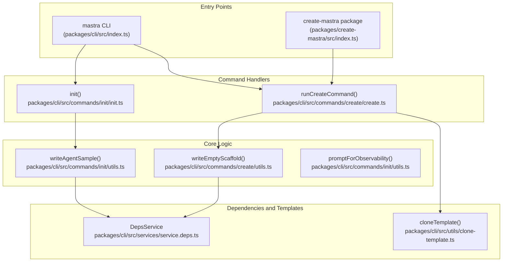
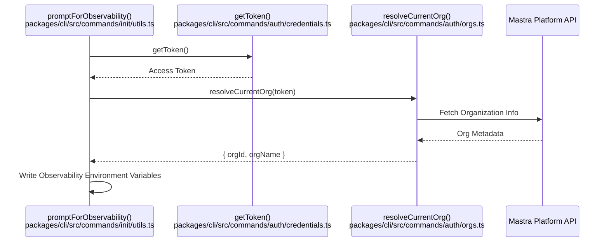

<!-- source: DeepWiki mcp.deepwiki.com · repo mastra-ai/mastra · page 8.1 Project Creation and Initialization · fetched 2026-10-26 -->

# Project Creation and Initialization

Relevant source files

The following files were used as context for generating this wiki page:

- [.changeset/fresh-init-provider-models.md](.changeset/fresh-init-provider-models.md)
- [docs/src/content/en/reference/cli/create-mastra.mdx](docs/src/content/en/reference/cli/create-mastra.mdx)
- [e2e-tests/experiment-worker/tests/portability-isolation.test.ts](e2e-tests/experiment-worker/tests/portability-isolation.test.ts)
- [packages/cli/src/commands/actions/create-project.test.ts](packages/cli/src/commands/actions/create-project.test.ts)
- [packages/cli/src/commands/actions/create-project.ts](packages/cli/src/commands/actions/create-project.ts)
- [packages/cli/src/commands/actions/init-project.ts](packages/cli/src/commands/actions/init-project.ts)
- [packages/cli/src/commands/auth/api.ts](packages/cli/src/commands/auth/api.ts)
- [packages/cli/src/commands/auth/auth.test.ts](packages/cli/src/commands/auth/auth.test.ts)
- [packages/cli/src/commands/auth/credentials.test.ts](packages/cli/src/commands/auth/credentials.test.ts)
- [packages/cli/src/commands/auth/credentials.ts](packages/cli/src/commands/auth/credentials.ts)
- [packages/cli/src/commands/auth/login.test.ts](packages/cli/src/commands/auth/login.test.ts)
- [packages/cli/src/commands/auth/login.ts](packages/cli/src/commands/auth/login.ts)
- [packages/cli/src/commands/auth/orgs.test.ts](packages/cli/src/commands/auth/orgs.test.ts)
- [packages/cli/src/commands/auth/orgs.ts](packages/cli/src/commands/auth/orgs.ts)
- [packages/cli/src/commands/auth/tokens.ts](packages/cli/src/commands/auth/tokens.ts)
- [packages/cli/src/commands/create/command.test.ts](packages/cli/src/commands/create/command.test.ts)
- [packages/cli/src/commands/create/command.ts](packages/cli/src/commands/create/command.ts)
- [packages/cli/src/commands/create/create.test.ts](packages/cli/src/commands/create/create.test.ts)
- [packages/cli/src/commands/create/create.ts](packages/cli/src/commands/create/create.ts)
- [packages/cli/src/commands/create/pnpm11-packagemanager.test.ts](packages/cli/src/commands/create/pnpm11-packagemanager.test.ts)
- [packages/cli/src/commands/create/provider-adapter.test.ts](packages/cli/src/commands/create/provider-adapter.test.ts)
- [packages/cli/src/commands/create/provider-adapter.ts](packages/cli/src/commands/create/provider-adapter.ts)
- [packages/cli/src/commands/create/scaffold.test.ts](packages/cli/src/commands/create/scaffold.test.ts)
- [packages/cli/src/commands/create/utils.ts](packages/cli/src/commands/create/utils.ts)
- [packages/cli/src/commands/create/version-resolver.test.ts](packages/cli/src/commands/create/version-resolver.test.ts)
- [packages/cli/src/commands/create/version-resolver.ts](packages/cli/src/commands/create/version-resolver.ts)
- [packages/cli/src/commands/init/init.ts](packages/cli/src/commands/init/init.ts)
- [packages/cli/src/commands/init/observability-provision.test.ts](packages/cli/src/commands/init/observability-provision.test.ts)
- [packages/cli/src/commands/init/observability-provision.ts](packages/cli/src/commands/init/observability-provision.ts)
- [packages/cli/src/commands/init/utils.test.ts](packages/cli/src/commands/init/utils.test.ts)
- [packages/cli/src/commands/init/utils.ts](packages/cli/src/commands/init/utils.ts)
- [packages/cli/src/internal/auth.ts](packages/cli/src/internal/auth.ts)
- [packages/create-mastra/src/index.ts](packages/create-mastra/src/index.ts)
- [templates/template-agent-harness/.env.example](templates/template-agent-harness/.env.example)
- [templates/template-agent-harness/.gitignore](templates/template-agent-harness/.gitignore)
- [templates/template-agent-harness/AGENTS.md](templates/template-agent-harness/AGENTS.md)
- [templates/template-agent-harness/README.md](templates/template-agent-harness/README.md)
- [templates/template-agent-harness/package.json](templates/template-agent-harness/package.json)
- [templates/template-agent-harness/src/mastra/agents/agent.ts](templates/template-agent-harness/src/mastra/agents/agent.ts)
- [templates/template-agent-harness/src/mastra/index.ts](templates/template-agent-harness/src/mastra/index.ts)
- [templates/template-agent-harness/src/mastra/tools/schedule-tools.ts](templates/template-agent-harness/src/mastra/tools/schedule-tools.ts)
- [templates/template-agent-harness/tsconfig.json](templates/template-agent-harness/tsconfig.json)

This page covers the Mastra project scaffolding system, including the `create-mastra` command for creating new projects and the `mastra init` command for adding Mastra to existing projects. These commands handle directory structure setup, dependency installation, configuration file generation, and optional integrations with AI coding agents and Model Context Protocol (MCP) servers.

---

## 1. System Architecture

The project creation and initialization system consists of two primary entry points (`create-mastra` and `mastra init`) that share common scaffolding logic located in the `@mastra/cli` package.

**Diagram: Project Creation and Initialization Architecture**

Sources: [packages/cli/src/commands/create/create.ts:1-37](), [packages/cli/src/commands/init/init.ts:1-64](), [packages/cli/src/commands/create/utils.ts:94-156](), [packages/cli/src/commands/init/utils.ts:40-128]()

---

## 2. create-mastra and mastra init Commands

The `create-mastra` package provides a standalone executable for scaffolding new Mastra projects. Alternatively, developers can invoke `mastra create` or `mastra init` via the core CLI.

### Entry Point and Version Resolution

Scaffolding operations utilize a version resolver (`resolveMastraPackageVersions`) to guarantee that installed packages such as `@mastra/core`, `mastra`, and storage adapters align with the distribution channel of the running CLI (e.g., `latest` or `beta`) [packages/cli/src/commands/create/utils.ts:107-116]().

### CLI Flags and Interactive Prompts

Both commands inspect CLI flags via `commander` [packages/cli/src/commands/create/command.ts:1-30]() and fall back to interactive prompts using `@clack/prompts` [packages/cli/src/commands/create/create.ts:105-134]() when parameters are absent.

| Flag / Option | Description | Code Reference |
|---------------|-------------|----------------|
| `--empty` | Provisions a minimal project scaffold without example agents or workflows | [packages/cli/src/commands/create/create.ts:75-80]() |
| `--llm-provider` | Selects the default model provider (`openai`, `anthropic`, `groq`, `google`, `cerebras`, `mistral`) | [packages/cli/src/commands/init/utils.ts:20-25]() |
| `--template` | Clones a specified template slug or custom GitHub repository URL | [packages/cli/src/commands/create/create.ts:88-90]() |
| `--skills` | Installs coding assistant skill definitions into the project | [packages/cli/src/commands/actions/init-project.ts:68-75]() |

Sources: [packages/cli/src/commands/create/create.ts:73-93](), [packages/cli/src/commands/init/utils.ts:20-31]()

---

## 3. Project Initialization Flow

When initializing a project or scaffolding from scratch, the system writes configuration and source files, provisions directories, and configures environment files.

### Scaffold Generation (`writeEmptyScaffold`)

The `writeEmptyScaffold` function generates standard project configuration files [packages/cli/src/commands/create/utils.ts:94-156]():
- `package.json`: Configures scripts for `dev`, `build`, and `start`, alongside runtime engine requirements [packages/cli/src/commands/create/utils.ts:117-138]().
- `tsconfig.json`: Sets up TypeScript compilation targets (`ES2022`, strict mode) [packages/cli/src/commands/create/utils.ts:8-21]().
- `src/mastra/index.ts`: Exports a default `Mastra` instance [packages/cli/src/commands/create/utils.ts:144-148]().
- `.gitignore`: Excludes build outputs, environment files, and local SQLite/DuckDB database stores [packages/cli/src/commands/create/utils.ts:23-32]().

### Sample Generation (`writeAgentSample`)

When scaffolding with components enabled, `writeAgentSample` constructs a pre-configured weather agent utilizing the selected LLM provider and default memory bindings [packages/cli/src/commands/init/utils.ts:126-188](). This includes setting up instructions, model, tools (if `addExampleTool` is true), and scorers (if `addScorers` is true) [packages/cli/src/commands/init/utils.ts:134-188]().

Sources: [packages/cli/src/commands/create/utils.ts:94-156](), [packages/cli/src/commands/init/utils.ts:126-188]()

---

## 4. Observability Provisioning

The initialization routine offers an interactive prompt to enable Mastra Observability [packages/cli/src/commands/init/utils.ts:40-92](). When opted in, the CLI authenticates the user via browser-based login credentials [packages/cli/src/commands/auth/credentials.ts:1-15]() and provisions a project on the Mastra platform.

**Diagram: Observability Setup Data Flow**

Sources: [packages/cli/src/commands/init/utils.ts:40-92](), [packages/cli/src/commands/auth/orgs.ts:1-30]()

---

## 5. Dependency Management and Templates

The `DepsService` manages environment inspection and package installation [packages/cli/src/services/service.deps.ts:1-50](). It detects package managers (`pnpm`, `npm`, `yarn`, `bun`) [packages/cli/src/commands/utils.ts:13-46]() and installs required peer dependencies such as `@mastra/libsql`, `@mastra/duckdb`, and `@mastra/memory` when example components are selected [packages/cli/src/commands/init/init.ts:97-128]().

Templates managed via `loadTemplates` and `cloneTemplate` allow developers to bootstrap complex architectures (such as browsing agents and retrieval-augmented generation pipelines) directly from official GitHub templates [packages/cli/src/commands/create/create.ts:51-60](). For example, the `template-agent-harness` provides a general-purpose Mastra agent with features like a local `workspace/`, approval gates, conversation memory, web search, and recurring schedules [templates/template-agent-harness/README.md:1-14](). This template also includes local `libSQL` storage and `DuckDB` observability, with optional `Turso` storage [templates/template-agent-harness/README.md:40-41]().

Sources: [packages/cli/src/commands/init/init.ts:97-128](), [packages/cli/src/commands/utils.ts:13-46](), [packages/cli/src/commands/create/create.ts:51-60](), [templates/template-agent-harness/README.md:1-14](), [templates/template-agent-harness/README.md:40-41]()

---

