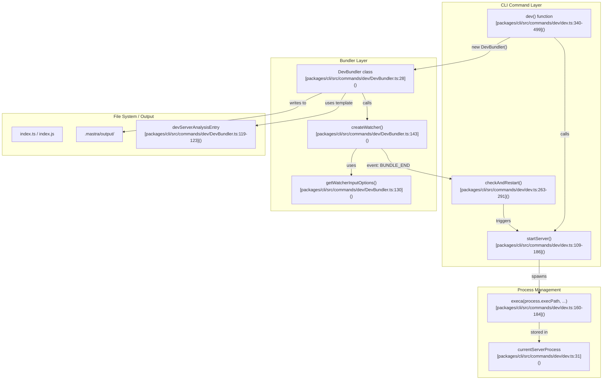
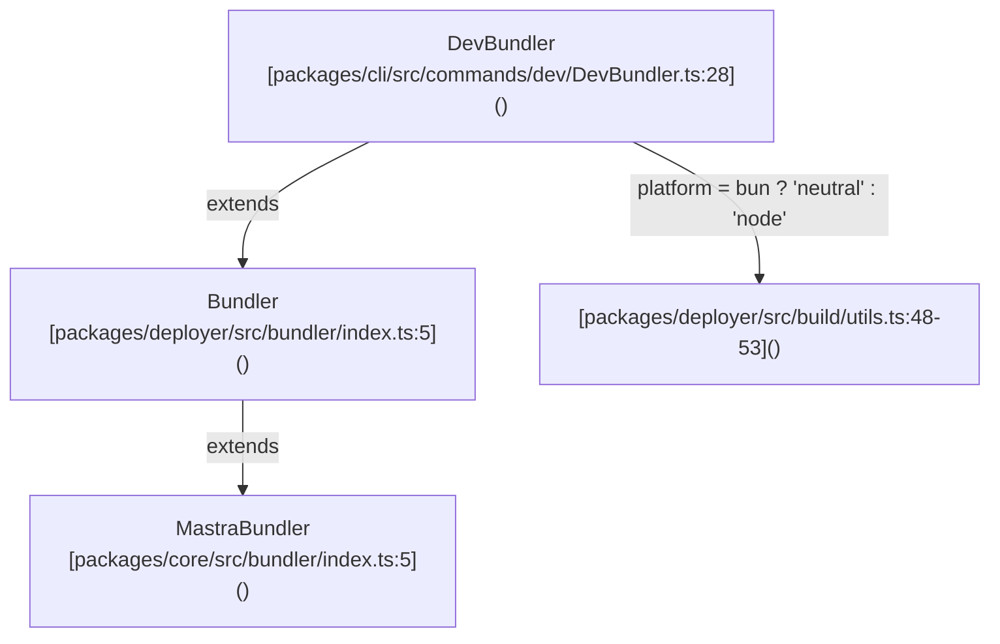
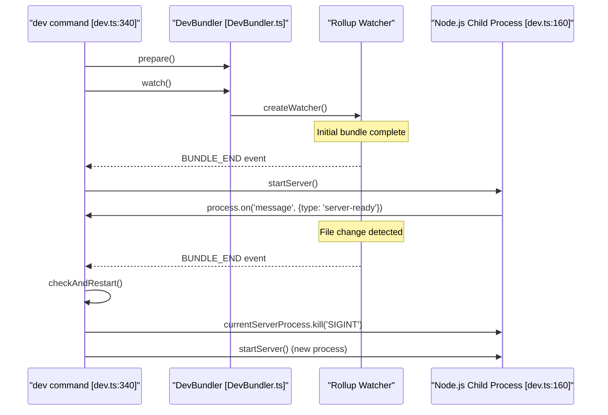
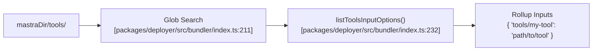

<!-- source: DeepWiki mcp.deepwiki.com · repo mastra-ai/mastra · page 8.2 Development Server and Hot Reload · fetched 2026-10-26 -->

# Development Server and Hot Reload

Relevant source files

The following files were used as context for generating this wiki page:

- [deployers/vercel/src/index.ts](deployers/vercel/src/index.ts)
- [deployers/vercel/src/routes.test.ts](deployers/vercel/src/routes.test.ts)
- [deployers/vercel/src/routes.ts](deployers/vercel/src/routes.ts)
- [mastracode/tui/src/__tests__/process-memory-diagnostics-lifecycle.test.ts](mastracode/tui/src/__tests__/process-memory-diagnostics-lifecycle.test.ts)
- [mastracode/tui/src/process-memory-diagnostics-lifecycle.ts](mastracode/tui/src/process-memory-diagnostics-lifecycle.ts)
- [packages/cli/src/analytics/index.ts](packages/cli/src/analytics/index.ts)
- [packages/cli/src/commands/actions/build-project.ts](packages/cli/src/commands/actions/build-project.ts)
- [packages/cli/src/commands/build/factory-ui-build.test.ts](packages/cli/src/commands/build/factory-ui-build.test.ts)
- [packages/cli/src/commands/build/factory-ui-build.ts](packages/cli/src/commands/build/factory-ui-build.ts)
- [packages/cli/src/commands/build/guard-live-dev-server.test.ts](packages/cli/src/commands/build/guard-live-dev-server.test.ts)
- [packages/cli/src/commands/build/guard-live-dev-server.ts](packages/cli/src/commands/build/guard-live-dev-server.ts)
- [packages/cli/src/commands/dev/dev-lock.test.ts](packages/cli/src/commands/dev/dev-lock.test.ts)
- [packages/cli/src/commands/dev/dev-lock.ts](packages/cli/src/commands/dev/dev-lock.ts)
- [packages/cli/src/commands/dev/dev.test.ts](packages/cli/src/commands/dev/dev.test.ts)
- [packages/cli/src/commands/dev/dev.ts](packages/cli/src/commands/dev/dev.ts)
- [packages/cli/src/commands/studio/studio.test.ts](packages/cli/src/commands/studio/studio.test.ts)
- [packages/cli/src/commands/studio/studio.ts](packages/cli/src/commands/studio/studio.ts)
- [packages/cli/src/utils/check-peer-deps.test.ts](packages/cli/src/utils/check-peer-deps.test.ts)
- [packages/cli/src/utils/check-peer-deps.ts](packages/cli/src/utils/check-peer-deps.ts)
- [packages/core/src/telemetry/context.test.ts](packages/core/src/telemetry/context.test.ts)
- [packages/core/src/telemetry/context.ts](packages/core/src/telemetry/context.ts)
- [packages/core/src/telemetry/feature-telemetry.test.ts](packages/core/src/telemetry/feature-telemetry.test.ts)
- [packages/core/src/telemetry/feature-telemetry.ts](packages/core/src/telemetry/feature-telemetry.ts)
- [packages/core/src/telemetry/index.ts](packages/core/src/telemetry/index.ts)
- [packages/core/src/telemetry/posthog.test.ts](packages/core/src/telemetry/posthog.test.ts)
- [packages/core/src/telemetry/posthog.ts](packages/core/src/telemetry/posthog.ts)
- [packages/core/src/telemetry/usage-telemetry.test.ts](packages/core/src/telemetry/usage-telemetry.test.ts)
- [packages/core/src/telemetry/usage-telemetry.ts](packages/core/src/telemetry/usage-telemetry.ts)
- [packages/deployer/src/build/utils.test.ts](packages/deployer/src/build/utils.test.ts)
- [packages/deployer/src/build/utils.ts](packages/deployer/src/build/utils.ts)
- [packages/deployer/src/server/__tests__/auth-integration.test.ts](packages/deployer/src/server/__tests__/auth-integration.test.ts)
- [packages/deployer/src/server/__tests__/node-server-host.test.ts](packages/deployer/src/server/__tests__/node-server-host.test.ts)
- [packages/deployer/src/server/__tests__/option-studio-base.test.ts](packages/deployer/src/server/__tests__/option-studio-base.test.ts)
- [packages/deployer/src/server/__tests__/shutdown.test.ts](packages/deployer/src/server/__tests__/shutdown.test.ts)
- [packages/deployer/src/server/__tests__/studio-refresh.test.ts](packages/deployer/src/server/__tests__/studio-refresh.test.ts)
- [packages/deployer/src/server/__tests__/swagger-openapi-warning.test.ts](packages/deployer/src/server/__tests__/swagger-openapi-warning.test.ts)
- [packages/deployer/src/server/handlers/__tests__/client.test.ts](packages/deployer/src/server/handlers/__tests__/client.test.ts)
- [packages/deployer/src/server/handlers/client.ts](packages/deployer/src/server/handlers/client.ts)
- [packages/deployer/src/server/index.ts](packages/deployer/src/server/index.ts)
- [packages/deployer/src/server/welcome.ts](packages/deployer/src/server/welcome.ts)
- [packages/playground/e2e/tests/agents/recovery.spec.ts](packages/playground/e2e/tests/agents/recovery.spec.ts)
- [packages/playground/e2e/tests/agents/refresh-reconnect.spec.ts](packages/playground/e2e/tests/agents/refresh-reconnect.spec.ts)
- [packages/playground/index.html](packages/playground/index.html)
- [packages/playground/public/mastra-dark-tile.svg](packages/playground/public/mastra-dark-tile.svg)
- [packages/playground/src/App.tsx](packages/playground/src/App.tsx)
- [packages/playground/vite.config.ts](packages/playground/vite.config.ts)

This document describes the `mastra dev` command and its hot reload system, which provides a development server with automatic rebuilding and restarting when source files change. The development server enables rapid iteration by detecting file changes, rebundling code, and restarting the server process without manual intervention.

For information about building production bundles, see [Build System and Dependency Analysis](). For details on the Studio UI served during development, see [Studio UI and Playground]().

## Architecture Overview

The development server consists of three primary components: the `DevBundler` class that watches and rebuilds code using Rollup, the `dev` function that orchestrates the startup, and the `startServer` function that manages the server process lifecycle via `execa`.

### System Data Flow and Entities

The following diagram maps the natural language concepts of "Watching" and "Restarting" to the specific code entities in the Mastra CLI and Deployer packages.

Title: Development Server Data Flow

Sources: [packages/cli/src/commands/dev/dev.ts:31-499](), [packages/cli/src/commands/dev/DevBundler.ts:28-203]()

## DevBundler Class

The `DevBundler` class extends the base `Bundler` and configures Rollup for development with hot reloading. It detects the runtime environment (Node.js vs Bun) and adjusts the bundler platform accordingly [packages/deployer/src/build/utils.ts:48-53]().

### Class Hierarchy and Platform Selection

Title: DevBundler Entity Relationships

Sources: [packages/cli/src/commands/dev/DevBundler.ts:28-38](), [packages/deployer/src/bundler/index.ts:5-10](), [packages/deployer/src/build/utils.ts:48-53]()

**Key Methods:**

| Method | Purpose | Source |
|--------|---------|----------------|
| `constructor(customEnvFile?, factory?)` | Initializes bundler, sets `this.platform` and `this.factory` flag. | [packages/cli/src/commands/dev/DevBundler.ts:32-38]() |
| `getEnvFiles()` | Returns first existing file from `['.env.development', '.env.local', '.env']`, respects `MASTRA_SKIP_DOTENV`. | [packages/cli/src/commands/dev/DevBundler.ts:40-61]() |
| `prepare(outputDirectory)` | Preserves `dev.lock`, calls `super.prepare()`, and copies Studio UI assets. | [packages/cli/src/commands/dev/DevBundler.ts:63-92]() |
| `watch(entryFile, outputDirectory, toolsPaths, fsRoutingWatchOptions?)` | Configures Rollup watcher with environment, tools, and filesystem routing plugins. | [packages/cli/src/commands/dev/DevBundler.ts:94-203]() |

The `watch()` method configures a Rollup watcher with critical development plugins:
1. **env-watcher**: Implements `buildStart()` hook to call `this.addWatchFile(envFile)` for each discovered `.env` file [packages/cli/src/commands/dev/DevBundler.ts:149-155]().
2. **fs-routing-watcher**: Discovers file-system routed agents via `discoverFsAgents`, adds instructions and schedules to the watch list, and handles automatic registration of file-based primitives [packages/cli/src/commands/dev/DevBundler.ts:157-178]().
3. **tools-watcher**: Implements `buildEnd()` hook to generate `tools.mjs`, importing discovered tools and exporting them for the server [packages/cli/src/commands/dev/DevBundler.ts:180-191]().

Sources: [packages/cli/src/commands/dev/DevBundler.ts:28-203]()

## Server Process Lifecycle

The dev command manages the server process lifecycle through `startServer`, `rebundleAndRestart`, and `checkAndRestart` functions.

### Process Management Flow

Title: Dev Server Restart Sequence

Sources: [packages/cli/src/commands/dev/dev.ts:109-210](), [packages/cli/src/commands/dev/DevBundler.ts:94-203]()

**Server Startup Process:**

The `startServer` function spawns a Node.js child process using `execa` with specific configurations:
- **NODE_ENV**: Set to `'production'` or user-provided environment state to optimize dependency runtime [packages/cli/src/commands/dev/dev.ts:160-167]().
- **MASTRA_DEV**: Set to `'true'` to signal development mode to the server [packages/cli/src/commands/dev/dev.ts:168]().
- **IPC**: Enabled via `stdio: ['inherit', 'pipe', 'pipe', 'ipc']` to allow the server to signal readiness and receive instructions [packages/cli/src/commands/dev/dev.ts:182]().

**Error Recovery:**

The server implements automatic restart on error with a maximum of 3 attempts (`ON_ERROR_MAX_RESTARTS`) [packages/cli/src/commands/dev/dev.ts:35](). If the process fails to start, it checks for peer dependency mismatches and logs appropriate warnings [packages/cli/src/utils/check-peer-deps.ts:150-177]().

Sources: [packages/cli/src/commands/dev/dev.ts:31-186](), [packages/cli/src/commands/dev/dev.ts:160-184]()

## File Watching and Hot Reload Mechanism

The hot reload system monitors source files and environment variables, triggering rebuilds and server restarts.

### Watch Configuration

The Rollup watcher is initialized via `createWatcher()` [packages/cli/src/commands/dev/DevBundler.ts:131](). It uses `getWatcherInputOptions()` which configures standard Mastra plugins including `tsConfigPaths` and `esbuild`.

| Feature | Implementation | Source |
|---------|----------------|--------|
| **Entry Point** | Uses `devServerAnalysisEntry` to wrap the Mastra instance and scoring workflows. | [packages/cli/src/commands/dev/DevBundler.ts:119-123]() |
| **Workspace Watch** | Analyzes bundle to find local workspace packages to watch via `subpathExternalsResolver`. | [packages/deployer/src/bundler/index.ts:100]() |
| **External Handling** | Marks dependencies as external during dev to allow Node.js to resolve them directly from `node_modules`. | [packages/deployer/src/bundler/index.ts:112-116]() |

### Hot Reload Status Check

Before restarting the server, the `checkAndRestart()` function queries the `/__hot-reload-status` endpoint [packages/cli/src/commands/dev/dev.ts:275-277](). This allows the server to temporarily disable restarts during sensitive operations like template installations [packages/cli/src/commands/dev/dev.ts:278-285]().

Sources: [packages/cli/src/commands/dev/dev.ts:263-291](), [packages/cli/src/commands/dev/DevBundler.ts:94-203]()

## Tool Discovery and Bundling

The development server automatically discovers and bundles tool files to make them available to the Mastra instance.

### Tool Path Resolution

The `getAllToolPaths` method handles the discovery logic by scanning the project directory [packages/deployer/src/bundler/index.ts:209-230](). It looks for `.js` and `.ts` files in the `tools` directory and any tools defined under agents for filesystem-routed projects.

### Tool Bundling Process

Tools are bundled as separate entry points. `DevBundler` uses `listToolsInputOptions` to generate a map of tool names to file paths [packages/cli/src/commands/dev/DevBundler.ts:123]().

Title: Tool Discovery and Bundling Flow

Sources: [packages/deployer/src/bundler/index.ts:209-267](), [packages/cli/src/commands/dev/DevBundler.ts:123]()

The `tools-watcher` plugin generates a `tools.mjs` file in the output directory that imports all tool chunks and exports them as a single object for the server [packages/cli/src/commands/dev/DevBundler.ts:180-191]().

Sources: [packages/cli/src/commands/dev/DevBundler.ts:180-191]()

## Environment Variable Management

The `DevBundler` loads environment variables from multiple sources to configure the runtime.

- **Precedence**: Files are checked in order: custom env file (if provided), `.env.development`, `.env.local`, then `.env` [packages/cli/src/commands/dev/DevBundler.ts:46-49]().
- **Skip Logic**: If `MASTRA_SKIP_DOTENV` is set, no `.env` files are loaded to prevent interference with system-level variables [packages/cli/src/commands/dev/DevBundler.ts:42-44]().
- **Watching**: The `env-watcher` plugin adds these files to the Rollup watch list, so changing an environment variable triggers a server restart [packages/cli/src/commands/dev/DevBundler.ts:149-155]().

Sources: [packages/cli/src/commands/dev/DevBundler.ts:40-61](), [packages/cli/src/commands/dev/DevBundler.ts:149-155]()

## Workspace Dependency Analysis

In monorepo environments, `mastra dev` analyzes workspace dependencies to ensure that changes in local packages trigger hot reloads.

- **Transitive Dependencies**: The system uses `collectTransitiveWorkspaceDependencies` to map out the dependency graph within the monorepo [packages/deployer/src/bundler/index.ts:21-25]().
- **Dependency Detection**: During the analysis phase in `analyzeBundle`, the bundler identifies which modules are part of the workspace versus external registry packages [packages/deployer/src/build/analyze.ts:197-209]().
- **Watcher Integration**: Workspace packages are added to the Rollup watcher, allowing developers to edit code in a shared library and see the effects immediately in the agent server.

Sources: [packages/deployer/src/bundler/index.ts:21-25]()

## Graceful Shutdown

The `dev` command registers a `SIGINT` handler to ensure all processes and watchers are cleaned up properly [packages/cli/src/commands/dev/dev.ts:487-498]().

1. **Log Shutdown**: Calls `devLogger.shutdown()` to notify the user.
2. **Kill Server**: Terminates the `currentServerProcess` child process.
3. **Close Watcher**: Calls `watcher.close()` and waits for completion before exiting the CLI process to prevent orphaned processes.

Sources: [packages/cli/src/commands/dev/dev.ts:487-498]()

---

