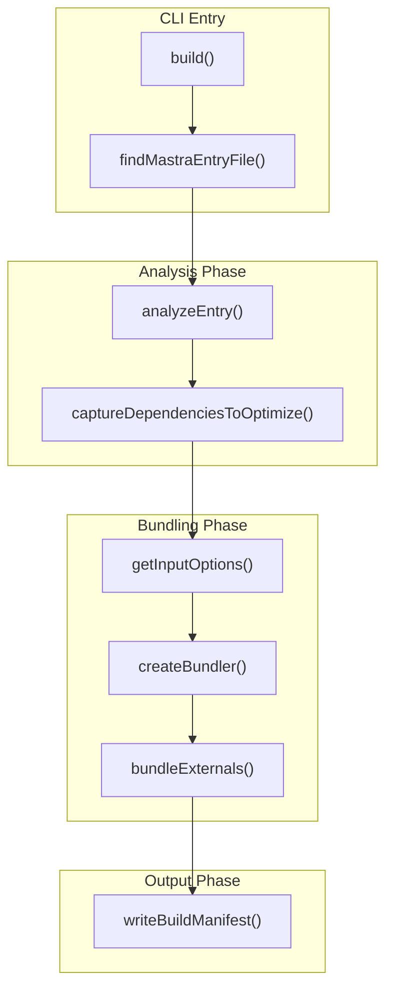
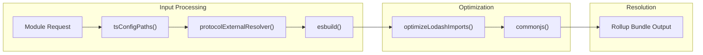
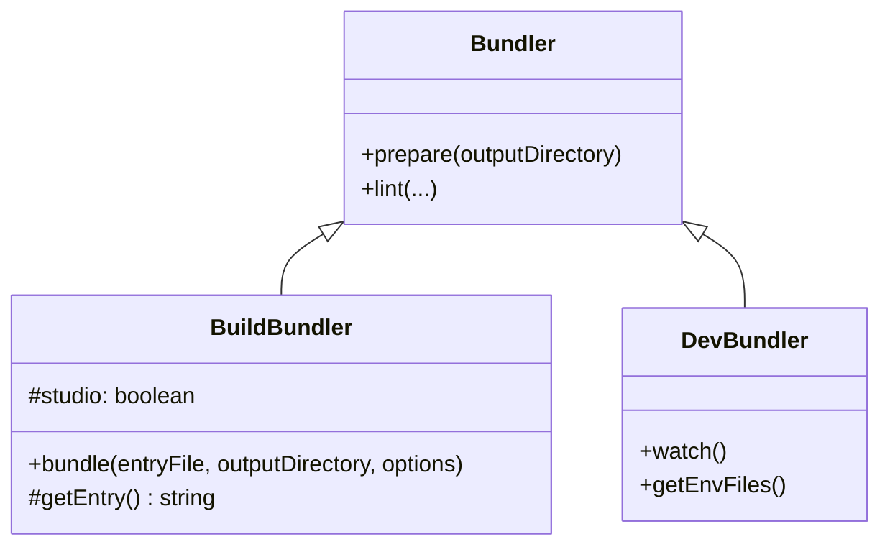

<!-- source: DeepWiki mcp.deepwiki.com · repo mastra-ai/mastra · page 8.3 Build System and Dependency Analysis · fetched 2026-10-26 -->

# Build System and Dependency Analysis

Relevant source files

The following files were used as context for generating this wiki page:

- [e2e-tests/monorepo/monorepo.test.ts](e2e-tests/monorepo/monorepo.test.ts)
- [e2e-tests/monorepo/template/apps/custom/package.json](e2e-tests/monorepo/template/apps/custom/package.json)
- [e2e-tests/monorepo/template/apps/custom/src/mastra/index.ts](e2e-tests/monorepo/template/apps/custom/src/mastra/index.ts)
- [e2e-tests/monorepo/template/packages/versionless-dependent/package.json](e2e-tests/monorepo/template/packages/versionless-dependent/package.json)
- [e2e-tests/monorepo/template/packages/versionless-dependent/src/index.ts](e2e-tests/monorepo/template/packages/versionless-dependent/src/index.ts)
- [packages/cli/src/commands/build/BuildBundler.test.ts](packages/cli/src/commands/build/BuildBundler.test.ts)
- [packages/cli/src/commands/build/BuildBundler.ts](packages/cli/src/commands/build/BuildBundler.ts)
- [packages/cli/src/commands/build/build.ts](packages/cli/src/commands/build/build.ts)
- [packages/core/src/bundler/types.ts](packages/core/src/bundler/types.ts)
- [packages/deployer/src/build/analyze.test.ts](packages/deployer/src/build/analyze.test.ts)
- [packages/deployer/src/build/analyze.ts](packages/deployer/src/build/analyze.ts)
- [packages/deployer/src/build/analyze/analyzeEntry.test.ts](packages/deployer/src/build/analyze/analyzeEntry.test.ts)
- [packages/deployer/src/build/analyze/analyzeEntry.ts](packages/deployer/src/build/analyze/analyzeEntry.ts)
- [packages/deployer/src/build/analyze/bundleExternals.test.ts](packages/deployer/src/build/analyze/bundleExternals.test.ts)
- [packages/deployer/src/build/analyze/bundleExternals.ts](packages/deployer/src/build/analyze/bundleExternals.ts)
- [packages/deployer/src/build/analyze/externals.ts](packages/deployer/src/build/analyze/externals.ts)
- [packages/deployer/src/build/bundler.ts](packages/deployer/src/build/bundler.ts)
- [packages/deployer/src/build/plugins/node-modules-extension-resolver.test.ts](packages/deployer/src/build/plugins/node-modules-extension-resolver.test.ts)
- [packages/deployer/src/build/plugins/node-modules-extension-resolver.ts](packages/deployer/src/build/plugins/node-modules-extension-resolver.ts)
- [packages/deployer/src/build/plugins/tsconfig-paths.test.ts](packages/deployer/src/build/plugins/tsconfig-paths.test.ts)
- [packages/deployer/src/build/plugins/tsconfig-paths.ts](packages/deployer/src/build/plugins/tsconfig-paths.ts)
- [packages/deployer/src/build/types.ts](packages/deployer/src/build/types.ts)
- [packages/deployer/src/build/watcher.test.ts](packages/deployer/src/build/watcher.test.ts)
- [packages/deployer/src/build/watcher.ts](packages/deployer/src/build/watcher.ts)
- [packages/deployer/src/bundler/index.test.ts](packages/deployer/src/bundler/index.test.ts)
- [packages/deployer/src/bundler/index.ts](packages/deployer/src/bundler/index.ts)
- [packages/deployer/src/bundler/workspaceDependencies.test.ts](packages/deployer/src/bundler/workspaceDependencies.test.ts)
- [packages/deployer/src/bundler/workspaceDependencies.ts](packages/deployer/src/bundler/workspaceDependencies.ts)
- [packages/deployer/src/services/deps.test.ts](packages/deployer/src/services/deps.test.ts)
- [packages/deployer/src/services/deps.ts](packages/deployer/src/services/deps.ts)

## Purpose and Scope

This page documents the Mastra build system, static analysis (`analyzeBundle`) [packages/deployer/src/build/analyze.ts:12-13](), dependency detection, workspace resolution, and external bundling infrastructure. It details how the CLI command `build` [packages/cli/src/commands/build/build.ts:18-32]() orchestrates entry point discovery, Rollup configuration, plugin execution, and bundle validation.

---

## 1. Analysis and Bundling Pipeline

The build pipeline coordinates analysis, optimization, and emission of application bundles. Initiated by the CLI build command [packages/cli/src/commands/build/build.ts:18-32](), the process resolves entry files, evaluates project structure, and invokes the bundling engine.

Title: "PipelineExecution"

*Sources: [packages/cli/src/commands/build/build.ts:18-88](), [packages/deployer/src/build/analyze/analyzeEntry.ts:114-182](), [packages/deployer/src/build/bundler.ts:61-183]()*

The pipeline begins with `build()` [packages/cli/src/commands/build/build.ts:18-32](), which locates user entries, sets up deployer configurations, and runs `getInputOptions()` [packages/deployer/src/build/bundler.ts:61-183]() to feed Rollup.

Sources: [packages/cli/src/commands/build/build.ts:18-88](), [packages/deployer/src/build/bundler.ts:61-183]()

---

## 2. Dependency Detection and Workspace Resolution

Mastra distinguishes between project code, workspace packages, and external registry dependencies during static analysis.

### Registry and Version Specifiers
The function `isRegistryVersionSpec` [packages/deployer/src/bundler/index.ts:76-92]() evaluates whether a package specifier can be resolved directly from an npm registry. It permits semver ranges, dist-tags, and valid npm aliases while rejecting file paths, tarballs, and workspace protocols.

### Transitive Workspace Dependencies
`captureDependenciesToOptimize` [packages/deployer/src/build/analyze/analyzeEntry.ts:114-182]() extracts and categorizes dependencies from Rollup output. It identifies workspace packages and resolves their root paths for proper bundling optimization. This function recursively discovers transitive workspace dependencies from package manifests [packages/deployer/src/build/analyze/analyzeEntry.ts:198-201](). The `getWorkspaceInformation` function [packages/deployer/src/bundler/workspaceDependencies.ts:10-12]() is used to gather details about all workspace packages.

The `packWorkspaceDependencies` function [packages/deployer/src/bundler/workspaceDependencies.ts:100-102]() is responsible for creating tarballs of workspace dependencies. This is crucial for ensuring that local workspace packages are correctly included in the final bundle, especially when dealing with `file:` or `link:` protocol dependencies. The `withPlaceholderVersions` utility [packages/deployer/src/services/deps.ts:42-76]() temporarily injects a placeholder version (`0.0.0`) into `package.json` files of versionless workspace packages to allow package managers like pnpm and bun to pack them.

Sources: [packages/deployer/src/bundler/index.ts:76-111](), [packages/deployer/src/build/analyze/analyzeEntry.ts:114-182](), [packages/deployer/src/bundler/workspaceDependencies.ts:10-12](), [packages/deployer/src/bundler/workspaceDependencies.ts:100-102](), [packages/deployer/src/services/deps.ts:42-76]()

---

## 3. Rollup Plugins and Bundler Configuration

Rollup options are configured via `getInputOptions` [packages/deployer/src/build/bundler.ts:61-183](), which incorporates custom plugins for path mapping, environment definition, and lodash optimization.

Title: "BundlerPluginArchitecture"

*Sources: [packages/deployer/src/build/bundler.ts:61-183](), [packages/deployer/src/build/plugins/tsconfig-paths.ts:34-137]()*

Key plugins include:
- `tsConfigPaths`: Resolves TypeScript path aliases (`paths`) by traversing up to locate `tsconfig.json` or `tsconfig.base.json` files [packages/deployer/src/build/plugins/tsconfig-paths.ts:34-84]().
- `protocolExternalResolver`: Handles protocols like `node:` during module resolution [packages/deployer/src/build/bundler.ts:106]().
- `esbuild`: Handles high-speed transpilation and variable injection (`process.env.NODE_ENV`) [packages/deployer/src/build/bundler.ts:136-139]().
- `nodeModulesExtensionResolver`: Ensures that imports from `node_modules` are correctly resolved, especially for packages that might not explicitly include file extensions in their imports [packages/deployer/src/build/plugins/node-modules-extension-resolver.ts:10-12](). This plugin is conditionally applied based on the `externalsPreset` option [packages/deployer/src/build/bundler.ts:157]().

Sources: [packages/deployer/src/build/bundler.ts:61-183](), [packages/deployer/src/build/plugins/tsconfig-paths.ts:34-137](), [packages/deployer/src/build/plugins/node-modules-extension-resolver.ts:10-12]()

---

## 4. Bundler Class Hierarchy and Execution

Mastra uses class-based bundler wrappers to handle production builds versus development watch loops.

Title: "BundlerClassHierarchy"

*Sources: [packages/cli/src/commands/build/BuildBundler.ts:10-108](), [packages/deployer/src/bundler/index.ts:5-25]()*

The `BuildBundler` class [packages/cli/src/commands/build/BuildBundler.ts:10-108]() extends the base deployer bundler [packages/deployer/src/bundler/index.ts:5-25]() to inject startup routines such as `mastra.restartAllActiveWorkflowRuns()` and durable agent recovery configurations into the generated entry script [packages/cli/src/commands/build/BuildBundler.ts:70-103](). It also handles the `studio` option, which determines whether the Mastra Studio UI assets are copied into the output directory [packages/cli/src/commands/build/BuildBundler.ts:11-12](), [packages/cli/src/commands/build/BuildBundler.ts:45-53]().

The `BuildBundler` also sets the `platform` for esbuild. For Bun environments, it uses `'neutral'` to preserve Bun-specific globals, otherwise it defaults to `'node'` [packages/cli/src/commands/build/BuildBundler.ts:17-19](). It also ensures that `externals` are set to `true` by default for production builds, allowing external dependencies to be installed rather than bundled [packages/cli/src/commands/build/BuildBundler.ts:24-31]().

Sources: [packages/cli/src/commands/build/BuildBundler.ts:10-108](), [packages/deployer/src/bundler/index.ts:5-25](), [packages/cli/src/commands/build/BuildBundler.ts:11-12](), [packages/cli/src/commands/build/BuildBundler.ts:45-53](), [packages/cli/src/commands/build/BuildBundler.ts:17-19](), [packages/cli/src/commands/build/BuildBundler.ts:24-31]()

---

## 5. Bundle Output Validation and Error Handling

The build system validates output chunks using `validateError` [packages/deployer/src/build/analyze.ts:137-200]() to intercept resolution issues and commonjs incompatibilities prior to deployment.

- `DEPLOYER_ANALYZE_TYPE_ERROR`: Raised when an incompatible CommonJS module fails type analysis [packages/deployer/src/build/analyze.ts:157-170]().
- `DEPLOYER_ANALYZE_MODULE_NOT_FOUND`: Triggered when an import cannot be resolved from the parent package or node modules [packages/deployer/src/build/analyze.ts:171-180]().
- `DEPLOYER_ANALYZE_MISSING_NATIVE_BUILD`: Identifies binary dependencies lacking a compatible native build target [packages/deployer/src/build/analyze.ts:188-195]().

Sources: [packages/deployer/src/build/analyze.ts:137-200]()

---

