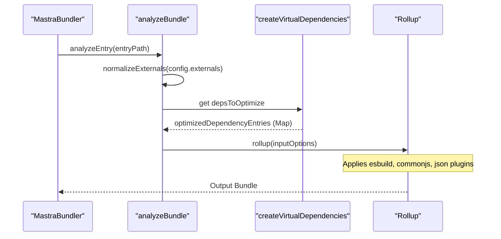

<!-- source: DeepWiki mcp.deepwiki.com · repo mastra-ai/mastra · page 8.5 Platform Deployers · fetched 2026-10-26 -->

# Platform Deployers

<details>
<summary>Relevant source files</summary>

The following files were used as context for generating this wiki page:

- [deployers/cloudflare/package.json](deployers/cloudflare/package.json)
- [deployers/netlify/package.json](deployers/netlify/package.json)
- [deployers/vercel/package.json](deployers/vercel/package.json)
- [deployers/vercel/src/index.ts](deployers/vercel/src/index.ts)
- [deployers/vercel/src/routes.test.ts](deployers/vercel/src/routes.test.ts)
- [deployers/vercel/src/routes.ts](deployers/vercel/src/routes.ts)
- [packages/cli/src/commands/studio/studio.test.ts](packages/cli/src/commands/studio/studio.test.ts)
- [packages/cli/src/commands/studio/studio.ts](packages/cli/src/commands/studio/studio.ts)
- [packages/deployer/src/build/utils.test.ts](packages/deployer/src/build/utils.test.ts)
- [packages/deployer/src/build/utils.ts](packages/deployer/src/build/utils.ts)
- [packages/deployer/src/server/__tests__/auth-integration.test.ts](packages/deployer/src/server/__tests__/auth-integration.test.ts)
- [packages/deployer/src/server/__tests__/node-server-host.test.ts](packages/deployer/src/server/__tests__/node-server-host.test.ts)
- [packages/deployer/src/server/__tests__/option-studio-base.test.ts](packages/deployer/src/server/__tests__/option-studio-base.test.ts)
- [packages/deployer/src/server/__tests__/shutdown.test.ts](packages/deployer/src/server/__tests__/shutdown.test.ts)
- [packages/deployer/src/server/__tests__/studio-refresh.test.ts](packages/deployer/src/server/__tests__/studio-refresh.test.ts)
- [packages/deployer/src/server/__tests__/swagger-openapi-warning.test.ts](packages/deployer/src/server/__tests__/swagger-openapi-warning.test.ts)
- [packages/deployer/src/server/handlers/__tests__/client.test.ts](packages/deployer/src/server/handlers/__tests__/client.test.ts)
- [packages/deployer/src/server/handlers/client.ts](packages/deployer/src/server/handlers/client.ts)
- [packages/deployer/src/server/index.ts](packages/deployer/src/server/index.ts)
- [packages/deployer/src/server/welcome.ts](packages/deployer/src/server/welcome.ts)
- [packages/playground/e2e/tests/agents/recovery.spec.ts](packages/playground/e2e/tests/agents/recovery.spec.ts)
- [packages/playground/e2e/tests/agents/refresh-reconnect.spec.ts](packages/playground/e2e/tests/agents/refresh-reconnect.spec.ts)
- [packages/playground/index.html](packages/playground/index.html)
- [packages/playground/public/mastra-dark-tile.svg](packages/playground/public/mastra-dark-tile.svg)
- [packages/playground/src/App.tsx](packages/playground/src/App.tsx)
- [packages/playground/vite.config.ts](packages/playground/vite.config.ts)

</details>


Platform deployers enable Mastra applications to be deployed to serverless environments including Cloudflare Workers, Vercel Functions, Netlify Edge Functions, and Mastra Cloud. Each deployer handles platform-specific bundling, dependency resolution, entry point generation, and runtime constraint management.

For information about the CLI commands that invoke deployers, see [CLI Command Reference](#8.6). For details on the build system and bundler architecture, see [Build System and Dependency Analysis](#8.3) and [Bundler Architecture and Plugin System](#8.4).

## Deployer Package Structure

The Mastra deployment system consists of a base `Deployer` abstraction and platform-specific implementations. These packages manage the transformation of local Mastra code into deployment-ready artifacts.

| Package | Platform | Runtime | Key Dependencies |
|---------|----------|---------|------------------|
| `@mastra/deployer-cloudflare` | Cloudflare Workers | V8 isolate | `wrangler`, `cloudflare`, `rollup` [deployers/cloudflare/package.json:45-52]() |
| `@mastra/deployer-vercel` | Vercel Functions | Node.js | `fs-extra` [deployers/vercel/package.json:35-38]() |
| `@mastra/deployer-netlify` | Netlify Edge | Deno/Node | `fs-extra`, `rollup` [deployers/netlify/package.json:35-39]() |
| `@mastra/deployer-cloud` | Mastra Cloud / Generic | Node.js | `execa`, `pino`, `redis` |

Sources: [deployers/cloudflare/package.json:45-52](), [deployers/vercel/package.json:35-38](), [deployers/netlify/package.json:35-39]()

## Deployer System Architecture

The deployer system bridges high-level CLI commands to underlying bundling and validation logic. The CLI layer coordinates the build and upload process, while the deployer implementations handle target-specific output generation.

Title: Deployment Entity Mapping
```mermaid
graph TD
    subgraph "CLI Command Space"
        CLI_Deploy["mastra deploy"]
        CLI_StudioDeploy["mastra studio deploy"]
        CLI_ServerDeploy["mastra server deploy"]
    end
    
    subgraph "Code Entity Space"
        DeployerBase["Deployer class"]
        CFDeployer["CloudflareDeployer"]
        VercelDeployer["VercelDeployer"]
        NetlifyDeployer["NetlifyDeployer"]
        CloudDeployer["CloudDeployer"]
    end
    
    subgraph "Execution Logic"
        RunBuild["runBuild()"]
        ZipOutput["zipOutput()"]
        UploadDeploy["uploadDeploy()"]
        PollDeploy["pollDeploy()"]
    end
    
    CLI_Deploy --> RunBuild
    CLI_StudioDeploy --> RunBuild
    CLI_ServerDeploy --> RunBuild

    RunBuild --> CFDeployer
    RunBuild --> VercelDeployer
    RunBuild --> NetlifyDeployer
    RunBuild --> CloudDeployer

    CFDeployer --|> DeployerBase
    CloudDeployer --|> DeployerBase
    VercelDeployer --|> DeployerBase
    NetlifyDeployer --|> DeployerBase

    CFDeployer --> ZipOutput
    VercelDeployer --> ZipOutput
    NetlifyDeployer --> ZipOutput
    CloudDeployer --> ZipOutput

    ZipOutput --> UploadDeploy
    UploadDeploy --> PollDeploy
```

Sources: [packages/cli/src/commands/deploy/index.ts:57-71](), [packages/cli/src/commands/studio/deploy.ts:73-96](), [packages/cli/src/commands/server/deploy.ts:49-74](), [packages/cli/src/commands/studio/platform-api.ts:131-199](), [packages/cli/src/commands/server/platform-api.ts:148-206]()

## Bundling and Analysis Pipeline

The deployment process includes a rigorous analysis phase to ensure the generated bundle is valid for the target platform. The analysis validates the bundled output by attempting to import generated modules and tracking external dependencies.

### Deployment Flow
The deployment pipeline follows a standardized sequence, orchestrated by the `mastra deploy` command [packages/cli/src/commands/deploy/index.ts:11]():
1.  **Build Execution**: The `runBuild` utility is invoked to compile the project [packages/cli/src/commands/deploy/index.ts:31](). This step generates the `.mastra/output` directory.
2.  **Build Staleness Check**: `checkBuildStaleness` determines if a rebuild is necessary based on source file hashes [packages/cli/src/commands/deploy/index.ts:32]().
3.  **Preflight Checks**: `preflightBuildOutput` performs validations on the generated output, such as checking for unsupported Node.js APIs [packages/cli/src/commands/deploy-preflight.ts:24]().
4.  **Environment Variable Handling**: `loadDeployEnvFromDotenv` loads environment variables from `.env` files, and `readEnvVars` prompts the user to select an `.env` file if multiple are present [packages/cli/src/commands/deploy/index.ts:48](), [packages/cli/src/commands/studio/deploy.ts:123-171]().
5.  **Output Zipping**: The `zipOutput` function archives the `.mastra/output` directory into a `.zip` file for upload [packages/cli/src/commands/deploy/index.ts:70](), [packages/cli/src/commands/studio/deploy.ts:73-96]().
6.  **Platform Upload**: The zipped artifact is uploaded to the Mastra platform via `uploadToEnvironment` [packages/cli/src/commands/deploy/index.ts:68](). This involves creating a deploy record and uploading the artifact to a signed URL [packages/cli/src/commands/studio/platform-api.ts:146-188]().
7.  **Deployment Polling**: `pollEnvironmentDeploy` continuously checks the status of the deployment until it reaches a terminal state (success or failure) [packages/cli/src/commands/deploy/index.ts:63]().

Sources: [packages/cli/src/commands/deploy/index.ts:11,31,32,48,63,68,70](), [packages/cli/src/commands/studio/deploy.ts:73-96,123-171](), [packages/cli/src/commands/studio/platform-api.ts:146-188](), [packages/cli/src/commands/deploy-preflight.ts:24]()

## Cloudflare Workers Deployer (`@mastra/deployer-cloudflare`)

The `CloudflareDeployer` transforms Mastra projects into Cloudflare Workers. It sets the platform to `browser` to ensure compatible module resolution for V8 isolates [packages/deployer/src/build/utils.ts:28-33]().

### Platform Stubs and Optimization
Cloudflare Workers lack certain Node.js APIs. The deployer automatically handles optimizations:
-   **TypeScript Stub**: Replaces the TypeScript library with a minimal stub to keep the bundle small, as `@mastra/agent-builder` only uses it for optional validation [deployers/cloudflare/src/index.ts:122-142]().
-   **Execa Stub**: Stubs `execa` which is used for local process management but is unavailable in Workers [deployers/cloudflare/src/index.ts:146-155]().
-   **Readable Stream Redirect**: Redirects `readable-stream` to native `node:stream` available via `nodejs_compat` [deployers/cloudflare/src/index.ts:161-165]().

### Custom Plugins
-   **`nodeBuiltinsExternal`**: Marks Node.js builtins as external so they are resolved to `nodejs_compat` at runtime [deployers/cloudflare/src/index.ts:20-30]().
-   **`mastraInstanceWrapper`**: Wraps the Mastra instance for the Worker environment [deployers/cloudflare/src/index.ts:10]().
-   **`postgresStoreInstanceChecker`**: Validates storage configurations for edge compatibility [deployers/cloudflare/src/index.ts:11]().

Sources: [deployers/cloudflare/src/index.ts:1-165](), [packages/deployer/src/build/utils.ts:28-33]()

## Mastra Cloud Deployer (`@mastra/deployer-cloud`)

The `CloudDeployer` is optimized for Mastra Cloud and generic Node.js environments. It manages environment variables and ensures readiness for cloud execution.

### Key Features
-   **Environment Management**: Loads variables from `.env` files and warns if they are not configured as secrets in the target platform [packages/cli/src/commands/studio/deploy.ts:123-171]().
-   **Dependency Syncing**: Uses `scripts/sync-versions.mjs` to ensure consistency between the deployer and core packages.
-   **Logging**: Integrates `@mastra/loggers` and `pino` for cloud-native observability.

Sources: [packages/cli/src/commands/studio/deploy.ts:123-171]()

## Data Flow: Bundling and Externals

The following diagram illustrates the flow from source code to optimized external bundles.

Title: Bundler and Externals Data Flow


Sources: [packages/deployer/src/bundler/index.ts:5-16](), [packages/deployer/src/build/analyze.ts:11-13](), [packages/deployer/src/build/analyze/bundleExternals.ts:48-64](), [packages/deployer/src/build/bundler.ts:88-176]()

## Vercel and Netlify Deployers

### Vercel Deployer (`@mastra/deployer-vercel`)
The `VercelDeployer` prepares artifacts for Vercel Functions. It handles the mapping of dependencies and ensures they are correctly bundled for the Vercel Node.js runtime [deployers/vercel/package.json:35-38]().
The Vercel deployer forces `externals: true` for bundling, as Vercel serverless functions resolve dependencies from `node_modules`. This prevents issues like "Detected unsettled top-level await" errors [deployers/vercel/src/index.ts:31-41]().
It also manages the `vc_config.json` file, specifying the Node.js runtime version and other function configurations [deployers/vercel/src/index.ts:170-178]().

When the Studio is enabled (`options.studio = true`), the Vercel deployer copies Studio assets to the `.vercel/output/static` directory and injects runtime configuration into `index.html` [deployers/vercel/src/index.ts:57-69,117-146](). It reads Studio's top-level route segments from `routes-manifest.json` to configure Vercel routing [deployers/vercel/src/index.ts:77-90]().

### Netlify Deployer (`@mastra/deployer-netlify`)
The `NetlifyDeployer` utilizes `rollup` to bundle Mastra applications for Netlify Edge or Functions. It manages the output directory and ensures the runtime environment is correctly configured [deployers/netlify/package.json:35-39]().

Sources: [deployers/vercel/package.json:35-38](), [deployers/netlify/package.json:35-39](), [deployers/vercel/src/index.ts:31-41,57-69,77-90,117-146,170-178]()

---

