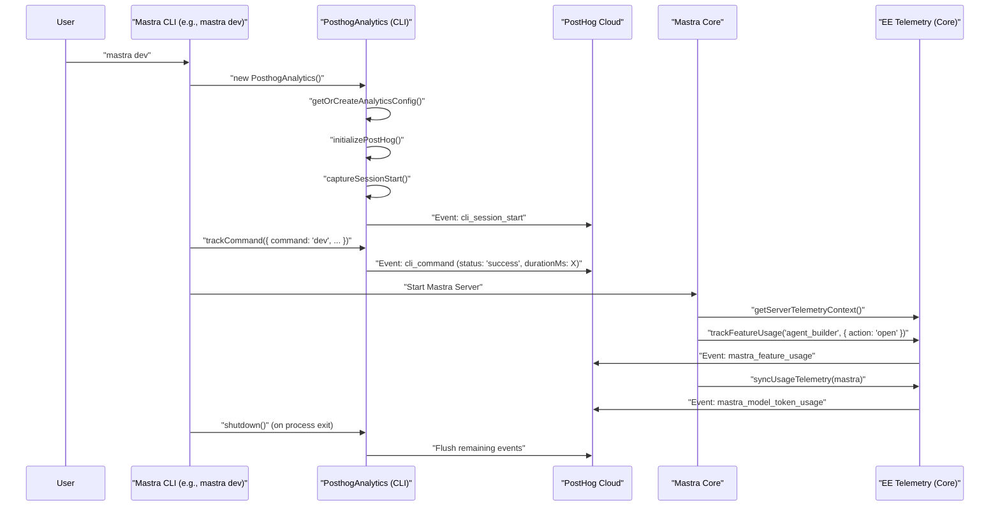

<!-- source: DeepWiki mcp.deepwiki.com · repo mastra-ai/mastra · page 8.8 Analytics and Telemetry · fetched 2026-10-26 -->

# Analytics and Telemetry

<details>
<summary>Relevant source files</summary>

The following files were used as context for generating this wiki page:

- [mastracode/tui/src/__tests__/process-memory-diagnostics-lifecycle.test.ts](mastracode/tui/src/__tests__/process-memory-diagnostics-lifecycle.test.ts)
- [mastracode/tui/src/process-memory-diagnostics-lifecycle.ts](mastracode/tui/src/process-memory-diagnostics-lifecycle.ts)
- [packages/cli/src/analytics/index.ts](packages/cli/src/analytics/index.ts)
- [packages/cli/src/commands/actions/build-project.ts](packages/cli/src/commands/actions/build-project.ts)
- [packages/cli/src/commands/build/factory-ui-build.test.ts](packages/cli/src/commands/build/factory-ui-build.test.ts)
- [packages/cli/src/commands/build/factory-ui-build.ts](packages/cli/src/commands/build/factory-ui-build.ts)
- [packages/cli/src/commands/build/guard-live-dev-server.test.ts](packages/cli/src/commands/build/guard-live-dev-server.test.ts)
- [packages/cli/src/commands/build/guard-live-dev-server.ts](packages/cli/src/commands/build/guard-live-dev-server.ts)
- [packages/cli/src/commands/dev/dev-lock.test.ts](packages/cli/src/commands/dev/dev-lock.test.ts)
- [packages/cli/src/commands/dev/dev-lock.ts](packages/cli/src/commands/dev/dev-lock.ts)
- [packages/cli/src/commands/dev/dev.test.ts](packages/cli/src/commands/dev/dev.test.ts)
- [packages/cli/src/commands/dev/dev.ts](packages/cli/src/commands/dev/dev.ts)
- [packages/cli/src/utils/check-peer-deps.test.ts](packages/cli/src/utils/check-peer-deps.test.ts)
- [packages/cli/src/utils/check-peer-deps.ts](packages/cli/src/utils/check-peer-deps.ts)
- [packages/core/src/telemetry/context.test.ts](packages/core/src/telemetry/context.test.ts)
- [packages/core/src/telemetry/context.ts](packages/core/src/telemetry/context.ts)
- [packages/core/src/telemetry/feature-telemetry.test.ts](packages/core/src/telemetry/feature-telemetry.test.ts)
- [packages/core/src/telemetry/feature-telemetry.ts](packages/core/src/telemetry/feature-telemetry.ts)
- [packages/core/src/telemetry/index.ts](packages/core/src/telemetry/index.ts)
- [packages/core/src/telemetry/posthog.test.ts](packages/core/src/telemetry/posthog.test.ts)
- [packages/core/src/telemetry/posthog.ts](packages/core/src/telemetry/posthog.ts)
- [packages/core/src/telemetry/usage-telemetry.test.ts](packages/core/src/telemetry/usage-telemetry.test.ts)
- [packages/core/src/telemetry/usage-telemetry.ts](packages/core/src/telemetry/usage-telemetry.ts)

</details>


This document describes the analytics and telemetry system used by the Mastra CLI, the `create-mastra` bootstrapper, and the core framework to collect usage data. The system tracks CLI command usage, model provider selections, and framework lifecycle events to improve the developer experience.

## Overview

Mastra implements an anonymous telemetry system built on PostHog. It operates across three main layers:
1.  **CLI Analytics**: Tracks command executions, project initialization, and template usage. [packages/cli/src/analytics/index.ts:205-212]()
2.  **Bootstrapper Analytics**: The `create-mastra` package uses its own PostHog instance to track project scaffolding success. [packages/cli/src/analytics/index.ts:205-212]()
3.  **Core Framework Telemetry**: Tracks feature usage and model token usage within the Mastra core framework. [packages/core/src/telemetry/feature-telemetry.ts:23](), [packages/core/src/telemetry/usage-telemetry.ts:139-161]()

Key tracked metrics include:
- **CLI Command Executions**: Tracking success/error status and duration of commands like `create`, `init`, `dev`, and `build`. [packages/cli/src/analytics/index.ts:205-212]()
- **Model Provider Selections**: Identifying which LLM providers (OpenAI, Anthropic, Groq, Google, Cerebras, Mistral) are most commonly used. [packages/cli/src/analytics/index.ts:187-203]()
- **Feature Usage**: Tracking the usage of specific Mastra features (e.g., `agent_builder`, `workflow_engine`). [packages/core/src/telemetry/feature-telemetry.ts:130-142]()
- **Model Token Usage**: Aggregated input/output token counts per model and provider. [packages/core/src/telemetry/usage-telemetry.ts:146-152]()

**Sources:** [packages/cli/src/analytics/index.ts:205-212](), [packages/cli/src/analytics/index.ts:187-203](), [packages/core/src/telemetry/feature-telemetry.ts:23](), [packages/core/src/telemetry/feature-telemetry.ts:130-142](), [packages/core/src/telemetry/usage-telemetry.ts:139-161](), [packages/core/src/telemetry/usage-telemetry.ts:146-152]()

## PosthogAnalytics Implementation

The core of the CLI telemetry system is the `PosthogAnalytics` class. It manages the connection to PostHog, session persistence, and event formatting.

### Class Architecture and Persistence

| Feature | Implementation Detail |
|---------|-----------------------|
| **API Key** | `phc_SBLpZVAB6jmHOct9CABq3PF0Yn5FU3G2FgT4xUr2XrT` [packages/core/src/telemetry/posthog.ts:5]() |
| **Host** | `https://us.posthog.com` [packages/core/src/telemetry/posthog.ts:6]() |
| **Global Access** | Set via `setAnalytics(instance)` [packages/cli/src/analytics/index.ts:44-46]() and retrieved via `getAnalytics()` [packages/cli/src/analytics/index.ts:41-43](). |
| **Shutdown** | The CLI ensures events are flushed before exit using `client?.flush()`. [packages/cli/src/analytics/index.ts:131-133]()
| **Distinct ID** | Passed to the server process via `MASTRA_CLI_DISTINCT_ID` environment variable during `dev`. [packages/cli/src/commands/dev/dev.ts:172]()
| **Session ID** | A unique ID generated per CLI session. [packages/cli/src/analytics/index.ts:72]()
| **Persistence** | `distinctId` and `sessionId` are stored in `~/.mastra/analytics.json`. [packages/cli/src/analytics/index.ts:7]()

### Contextual Origin
The CLI supports an origin identifier via the `MASTRA_TELEMETRY_COMMAND` environment variable, allowing the team to distinguish between different execution contexts (e.g., `dev`, `create`, `factory dev`). [packages/cli/src/commands/dev/dev.ts:170]()

**Sources:** [packages/core/src/telemetry/posthog.ts:5](), [packages/core/src/telemetry/posthog.ts:6](), [packages/cli/src/analytics/index.ts:44-46](), [packages/cli/src/analytics/index.ts:41-43](), [packages/cli/src/analytics/index.ts:131-133](), [packages/cli/src/commands/dev/dev.ts:172](), [packages/cli/src/analytics/index.ts:72](), [packages/cli/src/analytics/index.ts:7](), [packages/cli/src/commands/dev/dev.ts:170]()

## Analytics Setup and Data Flow

The analytics system is initialized at the entry point of both the main CLI and the `create-mastra` utility.

### Analytics Initialization Flow
```mermaid
graph TD
    A["CLI Entry Point"] --> B["Initialize PosthogAnalytics"];
    B --> C["Read/Create ~/.mastra/analytics.json"];
    C --> D["Generate distinctId and sessionId"];
    D --> E["Initialize PostHog client"];
    E --> F["Capture cli_session_start event"];
    F --> G["Set global analytics instance"];
    G --> H["CLI Commands Execute"];
    H --> I["Track Events"];
    I --> J["Capture cli_command or custom events"];
    J --> K["Flush events on process exit"];

    subgraph "Code Entities"
        B -- "new PosthogAnalytics()" [packages/cli/src/analytics/index.ts:55]()
        C -- "getOrCreateAnalyticsConfig()" [packages/cli/src/analytics/index.ts:79-107]()
        D -- "createDistinctId(), randomUUID()" [packages/cli/src/analytics/index.ts:144](), [packages/cli/src/analytics/index.ts:102]()
        E -- "initializePostHog()" [packages/cli/src/analytics/index.ts:120-133]()
        F -- "captureSessionStart()" [packages/cli/src/analytics/index.ts:128](), [packages/cli/src/analytics/index.ts:169-181]()
        G -- "setAnalytics()" [packages/cli/src/analytics/index.ts:44-46]()
        I -- "trackEvent(), trackCommand()" [packages/cli/src/analytics/index.ts:187-257]()
        K -- "client?.flush()" [packages/cli/src/analytics/index.ts:131]()
    end
```
**Sources:** [packages/cli/src/analytics/index.ts:55](), [packages/cli/src/analytics/index.ts:79-107](), [packages/cli/src/analytics/index.ts:144](), [packages/cli/src/analytics/index.ts:102](), [packages/cli/src/analytics/index.ts:120-133](), [packages/cli/src/analytics/index.ts:128](), [packages/cli/src/analytics/index.ts:169-181](), [packages/cli/src/analytics/index.ts:44-46](), [packages/cli/src/analytics/index.ts:187-257](), [packages/cli/src/analytics/index.ts:131]()

## Event Tracking Categories

### 1. CLI Command Execution Tracking
The `PosthogAnalytics.trackCommand` method is used to capture CLI command executions. This includes:
- The command name (e.g., `dev`, `create`). [packages/cli/src/analytics/index.ts:218]()
- Arguments passed to the command. [packages/cli/src/analytics/index.ts:224]()
- Duration of the command execution. [packages/cli/src/analytics/index.ts:228]()
- Status (`success` or `error`). [packages/cli/src/analytics/index.ts:219]()
- Error details if applicable. [packages/cli/src/analytics/index.ts:232]()
- The `MASTRA_TELEMETRY_COMMAND` environment variable is used to set the command context for the server process. [packages/cli/src/commands/dev/dev.ts:170]()

### 2. Core Framework Feature Usage
The core framework uses `trackFeatureUsage` to send events related to specific features.
- `FEATURE_USAGE_EVENT` is `mastra_feature_usage`. [packages/core/src/telemetry/feature-telemetry.ts:23]()
- Events include `feature_name` (e.g., `agent_builder`), `project_id` (hashed project root), `project_id2` (platform project ID), `command`, `node_env`, and other custom properties. [packages/core/src/telemetry/feature-telemetry.ts:130-142]()
- These events are captured by `captureTelemetryEvent`. [packages/core/src/telemetry/posthog.ts:83-87]()

### 3. Core Framework Model Token Usage
The `syncUsageTelemetry` function periodically sends aggregated model token usage.
- `USAGE_TELEMETRY_EVENT` is `mastra_model_token_usage`. [packages/core/src/telemetry/usage-telemetry.ts:13]()
- It aggregates input/output tokens per provider and model since the last sync. [packages/core/src/telemetry/usage-telemetry.ts:146-152]()
- A cursor file (`~/.mastra/usage-telemetry.json`) tracks the last synced timestamp for each project. [packages/core/src/telemetry/usage-telemetry.ts:36-37]()
- This ensures only deltas are sent, but also includes lifetime totals. [packages/core/src/telemetry/usage-telemetry.ts:151-152]()

**Sources:** [packages/cli/src/analytics/index.ts:218](), [packages/cli/src/analytics/index.ts:224](), [packages/cli/src/analytics/index.ts:228](), [packages/cli/src/analytics/index.ts:219](), [packages/cli/src/analytics/index.ts:232](), [packages/cli/src/commands/dev/dev.ts:170](), [packages/core/src/telemetry/feature-telemetry.ts:23](), [packages/core/src/telemetry/feature-telemetry.ts:130-142](), [packages/core/src/telemetry/posthog.ts:83-87](), [packages/core/src/telemetry/usage-telemetry.ts:13](), [packages/core/src/telemetry/usage-telemetry.ts:146-152](), [packages/core/src/telemetry/usage-telemetry.ts:36-37](), [packages/core/src/telemetry/usage-telemetry.ts:151-152]()

## Privacy and Telemetry Opt-Out

### Opt-Out Mechanism
The framework respects privacy by allowing users to skip telemetry features:
- **Environment Control**: Users can opt out of CLI analytics by setting the environment variable `MASTRA_TELEMETRY_DISABLED` to a truthy value (e.g., `1`, `true`, `yes`). The `isTelemetryEnabled()` method checks this environment variable for both CLI and core telemetry. [packages/cli/src/analytics/index.ts:136-143](), [packages/core/src/telemetry/posthog.ts:19-25]()

### Data Sanitization
Mastra is designed to avoid collecting sensitive information:
- **API Keys**: API keys are not included in the tracking events sent to PostHog.
- **Project Data**: Telemetry focuses on framework usage (which components are used) rather than the content of the agents or workflows themselves.
- **API Host Bucketing**: The `bucketApiHost` function categorizes API URLs (e.g., `cloud`, `staging`, `localhost`, `custom`) instead of sending raw hostnames, preventing leakage of internal or self-hosted domains. [packages/cli/src/analytics/index.ts:27-37]()
- **Hashed Identifiers**: Project IDs and machine IDs are hashed before being sent to PostHog to maintain anonymity. [packages/core/src/telemetry/posthog.ts:27-29](), [packages/core/src/telemetry/posthog.ts:31-33]()

**Sources:** [packages/cli/src/analytics/index.ts:136-143](), [packages/core/src/telemetry/posthog.ts:19-25](), [packages/cli/src/analytics/index.ts:27-37](), [packages/core/src/telemetry/posthog.ts:27-29](), [packages/core/src/telemetry/posthog.ts:31-33]()

## Summary of Analytics Integration

### CLI Command Tracking Sequence

**Sources:** [packages/cli/src/analytics/index.ts:55](), [packages/cli/src/analytics/index.ts:79-107](), [packages/cli/src/analytics/index.ts:120-133](), [packages/cli/src/analytics/index.ts:128](), [packages/cli/src/analytics/index.ts:169-181](), [packages/cli/src/analytics/index.ts:205-212](), [packages/core/src/telemetry/feature-telemetry.ts:130-142](), [packages/core/src/telemetry/usage-telemetry.ts:139-161]()

---

