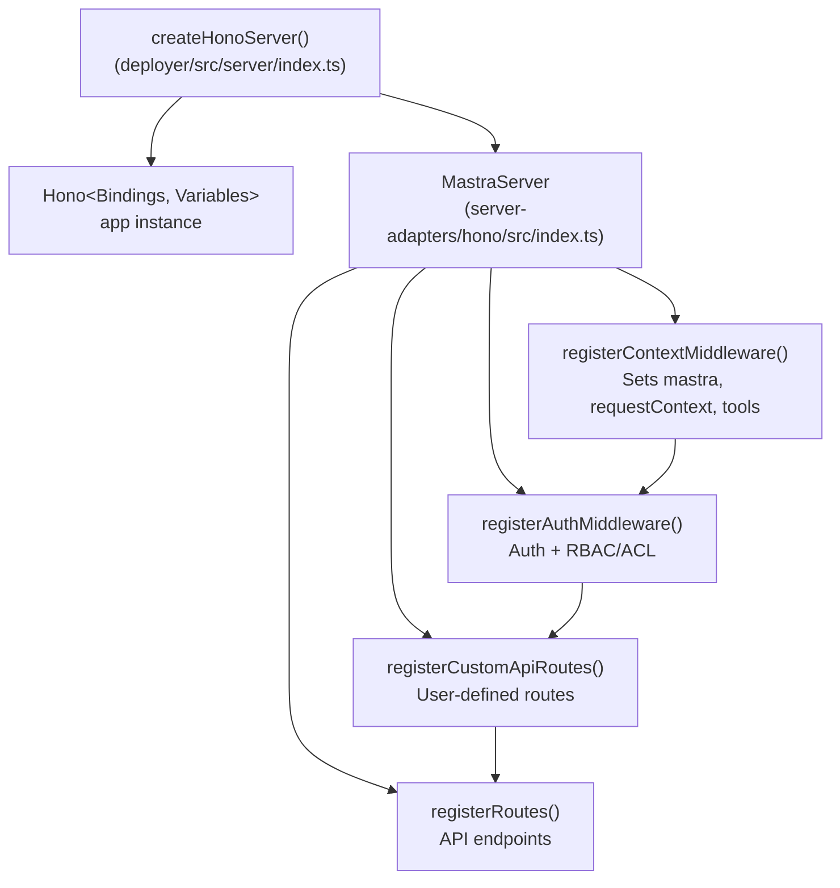
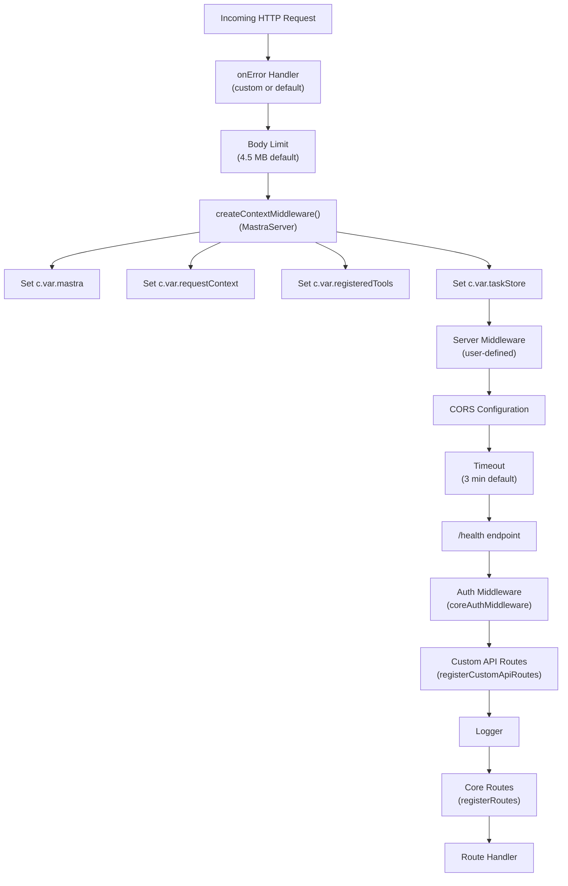
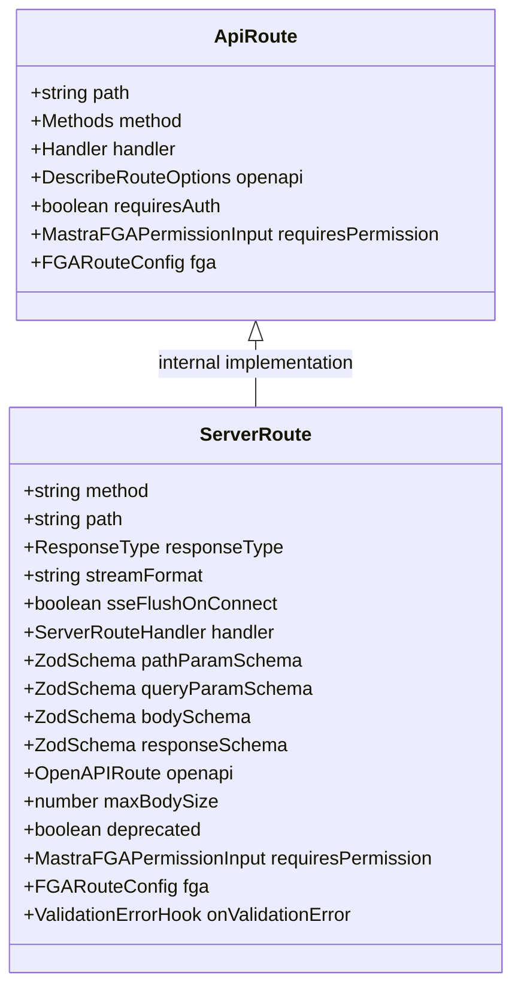
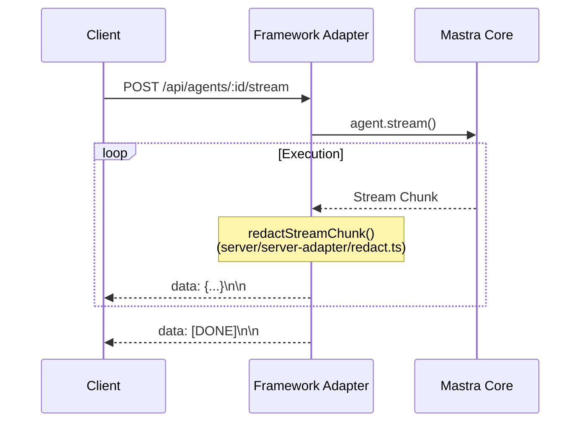
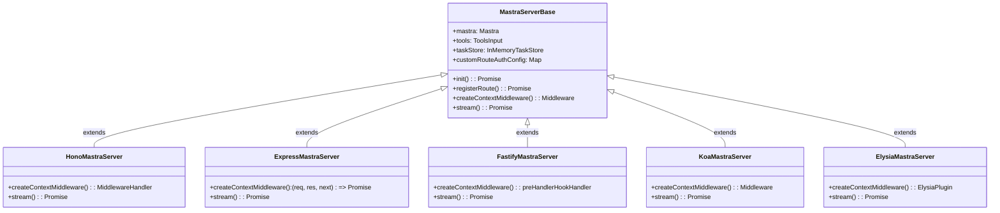

<!-- source: DeepWiki mcp.deepwiki.com · repo mastra-ai/mastra · page 9 Server and API Layer · fetched 2026-10-26 -->

# Server and API Layer

Relevant source files

The following files were used as context for generating this wiki page:

- [.changeset/elysia-streamed-body-limit.md](.changeset/elysia-streamed-body-limit.md)
- [.changeset/express-multipart-body-limit.md](.changeset/express-multipart-body-limit.md)
- [.changeset/nestjs-shared-rbac-suite.md](.changeset/nestjs-shared-rbac-suite.md)
- [.changeset/studio-rbac-express-elysia.md](.changeset/studio-rbac-express-elysia.md)
- [packages/server/src/server/auth/helpers.test.ts](packages/server/src/server/auth/helpers.test.ts)
- [packages/server/src/server/auth/helpers.ts](packages/server/src/server/auth/helpers.ts)
- [packages/server/src/server/server-adapter/index.test.ts](packages/server/src/server/server-adapter/index.test.ts)
- [packages/server/src/server/server-adapter/index.ts](packages/server/src/server/server-adapter/index.ts)
- [server-adapters/elysia/src/__tests__/body-limit-streaming.test.ts](server-adapters/elysia/src/__tests__/body-limit-streaming.test.ts)
- [server-adapters/elysia/src/index.ts](server-adapters/elysia/src/index.ts)
- [server-adapters/express/src/__tests__/express-adapter.test.ts](server-adapters/express/src/__tests__/express-adapter.test.ts)
- [server-adapters/express/src/__tests__/multipart-body-limit.test.ts](server-adapters/express/src/__tests__/multipart-body-limit.test.ts)
- [server-adapters/express/src/index.ts](server-adapters/express/src/index.ts)
- [server-adapters/fastify/src/__tests__/fastify-adapter.test.ts](server-adapters/fastify/src/__tests__/fastify-adapter.test.ts)
- [server-adapters/fastify/src/index.ts](server-adapters/fastify/src/index.ts)
- [server-adapters/hono/src/__tests__/hono-adapter.test.ts](server-adapters/hono/src/__tests__/hono-adapter.test.ts)
- [server-adapters/hono/src/index.ts](server-adapters/hono/src/index.ts)
- [server-adapters/koa/src/__tests__/koa-adapter.test.ts](server-adapters/koa/src/__tests__/koa-adapter.test.ts)
- [server-adapters/koa/src/index.ts](server-adapters/koa/src/index.ts)
- [server-adapters/nestjs/src/__tests__/nestjs-adapter.test.ts](server-adapters/nestjs/src/__tests__/nestjs-adapter.test.ts)
- [server-adapters/nestjs/src/__tests__/stream-redaction.test.ts](server-adapters/nestjs/src/__tests__/stream-redaction.test.ts)
- [server-adapters/nestjs/src/interceptors/streaming.interceptor.ts](server-adapters/nestjs/src/interceptors/streaming.interceptor.ts)
- [server-adapters/server-adapters-test-suite/src/body-limit-test-suite.ts](server-adapters/server-adapters-test-suite/src/body-limit-test-suite.ts)
- [server-adapters/server-adapters-test-suite/src/route-adapter-test-suite.ts](server-adapters/server-adapters-test-suite/src/route-adapter-test-suite.ts)
- [server-adapters/server-adapters-test-suite/src/test-helpers.ts](server-adapters/server-adapters-test-suite/src/test-helpers.ts)

## Purpose and Scope

This document describes the HTTP server architecture and API layer that exposes Mastra's agent, workflow, tool, and memory capabilities over HTTP. It covers server initialization, middleware registration, route organization, streaming mechanisms, and API design patterns. Mastra provides a framework-agnostic core with adapters for popular Node.js web frameworks, enabling developers to mount Mastra onto existing infrastructure or run it as a standalone service.

**Sources:** [packages/server/src/server/server-adapter/index.ts:1-200](), [server-adapters/hono/src/index.ts:1-74]()

## Server Architecture and Initialization

### Hono Framework Foundation

Mastra's primary server implementation uses [Hono](https://hono.dev). The server is initialized through `createHonoServer`, which sets up the application instance and attaches the `MastraServer` adapter. The `MastraServer` class manages the translation between framework-specific request/response objects and Mastra's internal execution logic. For details, see [Server Architecture and Setup](#9.1).

**Title:** Server Initialization Flow

**Sources:** [server-adapters/hono/src/index.ts:75-155](), [packages/server/src/server/server-adapter/index.ts:7-30]()

### Middleware Registration Order

Middleware registration follows a strict order to ensure proper request processing. The `createContextMiddleware` is crucial as it initializes the `RequestContext` by parsing it from either the request body (POST/PUT) or query parameters (GET). It also handles request metadata and attaches core Mastra objects to the request lifecycle. For details, see [Server Architecture and Setup](#9.1).

**Title:** Middleware Stack Registration Order

**Sources:** [server-adapters/hono/src/index.ts:76-154](), [packages/server/src/server/server-adapter/index.ts:144-153](), [server-adapters/express/src/index.ts:78-145]()

## Route Organization and Structure

### Route Definition Pattern

Routes are defined using the `ApiRoute` and `ServerRoute` types. `ServerRoute` provides the schema-driven structure for internal Mastra endpoints, including support for streaming formats (SSE vs plain text) and validation schemas for path parameters, query parameters, and request bodies.

**Title:** Route Entity Space

**Sources:** [packages/server/src/server/server-adapter/routes/index.ts:114-162](), [packages/server/src/server/server-adapter/index.ts:159-195]()

## Agent API Endpoints

The agent API manages agent execution and discovery. It supports standard LLM interactions (`generate`, `stream`) and advanced features like tool approval, signal delivery, and thread subscriptions. For details, see [Agent API Endpoints](#9.2).

| Endpoint | Method | Path | Purpose |
|----------|--------|------|---------|
| `LIST_AGENTS` | GET | `/agents` | List all available agents |
| `GENERATE_AGENT` | POST | `/agents/:agentId/generate` | Blocking agent generation |
| `STREAM_GENERATE` | POST | `/agents/:agentId/stream` | Streaming agent response |
| `APPROVE_TOOL_CALL` | POST | `/agents/:agentId/approve-tool-call` | Manually approve a suspended tool |
| `SEND_MESSAGE` | POST | `/agents/:agentId/send-message` | Send user input to an active run |
| `SEND_SIGNAL` | POST | `/agents/:agentId/signals` | Send system signals (reactive/notification) |
| `SUBSCRIBE_THREAD` | POST | `/agents/:agentId/threads/subscribe` | Real-time SSE subscription to thread |

**Sources:** [packages/server/src/server/handlers/agents.ts:40-79](), [packages/server/src/server/server-adapter/routes/agents.ts:1-20]()

## Workflow API Endpoints

Workflow endpoints manage the execution and monitoring of multi-step processes. For details, see [Workflow API Endpoints](#9.3).

| Endpoint | Method | Path | Purpose |
|----------|--------|------|---------|
| `LIST_WORKFLOWS` | GET | `/workflows` | List all available workflows |
| `STREAM_WORKFLOW` | POST | `/workflows/:workflowId/stream` | Execute and stream workflow steps |
| `GET_WORKFLOW_RUN` | GET | `/workflows/:workflowId/runs/:runId` | Get status of a specific run |

**Sources:** [packages/server/src/server/server-adapter/routes/workflows.ts:1-10]()

## Memory and Storage API Endpoints

The memory API provides endpoints for thread management and searching across conversational history. For details, see [Memory and Storage API Endpoints](#9.4).

| Endpoint | Method | Path | Purpose |
|----------|--------|------|---------|
| `LIST_THREADS` | GET | `/memory/threads` | List threads with pagination |
| `CREATE_THREAD` | POST | `/memory/threads` | Create a new memory thread |
| `LIST_MESSAGES` | GET | `/memory/threads/:threadId/messages` | Retrieve messages for a thread |
| `SEARCH_MEMORY` | GET | `/memory/search` | Semantic search across stored messages |
| `GET_OM_STATUS` | GET | `/memory/observational` | Get observational memory status |

**Sources:** [packages/server/src/server/server-adapter/routes/memory.ts:1-10]()

## Streaming Architecture

Mastra uses Server-Sent Events (SSE) for real-time streaming. The `redactStreamChunk` utility ensures sensitive data like system prompts or internal tool definitions are stripped from the output before reaching the client. For details, see [Streaming Architecture and SSE](#9.5).

**Title:** Streaming Sequence

**Sources:** [server-adapters/hono/src/index.ts:156-200](), [packages/server/src/server/server-adapter/redact.ts:1-20](), [packages/server/src/server/server-adapter/serialize.ts:1-15]()

## Server Adapters

Mastra provides a base `MastraServer` class (extending `MastraServerBase`) that is specialized for specific frameworks. This abstraction allows Mastra to be mounted on various web frameworks while maintaining consistent behavior for context parsing, authentication, and streaming. For details, see [Server Adapters (Hono, Express, Fastify, Koa, Elysia, NestJS)](#9.7).

**Title:** MastraServer Adapter Hierarchy

**Sources:** [packages/server/src/server/server-adapter/index.ts:7-15](), [server-adapters/hono/src/index.ts:111-112](), [server-adapters/express/src/index.ts:77-80](), [server-adapters/fastify/src/index.ts:80-85](), [server-adapters/koa/src/index.ts:92-92](), [server-adapters/elysia/src/index.ts:196-196]()

## Child Pages

- [Server Architecture and Setup](#9.1) — Document `createHonoServer`, `createNodeServer`, middleware stack, and server configuration.
- [Agent API Endpoints](#9.2) — Document `/agents` endpoints (list, get, generate, stream), agent handlers, and stored agent overrides.
- [Workflow API Endpoints](#9.3) — Document `/workflows` endpoints (list, run, status), workflow execution via API.
- [Memory and Storage API Endpoints](#9.4) — Document `/memory` endpoints (threads, messages, working memory, observational memory status).
- [Streaming Architecture and SSE](#9.5) — Document Server-Sent Events, stream chunk formats, `processMastraStream` utility, and streaming best practices.
- [Authentication and Authorization](#9.6) — Document auth middleware, `RequestContext` security model, resource/thread ownership validation, and RBAC.
- [Server Adapters (Hono, Express, Fastify, Koa, Elysia, NestJS)](#9.7) — Document the server adapter abstraction, `MastraServer` base class, and framework-specific adapters. Includes Next.js and TanStack Start.
- [A2A Protocol and Responses API](#9.8) — Document the Agent-to-Agent (A2A) protocol implementation, OpenAI-compatible Responses API, and background task management.
- [ACP (Agent Client Protocol) Integration](#9.9) — Document the `@mastra/acp` package: `AcpAgent` class, tool creation, and connection lifecycle.
- [Schedules, Background Tasks, and Workers API](#9.10) — Document server endpoints for schedules and background tasks, and runtime worker loop interactions.

---

