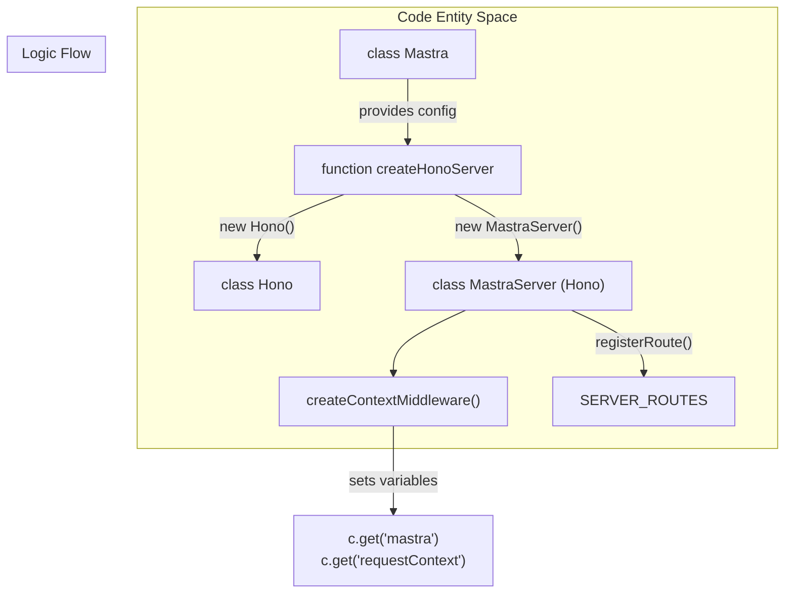
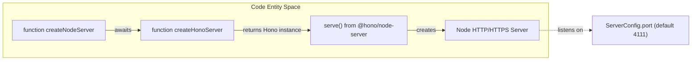
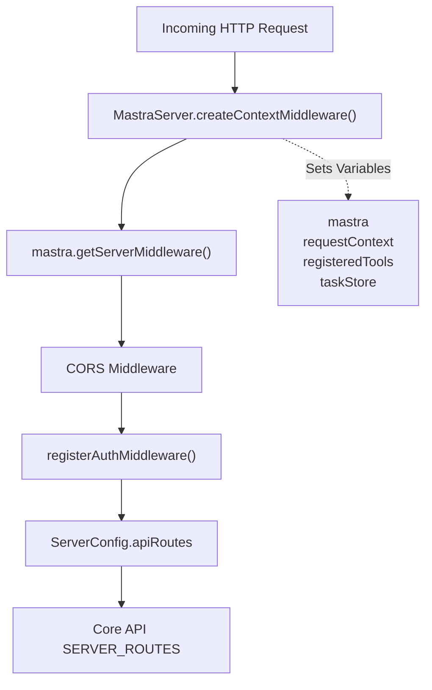
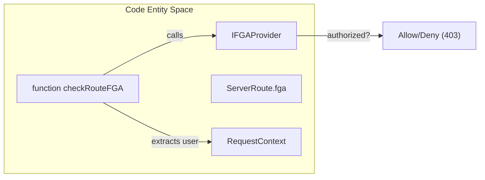

<!-- source: DeepWiki mcp.deepwiki.com · repo mastra-ai/mastra · page 9.1 Server Architecture and Setup · fetched 2026-10-26 -->

# Server Architecture and Setup

<details>
<summary>Relevant source files</summary>

The following files were used as context for generating this wiki page:

- [.changeset/elysia-streamed-body-limit.md](.changeset/elysia-streamed-body-limit.md)
- [.changeset/express-multipart-body-limit.md](.changeset/express-multipart-body-limit.md)
- [.changeset/nestjs-shared-rbac-suite.md](.changeset/nestjs-shared-rbac-suite.md)
- [.changeset/studio-rbac-express-elysia.md](.changeset/studio-rbac-express-elysia.md)
- [deployers/vercel/src/index.ts](deployers/vercel/src/index.ts)
- [deployers/vercel/src/routes.test.ts](deployers/vercel/src/routes.test.ts)
- [deployers/vercel/src/routes.ts](deployers/vercel/src/routes.ts)
- [packages/cli/src/commands/studio/studio.test.ts](packages/cli/src/commands/studio/studio.test.ts)
- [packages/cli/src/commands/studio/studio.ts](packages/cli/src/commands/studio/studio.ts)
- [packages/deployer/src/build/utils.test.ts](packages/deployer/src/build/utils.test.ts)
- [packages/deployer/src/build/utils.ts](packages/deployer/src/build/utils.ts)
- [packages/deployer/src/server/__tests__/auth-integration.test.ts](packages/deployer/src/server/__tests__/auth-integration.test.ts)
- [packages/deployer/src/server/__tests__/node-server-host.test.ts](packages/deployer/src/server/__tests__/node-server-host.test.ts)
- [packages/deployer/src/server/__tests__/option-studio-base.test.ts](packages/deployer/src/server/__tests__/option-studio-base.test.ts)
- [packages/deployer/src/server/__tests__/shutdown.test.ts](packages/deployer/src/server/__tests__/shutdown.test.ts)
- [packages/deployer/src/server/__tests__/studio-refresh.test.ts](packages/deployer/src/server/__tests__/studio-refresh.test.ts)
- [packages/deployer/src/server/__tests__/swagger-openapi-warning.test.ts](packages/deployer/src/server/__tests__/swagger-openapi-warning.test.ts)
- [packages/deployer/src/server/handlers/__tests__/client.test.ts](packages/deployer/src/server/handlers/__tests__/client.test.ts)
- [packages/deployer/src/server/handlers/client.ts](packages/deployer/src/server/handlers/client.ts)
- [packages/deployer/src/server/index.ts](packages/deployer/src/server/index.ts)
- [packages/deployer/src/server/welcome.ts](packages/deployer/src/server/welcome.ts)
- [packages/playground/e2e/tests/agents/recovery.spec.ts](packages/playground/e2e/tests/agents/recovery.spec.ts)
- [packages/playground/e2e/tests/agents/refresh-reconnect.spec.ts](packages/playground/e2e/tests/agents/refresh-reconnect.spec.ts)
- [packages/playground/index.html](packages/playground/index.html)
- [packages/playground/public/mastra-dark-tile.svg](packages/playground/public/mastra-dark-tile.svg)
- [packages/playground/src/App.tsx](packages/playground/src/App.tsx)
- [packages/playground/vite.config.ts](packages/playground/vite.config.ts)
- [packages/server/src/server/auth/helpers.test.ts](packages/server/src/server/auth/helpers.test.ts)
- [packages/server/src/server/auth/helpers.ts](packages/server/src/server/auth/helpers.ts)
- [packages/server/src/server/server-adapter/index.test.ts](packages/server/src/server/server-adapter/index.test.ts)
- [packages/server/src/server/server-adapter/index.ts](packages/server/src/server/server-adapter/index.ts)
- [server-adapters/elysia/src/__tests__/body-limit-streaming.test.ts](server-adapters/elysia/src/__tests__/body-limit-streaming.test.ts)
- [server-adapters/elysia/src/index.ts](server-adapters/elysia/src/index.ts)
- [server-adapters/express/src/__tests__/express-adapter.test.ts](server-adapters/express/src/__tests__/express-adapter.test.ts)
- [server-adapters/express/src/__tests__/multipart-body-limit.test.ts](server-adapters/express/src/__tests__/multipart-body-limit.test.ts)
- [server-adapters/express/src/index.ts](server-adapters/express/src/index.ts)
- [server-adapters/fastify/src/__tests__/fastify-adapter.test.ts](server-adapters/fastify/src/__tests__/fastify-adapter.test.ts)
- [server-adapters/fastify/src/index.ts](server-adapters/fastify/src/index.ts)
- [server-adapters/hono/src/__tests__/hono-adapter.test.ts](server-adapters/hono/src/__tests__/hono-adapter.test.ts)
- [server-adapters/hono/src/index.ts](server-adapters/hono/src/index.ts)
- [server-adapters/koa/src/__tests__/koa-adapter.test.ts](server-adapters/koa/src/__tests__/koa-adapter.test.ts)
- [server-adapters/koa/src/index.ts](server-adapters/koa/src/index.ts)
- [server-adapters/nestjs/src/__tests__/nestjs-adapter.test.ts](server-adapters/nestjs/src/__tests__/nestjs-adapter.test.ts)
- [server-adapters/nestjs/src/__tests__/stream-redaction.test.ts](server-adapters/nestjs/src/__tests__/stream-redaction.test.ts)
- [server-adapters/nestjs/src/interceptors/streaming.interceptor.ts](server-adapters/nestjs/src/interceptors/streaming.interceptor.ts)
- [server-adapters/server-adapters-test-suite/src/body-limit-test-suite.ts](server-adapters/server-adapters-test-suite/src/body-limit-test-suite.ts)
- [server-adapters/server-adapters-test-suite/src/route-adapter-test-suite.ts](server-adapters/server-adapters-test-suite/src/route-adapter-test-suite.ts)
- [server-adapters/server-adapters-test-suite/src/test-helpers.ts](server-adapters/server-adapters-test-suite/src/test-helpers.ts)

</details>


This page documents the Mastra server architecture, covering how HTTP servers are created, configured, and deployed across different environments. It explains the layered approach to server initialization, middleware registration, and platform-specific deployment patterns using the `MastraServer` adapter system.

## Server Creation Architecture

Mastra uses a two-tier server creation pattern: `createHonoServer` creates and configures a Hono application instance, while `createNodeServer` (in Node.js environments) wraps it with Node.js HTTP server capabilities.

### Hono Server Creation Flow

The `createHonoServer` function is the primary entry point for setting up the API. It bridges the gap between the core `Mastra` instance and the HTTP layer by initializing the framework-specific adapter and registering bundled tools.



**Sources:** [packages/deployer/src/server/index.ts:130-146](), [packages/deployer/src/server/index.ts:148-153]()

### Node Server Wrapper

In standard Node.js environments, `createNodeServer` uses `@hono/node-server` to turn the Hono application into a listening process. It supports both HTTP and HTTPS configurations, including custom SSL certificates for local development or secure production deployments.



**Sources:** [packages/deployer/src/server/index.ts:482-536](), [packages/core/src/server/types.ts:224-229]()

## Server Configuration

The `Mastra` instance configuration includes a `server` block defined by the `ServerConfig` type.

| Configuration | Type | Default | Description |
|--------------|------|---------|-------------|
| `port` | `number` | `4111` | HTTP server port [packages/core/src/server/types.ts:224-226]() |
| `host` | `string` | `'localhost'` | Server hostname [packages/core/src/server/types.ts:227-231]() |
| `studioHost` | `string` | `host` | Host for Studio API URL [packages/core/src/server/types.ts:233-237]() |
| `studioProtocol` | `'http' \| 'https'` | auto-detected | Protocol for Studio API URL [packages/core/src/server/types.ts:238-244]() |
| `studioPort` | `number` | `port` | Port for Studio API URL [packages/core/src/server/types.ts:246-250]() |
| `studioBase` | `string` | `'/'` | Base path for Mastra Studio UI [packages/core/src/server/types.ts:252-256]() |
| `apiPrefix` | `string` | `'/api'` | Base path for API routes [packages/core/src/server/types.ts:258-262]() |
| `apiRoutes` | `ApiRoute[]` | `[]` | Custom user-defined API routes [packages/core/src/server/types.ts:268-270]() |
| `middleware` | `Middleware \| Middleware[]` | `[]` | Custom middleware for the server [packages/core/src/server/types.ts:272-274]() |
| `cors` | `CorsOptions \| false` | See below | CORS configuration [packages/core/src/server/types.ts:276-279]() |
| `bodySizeLimit` | `number` | `4.5 MB` | Max request body size [packages/core/src/server/types.ts:309-312]() |
| `mcpOptions` | `MCPOptions` | `{}` | MCP transport settings [packages/core/src/server/types.ts:319-329]() |
| `a2a` | `A2AConfig` | `{}` | A2A protocol configuration [packages/core/src/server/types.ts:330-333]() |
| `storedResources` | `StoredResourcesConfig` | `{}` | Configuration for stored resources [packages/core/src/server/types.ts:334-337]() |
| `auth` | `MastraAuthConfig` | `undefined` | Authentication configuration [packages/core/src/server/types.ts:338-341]() |
| `onError` | `function` | `undefined` | Custom error handler [packages/core/src/server/types.ts:342-345]() |
| `httpLogging` | `HttpLoggingConfig` | `{ enabled: false }` | HTTP request logging configuration [packages/core/src/server/types.ts:350-353]() |
| `fga` | `IFGAProvider` | `undefined` | Fine-grained authorization provider [packages/core/src/server/types.ts:354-357]() |
| `streamOptions` | `StreamOptions` | `{ redact: true }` | Streaming options [packages/core/src/server/types.ts:362-365]() |

**Sources:** [packages/core/src/server/types.ts:224-365]()

## Middleware Pipeline

The server initialization registers middleware in a specific sequence to ensure the `Mastra` context is available to all handlers. Each adapter (Hono, Express, Koa, Fastify) implements its own version of these hooks.



### Context Middleware
The `createContextMiddleware()` implementation in the adapters is responsible for:
1.  **Request Context Parsing**: Extracting `requestContext` from either POST/PUT bodies or GET query parameters (supporting both raw JSON and base64 encoded JSON) [server-adapters/hono/src/index.ts:155-162](), [server-adapters/fastify/src/index.ts:90-123](), [server-adapters/koa/src/index.ts:203-236](), [server-adapters/express/src/index.ts:90-123]().
2.  **Context Injection**: Attaching the `mastra` instance, `requestContext`, and `registeredTools` to the framework's local state (e.g., `c.set` in Hono, `res.locals` in Express, `ctx.state` in Koa) [server-adapters/hono/src/index.ts:155-162](), [server-adapters/fastify/src/index.ts:135-141](), [server-adapters/koa/src/index.ts:248-254](), [server-adapters/express/src/index.ts:133-139]().
3.  **Abort Signaling**: Initializing an `AbortController` linked to the request/call lifecycle. This is critical for AI workloads to allow cancellation of long-running LLM generations or workflow steps when a client disconnects [server-adapters/hono/src/index.ts:179-188](), [server-adapters/fastify/src/index.ts:143-157](), [server-adapters/koa/src/index.ts:256-267](), [server-adapters/express/src/index.ts:140-151]().

**Sources:** [server-adapters/hono/src/index.ts:155-162](), [server-adapters/fastify/src/index.ts:90-123](), [server-adapters/koa/src/index.ts:203-236](), [server-adapters/express/src/index.ts:90-123](), [server-adapters/fastify/src/index.ts:135-141](), [server-adapters/koa/src/index.ts:248-254](), [server-adapters/express/src/index.ts:133-139](), [server-adapters/hono/src/index.ts:179-188](), [server-adapters/fastify/src/index.ts:143-157](), [server-adapters/koa/src/index.ts:256-267](), [server-adapters/express/src/index.ts:140-151]()

## Server Adapters

Mastra provides first-class support for multiple Node.js frameworks through the `MastraServer` base class abstraction.

| Framework | Adapter Package | Implementation Detail |
|-----------|-----------------|-----------------------|
| **Hono** | `@mastra/hono` | Uses `c.set` for variables; implements `skipIfFrameworkPublic` to protect framework-internal routes [server-adapters/hono/src/index.ts:128-128]() |
| **Express** | `@mastra/express` | Uses `res.locals`; uses `res.on('close')` for reliable abort signaling during streams [server-adapters/express/src/index.ts:86-86]() |
| **Fastify** | `@mastra/fastify` | Uses `reply.hijack()` for streaming to bypass standard Fastify response lifecycle [server-adapters/fastify/src/index.ts:83-83]() |
| **Koa** | `@mastra/koa` | Uses `ctx.state`; implements a custom global error boundary middleware for async catch-all [server-adapters/koa/src/index.ts:92-92]() |
| **Elysia** | `@mastra/elysia` | Uses `ctx.store` for variables; normalizes route parameters to avoid router conflicts [server-adapters/elysia/src/index.ts:193-193]() |

**Sources:** [server-adapters/hono/src/index.ts:128-128](), [server-adapters/express/src/index.ts:86-86](), [server-adapters/fastify/src/index.ts:83-83](), [server-adapters/koa/src/index.ts:92-92](), [server-adapters/elysia/src/index.ts:193-193]()

## Fine-Grained Authorization (FGA)

For enterprise use cases, Mastra supports resource-level authorization via FGA providers. The `checkRouteFGA` function evaluates if a user has permission to access a specific resource based on the `RequestContext`.



**Sources:** [packages/core/src/server/types.ts:354-357]()

## Custom API Routes

Users define custom routes using `registerApiRoute`. This helper ensures that the route configuration is valid and compatible with the Mastra server adapter.

```typescript
import { registerApiRoute } from '@mastra/core/server';

const myRoute = registerApiRoute('/my-custom-endpoint', {
  method: 'POST',
  handler: async (c) => {
    const mastra = c.get('mastra');
    const context = c.get('requestContext');
    return c.json({ success: true });
  },
  requiresAuth: true
});
```

**Validation Rules:**
-   **Handler Requirement**: Must define exactly one of `handler` or `createHandler` [packages/core/src/server/index.ts:106-123]().
-   **Method Requirement**: The `method` property is mandatory [packages/core/src/server/index.ts:97-104]().

**Sources:** [packages/core/src/server/index.ts:135-149](), [packages/core/src/server/types.ts:19-33]()

## Error Handling

The server implements a centralized error handling strategy to provide consistent responses across all frameworks:
1.  **Custom Handlers**: If `server.onError` is provided in the Mastra configuration, it is invoked for all unhandled exceptions [server-adapters/koa/src/index.ts:160-161]().
2.  **Framework Error Boundaries**: Adapters like Hono register an `errorHandler` at the top of the middleware stack to catch errors from any downstream middleware or route handlers [packages/deployer/src/server/index.ts:34-34]().
3.  **Zod Validation Errors**: Errors during request parameter validation (query, body, or path) are formatted into structured JSON responses using `formatZodError` [packages/server/src/server/server-adapter/index.ts:24-24]().
4.  **Body Limits**: Request bodies exceeding the `bodySizeLimit` (default 4.5MB) are rejected with a 413 Payload Too Large error [packages/server/src/server/server-adapter/index.ts:167-168]().

**Sources:** [server-adapters/koa/src/index.ts:160-161](), [packages/deployer/src/server/index.ts:34-34](), [packages/server/src/server/server-adapter/index.ts:24-24](), [packages/server/src/server/server-adapter/index.ts:167-168]()

---

