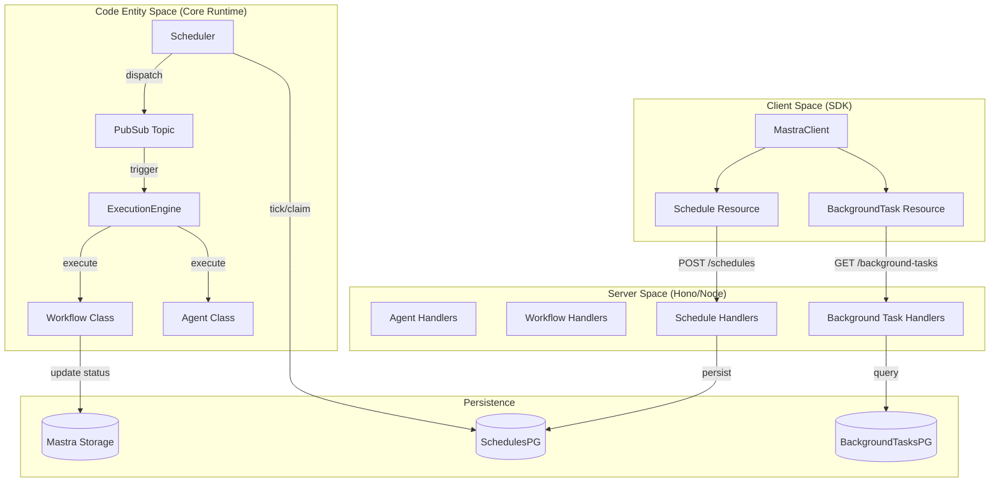
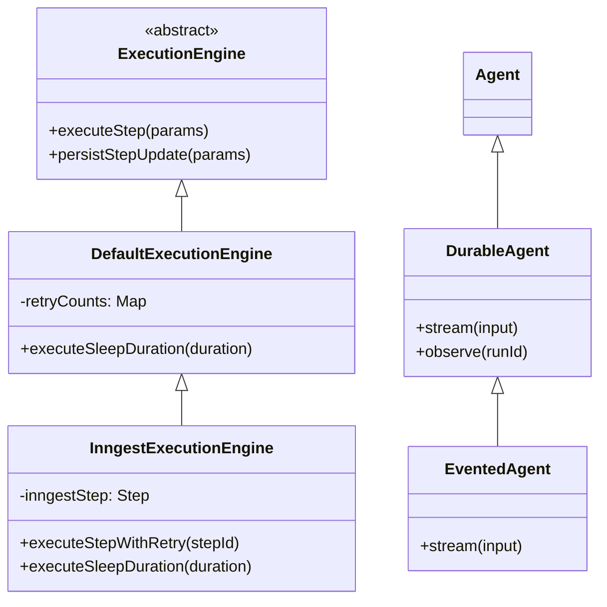

<!-- source: DeepWiki mcp.deepwiki.com · repo mastra-ai/mastra · page 9.10 Schedules, Background Tasks, and Workers API · fetched 2026-10-26 -->

# Schedules, Background Tasks, and Workers API

Relevant source files

The following files were used as context for generating this wiki page:

- [client-sdks/ai-sdk/src/__tests__/chat-route-credential-headers.test.ts](client-sdks/ai-sdk/src/__tests__/chat-route-credential-headers.test.ts)
- [deployers/cloud/src/utils/execa.ts](deployers/cloud/src/utils/execa.ts)
- [docs/src/content/en/docs/workflows/time-travel.mdx](docs/src/content/en/docs/workflows/time-travel.mdx)
- [docs/src/content/en/reference/client-js/workflows.mdx](docs/src/content/en/reference/client-js/workflows.mdx)
- [docs/src/content/en/reference/streaming/workflows/resumeStream.mdx](docs/src/content/en/reference/streaming/workflows/resumeStream.mdx)
- [docs/src/content/en/reference/workflows/run-methods/restart.mdx](docs/src/content/en/reference/workflows/run-methods/restart.mdx)
- [docs/src/content/en/reference/workflows/run-methods/resume.mdx](docs/src/content/en/reference/workflows/run-methods/resume.mdx)
- [docs/src/content/en/reference/workflows/run-methods/start.mdx](docs/src/content/en/reference/workflows/run-methods/start.mdx)
- [docs/src/content/en/reference/workflows/run-methods/timeTravel.mdx](docs/src/content/en/reference/workflows/run-methods/timeTravel.mdx)
- [docs/src/content/en/reference/workflows/workflow-methods/foreach.mdx](docs/src/content/en/reference/workflows/workflow-methods/foreach.mdx)
- [e2e-tests/deployers/template/cloudflare/src/mastra/index.ts](e2e-tests/deployers/template/cloudflare/src/mastra/index.ts)
- [packages/agent-builder/integration-tests/src/agent-template-behavior.test.ts](packages/agent-builder/integration-tests/src/agent-template-behavior.test.ts)
- [packages/agent-builder/integration-tests/src/workflow-builder-integration.test.ts](packages/agent-builder/integration-tests/src/workflow-builder-integration.test.ts)
- [packages/core/src/workflows/concurrent-time-travel.test.ts](packages/core/src/workflows/concurrent-time-travel.test.ts)
- [packages/core/src/workflows/evented/concurrent-time-travel.test.ts](packages/core/src/workflows/evented/concurrent-time-travel.test.ts)
- [packages/deployer/src/build/analyze/constants.ts](packages/deployer/src/build/analyze/constants.ts)
- [packages/deployer/src/deploy/log.ts](packages/deployer/src/deploy/log.ts)
- [packages/deployer/src/validator/custom-resolver.ts](packages/deployer/src/validator/custom-resolver.ts)
- [packages/deployer/src/validator/validate.test.ts](packages/deployer/src/validator/validate.test.ts)
- [packages/deployer/src/validator/validate.ts](packages/deployer/src/validator/validate.ts)
- [packages/server/src/server/agent-builder-ee-static-imports.test.ts](packages/server/src/server/agent-builder-ee-static-imports.test.ts)
- [packages/server/src/server/handlers/agent-builder.test.ts](packages/server/src/server/handlers/agent-builder.test.ts)
- [packages/server/src/server/handlers/authorship.ts](packages/server/src/server/handlers/authorship.ts)
- [packages/server/src/server/handlers/editor-builder.test.ts](packages/server/src/server/handlers/editor-builder.test.ts)
- [packages/server/src/server/handlers/editor-builder.ts](packages/server/src/server/handlers/editor-builder.ts)
- [packages/server/src/server/handlers/error.test.ts](packages/server/src/server/handlers/error.test.ts)
- [packages/server/src/server/handlers/error.ts](packages/server/src/server/handlers/error.ts)
- [packages/server/src/server/handlers/mcp.ts](packages/server/src/server/handlers/mcp.ts)
- [packages/server/src/server/handlers/tool-schema-overrides.ts](packages/server/src/server/handlers/tool-schema-overrides.ts)
- [packages/server/src/server/handlers/tools.test.ts](packages/server/src/server/handlers/tools.test.ts)
- [packages/server/src/server/handlers/tools.ts](packages/server/src/server/handlers/tools.ts)
- [packages/server/src/server/handlers/utils.test.ts](packages/server/src/server/handlers/utils.test.ts)
- [packages/server/src/server/handlers/utils.ts](packages/server/src/server/handlers/utils.ts)
- [packages/server/src/server/handlers/workflow-builder.test.ts](packages/server/src/server/handlers/workflow-builder.test.ts)
- [packages/server/src/server/handlers/workflow-builder.ts](packages/server/src/server/handlers/workflow-builder.ts)
- [packages/server/src/server/handlers/workflows.restart.test.ts](packages/server/src/server/handlers/workflows.restart.test.ts)
- [packages/server/src/server/handlers/workflows.test.ts](packages/server/src/server/handlers/workflows.test.ts)
- [packages/server/src/server/handlers/workflows.ts](packages/server/src/server/handlers/workflows.ts)
- [packages/server/src/server/schemas/editor-builder.ts](packages/server/src/server/schemas/editor-builder.ts)
- [packages/server/src/server/schemas/workflows.ts](packages/server/src/server/schemas/workflows.ts)
- [packages/server/src/server/server-adapter/mcp-auth.ts](packages/server/src/server/server-adapter/mcp-auth.ts)
- [packages/server/src/server/server-adapter/routes/editor-builder.ts](packages/server/src/server/server-adapter/routes/editor-builder.ts)
- [packages/server/src/server/utils.ts](packages/server/src/server/utils.ts)
- [packages/server/src/server/utils/resolve-builder-model-policy.ts](packages/server/src/server/utils/resolve-builder-model-policy.ts)

This page documents the server endpoints and runtime architecture for managing schedules, cron triggers, and background task lifecycles within the Mastra framework. It details how the scheduler loop interacts with storage, how background tasks are managed across different execution engines (Default, Evented, and Inngest), and the API surface available for inspection and management.

## Overview and Data Flow

Mastra provides a robust system for executing workflows and agentic tasks either on a schedule (Cron) or as long-running background processes. The system relies on a combination of storage adapters for persistence and a worker loop that "claims" and executes tasks.

### Scheduled Execution Flow
The scheduler uses cron syntax to define recurring triggers. The `Scheduler` component within the workflow system is responsible for the tick-claim-publish loop.

1.  **Schedule Definition**: Schedules are defined in the `Workflow` configuration using `WorkflowScheduleConfig` [packages/core/src/workflows/workflow.ts:18-20]().
2.  **Tick Loop**: The scheduler periodically checks the storage for schedules that are due to fire.
3.  **Claiming**: To prevent multiple workers from firing the same schedule, a "claim" mechanism is used in the database.
4.  **Publishing**: Once claimed, a `workflow.start` event is dispatched into the `PubSub` system.

### Background Task Lifecycle
Background tasks represent asynchronous executions of agents or workflows. They are managed through the `BackgroundTask` resource and monitored via the `MastraClient`. In durable environments like Inngest, the `InngestWorkflow` class provides specialized methods to list runs via the storage layer [workflows/inngest/src/workflow.ts:119-137]().

#### System Interaction Diagram
The following diagram illustrates the interaction between the Client SDK, the Server Handlers, and the Workflow Execution Engines.

Title: Background Task and Schedule Management Flow

Sources: [packages/core/src/workflows/workflow.ts:18-20](), [stores/pg/src/storage/index.ts:115-118](), [workflows/inngest/src/workflow.ts:119-137]()

## Workers and Execution Engines

The behavior of background tasks and schedules varies depending on the `ExecutionEngine` configured for the Mastra instance.

### Default Execution Engine
The `DefaultExecutionEngine` manages in-process execution and local retries. For background tasks, it relies on the server's request lifecycle unless explicitly coupled with a persistent storage adapter for status recovery.

### Evented and Inngest Engines
For durable background tasks, Mastra supports event-driven architectures:
- **Evented Engine**: Uses a `PubSub` implementation (e.g., Redis Streams) to decouple task triggering from execution. The `createEventedAgent` factory wraps an `Agent` for fire-and-forget durable execution [packages/core/src/agent/durable/create-evented-agent.ts]().
- **Inngest Engine**: Offloads durability to the Inngest platform. The `InngestExecutionEngine` uses `inngestStep.run` and `inngestStep.sleep` primitives to ensure that background tasks can survive server restarts [workflows/inngest/src/execution-engine.ts:57-70](). It specifically overrides `executeSleepDuration` to use Inngest's native sleep primitive [workflows/inngest/src/execution-engine.ts:188-190](). The `createInngestAgent` factory is used to create Inngest-powered durable agents [docs/src/content/en/reference/agents/inngest-agent.mdx]().

Title: Execution Engine Specialization for Background Tasks

Sources: [workflows/inngest/src/execution-engine.ts:57-70](), [workflows/inngest/src/execution-engine.ts:114-127](), [workflows/inngest/src/execution-engine.ts:188-190](), [packages/core/src/agent/durable/create-evented-agent.ts](), [docs/src/content/en/reference/agents/inngest-agent.mdx]()

## API Reference: Background Tasks

Clients use the `MastraClient` to inspect the lifecycle of background tasks. These tasks are typically generated when an agent or workflow is run with `runId` and `resourceId` parameters, allowing for asynchronous status polling.

### Endpoints and Operations

The `workflows` handler provides routes for managing runs, including listing, getting status, and deletion [packages/server/src/server/handlers/workflows.ts:165-176](). The `agent-builder` handlers also expose similar endpoints for agent builder actions, which are essentially workflows [packages/server/src/server/handlers/agent-builder.ts:10-25]().

| Operation | Method | Endpoint | Description |
| :--- | :--- | :--- | :--- |
| **List Workflows** | `GET` | `/workflows` | Retrieves a list of all available workflows in the system [packages/server/src/server/handlers/workflows.ts:162-174](). |
| **List Workflow Runs** | `GET` | `/workflows/:workflowId/runs` | Retrieves a paginated list of all background executions for a workflow [packages/server/src/server/handlers/workflows.ts:400-404](). |
| **Get Run By ID** | `GET` | `/workflows/:workflowId/runs/:runId` | Gets detailed status, including step-level results and active paths [packages/server/src/server/handlers/workflows.ts:490-494](). |
| **Delete Run** | `DELETE` | `/workflows/:workflowId/runs/:runId` | Removes the run snapshot from storage [packages/server/src/server/handlers/workflows.ts:550-554](). |
| **Start Async Workflow** | `POST` | `/workflows/:workflowId/start-async` | Starts a workflow run asynchronously and awaits its completion [packages/server/src/server/handlers/workflows.ts:600-604](). |
| **Resume Async Workflow** | `POST` | `/workflows/:workflowId/resume-async` | Resumes a suspended workflow step asynchronously and awaits its completion [packages/server/src/server/handlers/workflows.ts:700-704](). |
| **Stream Workflow** | `POST` | `/workflows/:workflowId/stream` | Streams workflow execution for real-time updates [packages/server/src/server/handlers/workflows.ts:900-904](). |
| **Observe Stream Workflow** | `GET` | `/workflows/:workflowId/runs/:runId/observe` | Observes a running workflow stream, allowing reconnection and replay of missed events [packages/server/src/server/handlers/workflows.ts:1070-1074](). |
| **Cancel Workflow Run** | `POST` | `/workflows/:workflowId/runs/:runId/cancel` | Cancels a specific workflow run [packages/server/src/server/handlers/workflows.ts:1180-1184](). |
| **Time Travel Workflow** | `POST` | `/workflows/:workflowId/runs/:runId/time-travel` | Allows re-execution of a workflow from a specific step with new input or state [packages/server/src/server/handlers/workflows.ts:1270-1274](). |
| **Restart Workflow** | `POST` | `/workflows/:workflowId/runs/:runId/restart` | Restarts a workflow run from the beginning [packages/server/src/server/handlers/workflows.ts:1360-1364](). |
| **Execute Workflow Step** | `POST` | `/workflows/:workflowId/runs/:runId/execute-step` | Executes a specific step within a workflow run [packages/server/src/server/handlers/workflows.ts:1450-1454](). |
| **List Workflow Run Counts** | `GET` | `/workflows/run-counts` | Retrieves per-workflow counts of running and suspended runs [packages/server/src/server/handlers/workflows.ts:240-244](). |

### Data Structures
A workflow run snapshot typically includes:
- `status`: Current state (`success`, `failed`, `canceled`, `tripwire`, etc.) [packages/server/src/server/schemas/workflows.ts:5-17]().
- `runId`: Unique identifier for the execution [packages/server/src/server/schemas/workflows.ts:103]().
- `snapshot`: The serialized state of the workflow [packages/server/src/server/schemas/workflows.ts:105-107]().
- `createdAt`: Timestamp of creation [packages/server/src/server/schemas/workflows.ts:108]().
- `updatedAt`: Timestamp of last update [packages/server/src/server/schemas/workflows.ts:109]().
- `resourceId`: Optional identifier for the resource associated with the run [packages/server/src/server/schemas/workflows.ts:110]().

Sources: [packages/server/src/server/handlers/workflows.ts:51-176](), [packages/server/src/server/handlers/workflows.ts:400-404](), [packages/server/src/server/handlers/workflows.ts:490-494](), [packages/server/src/server/handlers/workflows.ts:550-554](), [packages/server/src/server/handlers/workflows.ts:600-604](), [packages/server/src/server/handlers/workflows.ts:700-704](), [packages/server/src/server/handlers/workflows.ts:900-904](), [packages/server/src/server/handlers/workflows.ts:1070-1074](), [packages/server/src/server/handlers/workflows.ts:1180-1184](), [packages/server/src/server/handlers/workflows.ts:1270-1274](), [packages/server/src/server/handlers/workflows.ts:1360-1364](), [packages/server/src/server/handlers/workflows.ts:1450-1454](), [packages/server/src/server/handlers/workflows.ts:240-244](), [packages/server/src/server/schemas/workflows.ts:197-204](), [packages/server/src/server/schemas/workflows.ts:5-17](), [packages/server/src/server/schemas/workflows.ts:103-110](), [packages/server/src/server/handlers/agent-builder.ts:10-25]()

## API Reference: Schedules and Cron Triggers

The Schedules API allows for the dynamic creation and management of cron-based triggers for Mastra workflows. Storage is handled by domain-specific adapters like `SchedulesPG` for PostgreSQL [stores/pg/src/storage/domains/schedules/index.ts:37]() or `SchedulesLibSQL` for LibSQL [stores/libsql/src/storage/index.ts:22]().

### Endpoints and Operations

| Operation | Method | Endpoint | Description |
| :--- | :--- | :--- | :--- |
| **List Schedules** | `GET` | `/schedules` | Lists all registered schedules. |
| **Create Schedule** | `POST` | `/schedules` | Registers a new cron trigger for a workflow. |
| **Update Schedule** | `PATCH` | `/schedules/:id` | Updates cron expression or enabled status. |

### Schedule Storage
Storage adapters define tables for `mastra_schedules` and `mastra_schedule_triggers` to manage the lifecycle of recurring tasks [packages/core/src/storage/constants.ts:41-42](). The `Mastra` class can be configured with `notifications.dispatch.enabled` and a `cron` expression to enable an internal dispatcher workflow for scheduled notification delivery [docs/src/content/en/reference/core/mastra-class.mdx:39-55]().

Sources: [stores/pg/src/storage/index.ts:37](), [stores/libsql/src/storage/index.ts:22](), [packages/core/src/storage/constants.ts:41-42](), [docs/src/content/en/reference/core/mastra-class.mdx:39-55]()

## Runtime Responsibilities

### The Scheduler Loop
The scheduler runs as a background worker. Its primary responsibilities are:
1.  **Scanning**: Querying the `MastraStorage` for schedules where `nextRunAt` <= `now()`.
2.  **Concurrency Control**: Using atomic database updates to "claim" a schedule row.
3.  **Execution Dispatch**: Triggering the workflow execution engine.
4.  **Rescheduling**: Calculating the next run time based on the cron expression.

### Durable Execution with Inngest
For background tasks requiring high durability, `InngestWorkflow` wraps the execution in an Inngest function [workflows/inngest/src/workflow.ts:74-75](). This allows tasks to survive restarts and provides built-in concurrency and rate-limiting controls [workflows/inngest/src/workflow.ts:105-109](). The `createDurableAgent` factory also enables durable execution for agents, allowing them to survive client disconnects and process restarts [docs/src/content/en/docs/harness/durable-agents.mdx:19]().

### Caching and Replay
To support client reconnection, the server can cache run streams. The `cacheRunStream` utility tees the source stream and pushes chunks to the `MastraServerCache` so that the `/observe` endpoint can replay history to a late-joining client [packages/server/src/server/handlers/workflows.ts:72-106](). This is crucial for `DurableAgent` and `EventedAgent` which provide resumable streams [docs/src/content/en/reference/agents/durable-agent.mdx:16]().

Sources: [workflows/inngest/src/workflow.ts:74-109](), [packages/server/src/server/handlers/workflows.ts:72-106](), [docs/src/content/en/docs/harness/durable-agents.mdx:19](), [docs/src/content/en/reference/agents/durable-agent.mdx:16]()

---

