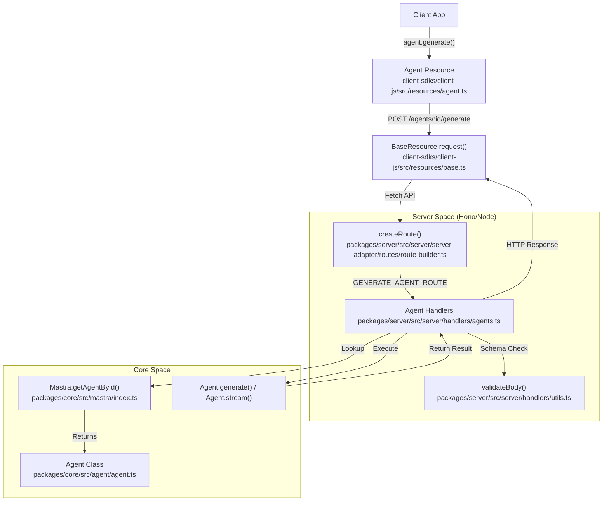
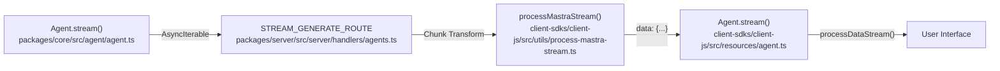

<!-- source: DeepWiki mcp.deepwiki.com · repo mastra-ai/mastra · page 9.2 Agent API Endpoints · fetched 2026-10-26 -->

# Agent API Endpoints

Relevant source files

The following files were used as context for generating this wiki page:

- [.changeset/fluffy-hornets-switch.md](.changeset/fluffy-hornets-switch.md)
- [client-sdks/client-js/src/client.ts](client-sdks/client-js/src/client.ts)
- [client-sdks/client-js/src/index.ts](client-sdks/client-js/src/index.ts)
- [client-sdks/client-js/src/resources/agent.client-tools.test.ts](client-sdks/client-js/src/resources/agent.client-tools.test.ts)
- [client-sdks/client-js/src/resources/agent.test.ts](client-sdks/client-js/src/resources/agent.test.ts)
- [client-sdks/client-js/src/resources/agent.ts](client-sdks/client-js/src/resources/agent.ts)
- [client-sdks/client-js/src/resources/observability.test.ts](client-sdks/client-js/src/resources/observability.test.ts)
- [client-sdks/client-js/src/resources/observability.ts](client-sdks/client-js/src/resources/observability.ts)
- [client-sdks/client-js/src/route-types.generated.ts](client-sdks/client-js/src/route-types.generated.ts)
- [client-sdks/client-js/src/types.ts](client-sdks/client-js/src/types.ts)
- [client-sdks/client-js/src/utils/ai-sdk-v4/ai-sdk-v4.test.ts](client-sdks/client-js/src/utils/ai-sdk-v4/ai-sdk-v4.test.ts)
- [client-sdks/client-js/src/utils/ai-sdk-v4/data-stream-parts.ts](client-sdks/client-js/src/utils/ai-sdk-v4/data-stream-parts.ts)
- [client-sdks/client-js/src/utils/ai-sdk-v4/fix-json.ts](client-sdks/client-js/src/utils/ai-sdk-v4/fix-json.ts)
- [client-sdks/client-js/src/utils/ai-sdk-v4/index.ts](client-sdks/client-js/src/utils/ai-sdk-v4/index.ts)
- [client-sdks/client-js/src/utils/ai-sdk-v4/parse-partial-json.ts](client-sdks/client-js/src/utils/ai-sdk-v4/parse-partial-json.ts)
- [client-sdks/react/src/agent/hooks.test.ts](client-sdks/react/src/agent/hooks.test.ts)
- [client-sdks/react/src/agent/hooks.ts](client-sdks/react/src/agent/hooks.ts)
- [docs/src/content/en/reference/client-js/agents.mdx](docs/src/content/en/reference/client-js/agents.mdx)
- [packages/cli/src/commands/api/route-metadata.generated.ts](packages/cli/src/commands/api/route-metadata.generated.ts)
- [packages/server/src/server/handlers/agent.test.ts](packages/server/src/server/handlers/agent.test.ts)
- [packages/server/src/server/handlers/agents.test.ts](packages/server/src/server/handlers/agents.test.ts)
- [packages/server/src/server/handlers/agents.ts](packages/server/src/server/handlers/agents.ts)
- [packages/server/src/server/handlers/observability-new-endpoints.ts](packages/server/src/server/handlers/observability-new-endpoints.ts)
- [packages/server/src/server/handlers/observability-shared.ts](packages/server/src/server/handlers/observability-shared.ts)
- [packages/server/src/server/handlers/observability-storage-schemas.ts](packages/server/src/server/handlers/observability-storage-schemas.ts)
- [packages/server/src/server/handlers/observability.test.ts](packages/server/src/server/handlers/observability.test.ts)
- [packages/server/src/server/handlers/observability.ts](packages/server/src/server/handlers/observability.ts)
- [packages/server/src/server/handlers/system.test.ts](packages/server/src/server/handlers/system.test.ts)
- [packages/server/src/server/handlers/system.ts](packages/server/src/server/handlers/system.ts)
- [packages/server/src/server/schemas/agents.ts](packages/server/src/server/schemas/agents.ts)
- [packages/server/src/server/schemas/system.ts](packages/server/src/server/schemas/system.ts)
- [packages/server/src/server/server-adapter/routes/agents.ts](packages/server/src/server/server-adapter/routes/agents.ts)
- [packages/server/src/server/server-adapter/routes/observability.ts](packages/server/src/server/server-adapter/routes/observability.ts)

This document describes the HTTP API endpoints exposed by `@mastra/server` for interacting with agents. These endpoints enable client applications to list agents, generate responses, stream outputs, manage model configurations, and control agent behavior through a REST API.

---

## Overview

The agent API provides HTTP endpoints for all core agent operations. The server handlers in [packages/server/src/server/handlers/agents.ts]() expose these endpoints, which are consumed by the client SDK in [client-sdks/client-js/src/resources/agent.ts]().

### Endpoint Categories

| Category | Endpoints | Source |
| :--- | :--- | :--- |
| **Discovery** | `GET /agents`, `GET /agents/:agentId`, `GET /agents/providers` | [packages/server/src/server/handlers/agents.ts:901-965](), [packages/server/src/server/handlers/agents.ts:151-176]() |
| **Generation** | `POST /.../generate`, `POST /.../stream`, `POST /.../stream-until-idle` | [packages/server/src/server/handlers/agents.ts:1072-1359](), [packages/cli/src/commands/api/route-metadata.generated.ts:81-160]() |
| **Network** | `POST /.../network/generate`, `POST /.../network/stream` | [packages/server/src/server/handlers/agents.ts:1210-1287]() |
| **Model Mgmt** | `POST /.../model`, `PUT /.../models/:id`, `POST /.../models/reorder` | [packages/server/src/server/handlers/agents.ts:1493-1678]() |
| **Tool Control** | `POST /.../tools/:toolCallId/approve` \| `decline` | [packages/server/src/server/handlers/agents.ts:1361-1491]() |
| **Signals** | `POST /.../signals`, `POST /.../subscribe`, `POST /.../send-message` | [packages/server/src/server/handlers/agents.ts:1680-1748](), [packages/cli/src/commands/api/route-metadata.generated.ts:161-202]() |

Sources: [packages/server/src/server/handlers/agents.ts:1-74](), [client-sdks/client-js/src/resources/agent.ts:153-230](), [packages/cli/src/commands/api/route-metadata.generated.ts:4-202]()

---

## Request Flow Architecture

The following diagram maps the natural language request flow to the specific code entities in the Mastra codebase.

Title: "Agent Request Code Mapping"

Sources: [packages/server/src/server/handlers/agents.ts:1-100](), [client-sdks/client-js/src/resources/agent.ts:52-100](), [packages/server/src/server/handlers/utils.ts:81-88]()

---

## Agent Discovery Endpoints

### List Agents
**Endpoint:** `GET /agents`

Returns all registered agents. Supports optional request context for dynamic agent resolution and partial serialization to reduce response size.

**Query Parameters:**
- `requestContext` (base64-encoded JSON, optional): For dynamic configuration resolution [client-sdks/client-js/src/client.ts:237-242]().
- `partial` (boolean, optional): If true, returns simplified agent data without full schemas [packages/server/src/server/handlers/agents.ts:904-906]().

**Handler Implementation:**
The `LIST_AGENTS_ROUTE` handler iterates over `mastra.listAgents()` and applies serialization to convert Zod/Standard schemas into JSON schemas for the client using `standardSchemaToJSONSchema` [packages/server/src/server/handlers/agents.ts:24](), [packages/server/src/server/handlers/agents.ts:901-923]().

### List Model Providers
**Endpoint:** `GET /agents/providers`

Returns available model providers and their connection status. The `isProviderConnected()` utility checks for required environment variables (e.g., `OPENAI_API_KEY`) defined in the `PROVIDER_REGISTRY` [packages/server/src/server/handlers/agents.ts:151-176]().

Sources: [packages/server/src/server/handlers/agents.ts:901-965](), [packages/server/src/server/handlers/agents.ts:151-176](), [client-sdks/client-js/src/client.ts:233-252]()

---

## Generation and Streaming

### Generate
**Endpoint:** `POST /agents/:agentId/generate`

Synchronous generation using the modern agent API.

**Client-Side Tool Execution Loop:**
When the server returns a `finishReason === 'tool-calls'`, the client SDK can execute local tools and re-submit the result to the server [client-sdks/client-js/src/resources/agent.ts:210-230]().
1. Server returns tool call instructions.
2. Client identifies the tool in `params.clientTools` [client-sdks/client-js/src/resources/agent.ts:219]().
3. Client executes `executeClientToolWithObservability` [client-sdks/client-js/src/resources/agent.ts:150-194]().
4. Client calls `respondFn` with the tool result added to message history [client-sdks/client-js/src/resources/agent.ts:208-230]().

### Stream
**Endpoint:** `POST /agents/:agentId/stream`

Streaming generation using Server-Sent Events (SSE).

Title: "Streaming Data Flow (SSE)"

Sources: [packages/server/src/server/handlers/agents.ts:1289-1359](), [client-sdks/client-js/src/resources/agent.ts:55-144](), [client-sdks/client-js/src/resources/agent.ts:210-230]()

---

## Agent Signals and Message Queuing

Agent signals allow asynchronous communication with active agent runs or memory threads.

**Endpoints:**
- `POST /agents/:agentId/signals`: Send a signal (e.g., `user-message`) to a specific thread or run [packages/server/src/server/handlers/agents.ts:1680-1711]().
- `POST /agents/:agentId/send-message`: Sends a message to the agent immediately [packages/server/src/server/handlers/agents.ts:1713-1721]().
- `POST /agents/:agentId/queue-message`: Queues a message for the agent [packages/server/src/server/handlers/agents.ts:1723-1731]().
- `POST /agents/:agentId/queue-signal`: Queues a typed signal for the next thread turn [packages/server/src/server/handlers/agents.ts:1723-1731]().
- `POST /agents/:agentId/threads/abort`: Aborts an agent thread [packages/server/src/server/handlers/agents.ts:1743-1748]().
- `POST /agents/:agentId/threads/signals/cancel`: Cancels pending signals on the server process [packages/server/src/server/handlers/agents.ts:1750-1755]().
- `POST /agents/:agentId/threads/subscribe`: Subscribe to updates on a specific thread via SSE [packages/server/src/server/handlers/agents.ts:1733-1741]().

The signal system supports behaviors like `deliver`, `persist`, or `discard` for active runs, and `wake`, `persist`, or `discard` for idle threads [client-sdks/client-js/src/types.ts:134-139](). Signal runtime options are cached using `signalRuntimeOptionsByRunId` and `latestSignalRuntimeOptionsByThread` [client-sdks/client-js/src/resources/agent.ts:104-105]().

Sources: [packages/server/src/server/handlers/agents.ts:1680-1755](), [client-sdks/client-js/src/types.ts:134-139](), [client-sdks/client-js/src/resources/agent.ts:101-128]()

---

## Model Management and Overrides

Mastra supports updating agent models at runtime, which is critical for agents stored in the database or managed via the Studio UI.

| Endpoint | Handler Logic |
| :--- | :--- |
| `POST /.../model` | Updates the primary model ID and provider [packages/server/src/server/handlers/agents.ts:1493-1543](). |
| `POST /.../models/reorder` | Changes the priority of models in the fallback list [packages/server/src/server/handlers/agents.ts:1545-1611](). |
| `PUT /.../models/:id` | Updates specific model config (retries, headers) by ID [packages/server/src/server/handlers/agents.ts:1613-1678](). |

Versioning and overrides are stashed in the `RequestContext` using `stashVersionOverrides` [packages/server/src/server/handlers/agents.ts:106-117](). This allows the server to resolve the correct agent version for subsequent requests in the same context.

Sources: [packages/server/src/server/handlers/agents.ts:1493-1678](), [packages/server/src/server/handlers/agents.ts:106-117]()

---

## Utility and Security Handlers

The API layer uses several utility functions to manage context and security:

- **Resource/Thread Resolution:** `getEffectiveResourceId` and `getEffectiveThreadId` resolve IDs from the request context or the request body [packages/server/src/server/handlers/utils.ts:94-96]().
- **Ownership Validation:** `validateThreadOwnership` and `validateRunOwnership` ensure the authenticated user has access to the requested resources [packages/server/src/server/handlers/utils.ts:98-99]().
- **Context Merging:** `mergeBodyRequestContext` allows merging client-provided context into the server's request context, excluding reserved keys [packages/server/src/server/handlers/agents.ts:142-153]().
- **Version Status:** `ensureDefaultVersionStatus` ensures sub-agents inherit the same draft/published semantics as the parent agent [packages/server/src/server/handlers/agents.ts:128-136]().

Sources: [packages/server/src/server/handlers/agents.ts:128-153](), [packages/server/src/server/handlers/utils.ts:91-99]()

---

