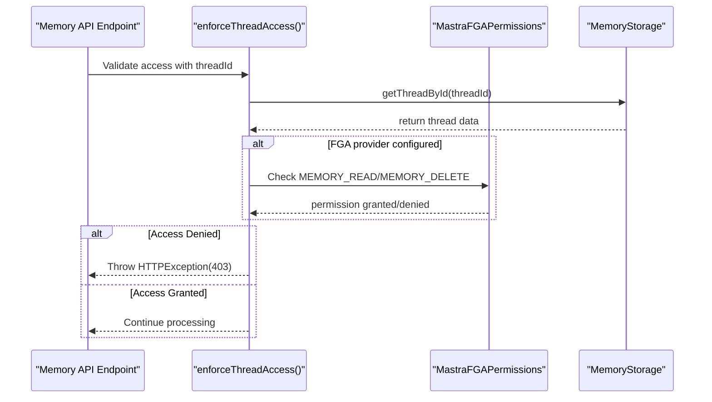
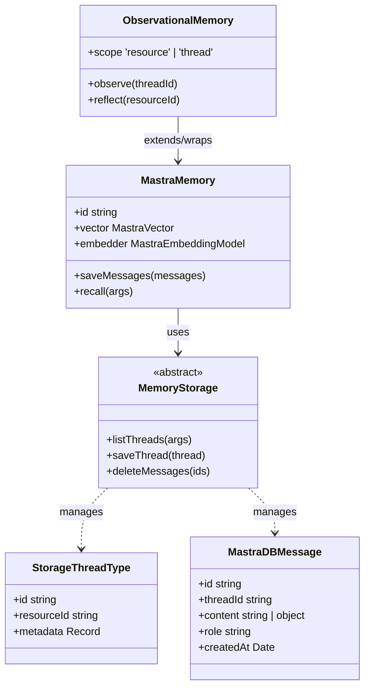

<!-- source: DeepWiki mcp.deepwiki.com · repo mastra-ai/mastra · page 9.4 Memory and Storage API Endpoints · fetched 2026-10-26 -->

# Memory and Storage API Endpoints

Relevant source files

The following files were used as context for generating this wiki page:

- [packages/core/src/storage/domains/memory/base.ts](packages/core/src/storage/domains/memory/base.ts)
- [packages/core/src/storage/domains/memory/inmemory.ts](packages/core/src/storage/domains/memory/inmemory.ts)
- [packages/core/src/storage/types.ts](packages/core/src/storage/types.ts)
- [packages/server/src/server/handlers/memory.test.ts](packages/server/src/server/handlers/memory.test.ts)
- [packages/server/src/server/handlers/memory.ts](packages/server/src/server/handlers/memory.ts)
- [packages/server/src/server/schemas/memory.test.ts](packages/server/src/server/schemas/memory.test.ts)
- [packages/server/src/server/schemas/memory.ts](packages/server/src/server/schemas/memory.ts)
- [stores/dsql/src/storage/domains/memory/index.ts](stores/dsql/src/storage/domains/memory/index.ts)
- [stores/dsql/src/storage/domains/memory/save-timestamps.test.ts](stores/dsql/src/storage/domains/memory/save-timestamps.test.ts)
- [stores/dsql/src/storage/domains/workflows/index.ts](stores/dsql/src/storage/domains/workflows/index.ts)
- [stores/libsql/src/storage/domains/memory/index.ts](stores/libsql/src/storage/domains/memory/index.ts)
- [stores/mongodb/src/storage/domains/memory/index.ts](stores/mongodb/src/storage/domains/memory/index.ts)
- [stores/mssql/src/storage/domains/workflows/index.ts](stores/mssql/src/storage/domains/workflows/index.ts)
- [stores/mysql/src/storage/domains/memory/index.ts](stores/mysql/src/storage/domains/memory/index.ts)
- [stores/oracledb/src/storage/domains/workflows/index.ts](stores/oracledb/src/storage/domains/workflows/index.ts)
- [stores/pg/src/storage/domains/memory/index.ts](stores/pg/src/storage/domains/memory/index.ts)
- [stores/spanner/src/storage/domains/memory/index.ts](stores/spanner/src/storage/domains/memory/index.ts)
- [stores/spanner/src/storage/domains/memory/list-messages-where.test.ts](stores/spanner/src/storage/domains/memory/list-messages-where.test.ts)
- [stores/spanner/src/storage/domains/workflows/index.ts](stores/spanner/src/storage/domains/workflows/index.ts)
- [stores/spanner/src/storage/domains/workflows/update-workflow-state.test.ts](stores/spanner/src/storage/domains/workflows/update-workflow-state.test.ts)

This document describes the REST API endpoints for memory and storage operations exposed by the Mastra server. These endpoints provide access to thread management, message storage, memory configuration, and observational memory features.

**Scope**: This page covers the HTTP API layer for memory and storage operations. For the underlying memory system architecture, see [Memory System Architecture](#7.1). For storage domain implementation details, see [Storage Domain Architecture](#7.3). For server setup and middleware configuration, see [Server Architecture and Setup](#9.1).

## Overview

The memory and storage API endpoints are organized into several functional groups:

| Endpoint Group | Base Path | Purpose | Handler Route |
| :------------- | :-------- | :------ | :------------ |
| Thread Management | `/memory/threads` | Create, list, update, delete conversation threads | `LIST_THREADS_ROUTE`, `CREATE_THREAD_ROUTE`, `UPDATE_THREAD_ROUTE`, `DELETE_THREAD_ROUTE`, `CLONE_THREAD_ROUTE` |
| Message Operations | `/memory/threads/{threadId}/messages` | Store and retrieve messages within threads | `LIST_MESSAGES_ROUTE`, `SAVE_MESSAGES_ROUTE`, `DELETE_MESSAGES_ROUTE` |
| Memory Configuration | `/memory/config` | Query memory system settings | `GET_MEMORY_CONFIG_ROUTE` |
| Memory Status | `/memory/status` | Monitor memory system state | `GET_MEMORY_STATUS_ROUTE` |
| Observational Memory | `/memory/observational-memory` | Access compressed long-term observations | `GET_OBSERVATIONAL_MEMORY_ROUTE`, `AWAIT_BUFFER_STATUS_ROUTE` |
| Working Memory | `/memory/threads/{threadId}/working-memory` | Manage structured persistent data | `GET_WORKING_MEMORY_ROUTE`, `UPDATE_WORKING_MEMORY_ROUTE` |
| Search Memory | `/memory/search` | Search across memory | `SEARCH_MEMORY_ROUTE` |

Authentication is required for all memory endpoints by default. The `requiresAuth: true` flag is set on route definitions [packages/server/src/server/handlers/memory.ts:53-53](). For detailed authentication and authorization policies, see [Authentication and Authorization](#9.6).

### Memory System Data Flow Diagram

```mermaid
graph TB
    subgraph ClientSDK["Client SDK Layer"]
        MastraClient["MastraClient"]
        MemoryThread["MemoryThread"]
    end
    
    subgraph APILayer["API Endpoints Layer"]
        ListThreadsRoute["GET /memory/threads<br/>LIST_THREADS_ROUTE"]
        CreateThreadRoute["POST /memory/threads<br/>CREATE_THREAD_ROUTE"]
        GetThreadRoute["GET /memory/threads/:threadId<br/>GET_THREAD_BY_ID_ROUTE"]
        ListMessagesRoute["GET /memory/threads/:threadId/messages<br/>LIST_MESSAGES_ROUTE"]
        SaveMessagesRoute["POST /memory/save-messages<br/>SAVE_MESSAGES_ROUTE"]
        DeleteMessagesRoute["DELETE /memory/threads/:threadId/messages<br/>DELETE_MESSAGES_ROUTE"]
        GetConfigRoute["GET /memory/config<br/>GET_MEMORY_CONFIG_ROUTE"]
        GetStatusRoute["GET /memory/status<br/>GET_MEMORY_STATUS_ROUTE"]
        GetOMRoute["GET /memory/observational-memory<br/>GET_OBSERVATIONAL_MEMORY_ROUTE"]
        AwaitBufferRoute["POST /memory/await-buffer-status<br/>AWAIT_BUFFER_STATUS_ROUTE"]
        GetWorkingMemRoute["GET /memory/threads/:threadId/working-memory<br/>GET_WORKING_MEMORY_ROUTE"]
        UpdateWorkingMemRoute["PUT /memory/threads/:threadId/working-memory<br/>UPDATE_WORKING_MEMORY_ROUTE"]
        SearchMemoryRoute["GET /memory/search<br/>SEARCH_MEMORY_ROUTE"]
        CloneThreadRoute["POST /memory/threads/:threadId/clone<br/>CLONE_THREAD_ROUTE"]
    end
    
    subgraph HandlerLayer["Handler Layer"]
        GetMemFromContext["getMemoryFromContext()\<br/>packages/server/src/server/handlers/memory.ts"]
        GetAgentFromContext["getAgentFromContext()\<br/>packages/server/src/server/handlers/memory.ts"]
        ValidateThreadAccess["enforceThreadAccess()\<br/>packages/server/src/server/handlers/memory.ts"]
    end
    
    subgraph MemoryLayer["Memory System"]
        MastraMemory["MastraMemory\<br/>@mastra/core/memory/memory.ts"]
        MemoryStorage["MemoryStorage Interface\<br/>@mastra/core/storage/domains/memory/base.ts"]
        StorageThreadType["StorageThreadType\<br/>@mastra/core/storage/types.ts"]
        MastraDBMessage["MastraDBMessage\<br/>@mastra/core/memory/types.ts"]
        ObservationalMemory["ObservationalMemory Processor\<br/>@mastra/memory/src/processors/observational-memory"]
        WorkingMemoryTool["Working Memory Tool\<br/>@mastra/memory/src/tools/working-memory.ts"]
    end
    
    subgraph StorageLayer["Storage Layer"]
        CompositeStore["MastraCompositeStore\<br/>@mastra/core/storage"]
        InMemoryStore["InMemoryMemory\<br/>@mastra/core/storage/domains/memory/inmemory.ts"]
        PgStore["MemoryPg\<br/>stores/pg/src/storage/domains/memory/index.ts"]
        LibSQLStore["MemoryLibSQL\<br/>stores/libsql/src/storage/domains/memory/index.ts"]
        MongoDBStore["MemoryMongoDB\<br/>stores/mongodb/src/storage/domains/memory/index.ts"]
        MySQLStore["MemoryMySQL\<br/>stores/mysql/src/storage/domains/memory/index.ts"]
        DSQLStore["MemoryDSQL\<br/>stores/dsql/src/storage/domains/memory/index.ts"]
    end
    
    MastraClient --> ListThreadsRoute
    MastraClient --> CreateThreadRoute
    MastraClient --> MemoryThread
    MastraClient --> GetConfigRoute
    MastraClient --> GetStatusRoute
    
    MemoryThread --> GetThreadRoute
    MemoryThread --> ListMessagesRoute
    MemoryThread --> GetWorkingMemRoute
    MemoryThread --> UpdateWorkingMemRoute
    MemoryThread --> SearchMemoryRoute
    MemoryThread --> CloneThreadRoute
    
    ListThreadsRoute --> GetMemFromContext
    CreateThreadRoute --> GetMemFromContext
    GetConfigRoute --> GetMemFromContext
    GetStatusRoute --> GetMemFromContext
    GetOMRoute --> GetAgentFromContext
    AwaitBufferRoute --> GetMemFromContext
    SearchMemoryRoute --> GetMemFromContext
    CloneThreadRoute --> GetMemFromContext
    
    GetThreadRoute --> ValidateThreadAccess
    ListMessagesRoute --> ValidateThreadAccess
    UpdateWorkingMemRoute --> ValidateThreadAccess
    DeleteMessagesRoute --> ValidateThreadAccess
    DeleteThreadRoute --> ValidateThreadAccess
    CloneThreadRoute --> ValidateThreadAccess
    
    ValidateThreadAccess --> MemoryStorage
    
    MastraMemory --> MemoryStorage
    MemoryStorage --> StorageThreadType
    MemoryStorage --> MastraDBMessage
    
    MemoryStorage --> CompositeStore
    CompositeStore --> InMemoryStore
    CompositeStore --> PgStore
    CompositeStore --> LibSQLStore
    CompositeStore --> MongoDBStore
    CompositeStore --> MySQLStore
    CompositeStore --> DSQLStore
```

**Sources**: [packages/server/src/server/handlers/memory.ts:9-52](), [packages/core/src/memory/memory.ts:114-216](), [packages/core/src/storage/domains/memory/base.ts:43-78](), [packages/core/src/storage/domains/memory/inmemory.ts:52-60](), [stores/pg/src/storage/domains/memory/index.ts:165-171](), [stores/libsql/src/storage/domains/memory/index.ts:165-171](), [stores/mongodb/src/storage/domains/memory/index.ts:74-74](), [stores/mysql/src/storage/domains/memory/index.ts:1-10](), [stores/dsql/src/storage/domains/memory/index.ts:75-75]()

---

## Thread Management Endpoints

Thread management endpoints support creating, listing, updating, deleting, and cloning conversation threads, which serve as organizational units for message and memory storage.

### List Threads

-   **Endpoint**: `GET /memory/threads`
-   **Handler**: `LIST_THREADS_ROUTE` [packages/server/src/server/handlers/memory.ts:309-312]()
-   **Description**: Lists memory threads, optionally filtered by `resourceId`, metadata, or associated `agentId`.
-   **Query Parameters**:

    | Parameter | Type | Required | Description |
    | :-------- | :--- | :------- | :---------- |
    | resourceId | string | No | Filter threads by resource ID |
    | metadata | string | No | Filter by thread metadata (JSON) |
    | agentId | string | No | Agent Id for access control |
    | page | number | No | Page number (zero-based), default 0 |
    | perPage | number | No | Items per page, default 100 |

-   **Handler Flow**:
    -   Resolves the in-scope memory via `getMemoryFromContext()` [packages/server/src/server/handlers/memory.ts:200-207]().
    -   If `agentId` is provided, attempts to find the Agent to enforce memory consistency [packages/server/src/server/handlers/memory.ts:208-232]().
    -   Applies Fine-Grained Authorization (FGA) through `filterAccessibleThreads` if configured [packages/server/src/server/handlers/memory.ts:330-333]().
    -   Calls the underlying storage `memoryStore.listThreads()` with pagination [packages/server/src/server/handlers/memory.ts:335-335]().

**Sources**: [packages/server/src/server/handlers/memory.ts:309-340](), [packages/server/src/server/schemas/memory.ts:11-11]()

---

### Create Thread

-   **Endpoint**: `POST /memory/threads`
-   **Handler**: `CREATE_THREAD_ROUTE` [packages/server/src/server/handlers/memory.ts:342-345]()
-   **Description**: Creates a new memory thread, scoped by agent and resource.
-   **Request Body**: `createThreadBodySchema` [packages/server/src/server/schemas/memory.ts:38-38]()
-   **Behavior**:
    -   Determines the effective `resourceId` from the request context or body [packages/server/src/server/handlers/memory.ts:356-356]().
    -   Persists the thread via `memoryStore.saveThread()` [packages/server/src/server/handlers/memory.ts:360-360]().

**Sources**: [packages/server/src/server/handlers/memory.ts:342-362](), [packages/server/src/server/schemas/memory.ts:38-38]()

---

### Update Thread

-   **Endpoint**: `PATCH /memory/threads/{threadId}`
-   **Handler**: `UPDATE_THREAD_ROUTE` [packages/server/src/server/handlers/memory.ts:364-367]()
-   **Description**: Update thread properties like title and metadata.
-   **Request Body**: `updateThreadBodySchema` [packages/server/src/server/schemas/memory.ts:39-39]()
-   **Behavior**:
    -   Enforces thread access using `enforceThreadAccess()` [packages/server/src/server/handlers/memory.ts:378-384]().
    -   Updates the thread via `memoryStore.updateThread()` [packages/server/src/server/handlers/memory.ts:386-386]().

**Sources**: [packages/server/src/server/handlers/memory.ts:364-388](), [packages/server/src/server/schemas/memory.ts:39-39]()

---

### Delete Thread

-   **Endpoint**: `DELETE /memory/threads/{threadId}`
-   **Handler**: `DELETE_THREAD_ROUTE` [packages/server/src/server/handlers/memory.ts:390-393]()
-   **Description**: Deletes a specific thread and all its associated messages.
-   **Behavior**:
    -   Enforces thread access using `enforceThreadAccess()` [packages/server/src/server/handlers/memory.ts:404-410]().
    -   Deletes the thread via `memoryStore.deleteThread()` [packages/server/src/server/handlers/memory.ts:412-412]().

**Sources**: [packages/server/src/server/handlers/memory.ts:390-414]()

---

### Clone Thread

-   **Endpoint**: `POST /memory/threads/{threadId}/clone`
-   **Handler**: `CLONE_THREAD_ROUTE` [packages/server/src/server/handlers/memory.ts:416-419]()
-   **Description**: Clones an existing thread, optionally associating it with a new resource ID.
-   **Request Body**: `cloneThreadBodySchema` [packages/server/src/server/schemas/memory.ts:48-48]()
-   **Behavior**:
    -   Enforces thread access on the source thread using `enforceThreadAccess()` [packages/server/src/server/handlers/memory.ts:430-436]().
    -   Clones the thread via `memoryStore.cloneThread()` [packages/server/src/server/handlers/memory.ts:438-438]().

**Sources**: [packages/server/src/server/handlers/memory.ts:416-440](), [packages/server/src/server/schemas/memory.ts:48-48]()

---

## Message Operations Endpoints

### List Thread Messages

-   **Endpoint**: `GET /memory/threads/{threadId}/messages`
-   **Handler**: `LIST_MESSAGES_ROUTE` [packages/server/src/server/handlers/memory.ts:442-445]()
-   **Description**: Retrieves messages from a specific thread, with optional filtering by role or date range.
-   **Query Parameters**:
    -   `agentId`, `include` (messages context), `filter` (roles, date ranges).
-   **Handler Behavior**:
    -   If an agent is specified but has no memory configured, returns an empty message list gracefully [packages/server/src/server/handlers/memory.ts:456-458]().
    -   System messages are typically excluded from recall unless explicitly included.
    -   Enforces thread access using `enforceThreadAccess()` [packages/server/src/server/handlers/memory.ts:460-466]().
    -   Retrieves messages via `memoryStore.listMessages()` [packages/server/src/server/handlers/memory.ts:468-468]().

**Sources**: [packages/server/src/server/handlers/memory.ts:442-470](), [packages/server/src/server/schemas/memory.ts:16-16]()

---

### Save Messages to Memory

-   **Endpoint**: `POST /memory/save-messages`
-   **Handler**: `SAVE_MESSAGES_ROUTE` [packages/server/src/server/handlers/memory.ts:472-475]()
-   **Description**: Persist messages into memory for the specified thread/resource.
-   **Request Body**: `saveMessagesBodySchema` [packages/server/src/server/schemas/memory.ts:37-37]()
-   **Behavior**:
    -   Determines the effective `resourceId` and `threadId` [packages/server/src/server/handlers/memory.ts:486-487]().
    -   Enforces thread access using `enforceThreadAccess()` [packages/server/src/server/handlers/memory.ts:489-495]().
    -   Saves messages via `memoryStore.saveMessages()` [packages/server/src/server/handlers/memory.ts:497-497]().

**Sources**: [packages/server/src/server/handlers/memory.ts:472-499](), [packages/server/src/server/schemas/memory.ts:37-37]()

---

### Delete Messages from Thread

-   **Endpoint**: `DELETE /memory/threads/{threadId}/messages`
-   **Handler**: `DELETE_MESSAGES_ROUTE` [packages/server/src/server/handlers/memory.ts:501-504]()
-   **Description**: Delete specified messages in a thread.
-   **Request Body**: `deleteMessagesBodySchema` [packages/server/src/server/schemas/memory.ts:41-41]()
-   **Behavior**:
    -   Enforces thread access for all messages to be deleted using `enforceDeleteMessagesThreadAccess()` [packages/server/src/server/handlers/memory.ts:515-520]().
    -   Deletes messages via `memoryStore.deleteMessages()` [packages/server/src/server/handlers/memory.ts:522-522]().

**Sources**: [packages/server/src/server/handlers/memory.ts:501-524](), [packages/server/src/server/schemas/memory.ts:41-41]()

---

## Memory Configuration and Status Endpoints

### Get Memory Status

-   **Endpoint**: `GET /memory/status`
-   **Handler**: `GET_MEMORY_STATUS_ROUTE` [packages/server/src/server/handlers/memory.ts:526-529]()
-   **Description**: Returns a boolean indicating if memory is initialized for a specified agent or the fallback storage.
-   **Behavior**:
    -   Returns `true` if fallback storage is configured, even if agent is missing [packages/server/src/server/handlers/memory.ts:540-542]().
    -   Uses `agent.hasOwnMemory()` to determine memory support [packages/server/src/server/handlers/memory.ts:544-544]().

**Sources**: [packages/server/src/server/handlers/memory.ts:526-546](), [packages/server/src/server/schemas/memory.ts:10-10]()

---

### Get Memory Config

-   **Endpoint**: `GET /memory/config`
-   **Handler**: `GET_MEMORY_CONFIG_ROUTE` [packages/server/src/server/handlers/memory.ts:548-551]()
-   **Description**: Returns the current memory configuration for a given agent.
-   **Behavior**:
    -   Gracefully returns a null config if an agent has no configured memory [packages/server/src/server/handlers/memory.ts:562-564]().
    -   Returns the serialized memory configuration via `memory.serializeConfig()` [packages/server/src/server/handlers/memory.ts:566-566]().

**Sources**: [packages/server/src/server/handlers/memory.ts:548-568](), [packages/server/src/server/schemas/memory.ts:12-12]()

---

## Observational Memory Endpoints

Observational Memory (OM) supports compressed, long-term memory storage for agents through **Observer** and **Reflector** background agents [docs/src/content/en/reference/memory/observational-memory.mdx:13-13]().

### Get Observational Memory Record

-   **Endpoint**: `GET /memory/observational-memory`
-   **Handler**: `GET_OBSERVATIONAL_MEMORY_ROUTE` [packages/server/src/server/handlers/memory.ts:570-573]()
-   **Description**: Retrieve the `ObservationalMemoryRecord` associated with a thread or resource.
-   **Query Parameters**: `agentId` (required), `threadId` (optional), `resourceId` (optional).
-   **Behavior**:
    -   Retrieves the OM record via `memory.getObservationalMemoryRecord()` [packages/server/src/server/handlers/memory.ts:584-584]().

**Sources**: [packages/server/src/server/handlers/memory.ts:570-586](), [packages/server/src/server/schemas/memory.ts:50-50]()

### Await Buffer Status

-   **Endpoint**: `POST /memory/await-buffer-status`
-   **Handler**: `AWAIT_BUFFER_STATUS_ROUTE` [packages/server/src/server/handlers/memory.ts:588-591]()
-   **Description**: Waits asynchronously for the background OM buffer to reach a specified flushed or idle state.
-   **Request Body**: `awaitBufferStatusBodySchema` [packages/server/src/server/schemas/memory.ts:52-52]()
-   **Behavior**:
    -   Awaits buffer status via `memory.awaitObservationalMemoryBufferStatus()` [packages/server/src/server/handlers/memory.ts:602-602]().

**Sources**: [packages/server/src/server/handlers/memory.ts:588-604](), [packages/server/src/server/schemas/memory.ts:52-52]()

---

## Working Memory Endpoints

Working Memory provides structured, scoped persistent data storage. It supports both `thread` and `resource` scopes [packages/core/src/memory/types.ts:186-186]().

### Get Working Memory

-   **Endpoint**: `GET /memory/threads/{threadId}/working-memory`
-   **Handler**: `GET_WORKING_MEMORY_ROUTE` [packages/server/src/server/handlers/memory.ts:606-609]()
-   **Description**: Retrieves the current working memory state associated with a thread.
-   **Behavior**:
    -   Enforces thread access using `enforceThreadAccess()` [packages/server/src/server/handlers/memory.ts:620-626]().
    -   Retrieves working memory via `memory.getWorkingMemory()` [packages/server/src/server/handlers/memory.ts:628-628]().

**Sources**: [packages/server/src/server/handlers/memory.ts:606-630](), [packages/server/src/server/schemas/memory.ts:18-18]()

---

### Update Working Memory

-   **Endpoint**: `PUT /memory/threads/{threadId}/working-memory`
-   **Handler**: `UPDATE_WORKING_MEMORY_ROUTE` [packages/server/src/server/handlers/memory.ts:632-635]()
-   **Description**: Updates working memory state by applying structured merges.
-   **Request Body**: `updateWorkingMemoryBodySchema` [packages/server/src/server/schemas/memory.ts:40-40]()
-   **Behavior**:
    -   Enforces thread access using `enforceThreadAccess()` [packages/server/src/server/handlers/memory.ts:646-652]().
    -   Updates working memory via `memory.updateWorkingMemory()` [packages/server/src/server/handlers/memory.ts:654-654]().
    -   Uses `deepMergeWorkingMemory` for merging updates, where `null` values delete keys and arrays are replaced [packages/core/src/memory/mock.ts:35-73]().

**Sources**: [packages/server/src/server/handlers/memory.ts:632-656](), [packages/server/src/server/schemas/memory.ts:40-40](), [packages/core/src/memory/mock.ts:35-73]()

---

## Search Memory Endpoints

### Search Memory

-   **Endpoint**: `GET /memory/search`
-   **Handler**: `SEARCH_MEMORY_ROUTE` [packages/server/src/server/handlers/memory.ts:658-661]()
-   **Description**: Searches across memory for relevant messages using semantic search.
-   **Query Parameters**: `query` (required), `agentId`, `resourceId`, `threadId`, `limit`, `offset`, `includeContext`.
-   **Behavior**:
    -   Performs semantic search via `memory.search()` [packages/server/src/server/handlers/memory.ts:672-672]().

**Sources**: [packages/server/src/server/handlers/memory.ts:658-689](), [packages/server/src/server/schemas/memory.ts:42-42]()

---

## Authorization and Security

Memory API endpoints enforce thread-level access control using the `enforceThreadAccess()` utility function [packages/server/src/server/handlers/memory.ts:64-64](). Access is validated by comparing effective resource ownership and optionally integrating with Fine-Grained Authorization (FGA) providers [packages/server/src/server/handlers/memory.ts:92-116]().

**Sources**: [packages/server/src/server/handlers/memory.ts:64-64, 92-116, 178-187]()

---

## Technical Implementation Details

### Working Memory Extraction and Signals
When `manageWorkingMemory` is enabled in Observational Memory config, Mastra automatically adds a `WorkingMemoryExtractor` and disables agent-managed tools, opting for `useStateSignals` instead [packages/memory/src/index.test.ts:80-99](). This allows the system to deliver working memory to the model as a state signal instead of folding it into the system message [packages/core/src/memory/types.ts:188-192]().

### Thread Metadata Structure
Mastra stores internal memory state in `thread.metadata.mastra.om`, which includes fields like `currentTask`, `suggestedResponse`, and `lastObservedAt` [packages/core/src/memory/types.ts:53-76](). Helpers like `getThreadOMMetadata` and `setThreadOMMetadata` are used to safely manage this nested structure [packages/core/src/memory/types.ts:85-118]().

### Memory System Entity Association

**Sources**: [packages/core/src/memory/memory.ts:114-216](), [packages/core/src/storage/types.ts:200-200](), [packages/core/src/memory/types.ts:39-46](), [packages/core/src/storage/domains/memory/base.ts:43-78](), [packages/memory/src/processors/observational-memory/observational-memory.ts:1-130]()

---

**Sources**:
- [packages/server/src/server/handlers/memory.ts:1-689]()
- [packages/core/src/memory/memory.ts:1-216]()
- [packages/core/src/memory/types.ts:1-200]()
- [packages/memory/src/index.ts:1-123]()
- [packages/memory/src/index.test.ts:42-126]()
- [packages/core/src/memory/mock.ts:35-105]()
- [docs/src/content/en/reference/memory/observational-memory.mdx:9-113]()
- [packages/core/src/storage/domains/memory/base.ts:1-172]()
- [packages/core/src/storage/domains/memory/inmemory.ts:1-200]()
- [stores/pg/src/storage/domains/memory/index.ts:1-192]()
- [stores/libsql/src/storage/domains/memory/index.ts:1-178]()
- [stores/mongodb/src/storage/domains/memory/index.ts:1-171]()
- [stores/mysql/src/storage/domains/memory/index.ts:1-206]()
- [stores/dsql/src/storage/domains/memory/index.ts:1-191]()
- [packages/server/src/server/schemas/memory.ts:1-227]()
- [packages/server/src/server/schemas/memory.test.ts:1-183]()
- [packages/server/src/server/handlers/memory.test.ts:1-218]()
- [packages/core/src/storage/types.ts:1-200]()

---

