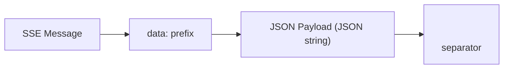
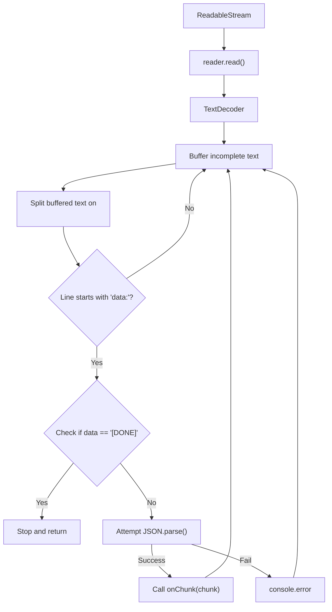
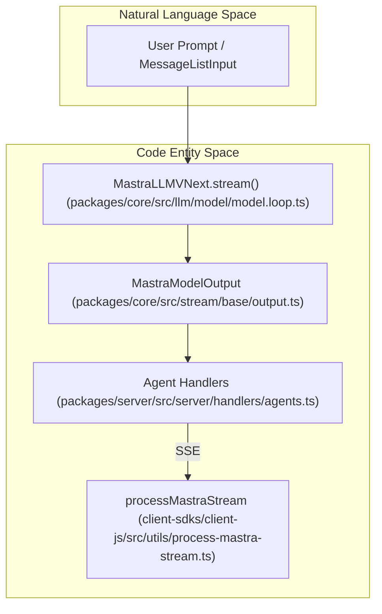
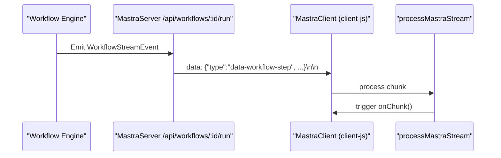

<!-- source: DeepWiki mcp.deepwiki.com · repo mastra-ai/mastra · page 9.5 Streaming Architecture and SSE · fetched 2026-10-26 -->

# Streaming Architecture and SSE

<details>
<summary>Relevant source files</summary>

The following files were used as context for generating this wiki page:

- [.changeset/react-shows-accepted-steers.md](.changeset/react-shows-accepted-steers.md)
- [.changeset/steer-shows-when-accepted.md](.changeset/steer-shows-when-accepted.md)
- [client-sdks/react/src/lib/mastra-db/accumulator.test.ts](client-sdks/react/src/lib/mastra-db/accumulator.test.ts)
- [client-sdks/react/src/lib/mastra-db/accumulator.ts](client-sdks/react/src/lib/mastra-db/accumulator.ts)
- [docs/src/content/en/reference/streaming/ChunkType.mdx](docs/src/content/en/reference/streaming/ChunkType.mdx)
- [observability/mastra/src/usage.test.ts](observability/mastra/src/usage.test.ts)
- [observability/mastra/src/usage.ts](observability/mastra/src/usage.ts)
- [packages/core/src/agent/__tests__/signals-pending-steer-chunk.test.ts](packages/core/src/agent/__tests__/signals-pending-steer-chunk.test.ts)
- [packages/core/src/loop/test-utils/aimock/scenarios/signal-queue-message.scenario.test.ts](packages/core/src/loop/test-utils/aimock/scenarios/signal-queue-message.scenario.test.ts)
- [packages/core/src/stream/aisdk/v5/transform.test.ts](packages/core/src/stream/aisdk/v5/transform.test.ts)
- [packages/core/src/stream/aisdk/v5/transform.ts](packages/core/src/stream/aisdk/v5/transform.ts)
- [packages/core/src/stream/base/output.test.ts](packages/core/src/stream/base/output.test.ts)
- [packages/core/src/stream/base/output.ts](packages/core/src/stream/base/output.ts)
- [packages/core/src/stream/index.ts](packages/core/src/stream/index.ts)
- [packages/core/src/stream/signal-exclusions.ts](packages/core/src/stream/signal-exclusions.ts)
- [packages/core/src/stream/types.ts](packages/core/src/stream/types.ts)

</details>


## Purpose and Scope

This document details the streaming architecture of the Mastra framework, focusing primarily on the Server-Sent Events (SSE) transport mechanism. It explains how streaming data is structured, transported, and consumed between the server and clients during agent and workflow executions. Additionally, it documents the `processMastraStream` utility used for client-side SSE parsing, the various stream chunk formats used internally, JSON resilience techniques, and best practices for both server streaming and client consumption.

Related sections for broader context include:
- [Server and API Layer](9.1) — overall server architecture and HTTP endpoints
- [Agent System](3) — agent execution and streaming details
- [Workflow System](4) — workflow execution and streaming

---

## SSE Protocol Overview

Mastra streams data using Server-Sent Events (SSE), a lightweight text/event-stream protocol standard that enables incrementally pushing events from the server to the client via HTTP. It is widely supported and provides built-in reconnection logic in browsers.

### SSE Message Format

Each SSE message consists of:

- A `data:` prefix line, marking the start of the payload.
- A JSON payload string representing a Mastra stream chunk.
- A double newline `\n\n` sequence terminating the message.

Example:
```
data: {"type":"text-delta","runId":"abc123","payload":{"text":"Hello"}}\n\n
```

A special terminating message:
```
data: [DONE]\n\n
```
signals the end of the stream.



| Component | Description | Example |
|---|---|---|
| `data:` | SSE message prefix | `data: ` |
| JSON | JSON-encoded stream chunk object | `{"type":"text-delta","runId":"...","payload":{...}}` |
| Separator | Double newline signals message end | `\n\n` |
| Terminator | Special end-of-stream indicator | `data: [DONE]\n\n` |

**Sources:** [client-sdks/client-js/src/utils/process-mastra-stream.ts:23-45]()

---

## Client-Side SSE Parser: `processMastraStream`

The client SDK provides the `processMastraStream` utility to parse and process Mastra SSE streams. This function robustly handles incremental UTF-8 chunks, buffering partial messages and recovering from parse errors.

### Data Flow and Processing Steps



### Implementation Highlights

- Maintains a string buffer to handle chunks that might split JSON objects across network packets [client-sdks/client-js/src/utils/process-mastra-stream.ts:30-40]().
- Efficiently splits on double newlines `\n\n` to extract complete SSE payloads [client-sdks/client-js/src/utils/process-mastra-stream.ts:42-45]().
- Checks for the special `[DONE]` message to complete the stream early [client-sdks/client-js/src/utils/process-mastra-stream.ts:54-57]().
- Logs but ignores parsing errors to allow streaming resilience [client-sdks/client-js/src/utils/process-mastra-stream.ts:63-65]().
- Calls user-provided `onChunk` callback with parsed chunk objects [client-sdks/client-js/src/utils/process-mastra-stream.ts:60-62]().

**Sources:** [client-sdks/client-js/src/utils/process-mastra-stream.ts:3-76]()

---

## Chunk Types and Formats

Mastra defines a structured streaming chunk format to represent data, control signals, and intermediate state during AI agent and workflow execution streams.

### Common Chunk Properties

All chunks share these base fields as defined in `BaseChunkType` [packages/core/src/stream/types.ts:91-96]():

| Field | Type | Description |
|---|---|---|
| `type` | `string` | Event type (e.g., `"text-delta"`) |
| `runId` | `string` | Unique ID of current run |
| `traceId` | `string` | Trace ID of the run that produced this chunk. Undefined when tracing is disabled. |
| `from` | Enum `ChunkFrom` | Source entity: `AGENT`, `WORKFLOW`, `NETWORK`, `USER`, `SYSTEM` |
| `metadata`| optional object | Additional context or tracing info|

`ChunkFrom` Enum values [packages/core/src/stream/types.ts:32-38]():
- `AGENT`: Chunks related to agent execution.
- `USER`: Chunk from user input.
- `SYSTEM`: Chunk from system processes.
- `WORKFLOW`: Chunk from workflow execution.
- `NETWORK`: Chunk from network operations.

### Agent Stream Chunks

Common chunk types emitted during an agent streaming session [packages/core/src/stream/types.ts:103-239]():

| Chunk Type | Description | Payload Highlights |
|---|---|---|
| `text-start` | Signals the beginning of text generation. | `{ id: string, providerMetadata?: ProviderMetadata }` |
| `text-delta` | Incremental text content during generation. | `{ id: string, text: string, providerMetadata?: ProviderMetadata }` |
| `text-end` | Signals the end of text generation. | `{ id: string, providerMetadata?: ProviderMetadata }` |
| `reasoning-start` | Signals the beginning of reasoning generation. | `{ id: string, signature?: string, providerMetadata?: ProviderMetadata }` |
| `reasoning-delta` | Incremental reasoning text during generation. | `{ id: string, text: string, providerMetadata?: ProviderMetadata }` |
| `reasoning-end` | Signals the end of reasoning generation. | `{ id: string, signature?: string, providerMetadata?: ProviderMetadata }` |
| `tool-call` | Request to invoke a tool. | `{ toolCallId: string, toolName: string, args?: unknown, providerExecuted?: boolean, observability?: ClientObservabilityCarrier }` |
| `tool-result` | Tool execution output. | `{ toolCallId: string, toolName: string, result?: unknown }` |
| `finish` | Final step result with metadata. | `FinishPayload` |

The `MastraModelOutput` class [packages/core/src/stream/base/output.ts:91-92]() aggregates and buffers these chunks internally. It provides a `getFullOutput()` method to retrieve the complete accumulated response [packages/core/src/stream/base/output.ts:179-186]().

**Sources:** [packages/core/src/stream/types.ts:103-239](), [packages/core/src/stream/base/output.ts:179-186](), [packages/core/src/stream/base/output.ts:91-92]()

---

## JSON Resilience and Repair

LLM models can produce malformed or partial JSON in their outputs, especially during streaming tool-call arguments or structured responses. Mastra employs a resilient multi-level parsing and repair approach:

1.  **Sanitization:** `sanitizeToolCallInput` removes common LLM-specific tokens (e.g., `<|call|>`) that can corrupt JSON [packages/core/src/stream/aisdk/v5/transform.ts:31-44]().
2.  **Repair:** `tryRepairJson` attempts to fix common JSON malformations like missing quotes, unquoted property names, single quotes, and trailing commas [packages/core/src/stream/aisdk/v5/transform.ts:62-99]().
3.  **Partial JSON parsing:** The client SDK uses `parsePartialJson` [client-sdks/client-js/src/resources/agent.ts:1]() to recover incomplete or truncated JSON tokens. This is critical for rendering UI components while the model is still generating a structured object.
4.  **Schema Validation:** Structured outputs are validated against Zod or Standard schemas before being emitted as final results via transformers like `createJsonTextStreamTransformer` [packages/core/src/stream/base/output-format-handlers.ts:10]().
5.  **Client-side Processing:** The `processClientTools` utility ensures that even partial tool arguments are handled gracefully in the browser environment [client-sdks/client-js/src/resources/agent.ts:67]().

**Sources:** [packages/core/src/stream/aisdk/v5/transform.ts:31-44](), [packages/core/src/stream/aisdk/v5/transform.ts:62-99](), [client-sdks/client-js/src/resources/agent.ts:1](), [packages/core/src/stream/base/output-format-handlers.ts:10](), [client-sdks/client-js/src/resources/agent.ts:67]()

---

## AI SDK Compatibility

Mastra integrates with the Vercel AI SDK by transforming internal Mastra streaming chunks into AI SDK-compatible formats.

-   **Stream Transformation:** The `@mastra/ai-sdk` package provides transformers like `WorkflowStreamToAISDKTransformer` to convert Mastra `ChunkType` into AI SDK `TextStreamPart` or `UIMessage` chunks [packages/core/src/stream/aisdk/v5/transform.ts:128-129]().
-   **Helper Conversions:** Functions like `convertMastraChunkToAISDKv5` bridge internal types to the `ai-sdk` ecosystem [packages/core/src/stream/aisdk/v5/transform.ts:80-81]().
-   **Chat Routes:** `handleChatStream` uses `toAISdkStream` to adapt Mastra's internal output to standard web streams expected by frontend libraries [client-sdks/react/src/agent/hooks.ts:154]().

**Sources:** [packages/core/src/stream/aisdk/v5/transform.ts:80-81](), [packages/core/src/stream/aisdk/v5/transform.ts:128-129](), [client-sdks/react/src/agent/hooks.ts:154]()

---

## Streaming Data Flow: Natural Language to Code Entities

This diagram illustrates how a user request flows through the streaming architecture, from the agent loop to the client-side parser.



**Sources:** [packages/server/src/server/handlers/agents.ts:35](), [client-sdks/client-js/src/utils/process-mastra-stream.ts:3-76](), [packages/core/src/stream/base/output.ts:91-92]()

---

## Workflow Streaming and Observation

Workflow streaming allows clients to observe the incremental execution of workflow steps.

### Sequence Diagram: Workflow Stream Event Flow



**Sources:** [client-sdks/client-js/src/utils/process-mastra-stream.ts:60-62]()

---

## Streaming Best Practices

| Practice | Explanation |
| :--- | :--- |
| **Use `processMastraStream`** | Always parse SSE streams with this utility to handle fragmented network packets correctly [client-sdks/client-js/src/utils/process-mastra-stream.ts:3-76](). |
| **Handle `[DONE]`** | Ensure the client stops listening when the special `[DONE]` signal is received to free resources [client-sdks/client-js/src/utils/process-mastra-stream.ts:54-57](). |
| **Transport Management** | Use `StreamTransport` to manage underlying WebSocket or HTTP connections for long-running streams [packages/core/src/stream/types.ts:63-67](). |
| **Safe Enqueueing** | Use `safeEnqueue` to prevent errors when writing to a stream controller that may have been closed [packages/core/src/stream/base/input.ts:30](). |
| **Destructuring Output** | Use `createDestructurableOutput` to maintain `this` context when extracting methods from `MastraModelOutput` [packages/core/src/stream/base/output.ts:91-92](). |
| **Partial JSON Recovery** | Use `parsePartialJson` for real-time UI updates during structured object generation [client-sdks/client-js/src/resources/agent.ts:1](). |
| **Persist Processor Data** | Use `persistProcessorDataChunk` to ensure non-transient `data-*` chunks from output processors are saved to thread history [packages/core/src/stream/base/output.ts:120-137](). |

**Sources:** [client-sdks/client-js/src/utils/process-mastra-stream.ts:3-76](), [packages/core/src/stream/types.ts:63-67](), [packages/core/src/stream/base/output.ts:91-92](), [packages/core/src/stream/base/input.ts:30](), [packages/core/src/stream/base/output.ts:120-137]()

---

