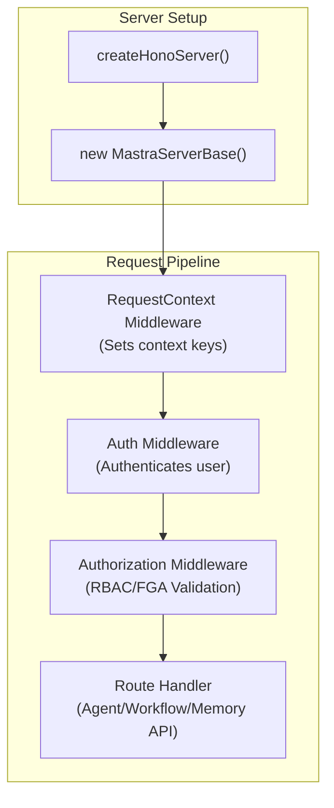
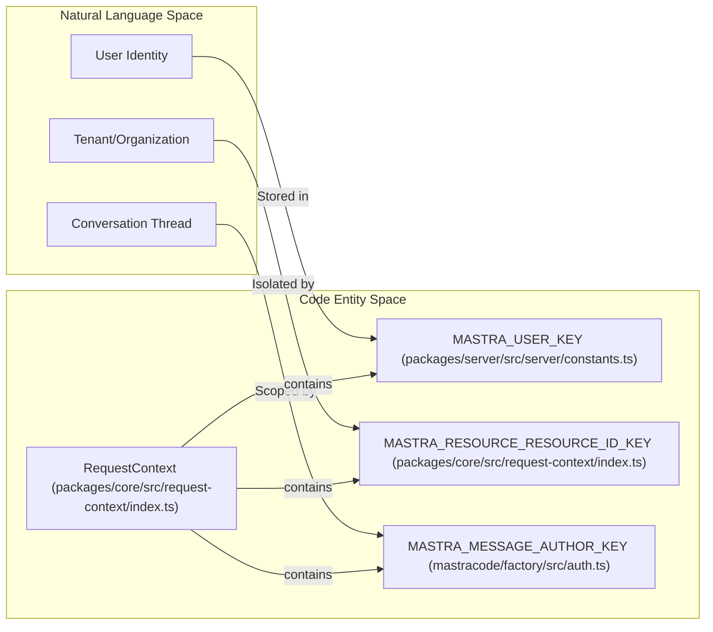
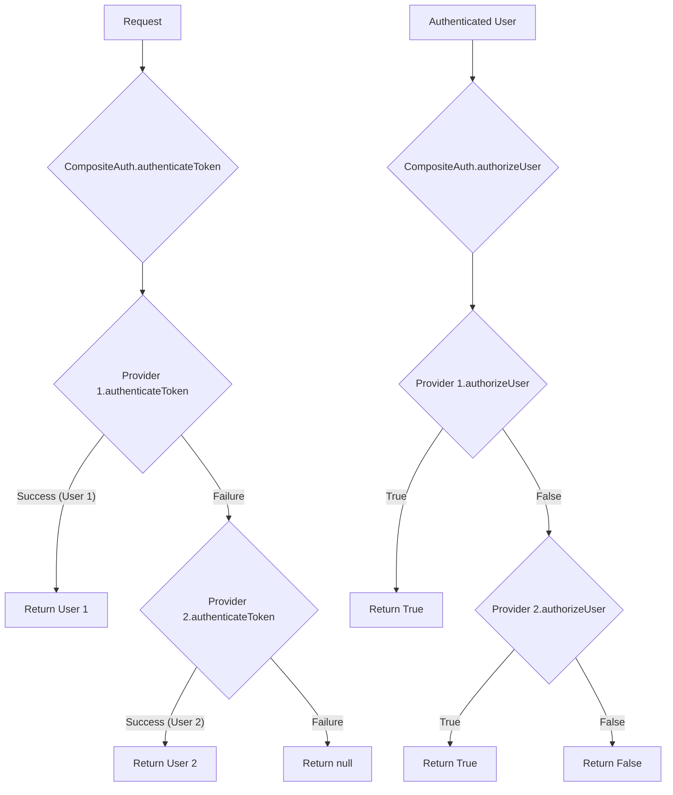

<!-- source: DeepWiki mcp.deepwiki.com · repo mastra-ai/mastra · page 9.6 Authentication and Authorization · fetched 2026-10-26 -->

# Authentication and Authorization

<details>
<summary>Relevant source files</summary>

The following files were used as context for generating this wiki page:

- [.changeset/sp5-host-only-studio-cookie.md](.changeset/sp5-host-only-studio-cookie.md)
- [auth/studio/src/index.test.ts](auth/studio/src/index.test.ts)
- [auth/studio/src/index.ts](auth/studio/src/index.ts)
- [auth/studio/src/session-cookie-scope.test.ts](auth/studio/src/session-cookie-scope.test.ts)
- [docs/src/content/en/reference/configuration.mdx](docs/src/content/en/reference/configuration.mdx)
- [docs/src/content/en/reference/server/register-api-route.mdx](docs/src/content/en/reference/server/register-api-route.mdx)
- [e2e-tests/_local-registry-setup/package.json](e2e-tests/_local-registry-setup/package.json)
- [e2e-tests/_local-registry-setup/prepare.js](e2e-tests/_local-registry-setup/prepare.js)
- [e2e-tests/_local-registry-setup/publish-ci-registry.js](e2e-tests/_local-registry-setup/publish-ci-registry.js)
- [e2e-tests/_local-registry-setup/publish-roots.js](e2e-tests/_local-registry-setup/publish-roots.js)
- [e2e-tests/_local-registry-setup/publish.js](e2e-tests/_local-registry-setup/publish.js)
- [e2e-tests/commonjs/setup.ts](e2e-tests/commonjs/setup.ts)
- [e2e-tests/create-mastra/create-mastra.test.ts](e2e-tests/create-mastra/create-mastra.test.ts)
- [e2e-tests/create-mastra/setup.ts](e2e-tests/create-mastra/setup.ts)
- [e2e-tests/deployers/setup.ts](e2e-tests/deployers/setup.ts)
- [e2e-tests/no-bundling/setup.ts](e2e-tests/no-bundling/setup.ts)
- [e2e-tests/type-check/setup.ts](e2e-tests/type-check/setup.ts)
- [e2e-tests/type-check/template/core/agent-message-input.test-d.ts](e2e-tests/type-check/template/core/agent-message-input.test-d.ts)
- [e2e-tests/type-check/template/core/auth.test-d.ts](e2e-tests/type-check/template/core/auth.test-d.ts)
- [e2e-tests/type-check/template/package.json](e2e-tests/type-check/template/package.json)
- [e2e-tests/type-check/template/tsconfig.exact-optional.json](e2e-tests/type-check/template/tsconfig.exact-optional.json)
- [e2e-tests/type-check/template/tsconfig.mcp.json](e2e-tests/type-check/template/tsconfig.mcp.json)
- [e2e-tests/type-check/template/vitest.config.ts](e2e-tests/type-check/template/vitest.config.ts)
- [e2e-tests/type-check/template/vitest.mcp.config.ts](e2e-tests/type-check/template/vitest.mcp.config.ts)
- [e2e-tests/type-check/test.ts](e2e-tests/type-check/test.ts)
- [mastracode/factory-ui/src/ui/domains/auth/services/auth.ts](mastracode/factory-ui/src/ui/domains/auth/services/auth.ts)
- [mastracode/factory/src/auth-seam.test.ts](mastracode/factory/src/auth-seam.test.ts)
- [mastracode/factory/src/auth.test.ts](mastracode/factory/src/auth.test.ts)
- [mastracode/factory/src/auth.ts](mastracode/factory/src/auth.ts)
- [packages/_internals/auth/src/provider/index.ts](packages/_internals/auth/src/provider/index.ts)
- [packages/_internals/auth/src/session/index.ts](packages/_internals/auth/src/session/index.ts)
- [packages/_types-builder/AGENTS.md](packages/_types-builder/AGENTS.md)
- [packages/auth/src/index.ts](packages/auth/src/index.ts)
- [packages/core/src/agent/message-list/types.ts](packages/core/src/agent/message-list/types.ts)
- [packages/core/src/server/auth.test.ts](packages/core/src/server/auth.test.ts)
- [packages/core/src/server/auth.ts](packages/core/src/server/auth.ts)
- [packages/core/src/server/composite-auth.ts](packages/core/src/server/composite-auth.ts)
- [packages/core/src/server/index.ts](packages/core/src/server/index.ts)
- [packages/core/src/server/server.test-d.ts](packages/core/src/server/server.test-d.ts)
- [packages/core/src/server/server.test.ts](packages/core/src/server/server.test.ts)
- [packages/core/src/server/types.ts](packages/core/src/server/types.ts)
- [packages/server/src/server/handlers/auth.test.ts](packages/server/src/server/handlers/auth.test.ts)
- [packages/server/src/server/handlers/auth.ts](packages/server/src/server/handlers/auth.ts)

</details>


## Purpose and Scope

This page documents Mastra's authentication and authorization system, focusing on the server-side middleware implementation, the security model via `RequestContext`, resource/thread ownership validation, and integration with Role-Based Access Control (RBAC). The framework provides a flexible architecture that secures API routes, workflows, agents, tools, and memory by propagating user identity and authorization state using a centralized context.

## Authentication Architecture

### Server Middleware Stack

Mastra’s server layer is designed to be framework-agnostic but provides deep integration with Hono and Node.js. The server registers a middleware pipeline that ensures each incoming API request is enriched with a `RequestContext` carrying authenticated user identity and resource scoping information before reaching route handlers [packages/core/src/server/index.ts:72-76]().

### Middleware Pipeline Diagram



**Key Implementation Details:**
- The `RequestContext` is a specialized container used for tenant isolation, ensuring that agents and workflows operate within defined security boundaries [packages/core/src/request-context/index.ts:10-15]().
- It supports reserved keys like `MASTRA_RESOURCE_ID_KEY` and `MASTRA_THREAD_ID_KEY` to automatically handle ownership [mastracode/factory/src/auth.ts:3]().
- In MCP environments, the `MCPServer` maps transport auth data (e.g., OAuth) into the `user` value via `mapAuthInfoToUser` for FGA checks [packages/_internals/auth/src/provider/index.ts:100-100]().

Sources:
[packages/core/src/server/index.ts:72-76](), [packages/core/src/request-context/index.ts:10-15](), [mastracode/factory/src/auth.ts:3](), [packages/_internals/auth/src/provider/index.ts:100-100]()

## RequestContext Security Model

### Fundamental Concept

The `RequestContext` object captures the security state for each interaction. It is the primary mechanism for:
1. **Tenant Isolation**: Mapping requests to specific `resourceId` values.
2. **Identity Propagation**: Carrying user info across agent loops and workflow steps.
3. **Dynamic Configuration**: Overriding instructions or models based on the authenticated context [packages/core/src/request-context/index.ts:10-15]().

### Identity and Resource Mapping

Mastra ensures request isolation by mapping authenticated users to resource or tenant scopes.

| Component | Code Entity | Responsibility |
|---|---|---|
| **Resource ID** | `MASTRA_RESOURCE_RESOURCE_ID_KEY` | The primary identifier for a tenant. Used to scope memory and vector search [packages/core/src/request-context/index.ts:10-15](). |
| **Thread ID** | `MASTRA_THREAD_ID_KEY` | Scopes conversation history within a resource [mastracode/factory/src/auth.ts:3](). |
| **User Key** | `MASTRA_USER_KEY` | Stores the authenticated user object in the `RequestContext` [packages/server/src/server/constants.ts:24](). |
| **Context Store** | `RequestContext` | Used internally by MCP clients to maintain context across async calls [packages/core/src/request-context/request-context.test-d.ts:5](). |

### Security Context Diagram



Sources:
[packages/core/src/request-context/index.ts:10-15](), [mastracode/factory/src/auth.ts:3](), [packages/server/src/server/constants.ts:24](), [packages/core/src/request-context/request-context.test-d.ts:5]()

## Resource and Thread Ownership Validation

Validation occurs at the API, Agent, and Storage layers. When an agent or workflow is invoked, the `resourceId` and `threadId` are resolved from the request or context to ensure the runtime accesses only the data belonging to that specific owner.

### `mapUserToResourceId`

The `mapUserToResourceId` callback in the `MastraAuthConfig` is a key mechanism for enforcing resource ownership. After successful authentication, this function is called with the authenticated user object, and its return value is set as `MASTRA_RESOURCE_ID_KEY` in the `RequestContext` [packages/core/src/server/types.ts:201-206](). This ensures that all subsequent operations within that request context are scoped to the specified resource.

```typescript
import { Mastra } from '@mastra/core'

export const mastra = new Mastra({
  server: {
    auth: {
      authenticateToken: async token => {
        return verifyToken(token) // { id: 'user-123', orgId: 'org-456', ... }
      },
      mapUserToResourceId: user => user.id, // Scopes memory to the user's ID
    },
  },
})
```
Sources:
[packages/core/src/server/types.ts:201-206]()

### Custom Route Authorization

Custom API routes defined with `registerApiRoute` can specify `requiresAuth`, `requiresPermission`, and `fga` options to enforce authentication and fine-grained authorization [packages/core/src/server/types.ts:26-28]().

- `requiresAuth`: A boolean flag to indicate if the route needs authentication [packages/core/src/server/types.ts:26]().
- `requiresPermission`: Specifies an RBAC permission or an array of permissions required to access the route [packages/core/src/server/types.ts:27]().
- `fga`: Provides Fine-Grained Authorization configuration for resource-level checks [packages/core/src/server/types.ts:28]().

The `isProtectedCustomRoute` helper function determines if a custom route requires authentication by checking the `customRouteAuthConfig` map [packages/server/src/server/auth/helpers.ts:27-70]().

### MCP Tool Security
For MCP tools, the `InternalMastraMCPClient` can enforce approval flows. The `RequireToolApproval` function allows intercepting tool calls to validate permissions or request human intervention [packages/_internals/auth/src/provider/index.ts:100-100]().

### Tool Execution Context
Tools receive the `RequestContext`, allowing them to perform authorization checks before executing sensitive operations. For example, an MCP server can be configured with `MCPServerFGAConfig` to override resource and permission mappings for `tools/list` and `tools/call` checks [packages/server/src/server/handlers/auth.ts:180-180]().

```ts
// Example of FGA mapping in MCPServer configuration
const server = new MCPServer({
  // ...
  fga: {
    resourceMapping: {
      tools: { fgaResourceType: 'mcp-tool' }
    }
  }
});
```
Sources:
[packages/core/src/server/types.ts:26-28](), [packages/server/src/server/auth/helpers.ts:27-70](), [packages/_internals/auth/src/provider/index.ts:100-100](), [packages/server/src/server/handlers/auth.ts:180-180]()

## Authentication and RBAC Providers

Mastra supports a wide array of authentication providers through a pluggable interface, defined by `IMastraAuthProvider` [packages/core/src/server/types.ts:12](). The `CompositeAuth` class allows combining multiple authentication providers, processing them in order until one successfully authenticates the user [packages/core/src/server/composite-auth.ts:1]().

### `IMastraAuthProvider` Interface

The `IMastraAuthProvider` interface defines the core methods for an authentication provider:
- `authenticateToken(token: string, request: MastraAuthRequest): Promise<TUser | null>`: Attempts to authenticate a user based on a token and request [packages/_internals/auth/src/provider/index.ts:90]().
- `authorizeUser(user: TUser, request: MastraAuthRequest): Promise<boolean>`: Determines if an authenticated user is authorized for the current request [packages/_internals/auth/src/provider/index.ts:91]().
- `mapUserToResourceId?(user: TUser): string | undefined | null`: (Optional) Maps an authenticated user to a resource ID for scoping [packages/_internals/auth/src/provider/index.ts:92]().

### `CompositeAuth`

The `CompositeAuth` class acts as a facade for multiple `IMastraAuthProvider` instances. When `authenticateToken` is called, it iterates through the registered providers, returning the result of the first successful authentication. For `authorizeUser`, it returns `true` if any provider authorizes the user [packages/core/src/server/auth.test.ts:51-60]().


Sources:
[packages/core/src/server/types.ts:12](), [packages/core/src/server/composite-auth.ts:1](), [packages/_internals/auth/src/provider/index.ts:90-92](), [packages/core/src/server/auth.test.ts:51-60]()

### RBAC and Fine-Grained Authorization (FGA)
For complex permission models, Mastra supports Fine-Grained Authorization (FGA), allowing developers to define relationship-based access control. The `IRBACProvider` and `IFGAProvider` interfaces are used for this purpose [packages/core/src/server/types.ts:7-9]().

- `IRBACProvider`: Provides role-based access control, typically checking if a user has a specific role or permission [packages/core/src/server/types.ts:9]().
- `IFGAProvider`: Offers more granular, relationship-based authorization, often used for resource-level permissions (e.g., "user X can edit document Y") [packages/core/src/server/types.ts:7]().

The `ApiRoute` configuration allows specifying `requiresPermission` for RBAC checks and `fga` for FGA checks on individual routes [packages/core/src/server/types.ts:27-28]().

Sources:
[packages/core/src/server/types.ts:7-9](), [packages/core/src/server/types.ts:27-28]()

## Summary of Security Components

| Component | Code Reference | Description |
|---|---|---|
| `RequestContext` | `RequestContext` | The primary carrier for identity and tenant metadata [packages/core/src/request-context/index.ts:10-15](). |
| `MASTRA_RESOURCE_ID_KEY` | `MASTRA_RESOURCE_RESOURCE_ID_KEY` | Reserved key for identifying the resource owner [packages/core/src/request-context/index.ts:10-15](). |
| `MASTRA_USER_KEY` | `MASTRA_USER_KEY` | Reserved key for storing the authenticated user object [packages/server/src/server/constants.ts:24](). |
| `IMastraAuthProvider` | `IMastraAuthProvider` | Interface for authentication providers [packages/core/src/server/types.ts:12](). |
| `CompositeAuth` | `CompositeAuth` | Aggregates multiple authentication providers [packages/core/src/server/composite-auth.ts:1](). |
| `mapUserToResourceId` | `mapUserToResourceId` | Callback in auth config to map user to a resource ID [packages/core/src/server/types.ts:201-206]() |
| `requiresPermission` | `ApiRoute.requiresPermission` | Route option for RBAC permission checks [packages/core/src/server/types.ts:27](). |
| `fga` | `ApiRoute.fga` | Route option for Fine-Grained Authorization checks [packages/core/src/server/types.ts:28](). |

Sources:
[packages/core/src/request-context/index.ts:10-15](), [packages/server/src/server/constants.ts:24](), [packages/core/src/server/types.ts:12](), [packages/core/src/server/composite-auth.ts:1](), [packages/core/src/server/types.ts:201-206](), [packages/core/src/server/types.ts:27-28]()

---

