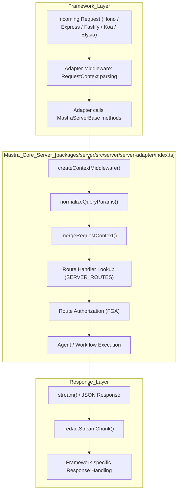
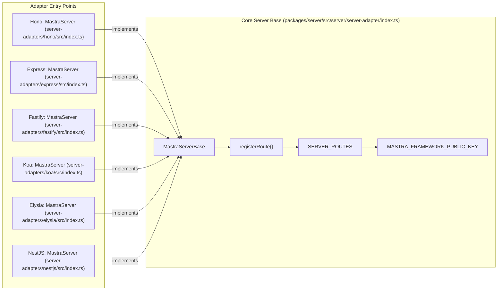

<!-- source: DeepWiki mcp.deepwiki.com · repo mastra-ai/mastra · page 9.7 Server Adapters (Hono, Express, Fastify, Koa, Elysia, NestJS) · fetched 2026-10-26 -->

# Server Adapters (Hono, Express, Fastify, Koa, Elysia, NestJS)

Relevant source files

The following files were used as context for generating this wiki page:

- [.changeset/elysia-streamed-body-limit.md](.changeset/elysia-streamed-body-limit.md)
- [.changeset/express-multipart-body-limit.md](.changeset/express-multipart-body-limit.md)
- [.changeset/nestjs-shared-rbac-suite.md](.changeset/nestjs-shared-rbac-suite.md)
- [.changeset/studio-rbac-express-elysia.md](.changeset/studio-rbac-express-elysia.md)
- [packages/server/src/server/auth/helpers.test.ts](packages/server/src/server/auth/helpers.test.ts)
- [packages/server/src/server/auth/helpers.ts](packages/server/src/server/auth/helpers.ts)
- [packages/server/src/server/server-adapter/index.test.ts](packages/server/src/server/server-adapter/index.test.ts)
- [packages/server/src/server/server-adapter/index.ts](packages/server/src/server/server-adapter/index.ts)
- [server-adapters/elysia/src/__tests__/body-limit-streaming.test.ts](server-adapters/elysia/src/__tests__/body-limit-streaming.test.ts)
- [server-adapters/elysia/src/index.ts](server-adapters/elysia/src/index.ts)
- [server-adapters/express/CHANGELOG.md](server-adapters/express/CHANGELOG.md)
- [server-adapters/express/src/__tests__/express-adapter.test.ts](server-adapters/express/src/__tests__/express-adapter.test.ts)
- [server-adapters/express/src/__tests__/multipart-body-limit.test.ts](server-adapters/express/src/__tests__/multipart-body-limit.test.ts)
- [server-adapters/express/src/index.ts](server-adapters/express/src/index.ts)
- [server-adapters/fastify/CHANGELOG.md](server-adapters/fastify/CHANGELOG.md)
- [server-adapters/fastify/src/__tests__/fastify-adapter.test.ts](server-adapters/fastify/src/__tests__/fastify-adapter.test.ts)
- [server-adapters/fastify/src/index.ts](server-adapters/fastify/src/index.ts)
- [server-adapters/hono/CHANGELOG.md](server-adapters/hono/CHANGELOG.md)
- [server-adapters/hono/src/__tests__/hono-adapter.test.ts](server-adapters/hono/src/__tests__/hono-adapter.test.ts)
- [server-adapters/hono/src/index.ts](server-adapters/hono/src/index.ts)
- [server-adapters/koa/CHANGELOG.md](server-adapters/koa/CHANGELOG.md)
- [server-adapters/koa/src/__tests__/koa-adapter.test.ts](server-adapters/koa/src/__tests__/koa-adapter.test.ts)
- [server-adapters/koa/src/index.ts](server-adapters/koa/src/index.ts)
- [server-adapters/nestjs/package.json](server-adapters/nestjs/package.json)
- [server-adapters/nestjs/src/__tests__/nestjs-adapter.test.ts](server-adapters/nestjs/src/__tests__/nestjs-adapter.test.ts)
- [server-adapters/nestjs/src/__tests__/stream-redaction.test.ts](server-adapters/nestjs/src/__tests__/stream-redaction.test.ts)
- [server-adapters/nestjs/src/interceptors/streaming.interceptor.ts](server-adapters/nestjs/src/interceptors/streaming.interceptor.ts)
- [server-adapters/server-adapters-test-suite/src/body-limit-test-suite.ts](server-adapters/server-adapters-test-suite/src/body-limit-test-suite.ts)
- [server-adapters/server-adapters-test-suite/src/route-adapter-test-suite.ts](server-adapters/server-adapters-test-suite/src/route-adapter-test-suite.ts)
- [server-adapters/server-adapters-test-suite/src/test-helpers.ts](server-adapters/server-adapters-test-suite/src/test-helpers.ts)

Mastra provides a flexible server adapter system that allows the framework's AI capabilities (agents, workflows, tools) to be mounted onto existing web frameworks. By abstracting the underlying HTTP server logic, Mastra ensures consistent behavior across different Node.js and Edge environments, enabling seamless integration into various server architectures.

---

## MastraServer Abstraction

At the core of the adapter system is the abstract base class `MastraServerBase`, which encapsulates common server-side logic while allowing specialization per web framework. This abstraction manages the lifecycle of incoming HTTP requests, context creation, route registration, authorization, and response streaming.

### Key Responsibilities

- **Route Registration**: It maps the internal Mastra API routes (defined in `SERVER_ROUTES`) to framework-specific HTTP handlers, enabling Mastra's functionality to be accessible via REST endpoints [packages/server/src/server/server-adapter/index.ts:31-32]().
- **Context Management**: Combines request data from HTTP bodies and query parameters to compose a `RequestContext`. This supports tenant isolation, dynamic agent/workflow configuration, and authorization decisions [packages/server/src/server/server-adapter/index.ts:6-7]().
- **Parameter Normalization**: Standardizes parsing of URL parameters and complex query parameters for consistent internal handling [packages/server/src/server/server-adapter/index.ts:140-140]().
- **Response Handling**: A unified interface for both full JSON responses and streaming responses using Server-Sent Events (SSE) or chunked encoding, ensuring client compatibility [packages/server/src/server/server-adapter/index.ts:39-39]().
- **Permission Enforcement**: Integrates with Fine-Grained Authorization (FGA) to enforce route-level permissions before invocation [packages/server/src/server/server-adapter/index.ts:182-182]().

### Request Processing Pipeline

The following diagram visualizes the flow of HTTP requests through the adapter layers into the core Mastra server logic:

**Sources:**
[packages/server/src/server/server-adapter/index.ts:7-15](),
[server-adapters/hono/src/index.ts:125-185](),
[server-adapters/express/src/index.ts:79-145]().

---

## Framework-Specific Adapters

Mastra supports multiple mainstream Node.js web frameworks, providing first-class adapters for each. Each adapter extends the `MastraServerBase` class to handle framework-specific nuances like body parsing, headers management, and streaming mechanics.

### 1. Hono Adapter (`@mastra/hono`)

- **Implementation**: Extends `MastraServerBase` with generic types for Hono app and context [server-adapters/hono/src/index.ts:124-124]().
- **Request Context Middleware**: Patches `c.req.json()` to prevent "Body is unusable" errors when multiple consumers read the body [server-adapters/hono/src/index.ts:137-149]().
- **Context Storage**: Uses Hono's `Context` to attach `mastra`, `requestContext`, and `registeredTools` [server-adapters/hono/src/index.ts:48-52]().
- **Streaming**: Uses Hono's `stream` utility for SSE or chunked responses [server-adapters/hono/src/index.ts:23-23]().
- **Framework-Public Routes**: Provides `skipIfFrameworkPublic` to ensure user middleware does not block internal public routes like Studio sign-in [server-adapters/hono/src/index.ts:82-89]().

**Sources:**
[server-adapters/hono/CHANGELOG.md:1-1](),
[server-adapters/hono/src/index.ts:124-185]().

---

### 2. Express Adapter (`@mastra/express`)

- **Implementation**: Extends `MastraServerBase` for Express `Application`, `Request`, and `Response` [server-adapters/express/src/index.ts:78-78]().
- **Locals Context**: Stores Mastra-specific data within `res.locals` [server-adapters/express/src/index.ts:65-75]().
- **Abort Handling**: Uses `res.on('close')` to abort the `AbortController` when the client disconnects [server-adapters/express/src/index.ts:136-142]().
- **Streaming**: Manually sets headers for `text/event-stream` or `text/plain` and writes chunks to the response object [server-adapters/express/src/index.ts:147-163]().

**Sources:**
[server-adapters/express/CHANGELOG.md:1-1](),
[server-adapters/express/src/index.ts:78-145]().

---

### 3. Fastify Adapter (`@mastra/fastify`)

- **Implementation**: Extends `MastraServerBase` using Fastify native types [server-adapters/fastify/src/index.ts:81-81]().
- **Request Context Middleware**: Extracts `requestContext` from both JSON bodies and query parameters [server-adapters/fastify/src/index.ts:83-122]().
- **Response Hijacking**: Calls `reply.hijack()` to take direct control of the raw response stream for streaming [server-adapters/fastify/src/index.ts:179-179]().
- **Header Management**: Merges existing headers (like CORS) before hijacking the reply [server-adapters/fastify/src/index.ts:165-175]().

**Sources:**
[server-adapters/fastify/CHANGELOG.md:1-1](),
[server-adapters/fastify/src/index.ts:81-156]().

---

### 4. Koa Adapter (`@mastra/koa`)

- **Implementation**: Extends `MastraServerBase` for Koa app and `Context` [server-adapters/koa/src/index.ts:90-90]().
- **State Context**: Stores Mastra variables in Koa’s `ctx.state` [server-adapters/koa/src/index.ts:77-84]().
- **Graceful Error Handling**: Implements a global error boundary middleware `mastraErrorBoundary` that uses the `server.onError` hook [server-adapters/koa/src/index.ts:113-145]().
- **Streaming**: Writes serialized chunks to a stream that is assigned to `ctx.body` [server-adapters/koa/src/index.ts:269-337]().

**Sources:**
[server-adapters/koa/CHANGELOG.md:1-1](),
[server-adapters/koa/src/index.ts:90-202]().

---

### 5. Elysia Adapter (`@mastra/elysia`)

- **Implementation**: Extends `MastraServerBase` for Elysia applications [server-adapters/elysia/src/index.ts:9-10]().
- **Body Limit Parsing**: Provides `createBodyLimitParser` to enforce body size limits before Elysia's default parsers, preventing oversized requests from consuming excessive memory [server-adapters/elysia/src/index.ts:60-82]().
- **Parameter Normalization**: Uses `normalizeRouteParams` and `remapParams` to handle Elysia's parameter routing, ensuring consistent parameter names for handlers [server-adapters/elysia/src/index.ts:91-114]().
- **Request Forwarding**: `createForwardRequest` ensures that the request body is correctly handled and forwarded, especially for non-GET/HEAD requests [server-adapters/elysia/src/index.ts:116-152]().
- **Safe Readable Stream**: `createSafeReadableStream` handles potential errors in upstream streams gracefully, preserving already sent chunks [server-adapters/elysia/src/index.ts:154-174]().

**Sources:**
[server-adapters/elysia/src/index.ts:9-10](),
[server-adapters/elysia/src/index.ts:60-82](),
[server-adapters/elysia/src/index.ts:91-114](),
[server-adapters/elysia/src/index.ts:116-152](),
[server-adapters/elysia/src/index.ts:154-174]().

---

### Overview Table of Adapters

| Feature | Hono | Express | Fastify | Koa | Elysia |
| :--- | :--- | :--- | :--- | :--- | :--- |
| **Base Class** | `MastraServer<HonoApp, HonoRequest, Context>` | `MastraServer<Application, Request, Response>` | `MastraServer<FastifyInstance, FastifyRequest, FastifyReply>` | `MastraServer<Koa, Context, Context>` | `MastraServer<AnyElysia, Request, Context>` |
| **Context Storage** | `c.set()` | `res.locals` | `request.requestContext` | `ctx.state` | `ctx.store` |
| **Streaming** | Hono `stream` | `res.write()` | `reply.hijack()` | `ctx.body = stream` | `new Response(stream)` |
| **Package** | `@mastra/hono` | `@mastra/express` | `@mastra/fastify` | `@mastra/koa` | `@mastra/elysia` |

**Sources:**
[server-adapters/hono/src/index.ts:124](),
[server-adapters/express/src/index.ts:78](),
[server-adapters/fastify/src/index.ts:81](),
[server-adapters/koa/src/index.ts:90](),
[server-adapters/elysia/src/index.ts:9-10]().

---

## NestJS Integration

Mastra provides specialized support for NestJS via the `@mastra/nestjs` package. It bridges NestJS Dependency Injection (DI) with Mastra services.

- **MastraService**: A service class that allows injection of Mastra into controllers, facilitating agent and workflow execution [server-adapters/nestjs/package.json:2-4]().
- **Express-only Constraint**: The NestJS adapter is built on top of `@nestjs/platform-express`, meaning it currently requires the underlying NestJS application to use Express [server-adapters/nestjs/package.json:47-68]().

**Sources:**
[server-adapters/nestjs/package.json:2-4](),
[server-adapters/nestjs/package.json:47-68]().

---

## Next.js and TanStack Start

Mastra provides dedicated adapters for modern meta-frameworks that use Route Handlers. These adapters share the same underlying `MastraServer` core but are optimized for edge and serverless runtimes.

- For details on Next.js integration, see [Server Adapter: Next.js (App Router)](#9.7.1).
- For details on TanStack Start integration, see [Server Adapter: TanStack Start](#9.7.2).

---

## System Architecture: Adapter to Code Entity Mapping

The following diagram illustrates the relationship between natural language server concepts and the specific code entities implementing the server adapter system.

**Sources:**
[server-adapters/hono/src/index.ts](),
[server-adapters/express/src/index.ts](),
[packages/server/src/server/server-adapter/index.ts:60-60](),
[server-adapters/nestjs/package.json:2-2](),
[server-adapters/elysia/src/index.ts]().

---

## Operational Features

### Stream Redaction
Before sending streamed chunks to clients, adapters apply `redactStreamChunk` logic by default to remove sensitive data from payloads such as system prompts or tool definitions [packages/server/src/server/server-adapter/index.ts:38-38](). This is controlled by the `redact` option in `StreamOptions` [packages/server/src/server/server-adapter/index.ts:94-105]().

### Fine-Grained Authorization (FGA)
Adapters integrate with `checkRouteFGA` to enforce permissions based on the `SERVER_ROUTES` configuration and the resolved `RequestContext` [packages/server/src/server/server-adapter/index.ts:11-11]().

**Sources:**
[packages/server/src/server/server-adapter/index.ts:38-38](),
[packages/server/src/server/server-adapter/index.ts:94-105](),
[packages/server/src/server/server-adapter/index.ts:11-11]().

---

