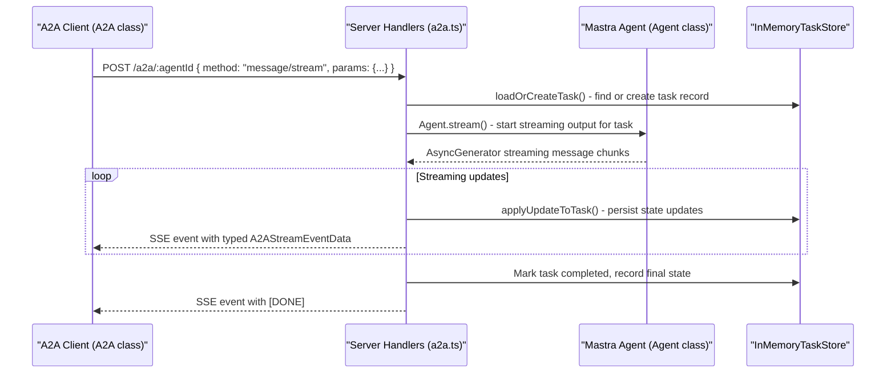
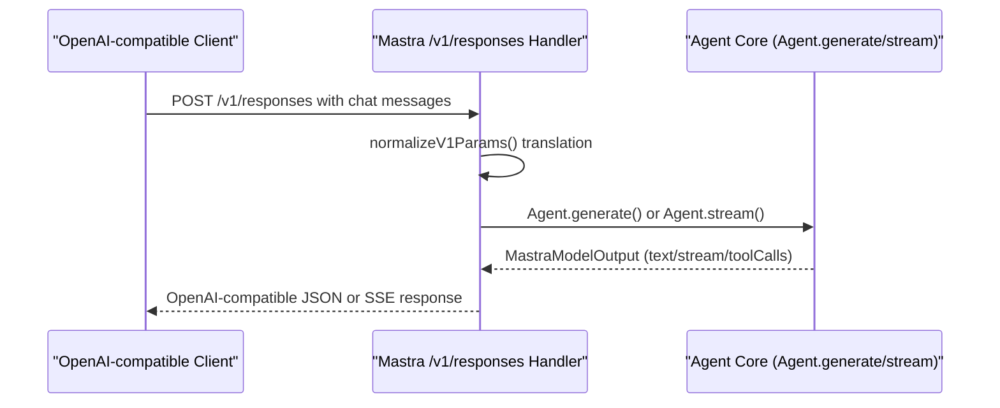
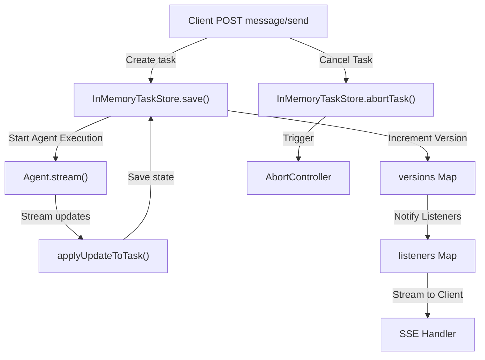
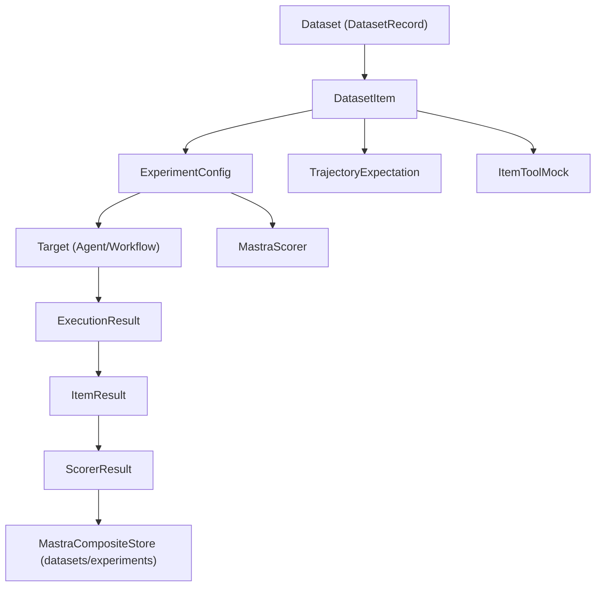

<!-- source: DeepWiki mcp.deepwiki.com · repo mastra-ai/mastra · page 9.8 A2A Protocol and Responses API · fetched 2026-10-26 -->

# A2A Protocol and Responses API

Relevant source files

The following files were used as context for generating this wiki page:

- [client-sdks/client-js/src/client.test.ts](client-sdks/client-js/src/client.test.ts)
- [client-sdks/client-js/src/resources/memory-thread.test.ts](client-sdks/client-js/src/resources/memory-thread.test.ts)
- [client-sdks/client-js/src/resources/memory-thread.ts](client-sdks/client-js/src/resources/memory-thread.ts)
- [deployers/cloud/package.json](deployers/cloud/package.json)
- [packages/core/package.json](packages/core/package.json)
- [packages/core/src/datasets/__tests__/dataset.test.ts](packages/core/src/datasets/__tests__/dataset.test.ts)
- [packages/core/src/datasets/dataset.ts](packages/core/src/datasets/dataset.ts)
- [packages/core/src/datasets/experiment/__tests__/runExperiment.test.ts](packages/core/src/datasets/experiment/__tests__/runExperiment.test.ts)
- [packages/core/src/datasets/experiment/__tests__/scorer-trajectory.test.ts](packages/core/src/datasets/experiment/__tests__/scorer-trajectory.test.ts)
- [packages/core/src/datasets/experiment/index.ts](packages/core/src/datasets/experiment/index.ts)
- [packages/core/src/datasets/experiment/item.ts](packages/core/src/datasets/experiment/item.ts)
- [packages/core/src/datasets/experiment/scorer.ts](packages/core/src/datasets/experiment/scorer.ts)
- [packages/core/src/datasets/experiment/types.ts](packages/core/src/datasets/experiment/types.ts)
- [packages/core/src/datasets/manager.ts](packages/core/src/datasets/manager.ts)
- [packages/core/src/evals/flush-before-trace-read.test.ts](packages/core/src/evals/flush-before-trace-read.test.ts)
- [packages/core/src/evals/flush-before-trace-read.ts](packages/core/src/evals/flush-before-trace-read.ts)
- [packages/core/src/storage/domains/datasets/__tests__/datasets.test.ts](packages/core/src/storage/domains/datasets/__tests__/datasets.test.ts)
- [packages/core/src/storage/domains/datasets/inmemory.ts](packages/core/src/storage/domains/datasets/inmemory.ts)
- [packages/core/src/storage/domains/experiments/inmemory.ts](packages/core/src/storage/domains/experiments/inmemory.ts)
- [packages/deployer/package.json](packages/deployer/package.json)
- [packages/server/package.json](packages/server/package.json)
- [packages/server/src/server/handlers/datasets.test.ts](packages/server/src/server/handlers/datasets.test.ts)
- [packages/server/src/server/handlers/datasets.ts](packages/server/src/server/handlers/datasets.ts)
- [packages/server/src/server/schemas/datasets.ts](packages/server/src/server/schemas/datasets.ts)
- [server-adapters/express/package.json](server-adapters/express/package.json)
- [server-adapters/fastify/package.json](server-adapters/fastify/package.json)
- [server-adapters/hono/package.json](server-adapters/hono/package.json)
- [server-adapters/koa/package.json](server-adapters/koa/package.json)
- [stores/_test-utils/src/domains/datasets/index.ts](stores/_test-utils/src/domains/datasets/index.ts)
- [stores/_test-utils/src/domains/experiments/index.ts](stores/_test-utils/src/domains/experiments/index.ts)
- [stores/libsql/src/storage/domains/datasets/index.ts](stores/libsql/src/storage/domains/datasets/index.ts)
- [stores/libsql/src/storage/domains/experiments/index.ts](stores/libsql/src/storage/domains/experiments/index.ts)
- [stores/mongodb/src/storage/domains/datasets/index.ts](stores/mongodb/src/storage/domains/datasets/index.ts)
- [stores/mongodb/src/storage/domains/experiments/index.ts](stores/mongodb/src/storage/domains/experiments/index.ts)
- [stores/mongodb/src/storage/index.ts](stores/mongodb/src/storage/index.ts)
- [stores/mysql/src/storage/domains/datasets/index.ts](stores/mysql/src/storage/domains/datasets/index.ts)
- [stores/mysql/src/storage/domains/experiments/index.ts](stores/mysql/src/storage/domains/experiments/index.ts)
- [stores/pg/src/storage/domains/datasets/index.ts](stores/pg/src/storage/domains/datasets/index.ts)
- [stores/pg/src/storage/domains/experiments/index.ts](stores/pg/src/storage/domains/experiments/index.ts)
- [stores/spanner/src/storage/domains/datasets/index.ts](stores/spanner/src/storage/domains/datasets/index.ts)
- [stores/spanner/src/storage/domains/experiments/index.ts](stores/spanner/src/storage/domains/experiments/index.ts)

This page documents the Agent-to-Agent (A2A) protocol implementation, the OpenAI-compatible Responses API, and the infrastructure for background task management and evaluation datasets in the Mastra framework.

## Overview

Mastra provides a robust set of API endpoints for complex agentic interactions that go beyond simple request-response cycles. This includes:
- **A2A Protocol**: A JSON-RPC based infrastructure for agents to communicate and manage tasks across network boundaries.
- **Responses API**: OpenAI-compatible endpoints (`/v1/responses`, `/v1/conversations`) for standardized integration with external tools and SDKs.
- **Background Tasks**: Management of long-running operations with status tracking, persistence, and cancellation.
- **Datasets & Experiments**: Evaluation workflows for scoring and comparing agent performance against gold-standard data.

## Agent-to-Agent (A2A) Protocol

The A2A protocol allows Mastra agents to function as networked entities. It uses a task-based system where one agent can delegate work to another, tracking the lifecycle of these requests through a specialized store. Mastra supports A2A Protocol v0.3 and v1.0, using the `A2A-Version` header to select the version [packages/core/package.json:44-53]().

### Agent Cards and Discovery
Every agent in a Mastra system exposes an `AgentCard` JSON metadata document via the `getAgentCardByIdHandler` [packages/server/src/server/handlers/a2a.ts:182-217](). This card contains metadata representing the agent's capabilities, description, versioning, and available tools (referred to as "skills") [packages/server/src/server/handlers/a2a.ts:188-215]().

For enhanced security, Mastra supports **Agent Card Signing** using JSON Web Signatures (JWS) [packages/server/src/server/handlers/a2a.ts:21](). On the client side, the `A2A` resource can verify these signatures using a configurable `verifySignature` option [client-sdks/client-js/src/resources/a2a.ts:135-143]().

### JSON-RPC Communication

Mastra implements the A2A protocol using JSON-RPC 2.0 over HTTP and Server-Sent Events. The `A2A` class in the client SDK provides a high-level interface for these calls [client-sdks/client-js/src/resources/a2a.ts:132-137]().

Key methods supported by the server (often prefixed with `/a2a/:agentId`) include:

- **`message/send`**: Sends a message to an agent to initiate or continue a task. This method processes the message and returns the result or task ID [client-sdks/client-js/src/resources/a2a.ts:185]().
- **`message/stream`**: Starts a streaming Server-Sent Event (SSE) connection to receive incremental updates from a running background task [client-sdks/client-js/src/resources/a2a.ts:207-212]().
- **`tasks/get`**: Retrieves the current status, result, or error of a background task [packages/server/src/server/handlers/a2a.ts:277-313]().
- **`tasks/cancel`**: Requests cancellation of a running background task [packages/server/src/server/handlers/a2a.ts:315-343]().

### Message Schema and Modalities

The protocol supports rich message parts via the `messagePartSchema`, which implements a union of three modalities [packages/server/src/server/handlers/a2a.ts:50-76]():

- `text`: String content with optional metadata.
- `file`: Includes either base64-encoded `bytes` or a downloadable `uri`, with mimeType and name.
- `data`: JSON-structured data for programmatic exchange.

Incoming A2A messages are parsed and converted into Mastra's internal message format using `convertToCoreMessage` [packages/server/src/server/a2a/protocol.ts:23]().

---

#### A2A Task Execution and Streaming Flow

**Sources:**
- [packages/server/src/server/handlers/a2a.ts:22-343]()
- [client-sdks/client-js/src/resources/a2a.ts:207-212]()
- [packages/server/src/server/a2a/store.ts:14-194]()

## Responses API

Mastra's Responses API offers an OpenAI Chat Completion-compatible interface. This facilitates integration with standard OpenAI SDKs and tools.

### Key Behavior and Mapping

Mastra translates between the OpenAI format and its internal representations. For example, it handles the conversion of roles and the normalization of message parts [packages/server/src/server/handlers/a2a.ts:174-190]().

- **V1 Normalization**: The server includes utilities like `normalizeV1Params` and `normalizeV1Part` to bridge differences between A2A protocol versions and internal core message formats [packages/server/src/server/handlers/a2a.ts:149-190]().
- **Task Mapping**: Tasks are converted to V1 formats using `toV1Task`, mapping internal states like `working` or `input-required` to V1 constants like `TASK_STATE_WORKING` [packages/server/src/server/handlers/a2a.ts:117-126]().

---

#### Responses API Integration Flow

**Sources:**
- [packages/server/src/server/handlers/a2a.ts:117-190]()
- [packages/core/src/a2a/a2a-agent.ts:120-145]()

## Background Task Management

Mastra supports long-lived background tasks, tracked and managed via the `InMemoryTaskStore`. This is essential for agents performing work that exceeds the duration of a single HTTP request.

### Task Lifecycle Management

- **Storage**: The `InMemoryTaskStore` manages task state, versioning, and listeners for updates [packages/server/src/server/a2a/store.ts:14-194]().
- **Concurrency Control**: It implements optimistic concurrency using `expectedVersion` to prevent stale updates [packages/server/src/server/a2a/store.ts:72-75]().
- **Cancellation**: Tasks can be aborted via `abortTask`, which triggers an `AbortController` registered for that specific task [packages/server/src/server/a2a/store.ts:122-128]().
- **Wait Mechanism**: Clients can wait for the next task update using `waitForNextUpdate`, which resolves when a new version of the task is saved [packages/server/src/server/a2a/store.ts:130-193]().

---

### Background Task Workflow Diagram

**Sources:**
- [packages/server/src/server/a2a/store.ts:14-194]()
- [packages/server/src/server/a2a/tasks.ts:28-30]()

## Evaluation Datasets and Experiments

Mastra includes evaluation infrastructure to facilitate benchmarking agent outputs against "gold standard" datasets. The core logic for running experiments is found in `packages/core/src/datasets/experiment/index.ts` and `packages/core/src/datasets/dataset.ts`.

### Dataset and Experiment Schemas

The server defines Zod schemas for managing evaluation workflows and data:
- **`listTasksParamsSchema`**: Supports filtering tasks by tenant, context, status, and time for evaluation purposes [packages/server/src/server/schemas/a2a.ts:119-128]().
- **Task Artifacts**: Evaluation often involves inspecting `Artifact` objects produced by tasks, which can contain text, files, or structured data [packages/server/src/server/handlers/a2a.ts:15-16]().
- **`trajectoryExpectationSchema`**: Defines the expected sequence and properties of steps in an agent's execution for trajectory scoring [packages/server/src/server/schemas/datasets.ts:141-172]().
- **`itemToolMockSchema`**: Allows defining static tool mocks for agent targets within an experiment item [packages/server/src/server/schemas/datasets.ts:185-187]().

### Experiment Execution

The `runExperiment` function [packages/core/src/datasets/experiment/index.ts:125-125]() orchestrates the execution of a dataset against a target (agent or workflow). It handles:
- **Item Processing**: Iterates through dataset items, executing the target for each [packages/core/src/datasets/experiment/index.ts:102-102]().
- **Scoring**: Applies configured `MastraScorer` instances to the results [packages/core/src/datasets/experiment/scorer.ts:46-65](). Scorers can be resolved by ID or provided as instances [packages/core/src/datasets/experiment/scorer.ts:46-65]().
- **Persistence**: Stores experiment results and scores using the `DatasetsStorage` and `ExperimentsStorage` domains [packages/core/src/datasets/dataset.ts:7-8]().
- **Hooks**: Supports `beforeAll`, `afterAll`, `beforeEach`, and `afterEach` hooks for custom logic during experiment runs [packages/core/src/datasets/experiment/index.ts:147-150]().

### Dataset Management

The `Dataset` class [packages/core/src/datasets/dataset.ts:43-43]() provides an API for interacting with a single dataset, including:
- **CRUD Operations**: Methods for creating, reading, updating, and deleting dataset items [packages/core/src/datasets/dataset.ts:200-200]().
- **Versioning**: Manages dataset versions [packages/core/src/datasets/dataset.ts:300-300]().
- **Experiment Management**: Initiates and lists experiments associated with the dataset [packages/core/src/datasets/dataset.ts:500-500]().

---

### Evaluation Data Entity Mapping

**Sources:**
- [packages/server/src/server/handlers/a2a.ts:15-16]()
- [packages/server/src/server/schemas/a2a.ts:119-128]()
- [packages/core/src/datasets/experiment/index.ts:29-48]()
- [packages/core/src/datasets/experiment/types.ts:1-1]()
- [packages/core/src/datasets/dataset.ts:10-32]()
- [packages/core/src/datasets/experiment/scorer.ts:19-19]()
- [packages/server/src/server/schemas/datasets.ts:141-172]()
- [packages/server/src/server/schemas/datasets.ts:185-187]()

## System Entity Mapping

The following diagram bridges high-level protocol concepts to the internal code entities and handlers.

### A2A and Evaluation Code Mapping

```mermaid
graph TD
    subgraph "Natural Language Space"
        A2A["A2A Protocol"]
        BT["Background Tasks"]
        EVAL["Experiments/Evals"]
        RESPAPI["Responses API"]
    end

    subgraph "Code Entity Space"
        H_A2A["packages/server/src/server/handlers/a2a.ts"]
        SCH_A2A["packages/server/src/server/schemas/a2a.ts"]
        TS["packages/server/src/server/a2a/store.ts"]
        AG["packages/core/src/a2a/a2a-agent.ts"]
        C_A2A["client-sdks/client-js/src/resources/a2a.ts"]
        PROT["packages/server/src/server/a2a/protocol.ts"]
        DS_CORE["packages/core/src/datasets/dataset.ts"]
        EXP_CORE["packages/core/src/datasets/experiment/index.ts"]
        SCH_DS["packages/server/src/server/schemas/datasets.ts"]
        H_DS["packages/server/src/server/handlers/datasets.ts"]
        DS_STORE["packages/core/src/storage/domains/datasets/base.ts"]
        EXP_STORE["packages/core/src/storage/domains/experiments/base.ts"]
    end

    A2A --> H_A2A
    A2A --> C_A2A
    A2A --> PROT
    BT --> TS
    BT --> SCH_A2A
    RESPAPI --> H_A2A
    EVAL --> DS_CORE
    EVAL --> EXP_CORE
    EVAL --> SCH_DS
    EVAL --> H_DS
    EVAL --> DS_STORE
    EVAL --> EXP_STORE
```

**Sources:**
- [packages/server/src/server/handlers/a2a.ts:1-50]()
- [client-sdks/client-js/src/resources/a2a.ts:132-137]()
- [packages/server/src/server/a2a/store.ts:14-20]()
- [packages/core/src/a2a/a2a-agent.ts:159-171]()
- [packages/core/src/datasets/dataset.ts:43-43]()
- [packages/core/src/datasets/experiment/index.ts:125-125]()
- [packages/server/src/server/schemas/datasets.ts:1-1]()
- [packages/server/src/server/handlers/datasets.ts:1-1]()
- [packages/core/src/storage/domains/datasets/base.ts:1-1]()
- [packages/core/src/storage/domains/experiments/base.ts:1-1]()

---

