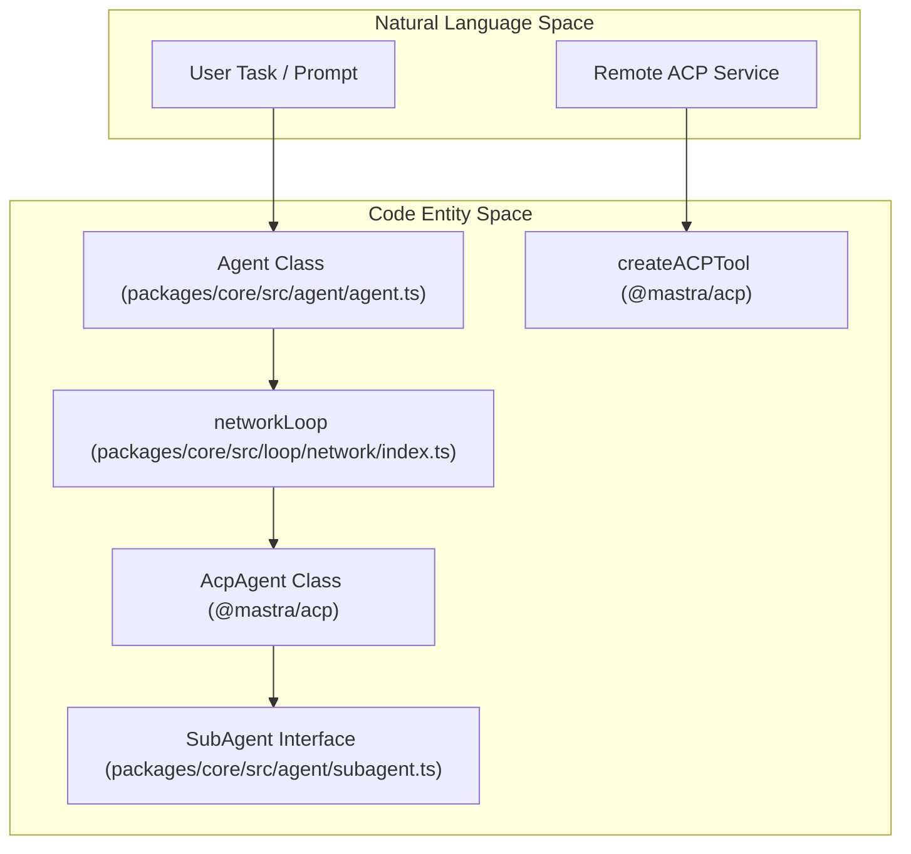

<!-- source: DeepWiki mcp.deepwiki.com · repo mastra-ai/mastra · page 9.9 ACP (Agent Client Protocol) Integration · fetched 2026-10-26 -->

# ACP (Agent Client Protocol) Integration

<details>
<summary>Relevant source files</summary>

The following files were used as context for generating this wiki page:

- [.changeset/peer-discovery-busy-caller.md](.changeset/peer-discovery-busy-caller.md)
- [.changeset/retake-lapsed-thread-lease.md](.changeset/retake-lapsed-thread-lease.md)
- [docs/src/content/en/docs/subagents.mdx](docs/src/content/en/docs/subagents.mdx)
- [mastracode/sdk/src/agent-connections/__tests__/cross-process-agent-signals.integration.test.ts](mastracode/sdk/src/agent-connections/__tests__/cross-process-agent-signals.integration.test.ts)
- [mastracode/sdk/src/agent-connections/__tests__/fixtures/cross-process-agent-signals-child.mts](mastracode/sdk/src/agent-connections/__tests__/fixtures/cross-process-agent-signals-child.mts)
- [observability/mastra/src/model-tracing.test.ts](observability/mastra/src/model-tracing.test.ts)
- [observability/mastra/src/model-tracing.ts](observability/mastra/src/model-tracing.ts)
- [packages/core/src/agent-controller/lease-lost-abort-reason.test.ts](packages/core/src/agent-controller/lease-lost-abort-reason.test.ts)
- [packages/core/src/agent/__tests__/delegation-thread-metadata.test.ts](packages/core/src/agent/__tests__/delegation-thread-metadata.test.ts)
- [packages/core/src/agent/__tests__/memory-metadata.test.ts](packages/core/src/agent/__tests__/memory-metadata.test.ts)
- [packages/core/src/agent/__tests__/signals-claimed-ownership.test.ts](packages/core/src/agent/__tests__/signals-claimed-ownership.test.ts)
- [packages/core/src/agent/__tests__/signals-idle-active-behavior.test.ts](packages/core/src/agent/__tests__/signals-idle-active-behavior.test.ts)
- [packages/core/src/agent/__tests__/stream.test.ts](packages/core/src/agent/__tests__/stream.test.ts)
- [packages/core/src/agent/__tests__/thread-lease-loss-abort.test.ts](packages/core/src/agent/__tests__/thread-lease-loss-abort.test.ts)
- [packages/core/src/agent/__tests__/tool-concurrency-called-strategy-resume.test.ts](packages/core/src/agent/__tests__/tool-concurrency-called-strategy-resume.test.ts)
- [packages/core/src/agent/__tests__/tool-concurrency-called-strategy.test.ts](packages/core/src/agent/__tests__/tool-concurrency-called-strategy.test.ts)
- [packages/core/src/agent/__tests__/tool-handling.test.ts](packages/core/src/agent/__tests__/tool-handling.test.ts)
- [packages/core/src/agent/agent-legacy.ts](packages/core/src/agent/agent-legacy.ts)
- [packages/core/src/agent/agent-types.test-d.ts](packages/core/src/agent/agent-types.test-d.ts)
- [packages/core/src/agent/agent.test.ts](packages/core/src/agent/agent.test.ts)
- [packages/core/src/agent/agent.ts](packages/core/src/agent/agent.ts)
- [packages/core/src/agent/agent.types.ts](packages/core/src/agent/agent.types.ts)
- [packages/core/src/agent/durable/durable-parity.test-d.ts](packages/core/src/agent/durable/durable-parity.test-d.ts)
- [packages/core/src/agent/subagent.ts](packages/core/src/agent/subagent.ts)
- [packages/core/src/agent/thread-stream-runtime.ts](packages/core/src/agent/thread-stream-runtime.ts)
- [packages/core/src/agent/types.ts](packages/core/src/agent/types.ts)
- [packages/core/src/agent/workflows/prepare-stream/index.ts](packages/core/src/agent/workflows/prepare-stream/index.ts)
- [packages/core/src/agent/workflows/prepare-stream/map-results-step.ts](packages/core/src/agent/workflows/prepare-stream/map-results-step.ts)
- [packages/core/src/agent/workflows/prepare-stream/prepare-memory-step.ts](packages/core/src/agent/workflows/prepare-stream/prepare-memory-step.ts)
- [packages/core/src/agent/workflows/prepare-stream/prepare-tools-step.ts](packages/core/src/agent/workflows/prepare-stream/prepare-tools-step.ts)
- [packages/core/src/agent/workflows/prepare-stream/run-scope-keys.ts](packages/core/src/agent/workflows/prepare-stream/run-scope-keys.ts)
- [packages/core/src/agent/workflows/prepare-stream/schema.ts](packages/core/src/agent/workflows/prepare-stream/schema.ts)
- [packages/core/src/agent/workflows/prepare-stream/stream-step.ts](packages/core/src/agent/workflows/prepare-stream/stream-step.ts)
- [packages/core/src/llm/model/model.loop.ts](packages/core/src/llm/model/model.loop.ts)
- [packages/core/src/loop/loop.ts](packages/core/src/loop/loop.ts)
- [packages/core/src/loop/network/index.ts](packages/core/src/loop/network/index.ts)
- [packages/core/src/loop/network/validation.test.ts](packages/core/src/loop/network/validation.test.ts)
- [packages/core/src/loop/network/validation.ts](packages/core/src/loop/network/validation.ts)
- [packages/core/src/loop/types.ts](packages/core/src/loop/types.ts)
- [packages/core/src/loop/workflows/agentic-execution/index.ts](packages/core/src/loop/workflows/agentic-execution/index.ts)
- [packages/core/src/loop/workflows/agentic-execution/tool-call-concurrency.test.ts](packages/core/src/loop/workflows/agentic-execution/tool-call-concurrency.test.ts)
- [packages/core/src/loop/workflows/agentic-execution/tool-call-concurrency.ts](packages/core/src/loop/workflows/agentic-execution/tool-call-concurrency.ts)
- [packages/core/src/loop/workflows/agentic-loop/index.ts](packages/core/src/loop/workflows/agentic-loop/index.ts)
- [packages/core/src/memory/index.ts](packages/core/src/memory/index.ts)
- [packages/core/src/memory/run-state.test.ts](packages/core/src/memory/run-state.test.ts)
- [packages/core/src/memory/run-state.ts](packages/core/src/memory/run-state.ts)
- [packages/core/src/tools/request-context-schema-types.test-d.ts](packages/core/src/tools/request-context-schema-types.test-d.ts)
- [packages/rag/src/document/validation.ts](packages/rag/src/document/validation.ts)

</details>


The `@mastra/acp` package provides robust mechanisms to integrate remote agents that implement the Agent Client Protocol (ACP) into the Mastra ecosystem. ACP accommodates connecting external "Agent-as-a-Service" endpoints seamlessly with Mastra's agent network and tooling, enabling hybrid architectures combining Mastra-native and remote agents.

This page documents the technical implementation of the ACP integration: the `AcpAgent` class for wrapping remote ACP-compatible agents as Mastra `SubAgent`s, the `createACPTool` factory for exposing ACP endpoints as tools, the `ACPConnection` lifecycle, and the protocol distinctions between ACP and Mastra's native Agent-to-Agent (A2A) protocol.

---

## Overview and Purpose

The ACP integration allows Mastra to act as a client for external agent services. It is designed to bridge the gap between Mastra's internal agentic loop and external providers that adhere to the ACP specification.

### Key Integration Goals
1.  **Wrapping remote agents as SubAgents**: The `AcpAgent` class implements the `SubAgent` interface, allowing remote ACP agents to participate in Mastra's multi-agent networks and delegation flows [packages/core/src/agent/subagent.ts:1-10]().
2.  **Exposing ACP endpoints as tools**: The `createACPTool` factory wraps ACP endpoints as `CoreTool` instances consumable by Mastra's tool invocation system.
3.  **Connection lifecycle management**: `ACPConnection` manages authentication, connection pooling, and request lifetime for ACP communication.
4.  **Protocol roles**: ACP is a client-focused protocol for interacting with external services, whereas A2A is optimized for internal Mastra-to-Mastra orchestration.

### ACP vs A2A Protocols

Mastra provides two protocols for inter-agent communication:

| Aspect           | ACP (Agent Client Protocol)                                | A2A (Agent-to-Agent)                                           |
| :--------------- | :--------------------------------------------------------- | :------------------------------------------------------------- |
| Protocol Role    | Client interface for connecting to external ACP agents.    | Mastra-native inter-agent communication and orchestration.     |
| Implementation   | Wraps external services (e.g., via `AcpAgent`) as SubAgents. | Native implementation using `A2AAgent` and `A2AStore`.         |
| State Management | Stateless client calls, relies on external endpoints.      | Full control over conversation/storage state via `A2AStore`.   |
| Use Cases        | Consume remote "Agent-as-a-Service" providers.             | Internal network of Mastra-native agents and workflows.        |

Sources: [packages/core/src/agent/subagent.ts:1-10](), [packages/core/src/loop/network/index.ts:1-2757]()

---

## Core Implementation Details

### AcpAgent Class
The `AcpAgent` class acts as a proxy, implementing the `SubAgent` interface [packages/core/src/agent/subagent.ts:1-10](). It forwards `generate` and `stream` calls to external ACP endpoints.

- **Interface Mapping**: Translates Mastra's `CoreMessage` into ACP-compliant payloads.
- **Network Integration**: Participates in the `networkLoop` [packages/core/src/loop/network/index.ts:1-2757](), allowing Mastra agents to delegate tasks to remote ACP agents.
- **Observability**: Integrates with Mastra's OpenTelemetry tracing, creating spans for remote calls.

### createACPTool Factory
`createACPTool` produces Mastra `Tool` instances that encapsulate calls to ACP endpoints.
- **Standardization**: Uses `createTool` [packages/core/src/tools/index.ts:1-1]() to ensure the remote agent appears as a standard tool in the `ToolsInput` map [packages/core/src/agent/types.ts:130-133]().
- **Validation**: Supports schema conversion via `toStandardSchema` [packages/core/src/schema/index.ts:1-1]() for the tool's input/output validation.

### ACPConnection Lifecycle
`ACPConnection` abstracts the transport layer (typically HTTP/SSE) for communicating with an ACP server.
- **Session Management**: Handles `threadId` and `resourceId` propagation [packages/core/src/request-context/index.ts:20]().
- **Error Handling**: Converts remote protocol errors into `MastraError` instances with appropriate `ErrorDomain.AGENT` and `ErrorCategory.NETWORK` [packages/core/src/error/index.ts:1-1]().

Sources: [packages/core/src/agent/subagent.ts:1-10](), [packages/core/src/loop/network/index.ts:1-2757](), [packages/core/src/tools/index.ts:1-1](), [packages/core/src/agent/types.ts:130-133](), [packages/core/src/schema/index.ts:1-1](), [packages/core/src/request-context/index.ts:20](), [packages/core/src/error/index.ts:1-1]()

---

## Data Flow: Remote Agent Execution

The following diagrams illustrate the execution flow and the relationship between Mastra core entities and the ACP protocol components.

### Sequence: Invoking a Remote ACP Agent
```mermaid
sequenceDiagram
    participant Parent as "Agent (Parent)"
    participant Loop as "AgenticLoopBuilder (packages/core/src/loop/loop-builder.ts)"
    participant Proxy as "AcpAgent (SubAgent Proxy)"
    participant Remote as "Remote ACP Endpoint"

    Parent->>Loop: .generate(prompt)
    Loop->>Loop: resolveModelConfig()
    Loop->>Proxy: generate(messages)
    Proxy->>Remote: POST /acp/v1/generate
    Remote-->>Proxy: { text: "...", usage: {...} }
    Proxy-->>Loop: SubAgentGenerateResult
    Loop->>Loop: runScorer() hooks
    Loop-->>Parent: Final result
```
Sources: [packages/core/src/loop/workflows/agentic-loop/index.ts:1-14](), [packages/core/src/agent/agent.ts:24-24]()

### Mapping Entities: Natural Language to Code

Sources: [packages/core/src/agent/subagent.ts:1-10](), [packages/core/src/agent/agent.ts:1-11892](), [packages/core/src/loop/network/index.ts:1-2757]()

---

## Technical Details and Integration Points

### Agent Network Compatibility
`AcpAgent` is a first-class citizen in Mastra's multi-agent system:
- **Delegation**: When a parent agent decides to delegate, the `networkLoop` can route the request to an `AcpAgent` instance just as it would to a local `Agent` [packages/core/src/loop/network/index.ts:1-2757]().
- **Message Filtering**: `MessageFilterContext` [packages/core/src/agent/agent.types.ts:58-81]() is used to decide which conversation history parts are sent to the remote ACP agent.

### Stream Handling
For streaming responses, `AcpAgent` bridges remote SSE streams into Mastra's `MastraAgentNetworkStream` [packages/core/src/stream/MastraAgentNetworkStream.ts:1-1]().
- **Chunk Transformation**: Remote ACP chunks are mapped to `ChunkType` [packages/core/src/stream/types.ts:1-1]().
- **Token Usage**: Aggregates token usage from the remote service to maintain accurate metrics in the local Mastra run.

### Security and Context
- **RequestContext**: The `AcpAgent` forwards relevant `RequestContext` values (like `tenantId` or `userId`) if configured, ensuring the remote agent has the necessary execution context [packages/core/src/request-context/index.ts:20]().
- **Auth Integration**: `ACPConnection` supports standard auth patterns (Bearer tokens, API keys) required by ACP endpoints.

---

## Key Components Reference

| Component | Role | Location |
| :--- | :--- | :--- |
| `AcpAgent` | Wraps remote ACP agents as Mastra `SubAgent`s. | `@mastra/acp` |
| `createACPTool` | Exposes ACP endpoints as Mastra `Tool`s. | `@mastra/acp` |
| `SubAgent` | Interface for cross-agent compatibility. | [packages/core/src/agent/subagent.ts:1-10]() |
| `networkLoop` | The core router for agent-to-agent communication. | [packages/core/src/loop/network/index.ts:1-2757]() |

---

## Sources
- [packages/core/src/agent/agent.ts:1-11892]()
- [packages/core/src/agent/agent.types.ts:58-81]()
- [packages/core/src/agent/subagent.ts:1-10]()
- [packages/core/src/error/index.ts:1-1]()
- [packages/core/src/loop/network/index.ts:1-2757]()
- [packages/core/src/loop/workflows/agentic-loop/index.ts:1-14]()
- [packages/core/src/request-context/index.ts:20]()
- [packages/core/src/schema/index.ts:1-1]()
- [packages/core/src/stream/MastraAgentNetworkStream.ts:1-1]()
- [packages/core/src/stream/types.ts:1-1]()
- [packages/core/src/tools/index.ts:1-1]()

---

