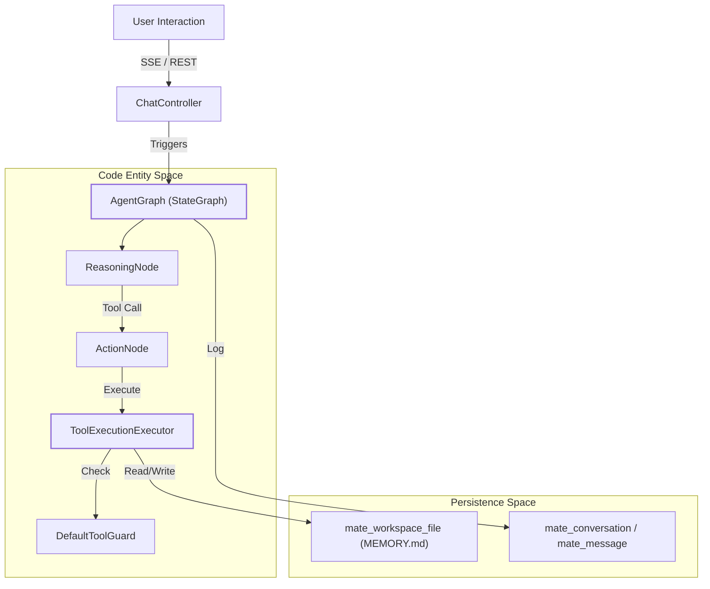
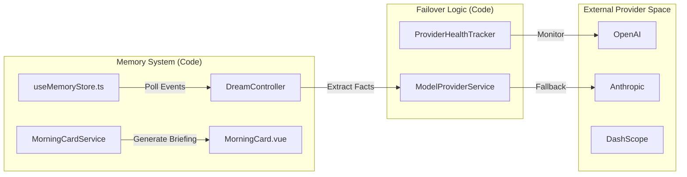

<!-- source: DeepWiki mcp.deepwiki.com · repo matevip/mateclaw · page 1 MateClaw Overview · fetched 2026-10-26 -->

# MateClaw Overview

Relevant source files

The following files were used as context for generating this wiki page:

- [LICENSE](LICENSE)
- [README.md](README.md)
- [README_zh.md](README_zh.md)
- [assets/architecture-biz-en.svg](assets/architecture-biz-en.svg)
- [assets/architecture-biz-zh.svg](assets/architecture-biz-zh.svg)
- [assets/architecture-tech-en.svg](assets/architecture-tech-en.svg)
- [assets/architecture-tech-zh.svg](assets/architecture-tech-zh.svg)
- [assets/images/preview.png](assets/images/preview.png)
- [mateclaw-server/src/main/java/vip/mate/memory/controller/DreamController.java](mateclaw-server/src/main/java/vip/mate/memory/controller/DreamController.java)
- [mateclaw-server/src/main/java/vip/mate/memory/fact/repository/FactMapper.java](mateclaw-server/src/main/java/vip/mate/memory/fact/repository/FactMapper.java)
- [mateclaw-server/src/main/java/vip/mate/memory/service/MorningCardService.java](mateclaw-server/src/main/java/vip/mate/memory/service/MorningCardService.java)
- [mateclaw-server/src/main/resources/db/data-en.sql](mateclaw-server/src/main/resources/db/data-en.sql)
- [mateclaw-server/src/main/resources/db/data-mysql-en.sql](mateclaw-server/src/main/resources/db/data-mysql-en.sql)
- [mateclaw-server/src/main/resources/db/data-mysql-zh.sql](mateclaw-server/src/main/resources/db/data-mysql-zh.sql)
- [mateclaw-server/src/main/resources/db/data-zh.sql](mateclaw-server/src/main/resources/db/data-zh.sql)
- [mateclaw-ui/src/stores/useMemoryStore.ts](mateclaw-ui/src/stores/useMemoryStore.ts)
- [mateclaw-ui/src/types/index.ts](mateclaw-ui/src/types/index.ts)
- [mateclaw-ui/src/views/Memory/components/MemoryBrowser.vue](mateclaw-ui/src/views/Memory/components/MemoryBrowser.vue)
- [mateclaw-ui/src/views/Memory/components/MorningCard.vue](mateclaw-ui/src/views/Memory/components/MorningCard.vue)
- [mateclaw-ui/src/views/Memory/index.vue](mateclaw-ui/src/views/Memory/index.vue)

MateClaw is a personal AI operating system designed to transform raw LLM capabilities into a reliable, persistent, and multi-surface intelligent assistant. Unlike standalone chat interfaces, MateClaw provides a comprehensive suite of infrastructure—including multi-provider failover, structured knowledge management (LLM Wiki), and a continuous memory lifecycle—all built on a robust Spring Boot backend [README.md:33-34]().

## Architectural Pillars

MateClaw is built upon five key architectural pillars that ensure it remains functional even when individual AI services fail, and grows smarter as you interact with it.

### 1. Multi-Provider Failover & Health Tracking
MateClaw abstracts over 14+ LLM providers (e.g., OpenAI, Anthropic, DashScope, DeepSeek, Ollama) [README.md:43](). The system features a **Provider Health Tracker** that monitors for API errors (401s, timeouts, quota exhaustion). If a primary provider fails, the system automatically routes the request to the next healthy provider in a user-defined priority list [README.md:43-45]().
*   **Key Entity:** `ModelProviderService` (See [Provider Management & Failover](#3.1))
*   **Data Source:** `mate_model_provider` table [mateclaw-server/src/main/resources/db/data-en.sql:31-33]()

### 2. LLM Wiki Knowledge Base
The **LLM Wiki** transforms raw materials (PDFs, Markdown, scraped web pages) into structured, interlinked pages [README.md:51](). It uses an ingestion pipeline to digest content into chunks, maintains canonical slugs, and allows the AI to cite specific sources during conversations [README.md:51-53]().
*   **Key Entity:** `WikiProcessingService` (See [Ingestion Pipeline](#5.1))

### 3. Workspace Memory & Dreaming
MateClaw implements a long-term memory system that goes beyond simple chat history. It uses a "Dreaming" workflow to extract facts from conversations and persist them into structured workspace files like `MEMORY.md` and `SOUL.md` [README.md:78-79]().
*   **Key Entities:** `DreamController` [mateclaw-server/src/main/java/vip/mate/memory/controller/DreamController.java:34](), `MemoryEmergenceService` (See [Memory Lifecycle & Dreaming](#6.1))

### 4. Tool & Skill Ecosystem
The system supports complex reasoning via **ReAct** and **Plan-Execute** agent patterns [README.md:74](). It integrates with the **Model Context Protocol (MCP)** and provides a "Tool Guard" layer for security, including Human-in-the-Loop (HiL) approval flows for sensitive actions [README.md:82]().
*   **Key Entity:** `AgentGraphBuilder` (See [StateGraph & Agent Patterns](#2.1))

### 5. Multi-Channel Delivery
A single MateClaw "brain" can be accessed through multiple surfaces: a Web Console, a Desktop app (Electron), an embeddable WebChat widget, and various IM channels (Telegram, Discord, WeChat, etc.) [README.md:56-65]().

---

## System Architecture & Code Mapping

The following diagrams illustrate how high-level system concepts map to specific code entities and database structures.

### Logic Flow: From User Intent to Execution
This diagram bridges the Natural Language Space (User Intent) to the Code Entity Space (Runtime execution).

**Sources:** [mateclaw-ui/src/types/index.ts:73-93](), [README.md:74](), [mateclaw-server/src/main/resources/db/data-en.sql:9-13]()

### Provider & Memory Lifecycle
This diagram shows how the system handles external failures and internal memory consolidation via "Dreaming".

**Sources:** [mateclaw-server/src/main/java/vip/mate/memory/controller/DreamController.java:34-40](), [mateclaw-ui/src/views/Memory/components/MorningCard.vue:29-35](), [mateclaw-ui/src/stores/useMemoryStore.ts:68-73](), [README.md:43]()

---

## Project Structure

MateClaw is organized into several modules to facilitate deployment across different environments:

| Module | Purpose |
| :--- | :--- |
| `mateclaw-server` | Spring Boot 3.5 backend; contains the StateGraph runtime and AI logic [README.md:167](). |
| `mateclaw-ui` | Vue 3 + TypeScript SPA for the management console and chat interface [README.md:168](). |
| `mateclaw-webchat` | A standalone UMD/ES bundle for embedding chat into third-party sites [README.md:169](). |
| `mateclaw-plugin-api` | Java SDK for developing third-party capability extensions [README.md:170](). |

---

## Map to Detailed Documentation

For deep dives into specific subsystems, refer to the following child pages:

*   **[Getting Started & Deployment](#1.1)**: Instructions for Docker Compose, environment variables, and setting up the SearXNG sidecar. For details, see [Getting Started & Deployment](#1.1).
*   **[Configuration Reference](#1.2)**: Detailed breakdown of `application.yml` settings, including agent budgets and provider retry policies. For details, see [Configuration Reference](#1.2).
*   **[Core Agent Runtime](#2)**: Details on the `StateGraph` architecture, `ReasoningNode`, and streaming delivery.
*   **[LLM Provider Layer](#3)**: How failover, cooldowns, and OAuth (for Claude Code) are managed.
*   **[LLM Wiki Knowledge Base](#5)**: Deep dive into the ingestion pipeline and RAG retrieval.
*   **[Memory & Dreaming System](#6)**: Technical details on `DreamReport` generation and the Morning Card UI.
*   **[Tools & Skills](#7)**: Catalog of built-in tools and the `SKILL.md` packaging format.

**Sources:** [README.md:165-174](), [mateclaw-ui/src/types/index.ts:35-48](), [mateclaw-server/src/main/java/vip/mate/memory/controller/DreamController.java:92-101]()

---

