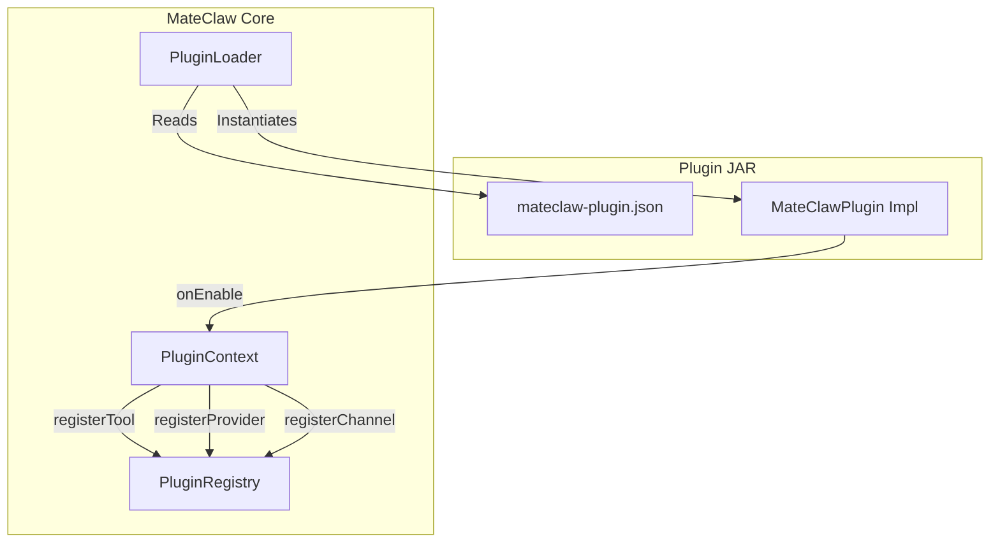
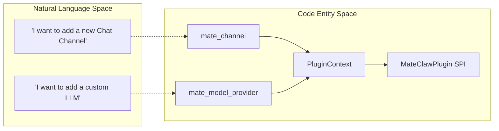

<!-- source: DeepWiki mcp.deepwiki.com · repo matevip/mateclaw · page 10 Plugin SDK · fetched 2026-10-26 -->

# Plugin SDK

Relevant source files

The following files were used as context for generating this wiki page:

- [mateclaw-server/src/main/java/vip/mate/MateClawApplication.java](mateclaw-server/src/main/java/vip/mate/MateClawApplication.java)
- [mateclaw-server/src/main/java/vip/mate/skill/controller/SkillController.java](mateclaw-server/src/main/java/vip/mate/skill/controller/SkillController.java)
- [mateclaw-server/src/main/java/vip/mate/skill/installer/BuiltinSkillSeedService.java](mateclaw-server/src/main/java/vip/mate/skill/installer/BuiltinSkillSeedService.java)
- [mateclaw-server/src/main/java/vip/mate/skill/model/SkillEntity.java](mateclaw-server/src/main/java/vip/mate/skill/model/SkillEntity.java)
- [mateclaw-server/src/main/java/vip/mate/skill/runtime/SkillPackageResolver.java](mateclaw-server/src/main/java/vip/mate/skill/runtime/SkillPackageResolver.java)
- [mateclaw-server/src/main/java/vip/mate/skill/runtime/SkillRuntimeService.java](mateclaw-server/src/main/java/vip/mate/skill/runtime/SkillRuntimeService.java)
- [mateclaw-server/src/main/java/vip/mate/skill/service/SkillService.java](mateclaw-server/src/main/java/vip/mate/skill/service/SkillService.java)
- [mateclaw-server/src/main/resources/db/migration/h2/V1__baseline_schema.sql](mateclaw-server/src/main/resources/db/migration/h2/V1__baseline_schema.sql)
- [mateclaw-server/src/main/resources/db/migration/h2/V32__bailian_team_provider.sql](mateclaw-server/src/main/resources/db/migration/h2/V32__bailian_team_provider.sql)
- [mateclaw-server/src/main/resources/db/migration/h2/V33__expand_api_key_column.sql](mateclaw-server/src/main/resources/db/migration/h2/V33__expand_api_key_column.sql)
- [mateclaw-server/src/main/resources/db/migration/h2/V34__siliconflow_opencode_providers.sql](mateclaw-server/src/main/resources/db/migration/h2/V34__siliconflow_opencode_providers.sql)
- [mateclaw-server/src/main/resources/db/migration/mysql/V1__baseline_schema.sql](mateclaw-server/src/main/resources/db/migration/mysql/V1__baseline_schema.sql)
- [mateclaw-server/src/main/resources/db/migration/mysql/V32__bailian_team_provider.sql](mateclaw-server/src/main/resources/db/migration/mysql/V32__bailian_team_provider.sql)
- [mateclaw-server/src/main/resources/db/migration/mysql/V33__expand_api_key_column.sql](mateclaw-server/src/main/resources/db/migration/mysql/V33__expand_api_key_column.sql)
- [mateclaw-server/src/main/resources/db/migration/mysql/V34__siliconflow_opencode_providers.sql](mateclaw-server/src/main/resources/db/migration/mysql/V34__siliconflow_opencode_providers.sql)
- [mateclaw-ui/src/views/Agents.vue](mateclaw-ui/src/views/Agents.vue)
- [mateclaw-ui/src/views/Dashboard.vue](mateclaw-ui/src/views/Dashboard.vue)
- [mateclaw-ui/src/views/SkillMarket.vue](mateclaw-ui/src/views/SkillMarket.vue)

The MateClaw Plugin SDK provides a structured framework for extending the platform's capabilities using external Java JAR files. Unlike **Skills**, which are Markdown-based prompt enhancements and scripts managed within the workspace [mateclaw-server/src/main/java/vip/mate/skill/model/SkillEntity.java:62-81](), **Plugins** are compiled Java components that can register deep system integrations such as new LLM providers, custom communication channels, or specialized toolsets that require complex dependencies.

### Core Architecture

MateClaw utilizes a Service Provider Interface (SPI) pattern to discover and load plugins at runtime. Each plugin operates within its own classloader to prevent dependency conflicts with the core system.

#### Plugin Lifecycle
The `MateClawPlugin` interface defines the lifecycle of a plugin:
1.  **onLoad**: Triggered when the JAR is first detected and loaded into the platform.
2.  **onEnable**: Triggered when the user enables the plugin via the UI. This is where registration of tools and providers occurs.
3.  **onDisable**: Triggered when the plugin is disabled or the system shuts down, allowing for graceful resource cleanup.

#### Plugin Registration Flow
Plugins interact with the system through the `PluginContext`, which provides APIs to register various components into the MateClaw registry, including tools [mateclaw-server/src/main/resources/db/migration/h2/V1__baseline_schema.sql:114-130](), providers [mateclaw-server/src/main/resources/db/migration/h2/V1__baseline_schema.sql:59-80](), and channels [mateclaw-server/src/main/resources/db/migration/h2/V1__baseline_schema.sql:133-146]().

**Plugin-System Interaction**

Sources: [mateclaw-server/src/main/resources/db/migration/h2/V1__baseline_schema.sql:114-146](), [mateclaw-server/src/main/java/vip/mate/skill/service/SkillService.java:145-151]()

---

### Plugin Manifest (`mateclaw-plugin.json`)

Every plugin must include a `mateclaw-plugin.json` file in its root. This manifest defines the plugin's identity and compatibility requirements.

| Field | Type | Description |
| :--- | :--- | :--- |
| `id` | String | Unique identifier (e.g., `com.example.weather-plugin`). |
| `name` | String | Human-readable name shown in the UI. |
| `version` | String | Semver version of the plugin. |
| `mainClass` | String | Fully qualified name of the `MateClawPlugin` implementation. |
| `pluginType` | Enum | `TOOL`, `PROVIDER`, `CHANNEL`, or `ALL`. |
| `apiVersion` | String | Required version of `mateclaw-plugin-api`. |

---

### Extension Capabilities

Through the `PluginContext`, plugins can inject logic into several core subsystems:

1.  **Tools**: Register Java methods as AI-callable tools. These are added to the `mate_tool` table and become available for selection in the Agent Studio [mateclaw-server/src/main/resources/db/migration/h2/V1__baseline_schema.sql:114-130]().
2.  **Providers**: Add support for new LLM backends by registering a `ModelProvider`. These entries populate the `mate_model_provider` table [mateclaw-server/src/main/resources/db/migration/h2/V1__baseline_schema.sql:59-80]().
3.  **Channels**: Implement `PluginChannelAdapter` to deliver agent responses to new platforms (e.g., specialized IoT alerts or internal enterprise IMs) [mateclaw-server/src/main/resources/db/migration/h2/V1__baseline_schema.sql:133-146]().
4.  **Memory Providers**: Extend how facts are stored or recalled by implementing `PluginMemoryProvider`.

**Entity Mapping Diagram**

Sources: [mateclaw-server/src/main/resources/db/migration/h2/V1__baseline_schema.sql:59-80](), [mateclaw-server/src/main/resources/db/migration/h2/V1__baseline_schema.sql:133-146]()

---

### Development Workflow

1.  **Dependency**: Add `mateclaw-plugin-api` to your Maven `pom.xml` with `<scope>provided</scope>`.
2.  **Implementation**: Create a class implementing `MateClawPlugin`.
3.  **Tool Definition**: Use `@Tool` and `@ToolParam` annotations on methods to define parameters and descriptions that the LLM will use for function calling.
4.  **Packaging**: Build a fat JAR containing your logic (excluding provided MateClaw APIs).
5.  **Deployment**: Upload the JAR via the Plugins section in the System Settings UI.

For a detailed walkthrough of building your first plugin, see [Building & Packaging a Plugin](#10.2).

---

### Child Pages

*   [Plugin API Contract](#10.1) — Detailed reference for the `mateclaw-plugin-api` module: `MateClawPlugin` interface, `PluginContext` methods, and manifest validation rules.
*   [Building & Packaging a Plugin](#10.2) — Step-by-step guide using the `mateclaw-plugin-sample` as a reference, covering Maven setup and tool annotation.

---

