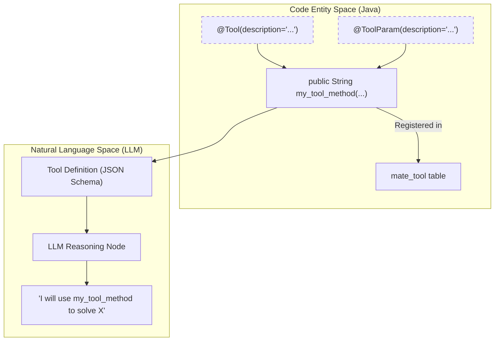
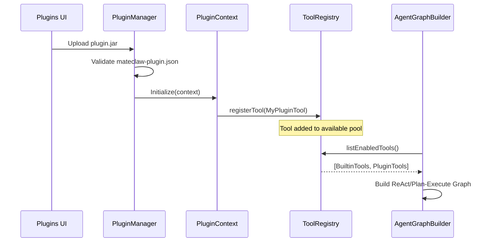
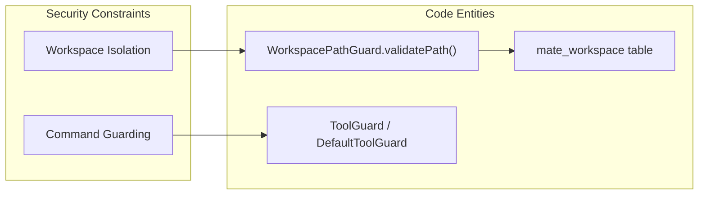

<!-- source: DeepWiki mcp.deepwiki.com · repo matevip/mateclaw · page 10.2 Building & Packaging a Plugin · fetched 2026-10-26 -->

# Building & Packaging a Plugin

<details>
<summary>Relevant source files</summary>

The following files were used as context for generating this wiki page:

- [mateclaw-server/pom.xml](mateclaw-server/pom.xml)
- [mateclaw-server/src/main/java/vip/mate/agent/AgentService.java](mateclaw-server/src/main/java/vip/mate/agent/AgentService.java)
- [mateclaw-server/src/main/java/vip/mate/agent/ThinkingLevelHolder.java](mateclaw-server/src/main/java/vip/mate/agent/ThinkingLevelHolder.java)
- [mateclaw-server/src/main/java/vip/mate/agent/model/AgentEntity.java](mateclaw-server/src/main/java/vip/mate/agent/model/AgentEntity.java)
- [mateclaw-server/src/main/java/vip/mate/channel/service/ChannelService.java](mateclaw-server/src/main/java/vip/mate/channel/service/ChannelService.java)
- [mateclaw-server/src/main/java/vip/mate/cron/service/CronJobService.java](mateclaw-server/src/main/java/vip/mate/cron/service/CronJobService.java)
- [mateclaw-server/src/main/java/vip/mate/exception/MateClawException.java](mateclaw-server/src/main/java/vip/mate/exception/MateClawException.java)
- [mateclaw-server/src/main/java/vip/mate/memory/event/ConversationCompletionPublisher.java](mateclaw-server/src/main/java/vip/mate/memory/event/ConversationCompletionPublisher.java)
- [mateclaw-server/src/main/java/vip/mate/tool/builtin/DocumentExtractTool.java](mateclaw-server/src/main/java/vip/mate/tool/builtin/DocumentExtractTool.java)
- [mateclaw-server/src/main/java/vip/mate/tool/builtin/DocxRenderTool.java](mateclaw-server/src/main/java/vip/mate/tool/builtin/DocxRenderTool.java)
- [mateclaw-server/src/main/java/vip/mate/tool/builtin/TikaExtractor.java](mateclaw-server/src/main/java/vip/mate/tool/builtin/TikaExtractor.java)
- [mateclaw-server/src/main/java/vip/mate/tool/document/GeneratedFileCache.java](mateclaw-server/src/main/java/vip/mate/tool/document/GeneratedFileCache.java)
- [mateclaw-server/src/main/java/vip/mate/tool/document/GeneratedFileController.java](mateclaw-server/src/main/java/vip/mate/tool/document/GeneratedFileController.java)
- [mateclaw-server/src/main/java/vip/mate/tool/document/MarkdownDocxRenderer.java](mateclaw-server/src/main/java/vip/mate/tool/document/MarkdownDocxRenderer.java)
- [mateclaw-server/src/main/java/vip/mate/tool/mcp/service/McpServerService.java](mateclaw-server/src/main/java/vip/mate/tool/mcp/service/McpServerService.java)
- [mateclaw-server/src/main/java/vip/mate/tool/service/ToolService.java](mateclaw-server/src/main/java/vip/mate/tool/service/ToolService.java)
- [mateclaw-server/src/main/java/vip/mate/workspace/core/service/WorkspaceService.java](mateclaw-server/src/main/java/vip/mate/workspace/core/service/WorkspaceService.java)
- [mateclaw-server/src/main/resources/db/migration/h2/V47__agent_max_iterations_100.sql](mateclaw-server/src/main/resources/db/migration/h2/V47__agent_max_iterations_100.sql)
- [mateclaw-server/src/main/resources/db/migration/h2/V4__agent_thinking_level.sql](mateclaw-server/src/main/resources/db/migration/h2/V4__agent_thinking_level.sql)
- [mateclaw-server/src/main/resources/db/migration/mysql/V47__agent_max_iterations_100.sql](mateclaw-server/src/main/resources/db/migration/mysql/V47__agent_max_iterations_100.sql)
- [mateclaw-server/src/main/resources/db/schema-mysql.sql](mateclaw-server/src/main/resources/db/schema-mysql.sql)
- [mateclaw-server/src/main/resources/db/schema.sql](mateclaw-server/src/main/resources/db/schema.sql)
- [mateclaw-ui/package.json](mateclaw-ui/package.json)

</details>


This guide provides a technical walkthrough for extending the MateClaw platform using the Java-based Plugin SDK. MateClaw uses a specialized plugin architecture that allows developers to register new tools, LLM providers, and communication channels without modifying the core server source code.

## Plugin Development Workflow

The development of a MateClaw plugin follows a standard lifecycle: environment setup, implementation of the entry point, tool definition, manifest creation, and deployment.

### 1. Maven Project Setup
Plugins must depend on `mateclaw-plugin-api`. In your `pom.xml`, this dependency should be marked as `provided` because the MateClaw platform provides the API classes at runtime [mateclaw-server/pom.xml:58-62]().

```xml
<dependencies>
    <dependency>
        <groupId>vip.mate</groupId>
        <artifactId>mateclaw-plugin-api</artifactId>
        <version>1.1.0-SNAPSHOT</version>
        <scope>provided</scope>
    </dependency>
</dependencies>
```
Sources: [mateclaw-server/pom.xml:58-62]()

### 2. Implementing the Plugin Entry Point
Every plugin must implement the `MateClawPlugin` interface. This class serves as the lifecycle manager for your extension.

*   **`onLoad(PluginContext context)`**: Called when the JAR is first detected. Use this to register components.
*   **`onEnable()`**: Called when the user activates the plugin via the UI.
*   **`onDisable()`**: Called when the plugin is deactivated or the server shuts down.

### 3. Defining Tools with Annotations
MateClaw uses Spring AI-compatible annotations to expose Java methods as LLM tools. Tools are automatically registered to the platform and can be used by the `AgentGraphBuilder` [mateclaw-server/src/main/java/vip/mate/agent/AgentService.java:39-40]().

*   **`@Tool`**: Applied to a public method to define it as a tool. The `description` field is critical as it tells the LLM when and how to use the tool [mateclaw-server/src/main/java/vip/mate/tool/builtin/DocumentExtractTool.java:39-64]().
*   **`@ToolParam`**: Applied to method parameters to provide metadata (description and required status) for the tool's JSON schema [mateclaw-server/src/main/java/vip/mate/tool/builtin/DocxRenderTool.java:60-66]().

**Tool Implementation Example:**
The following diagram illustrates how a Java method is transformed into a tool entity usable by the Agent Graph.

**Bridge: Java Method to Agent Tool**

Sources: [mateclaw-server/src/main/java/vip/mate/tool/builtin/DocumentExtractTool.java:39-67](), [mateclaw-server/src/main/java/vip/mate/tool/builtin/DocxRenderTool.java:60-66](), [mateclaw-server/src/main/resources/db/schema.sql:115-131]()

### 4. Creating the Manifest
A `mateclaw-plugin.json` file must be placed in the `src/main/resources` directory. This manifest defines the plugin's identity and compatibility.

| Field | Description |
| :--- | :--- |
| `id` | Unique identifier (e.g., `com.example.weather-plugin`) |
| `mainClass` | Fully qualified name of the class implementing `MateClawPlugin` |
| `version` | Semver version of the plugin |
| `apiLevel` | Required version of the MateClaw Plugin API |

## Data Flow: Plugin Loading & Execution

When a plugin JAR is uploaded, the platform initializes it through the `PluginContext`. Tools registered by the plugin are injected into the `AgentGraphBuilder` during conversation initialization to build the `StateGraph` [mateclaw-server/src/main/java/vip/mate/agent/AgentService.java:102-104]().

**Plugin Registration Sequence**

Sources: [mateclaw-server/src/main/java/vip/mate/agent/AgentService.java:39-45](), [mateclaw-server/src/main/resources/db/schema.sql:115-131]()

## Packaging and Deployment

### Building the JAR
Use the standard Maven package command. Ensure that dependencies provided by the platform (like `spring-ai`, `hutool`, or `mybatis-plus`) are not bundled into the plugin JAR to avoid ClassLoader conflicts [mateclaw-server/pom.xml:25-33]().

```bash
mvn clean package
```
Sources: [mateclaw-server/pom.xml:25-33]()

### Loading via UI
1.  Navigate to **System Settings** -> **Plugins** in the MateClaw Web Console.
2.  Click **Upload Plugin** and select your `.jar` file.
3.  The platform will parse the `mateclaw-plugin.json` and call `onLoad`.
4.  Toggle the **Enabled** switch to trigger `onEnable`.

### Security and Path Constraints
Plugins are subject to the same security evaluation as built-in tools. If a plugin tool attempts to access files, it should use `WorkspacePathGuard` to ensure it stays within the allowed workspace boundary [mateclaw-server/src/main/java/vip/mate/tool/builtin/DocxRenderTool.java:141-144](). Tools that perform file operations should be aware of the `mate_workspace` configuration [mateclaw-server/src/main/resources/db/schema.sql:205-214]().

**Bridge: Security Constraints to Code Entities**

Sources: [mateclaw-server/src/main/java/vip/mate/tool/builtin/DocxRenderTool.java:139-144](), [mateclaw-server/src/main/resources/db/schema.sql:205-214]()

---

