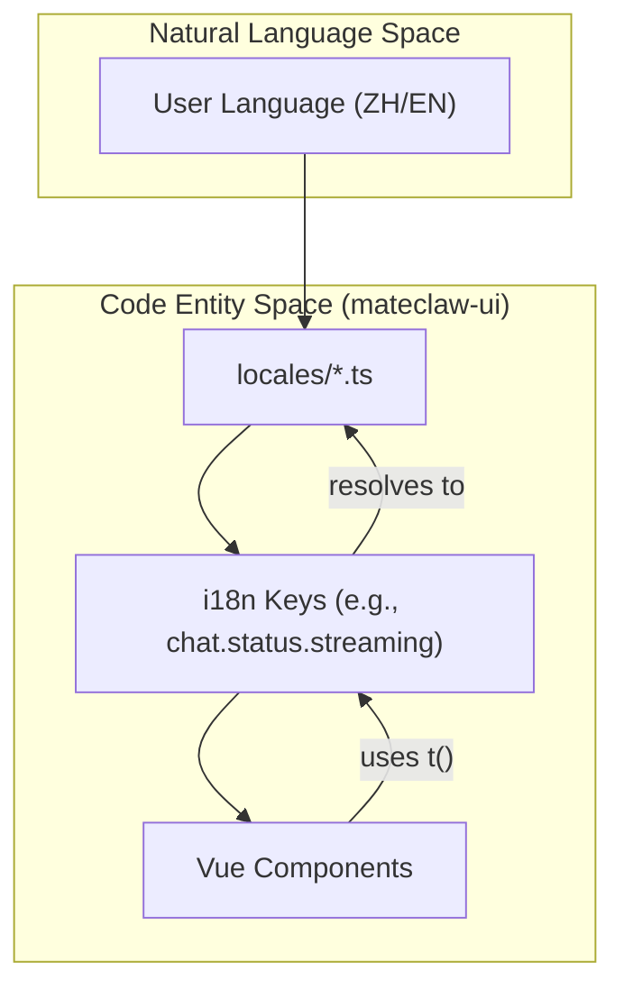
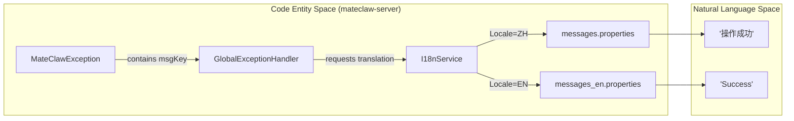

<!-- source: DeepWiki mcp.deepwiki.com · repo matevip/mateclaw · page 12 Internationalization & Localization · fetched 2026-10-26 -->

# Internationalization & Localization

<details>
<summary>Relevant source files</summary>

The following files were used as context for generating this wiki page:

- [mateclaw-server/src/main/java/vip/mate/exception/GlobalExceptionHandler.java](mateclaw-server/src/main/java/vip/mate/exception/GlobalExceptionHandler.java)
- [mateclaw-server/src/main/java/vip/mate/tool/builtin/CronJobTool.java](mateclaw-server/src/main/java/vip/mate/tool/builtin/CronJobTool.java)
- [mateclaw-server/src/main/java/vip/mate/tool/guard/DefaultToolGuard.java](mateclaw-server/src/main/java/vip/mate/tool/guard/DefaultToolGuard.java)
- [mateclaw-server/src/main/java/vip/mate/wiki/controller/WikiController.java](mateclaw-server/src/main/java/vip/mate/wiki/controller/WikiController.java)
- [mateclaw-server/src/main/resources/db/migration/h2/V3__register_cron_job_tool.sql](mateclaw-server/src/main/resources/db/migration/h2/V3__register_cron_job_tool.sql)
- [mateclaw-server/src/main/resources/db/migration/mysql/V3__register_cron_job_tool.sql](mateclaw-server/src/main/resources/db/migration/mysql/V3__register_cron_job_tool.sql)
- [mateclaw-server/src/main/resources/messages.properties](mateclaw-server/src/main/resources/messages.properties)
- [mateclaw-server/src/main/resources/messages_en.properties](mateclaw-server/src/main/resources/messages_en.properties)
- [mateclaw-ui/src/api/index.ts](mateclaw-ui/src/api/index.ts)
- [mateclaw-ui/src/i18n/locales/en-US.ts](mateclaw-ui/src/i18n/locales/en-US.ts)
- [mateclaw-ui/src/i18n/locales/zh-CN.ts](mateclaw-ui/src/i18n/locales/zh-CN.ts)
- [mateclaw-ui/src/views/Wiki/components/RawMaterialPanel.vue](mateclaw-ui/src/views/Wiki/components/RawMaterialPanel.vue)

</details>


MateClaw implements a comprehensive internationalization (i18n) and localization (l10n) system covering both the Vue 3 frontend and the Spring Boot backend. The system ensures that UI labels, error messages, tool descriptions, and agent processing states are presented in the user's preferred language (defaulting to `zh-CN` with full support for `en-US`).

## Frontend Architecture

The frontend uses `vue-i18n` with locale definitions stored as TypeScript modules. This allows for type-safe key references and easy expansion to new languages.

### Locale Structure
Locale files are located in `mateclaw-ui/src/i18n/locales/`. Each file exports a nested object structure categorized by functional modules (e.g., `chat`, `wiki`, `nav`, `common`).

*   **Chinese (Simplified):** [mateclaw-ui/src/i18n/locales/zh-CN.ts:1-215]()
*   **English (US):** [mateclaw-ui/src/i18n/locales/en-US.ts:1-175]()

### UI State Machine Mapping
The Chat UI displays real-time agent status during the `StateGraph` execution. These labels map internal processing phases to human-readable strings.

| Internal Phase | UI Label (EN) | UI Label (ZH) | Description |
| :--- | :--- | :--- | :--- |
| `streamPreparingContext` | Preparing context... | 准备上下文... | Collecting history and config [mateclaw-ui/src/i18n/locales/zh-CN.ts:177]() |
| `streamReadingMemory` | Reading memory... | 读取记忆... | Recalling facts and long-term memory [mateclaw-ui/src/i18n/locales/zh-CN.ts:178]() |
| `streamReasoning` | Analyzing... | 分析问题... | Internal LLM reasoning/planning [mateclaw-ui/src/i18n/locales/zh-CN.ts:179]() |
| `streamExecutingTool` | Executing tool... | 执行工具... | Running Shell, Browser, or API tools [mateclaw-ui/src/i18n/locales/zh-CN.ts:184]() |
| `streamAwaitingApproval` | Awaiting approval | 等待审批 | HIL (Human-in-the-loop) barrier [mateclaw-ui/src/i18n/locales/zh-CN.ts:185]() |

### Natural Language to UI Entities
This diagram shows how the system maps abstract concepts like "Processing Status" to specific code entities in the localization files.

**UI Localization Mapping**

Sources: [mateclaw-ui/src/i18n/locales/zh-CN.ts:46-51](), [mateclaw-ui/src/views/Wiki/components/RawMaterialPanel.vue:31-34]()

---

## Backend Internationalization

The backend utilizes standard Java `ResourceBundle` (`messages.properties`) for server-side messages, including error codes, tool metadata, and security guard descriptions.

### Resource Files
*   **Default (ZH):** [mateclaw-server/src/main/resources/messages.properties:1-53]()
*   **English:** [mateclaw-server/src/main/resources/messages_en.properties:1-53]()

### Exception Translation Flow
The `GlobalExceptionHandler` intercepts `MateClawException` and uses the `I18nService` to translate error keys before sending the response to the frontend.

1.  A business service throws `MateClawException` with a specific `msgKey` [mateclaw-server/src/main/java/vip/mate/exception/GlobalExceptionHandler.java:58-60]().
2.  `GlobalExceptionHandler.handleMateClawException` catches it [mateclaw-server/src/main/java/vip/mate/exception/GlobalExceptionHandler.java:45-50]().
3.  `translateExceptionMsg` calls `i18nService.msg(msgKey)` to look up the localized string [mateclaw-server/src/main/java/vip/mate/exception/GlobalExceptionHandler.java:57-66]().
4.  The result is wrapped in an `R<Void>` object and returned as JSON [mateclaw-server/src/main/java/vip/mate/exception/GlobalExceptionHandler.java:49]().

### Tool & Security Guard Metadata
Tools and security rules are localized to provide the LLM and the user with clear descriptions of what a tool does and why a command was blocked.

| Key Category | Example Key | Purpose |
| :--- | :--- | :--- |
| **Result Codes** | `result.agent_busy` | Standardized API response messages [mateclaw-server/src/main/resources/messages.properties:11]() |
| **Tool Desc** | `tool.read_file.desc` | Localized description for the LLM tool registry [mateclaw-server/src/main/resources/messages.properties:21]() |
| **Guard Rules** | `guard.SHELL_RM_RF.name` | Human-readable name for security violations [mateclaw-server/src/main/resources/messages_en.properties:95]() |

### Backend Message Resolution
This diagram bridges the internal error handling logic to the localized message property files.

**Backend Message Flow**

Sources: [mateclaw-server/src/main/java/vip/mate/exception/GlobalExceptionHandler.java:45-66](), [mateclaw-server/src/main/resources/messages.properties:4](), [mateclaw-server/src/main/resources/messages_en.properties:4]()

---

## Adding New Locale Keys

To add support for a new feature or language, follow these steps:

### 1. Frontend Keys
1.  Open `mateclaw-ui/src/i18n/locales/zh-CN.ts` and add the key to the appropriate section.
2.  Open `mateclaw-ui/src/i18n/locales/en-US.ts` and add the English translation.
3.  Use the key in Vue components via the `t()` function from `vue-i18n` [mateclaw-ui/src/views/Wiki/components/RawMaterialPanel.vue:31-34]().

### 2. Backend Keys
1.  Add the key to `mateclaw-server/src/main/resources/messages.properties` [mateclaw-server/src/main/resources/messages.properties:4-14]().
2.  Add the translation to `mateclaw-server/src/main/resources/messages_en.properties` [mateclaw-server/src/main/resources/messages_en.properties:4-14]().
3.  Reference the key when throwing exceptions:
    ```java
    throw new MateClawException(500, "result.agent_busy");
    ```
    The `GlobalExceptionHandler` will automatically attempt to resolve this key [mateclaw-server/src/main/java/vip/mate/exception/GlobalExceptionHandler.java:58-60]().

### 3. Database Seed Data
For built-in tools (like `CronJobTool`) registered via SQL, localization is handled by providing descriptions in the `mate_tool` table. These values can be updated or merged via Flyway migration scripts to ensure consistency across environments [mateclaw-server/src/main/resources/db/migration/mysql/V3__register_cron_job_tool.sql:2-4]().

---

