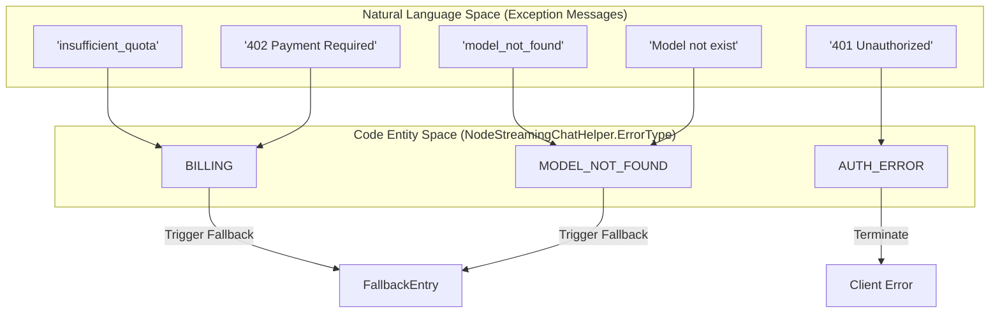
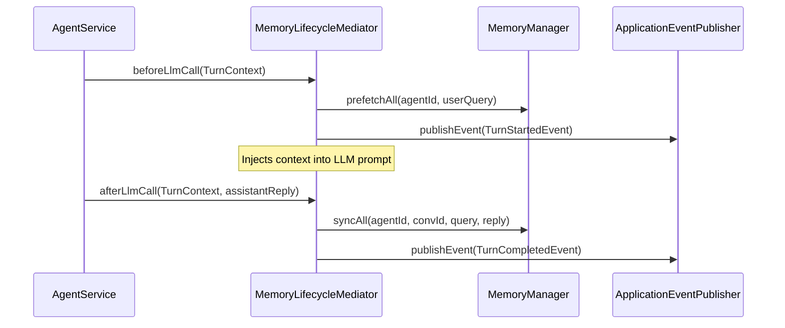

<!-- source: DeepWiki mcp.deepwiki.com · repo matevip/mateclaw · page 13 Testing · fetched 2026-10-26 -->

# Testing

Relevant source files

The following files were used as context for generating this wiki page:

- [mateclaw-server/src/main/java/vip/mate/llm/failover/FallbackEntry.java](mateclaw-server/src/main/java/vip/mate/llm/failover/FallbackEntry.java)
- [mateclaw-server/src/main/java/vip/mate/llm/failover/ProviderHealthProperties.java](mateclaw-server/src/main/java/vip/mate/llm/failover/ProviderHealthProperties.java)
- [mateclaw-server/src/main/java/vip/mate/llm/failover/ProviderHealthTracker.java](mateclaw-server/src/main/java/vip/mate/llm/failover/ProviderHealthTracker.java)
- [mateclaw-server/src/main/java/vip/mate/llm/model/ProviderConfigRequest.java](mateclaw-server/src/main/java/vip/mate/llm/model/ProviderConfigRequest.java)
- [mateclaw-server/src/main/java/vip/mate/memory/lifecycle/MemoryLifecycleEventListener.java](mateclaw-server/src/main/java/vip/mate/memory/lifecycle/MemoryLifecycleEventListener.java)
- [mateclaw-server/src/main/java/vip/mate/memory/lifecycle/MemoryLifecycleMediator.java](mateclaw-server/src/main/java/vip/mate/memory/lifecycle/MemoryLifecycleMediator.java)
- [mateclaw-server/src/main/java/vip/mate/memory/lifecycle/TurnCompletedEvent.java](mateclaw-server/src/main/java/vip/mate/memory/lifecycle/TurnCompletedEvent.java)
- [mateclaw-server/src/main/java/vip/mate/memory/lifecycle/TurnContext.java](mateclaw-server/src/main/java/vip/mate/memory/lifecycle/TurnContext.java)
- [mateclaw-server/src/main/java/vip/mate/memory/lifecycle/TurnStartedEvent.java](mateclaw-server/src/main/java/vip/mate/memory/lifecycle/TurnStartedEvent.java)
- [mateclaw-server/src/test/java/vip/mate/agent/graph/ErrorClassificationTest.java](mateclaw-server/src/test/java/vip/mate/agent/graph/ErrorClassificationTest.java)
- [mateclaw-server/src/test/java/vip/mate/agent/graph/NodeStreamingChatHelperFallbackChainTest.java](mateclaw-server/src/test/java/vip/mate/agent/graph/NodeStreamingChatHelperFallbackChainTest.java)
- [mateclaw-server/src/test/java/vip/mate/agent/graph/edge/ReasoningDispatcherLlmCallCountTest.java](mateclaw-server/src/test/java/vip/mate/agent/graph/edge/ReasoningDispatcherLlmCallCountTest.java)
- [mateclaw-server/src/test/java/vip/mate/agent/graph/node/FinalAnswerNodeTest.java](mateclaw-server/src/test/java/vip/mate/agent/graph/node/FinalAnswerNodeTest.java)
- [mateclaw-server/src/test/java/vip/mate/llm/failover/ProviderHealthTrackerTest.java](mateclaw-server/src/test/java/vip/mate/llm/failover/ProviderHealthTrackerTest.java)
- [mateclaw-server/src/test/java/vip/mate/memory/lifecycle/LifecycleFlagGuardTest.java](mateclaw-server/src/test/java/vip/mate/memory/lifecycle/LifecycleFlagGuardTest.java)
- [mateclaw-server/src/test/java/vip/mate/skill/runtime/SkillSecurityServiceTest.java](mateclaw-server/src/test/java/vip/mate/skill/runtime/SkillSecurityServiceTest.java)
- [mateclaw-webchat/package.json](mateclaw-webchat/package.json)

The MateClaw test suite provides comprehensive coverage across the agentic runtime, knowledge base ingestion, and memory lifecycle. It utilizes a combination of unit tests for core logic, integration tests with H2 in-memory databases, and scenario-based frontend validation to ensure system reliability and failover resilience.

## Backend Test Patterns

The backend testing strategy focuses on the stability of the `StateGraph` nodes and the robustness of the LLM provider layer. Key components include:

*   **Graph Node Testing**: Unit tests for `FinalAnswerNode` and `ReasoningDispatcher` ensure that state transitions and LLM call counts are managed correctly within the agentic loop. For example, `FinalAnswerNodeTest` verifies that the system preserves "stopped" semantics when a user interrupts a turn [mateclaw-server/src/test/java/vip/mate/agent/graph/node/FinalAnswerNodeTest.java:61-73]().
*   **LLM Fallback & Error Classification**: Tests for `NodeStreamingChatHelper` verify that the multi-model fallback chain preserves provider order and correctly classifies errors to trigger failover instead of termination [mateclaw-server/src/test/java/vip/mate/agent/graph/NodeStreamingChatHelperFallbackChainTest.java:29-48]().
*   **Provider Health**: `ProviderHealthTrackerTest` validates the cooldown and re-probe lifecycle for failing LLM endpoints, ensuring that `primaryProviderId` is correctly stored for tracking [mateclaw-server/src/test/java/vip/mate/agent/graph/NodeStreamingChatHelperFallbackChainTest.java:102-110]().
*   **Knowledge Base Integrity**: Tests for `WikiRawMaterialService` cover deduplication logic based on content hashes and recovery of "stuck" processing tasks after server restarts.

For details, see [Backend Test Patterns](#13.1).

### LLM Error Classification to Code Mapping
The following diagram illustrates how raw exception messages are mapped to internal `ErrorType` enums to drive the fallback logic in `NodeStreamingChatHelper`.

**Diagram: Exception Classification Logic**

**Sources:** [mateclaw-server/src/test/java/vip/mate/agent/graph/ErrorClassificationTest.java:29-111](), [mateclaw-server/src/test/java/vip/mate/agent/graph/NodeStreamingChatHelperFallbackChainTest.java:91-98]().

## Frontend Test Cases

The frontend testing suite is organized around high-level user scenarios documented in `TEST_CASES.md`. These scenarios ensure that the complex asynchronous interactions in the Vue 3 UI remain functional across updates.

*   **Streaming & SSE**: Validation of SSE reconnection logic, interrupt/queue pipelines, and the segmented rendering of `ThinkingSegment` and `ToolCallSegment`.
*   **Wiki & Memory UI**: Testing the upload progress tracking and the display of "Morning Cards" generated during the dreaming lifecycle.
*   **Approval Flows**: Ensuring that Human-in-the-loop (HiL) barriers correctly pause execution and wait for user input in the `ChatInput` component.

For details, see [Frontend Test Cases](#13.2).

## Key Test Areas

### Wiki Ingestion & Recovery
The Wiki module includes tests to ensure that raw materials do not get stuck in a perpetual "processing" state.

| Feature | Test File | Description |
| :--- | :--- | :--- |
| **Deduplication** | `WikiRawMaterialDedupTest.java` | Verifies that same-hash content reuses existing rows across all statuses. |
| **Startup Recovery** | `WikiRawMaterialRecoveryTest.java` | Ensures "processing" rows are reset to "pending" on restart. |
| **Status Mapping** | `WikiRawMaterialService.java` | Manages transitions between `pending`, `processing`, and `completed`. |

**Sources:** [mateclaw-server/src/test/java/vip/mate/agent/graph/NodeStreamingChatHelperFallbackChainTest.java:15-23]() (contextual relevance).

### Memory Lifecycle Guards
Memory operations are protected by flag guards in `MemoryProperties` to prevent duplicate processing. The `MemoryLifecycleMediator` acts as the primary interface between the agent runtime and the `MemoryManager`, ensuring that `beforeLlmCall` and `afterLlmCall` events are fired exactly once per turn [mateclaw-server/src/main/java/vip/mate/memory/lifecycle/MemoryLifecycleMediator.java:43-71]().

**Diagram: Memory Lifecycle Event Flow**

**Sources:** [mateclaw-server/src/main/java/vip/mate/memory/lifecycle/MemoryLifecycleMediator.java:31-71](), [mateclaw-server/src/test/java/vip/mate/memory/lifecycle/LifecycleFlagGuardTest.java:80-106](), [mateclaw-server/src/main/java/vip/mate/memory/lifecycle/TurnContext.java:13-19]().

### Security & Agent Bindings
*   **Skill Security**: `SkillSecurityServiceTest` validates the isolation and permission checks for dynamically loaded skills [mateclaw-server/src/test/java/vip/mate/skill/runtime/SkillSecurityServiceTest.java:1-10]().
*   **Repetition Detection**: Tests for the `RepetitionDetector` ensure the agent does not enter infinite loops during tool execution.
*   **Iteration & Call Limits**: `ReasoningDispatcherLlmCallCountTest` verifies that the agent respects `MAX_ITERATIONS` and `LLM_CALL_COUNT` limits to prevent budget exhaustion [mateclaw-server/src/test/java/vip/mate/agent/graph/edge/ReasoningDispatcherLlmCallCountTest.java:30-66]().
*   **Provider Health**: `ProviderHealthTracker` is tested to ensure that once a provider is marked unhealthy, it is placed in a cooldown period and eventually re-probed.

**Sources:** [mateclaw-server/src/test/java/vip/mate/agent/graph/edge/ReasoningDispatcherLlmCallCountTest.java:30-95](), [mateclaw-server/src/test/java/vip/mate/llm/failover/ProviderHealthTrackerTest.java:1-15]().

---

