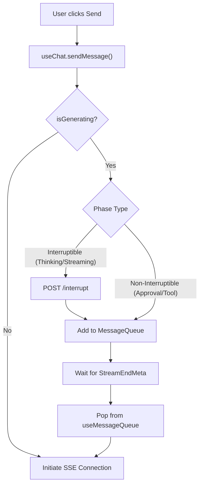
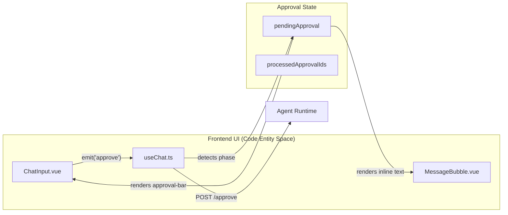

<!-- source: DeepWiki mcp.deepwiki.com · repo matevip/mateclaw · page 13.2 Frontend Test Cases · fetched 2026-10-26 -->

# Frontend Test Cases

Relevant source files

The following files were used as context for generating this wiki page:

- [mateclaw-server/src/main/java/vip/mate/agent/graph/plan/node/DirectAnswerNode.java](mateclaw-server/src/main/java/vip/mate/agent/graph/plan/node/DirectAnswerNode.java)
- [mateclaw-server/src/main/java/vip/mate/config/WebSocketConfig.java](mateclaw-server/src/main/java/vip/mate/config/WebSocketConfig.java)
- [mateclaw-server/src/main/java/vip/mate/workspace/conversation/ConversationService.java](mateclaw-server/src/main/java/vip/mate/workspace/conversation/ConversationService.java)
- [mateclaw-ui/TEST_CASES.md](mateclaw-ui/TEST_CASES.md)
- [mateclaw-ui/src/components/chat/BrowserTimeline.vue](mateclaw-ui/src/components/chat/BrowserTimeline.vue)
- [mateclaw-ui/src/components/chat/ChatInput.vue](mateclaw-ui/src/components/chat/ChatInput.vue)
- [mateclaw-ui/src/components/chat/PlanStepsPanel.vue](mateclaw-ui/src/components/chat/PlanStepsPanel.vue)
- [mateclaw-ui/src/composables/chat/useChat.ts](mateclaw-ui/src/composables/chat/useChat.ts)
- [mateclaw-ui/src/views/ChatConsole.vue](mateclaw-ui/src/views/ChatConsole.vue)

This page details the technical validation scenarios and implementation logic for the MateClaw Vue 3 frontend. It focuses on high-stakes interactions such as SSE streaming stability, the interrupt/queue pipeline, multi-segmented message rendering, and Human-in-the-Loop (HiL) approval flows.

## 1. SSE Lifecycle & Reconnection

The frontend maintains a robust Server-Sent Events (SSE) connection through the `useStream` and `useChat` composables. Testing focuses on ensuring that the UI remains synchronized with the backend agent graph state even across network flickers.

### Implementation Details
*   **Stale Event Guard**: `useChat` tracks a `streamConversationId` and `activeTurnId` to prevent events from a previous session or a timed-out turn from polluting the current UI state [mateclaw-ui/src/composables/chat/useChat.ts:151-159]().
*   **Heartbeat Monitoring**: The `heartbeat` ref captures periodic signals from the server to verify connection health [mateclaw-ui/src/composables/chat/useChat.ts:149-149]().
*   **Turn ID Isolation**: Each message generation turn is assigned a unique `activeTurnId` to ensure segments are flushed only to the correct assistant message placeholder [mateclaw-ui/src/composables/chat/useChat.ts:127-148]().

### Test Scenarios (TC-1)
| Case ID | Scenario | Key Code Entity | Expected Behavior |
| :--- | :--- | :--- | :--- |
| TC-1.1 | SSE Disconnect | `reconnectStream` | UI detects closure; calls `reconnectStream` with current `conversationId` to resume state [mateclaw-ui/src/composables/chat/useChat.ts:78-78](). |
| TC-1.2 | Thinking Phase | `StreamPhase` | Loading bar shows "Thinking..." and timer; suppresses "slow hint" details [mateclaw-ui/TEST_CASES.md:18-25](). |
| TC-1.3 | Generation End | `onStreamEnd` | Callback triggers history reconciliation and persistence checks [mateclaw-ui/src/composables/chat/useChat.ts:31-31](). |

**Sources:** [mateclaw-ui/src/composables/chat/useChat.ts:127-159](), [mateclaw-ui/TEST_CASES.md:16-41]()

---

## 2. Interrupt & Queue Pipeline

MateClaw supports an "Interrupt + Queue + Resume" model. Users can send new messages while the agent is still generating.

### Data Flow Diagram: Message Submission
"This diagram maps the natural language action of sending a message to the internal state management in `useChat.ts`."

**Sources:** [mateclaw-ui/src/composables/chat/useChat.ts:5-11](), [mateclaw-ui/src/composables/chat/useChat.ts:65-70]()

### Validation Areas
*   **Queue Display**: The `ChatInput` component must show a `queued-indicator` when a message is waiting, including the current queue size [mateclaw-ui/src/components/chat/ChatInput.vue:93-107]().
*   **Cancelation**: Users must be able to cancel a queued message via `cancelQueued` before it is dispatched [mateclaw-ui/src/composables/chat/useChat.ts:69-70]().
*   **Input Availability**: The input area remains active even during generation to facilitate the interrupt flow [mateclaw-ui/src/components/chat/ChatInput.vue:90-91]().

---

## 3. Segmented Message Rendering

Messages are rendered using a segmented approach (Claude Code style), allowing simultaneous display of thinking process, tool calls, and final content.

### Component Mapping
| Code Entity | Purpose | Segment Type |
| :--- | :--- | :--- |
| `ThinkingSegment` | Renders the model's internal reasoning chain. | `thinking` |
| `ToolCallSegment` | Displays tool execution status (running/success/error). | `tool_call` |
| `ContentSegment` | Renders markdown output with a `TypingCursor`. | `content` |
| `PlanStepsPanel` | Displays hierarchical steps for Plan-Execute agents. | `plan` |
| `BrowserTimeline` | Shows chronological browser actions with screenshots. | `browser` |

**Sources:** [mateclaw-ui/src/components/chat/MessageBubble.vue:22-32](), [mateclaw-ui/src/components/chat/PlanStepsPanel.vue:50-67](), [mateclaw-ui/src/components/chat/BrowserTimeline.vue:1-40]()

### Test Scenarios (TC-3)
*   **TC-3.1 (Plan Uniqueness)**: Ensure `PlanStepsPanel` appears only once per message bubble and correctly updates step status from `pending` to `completed` [mateclaw-ui/TEST_CASES.md:82-89]().
*   **TC-3.2 (Browser Timeline)**: Verify that `BrowserTimeline` is collapsed by default and displays screenshots upon expansion [mateclaw-ui/src/components/chat/BrowserTimeline.vue:64-71](), [mateclaw-ui/TEST_CASES.md:104-112]().
*   **TC-3.3 (Direct Answer)**: Verify that for simple queries, the Plan-Execute agent can bypass the full graph via `DirectAnswerNode` to deliver immediate content [mateclaw-server/src/main/java/vip/mate/agent/graph/plan/node/DirectAnswerNode.java:22-34]().

---

## 4. Approval Flow (Human-in-the-Loop)

High-risk tools (e.g., `execute_shell_command` with `rm`) trigger a security barrier that requires user confirmation.

### Code Entity Association
"This diagram links the UI components to the approval state logic."

**Sources:** [mateclaw-ui/src/components/chat/MessageBubble.vue:108-119](), [mateclaw-ui/src/components/chat/ChatInput.vue:61-88](), [mateclaw-ui/src/composables/chat/useChat.ts:161-161]()

### Test Scenarios (TC-2)
*   **TC-2.1 (Shell Approval)**: Trigger `execute_shell_command` with a dangerous pattern. Verify `ChatInput` replaces the textarea with an `approval-bar` [mateclaw-ui/TEST_CASES.md:52-61]().
*   **TC-2.2 (Denial Flow)**: Verify that clicking "Deny" sends the rejection to the backend and updates the message bubble to "Denied" status [mateclaw-ui/src/components/chat/ChatInput.vue:71-78]().
*   **TC-2.3 (Critical Block)**: Verify that `CRITICAL` severity rules (like `rm -rf /`) result in a direct block message without showing the approval UI [mateclaw-ui/TEST_CASES.md:70-77]().

---

## 5. Wiki & Memory UI

### Wiki Upload Progress
The Wiki module uses SSE to report ingestion progress. 
*   **Validation**: Verify that the `RawMaterialPanel` correctly displays progress bars and status updates from the `WikiProgressBus` (backend).
*   **Sources**: [mateclaw-ui/src/views/ChatConsole.vue:129-137]() (Drag-and-drop logic).

### Memory Morning Card
The "Morning Card" is the primary interface for reviewing nightly "dreaming" results.
*   **Implementation**: Displays fact promotions and contradictions discovered during the `MemoryEmergenceService` lifecycle.
*   **Test Case**: Verify that the card displays the `candidateCount` and allows users to "seen" the report, updating the `mate_memory_dream_report` table.

---

## 6. Visual & Theme Consistency

### Theme Variable Validation
*   **Dark Mode**: Ensure CSS variables like `--mc-primary` and `--mc-warning` update dynamically without hardcoded hex values [mateclaw-ui/TEST_CASES.md:146-154]().
*   **Animations**: The `StreamLoadingBar` and `TypingCursor` must maintain a 1.2s pulse duration for visual sync [mateclaw-ui/TEST_CASES.md:123-129]().

### Regression Checklist
1.  **Mobile Responsiveness**: Sidebar (`conversation-panel`) should collapse into a drawer on screens < 768px [mateclaw-ui/src/views/ChatConsole.vue:10-11]().
2.  **Attachment Previews**: Verify that image/video blobs render correctly in the `ChatInput` attachment list, using local `previewUrl` to avoid JWT auth issues [mateclaw-ui/src/components/chat/ChatInput.vue:24-38]().
3.  **Talk Mode**: Verify WebSocket connectivity for voice interactions via the `/api/v1/talk/ws` endpoint [mateclaw-server/src/main/java/vip/mate/config/WebSocketConfig.java:43-44]().

**Sources:** [mateclaw-ui/src/views/ChatConsole.vue:1-32](), [mateclaw-ui/TEST_CASES.md:182-187](), [mateclaw-server/src/main/java/vip/mate/config/WebSocketConfig.java:24-63]()

---

